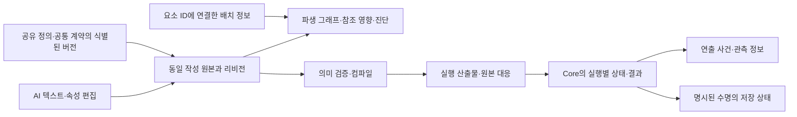

# AI 스킬 작성 데이터 구조 초안 — 2단계 임시

작성일: 2026-10-23  
상태: **2단계 완료**. 구조 초안·전체 요구 대응·별도 자체 재검토와 교정을 마쳤다. 구현·실행 검증은 후속 단계다.

[전제](ai-skill-authoring-premises.tmp.md)·[계획](ai-skill-authoring-plan.tmp.md)·[실행 지침](ai-skill-authoring-execution-guide.tmp.md)과
[1단계 요구사항](ai-skill-authoring-requirements.tmp.md)을 적용한다. [1단계 자체 재검토](ai-skill-authoring-requirements-review.tmp.md)의 교정을 전제로 한다.
이 문서는 **작성 정보와 실행 의미의 설계 제안**이다. 아래 요소 이름·점 표기·화살표·표는 검토용이며
직렬화 문법, 코드 타입, 그래프 노드 종류, IR 명령 또는 네이티브 API를 확정하지 않는다.
[별도 자체 재검토](ai-skill-authoring-data-model-review.tmp.md)는 대상 고정→발견 기록→교정→재판정을 관리한다.
3단계 전체 작성에 따른 보완은 §4.5의 집계 범위와 §5의 접수 영수증/침식 대체 참조이며,
변경 이유·재검토는 [3단계 기록](ai-skill-authoring-examples-review.tmp.md)에 별도로 남긴다.

2026-10-23 후속 조사에서 확인한 동적 타입·상태 저장·노드 간 데이터 전달의 선행 구현은
[스킬 런타임 데이터 참고](skill-runtime-data-references.md)에 기록했다.
M01/M05/M09/M10의 구현 검토 자료이며, 이 초안의 타입 체계나 Core 구현 방식의 확정을 뜻하지 않는다.

후속 [Core 기능 정의·조합 목표](skill-authoring-core-goals.tmp.md)에 따라 이 문서를 의미 모델의 초안으로 재사용한다.
본문의 4·5단계 번호와 과거 인계 기록은 유지하되, 현재 작업 순서는 [계획](ai-skill-authoring-plan.tmp.md)의 C0~C3 선행을 따른다.
M01~M12를 최종 실행 명령으로 확정하지 않으며 기존 완료 판정은 새 Core 구현의 검증 결과가 아니다.

## 1. 범위와 판단 기준

최신 [파편 목록][roster]과 연결된 위키를 기준으로 일반 파편 10계열, 엘리트 잠정 파편 11계열,
늑대를 포함한 장비 22계열을 다룬다. 일반보스의 구조 합의와 세부 수치·장비 연결의 미정은 별개다.
엘리트 전체는 추가 검토·변경 가능하다. 최종보스·사랑 방어형 등 보류 항목을 새 실행 정의로 채우지 않는다.
이관 전 사본은 최신 기준이 아니다. 1단계의 67행은 추적 단위이지 67개의 노드나 명령을 요구하는 목록이 아니다.

이번에 정할 것은 **무슨 정보로 의미를 결정하고, 누가 그 값을 소유하며, 어디서 수정·검증하는가**다.
기존 그래프 JSON은 현재 구현의 원본이고, 이번 방향의 구조화 텍스트 원본과 동일하다고 가정하지 않는다.
기존 [제작 목적](project-purpose.md)의 그래프 원본 설명은 기존 경로에 대한 설명으로 유지한다.
새 경로는 최신 사용자 합의에 따라 하나의 작성 원본에서 그래프를 생성한다. 두 원본을 병행 편집하는 전환안을 만들지 않는다.

| 구분             | 이 문서의 취급                                                                    |
| ---------------- | --------------------------------------------------------------------------------- |
| 요구·콘텐츠 의미 | 1단계 ID와 최신 원문을 근거로 보존. 잠정/미정 상태를 상속                         |
| 구조 제안        | M 요소, P 공통 계약 참조, V 검증 경계, T 추적 관계. 모두 본 단계의 설계 선택      |
| 구현 사실        | §13의 B 근거와 1단계 K 범위에서만 주장. 설계가 표현한다고 Core 지원을 뜻하지 않음 |
| 설명용 값        | X 예시의 수작업 대조용 값. 콘텐츠 값이나 실행 시험 결과로 내보내지 않음           |
| 후속 미정        | §14의 D 항목. 콘텐츠 결정, 구조 검증, 구현 조사, 연출 정책을 구분                 |

선택한 방향은 이름 있는 정의와 타입 있는 참조, 명시적 흐름·상태 전이, 계약이 있는 게임 동작의 조합이다.
각 스킬에 엔진 피해 공식을 복사하거나, 스킬 이름 하나로 내부 실행을 숨기는 두 방식 모두 피한다.
전체 프로그래밍 언어·범용 플러그인 시스템을 설계하지 않는다. 현재 요구로 필요한 조합만 근거와 함께 둔다.

## 2. 데이터 책임과 한 원본

이 그림은 정보 책임이며 실제 컴파일 서비스의 배치/구현 방식은 아니다. 그래프가 컴파일러의 중간 입력으로 쓰이더라도
원본의 파생물이고, 생성 후 그래프에만 존재하는 게임 의미를 허용하지 않는다.

| 정보                | 소유·수정 권한                                                                                   | 파생/참조와 수명                                                         | 금지하는 중복                                                      |
| ------------------- | ------------------------------------------------------------------------------------------------ | ------------------------------------------------------------------------ | ------------------------------------------------------------------ |
| 작성 원본           | 작성 문서가 정의·값·식·흐름·참조·작성 상태·근거를 소유. 텍스트와 속성 패널은 같은 변경 경로 사용 | 파일 표기는 4단계 선택. 의미 모델/참조 인덱스는 이 원본을 해석한 결과    | 텍스트의 피해량과 그래프 노드의 별도 피해량을 서로 동기화하는 구조 |
| 공유 정의·공통 계약 | 해당 정의 문서가 원본. 참조자는 ID와 해석한 버전/의존 지문을 보유                                | 입력·출력·자격·예외·계약 위치를 찾을 수 있음                             | 소비자마다 복사한 상수·계약을 독립 수정                            |
| 생성 그래프         | 편집기가 읽기 위한 파생 표현                                                                     | 원본 요소 ID/역할로 노드·연결을 다시 만들 수 있음                        | 배치·표시명으로 실행 순서나 정의 정체성을 결정                     |
| 화면 배치           | 원본과 구분된 편집 메타데이터가 좌표·접힘·사용자 주석을 소유                                     | 같은 저장 묶음/별도 파일은 미정. 실행 의미 지문에서 제외                 | 좌표 이동이 피해식·타깃을 바꿈                                     |
| 진단·컴파일 산출물  | 검증/컴파일이 입력 리비전·의존 지문·대상 버전에 대해 생성                                        | 해당 기준에만 유효. 원본 변경을 역으로 덮지 않음                         | 이전 성공 산출물을 현재 미완성 원본의 성공으로 표시                |
| 실행 상태           | Core가 장착 사본·직원·시전·대상별 인스턴스 값을 소유                                             | 정의는 생성/변경 규칙, 상태는 실제 잔량·시간·수혜자. 실행 정의 버전 고정 | 포큐버스 정의에 모든 대상의 현재 잔량 기록                         |
| 저장 상태           | 기존 게임 저장 권한이 원정/전투 경계에 맞춰 상태를 저장                                          | 무기 질량·빚·누적 부활은 소유 ID와 정의 버전을 함께 복원                 | 런타임 핸들·UI 선택을 영구 ID처럼 직렬화                           |
| 연출 전달           | Core 결과를 근거로 식별된 재생 의도·갱신/종료를 생성                                             | 재생 핸들은 소비자가 소유, gameplay HP/타깃은 Core 권한                  | Unity가 광선 적중·감염·기절 지속을 자체 재판정                     |

작성 기본값과 실행 초기값을 구분한다. 문서의 ‘새 상태 초기량 0’은 게임 의미인 명시적 초기화다.
미정 계수를 0으로 저장하는 것은 같은 일이 아니다. 실행 중 값의 미리보기는 읽기 전용 관측이며 원본 값에 덮어쓰지 않는다.

### 2.1 한 문서의 논리 구성

다음은 파일 문법이 아닌 소유·참조 관계다. 한 파일에 모든 스킬을 넣거나 스킬마다 여러 파일을 만들라는 뜻이 아니다.

| 구성                | 소유하는 정보와 참조                                                                  | 사용 예                                                                                 |
| ------------------- | ------------------------------------------------------------------------------------- | --------------------------------------------------------------------------------------- |
| 문서 정체성·근거    | 문서 ID, 작성 상태, 콘텐츠/요구 근거. 현재 리비전과 내용 지문은 편집·검증이 관리      | 잠정 엘리트라는 상태와 계수 미정은 별도로 보존                                          |
| 의존 선언           | 참조할 공유 정의·공통 계약의 ID와 요구 버전. 해석 결과에는 실제 의존 지문             | 포큐버스가 P02의 개인막 계약을 사용하되 흡수 공식을 복사하지 않음                       |
| 이름 있는 지역 정의 | M01~M12에서 필요한 값·대상·흐름·상태 등의 정의와 안정 ID                              | 개인량 식, 수혜자 조회, 막 수명 정의가 각각 한 곳에 존재                                |
| 실행 진입점·구성    | 수동 사용·재입력·장착/배치 구독의 진입 정의 참조, 활성화할 형태와 지역/공유 정의 연결 | Hello 사용과 Goodbye 재입력이 같은 활성 정의를 참조. 패시브는 수동 사용을 위장하지 않음 |
| 형태·장비·유물 변형 | 원본 효과 참조와 자격·변경 정의. 보류 형태는 보류로 기록                              | 단일전환의 범위/수치 대체가 해당 부여 동작에만 적용                                     |
| 연출 연결           | M12가 실행 사건/상태와 자원 역할을 참조                                               | 막 부여·흡수·종료를 대상별 활성에 연결                                                  |

진입점에서 참조를 따라간 집합이 해당 선택 실행의 검증 범위다. 사용하지 않는 지역 정의는 오류/경고 정책을 명시해
진단하되, 존재만으로 실행하지 않는다. 공유 정의의 소비자 목록과 생성 그래프는 이 구성에서 파생하며 별도 의미 원본이 아니다.

## 3. 핵심 표현 요소 M01~M12

각 정의에는 안정 ID·표시명·요구 ID/원문 근거·작성 상태를 연결한다. 아래 속성은 논리적 의미이며 모든 정의에
소유자·수명을 기계적으로 넣지 않는다. 정적 식은 값을 읽는 맥락만, 지속 효과는 생성·소유·종료까지 필요하다.

| 요소                   | 작성하는 정보와 결과                                                                                                                  | 적용 이유·필수 검사                                                              |
| ---------------------- | ------------------------------------------------------------------------------------------------------------------------------------- | -------------------------------------------------------------------------------- |
| M01 값·순수 식         | 타입/단위·값 또는 미정 자리, 참조·산술/비교·분기·집계·반올림·상한, 읽기 시점이 지정된 입력. 결과는 부작용 없는 값                     | C02, N09-b/E07-a. 같은 식 평가로 HP를 소비하거나 상태를 바꾸지 않음              |
| M02 대상·공간 조회     | 후보 집합·자격·중심/형상/방향·선정/정렬/동률·고정 시점·재조회 시점. 결과는 식별된 개체/타일 집합 또는 비어 있음                       | C08, N03/N04/E09. 선택 범위와 피해 범위를 별도 정의                              |
| M03 입력·접수·비용     | 입력 단계와 잠정 선택, 사용 자격, 비용/소비할 자원, 검증/확정 묶음, 요청 ID·취소/실패 결과                                            | C01, N04-b/N06-b. 두 위치 중 하나만 확정하거나 실패 뒤 일부 비용 잔존 금지       |
| M04 흐름               | 순차·분기·동시 회차·합류/결과 완료 대기·지연·유한/조건 반복·재입력 경로. 단계 ID·부모/자식 연결·끝 조건                               | C04/05, N02/N11. 같은 화면 위치는 순서가 아니고 ‘동시’는 무순서 쓰기 허용이 아님 |
| M05 상태·전이          | 상태의 보유 필드, 초기화·파생 여부, 진입/이탈·전이 조건·교체·가장 강한 기여 선택·행동 점유/종료 결과                                  | C05/06, N01/E05/E11. 상태값은 실행 인스턴스에만 존재                             |
| M06 자원·원장          | 수량 타입·소유 키·증감 원인·상한/부채 허용·소비 시점·정산·저장/복원. 잔액과 거래 결과를 구분                                          | C06/07, N07/N11/N10-e. 다른 자원을 같은 ‘스택’이라는 이유로 합치지 않음          |
| M07 게임 동작·결과     | 식별한 P 계약 호출, 타입 있는 입력·대상·출처·결과 사용. 피해/회복/막/제어/이동/설치/공격 교체/사망 방지 등은 각 계약의 서로 다른 결과 | C03/09, E03/E06/E09. `효과 실행`이라는 무타입 빈칸으로 대체하지 않음             |
| M08 사건·구독          | 사건 종류/처리 단계·필터·발생/원인 ID·출처·중복 키·활성 범위·구독 종료·후속 흐름                                                      | C03/10, N07/E02/E04. 피해 요청·HP 감소·HP0·사망 확정·한 발 정산 완료를 구분      |
| M09 효과 인스턴스 수명 | 정의와 별개인 활성 ID, 소유·수혜자·권한·생존 범위, 부모 종속/방출 후 분리, 갱신/교체 정책·종료 사유별 정리                            | C05/06, E07/E10. source 사망이 모든 child 삭제라는 암묵 규칙 없음                |
| M10 참조·구성          | 지역/공유 정의 참조, 필요한 종류/버전·매개변수, 실행 결과/활성 핸들 참조의 범위, 의존/역참조                                          | C07/12, N06-b/E07. 정의 참조와 살아 있는 효과 참조를 섞지 않음                   |
| M11 변형·기여          | 유물/장비 자격, 대상 효과 ID/명시 tag, 수치 변경/행동 대체/상태 기여, 적용 단계·출처·병용/우선순위·적용 횟수                          | C11, N08-b/N11-c. 변환된 범위를 다시 확대하거나 source를 바꿔 분류하지 않음      |
| M12 연출 연결          | 사건·자원 역할/참조·대상/위치/부착·값·시계·수명·취소·공개 정책·추적 ID                                                                | C13, N03-c/N06-c/F01~04. 게임 효과 개수와 시각 오브젝트 개수를 구분              |

요소마다 독립 노드를 만들라는 제안이 아니다. 예를 들어 ‘개인막 부여’ 하나의 그래프 동작에 M01 계산식,
M02 대상 조회, M07 막 동작과 M09 수명 참조를 함께 표시할 수 있다. 식·자원·반복 내부를 펼쳐 확인할 수 있어야 한다.
스킬별 묶음은 내부 정의/계약과 대응 ID를 찾을 수 있을 때만 축약 표시한다.

### 3.1 값·타입·평가 시점

| 구분      | 모델의 의미                                                                                             | 예·반례                                                                                     |
| --------- | ------------------------------------------------------------------------------------------------------- | ------------------------------------------------------------------------------------------- |
| 수량·비율 | HP량, 개수, 통화/재고, 계수·백분율·퍼센트포인트·공속포인트를 의미상 구분. 숫자 저장형/문법은 미정       | 공속 +15포인트와 현재 공속×1.15는 다름. 재고 부채는 음수 허용, 개인막 잔량은 음수 불가      |
| 시각·길이 | 특정 시계의 시각과 기간, 타일 좌표/거리와 공간 범위. 다른 시계 간 암묵 덧셈 금지                        | `만료시각−현재전투시각`은 남은 기간. 구체 연출의 호스트 잔여시간을 전투시간으로 더하지 않음 |
| 선택·참조 | Bool·유한 선택지·개체/타일/정의/활성 핸들·집합·결과 기록                                                | UnitRef는 TileRef가 아님. 대상의 타일을 읽는 명시적 연산과 시점 필요                        |
| 연산      | 의존성이 드러나는 순수 산술·비교·조건식·집계. 필요한 floor/ceil/clamp·중간 결과를 작성                  | 포큐버스 `floor(maxHP×계수)` 뒤 단일 변환을 다시 floor. 한 번에 곱한 뒤 floor로 합치지 않음 |
| 평가 맥락 | 정의 상수, 접수, 공격 시작, 방출, 접촉 전, 피해 후, 회차 조회, 정산/종료 등의 이름 있는 지점            | E09 Attack은 방출, 자기 회복 maxHP는 적중 후. N01 검 수는 다음 기본 공격 방출               |
| 범위 오류 | 정적 값의 NaN/무한대·허용 범위·0으로 나눔·잘못된 단위 거부, 동적 식은 가능한 오류와 실패 분기/계약 명시 | 미정 분모는 1로 대체하지 않음. 콘텐츠의 무상한 성장과 엔진 수치 안전 상한은 별개            |

M01의 입력은 `값 참조 + 관측 시점 + 필요한 출처`로 결정한다. 동적인 HP는 언제 읽을지 없는 채로 공유하지 않는다.
동일 회차의 snapshot은 `회차 ID + 대상 집합 + 필요한 값`을 한 번 고정한다. snapshot에 생존 개체 핸들을 넣었다고
나중의 대상 유효성이 보장되지 않는다. 사용 시 자격 재확인/실패 결과는 M07 계약에 따른다.

정의 상수·계산식의 의존 그래프는 순환을 거부한다. 시간에 따라 달라지는 상태를 이전 결과와 갱신하는 것은
M05/06의 전이이며 식의 무한 재귀가 아니다. 반올림·피해 계산 순서가 달라질 수 있는 식 결합 최적화는 허용하지 않는다.

### 3.2 대상과 공간

M02는 `후보 → 필터 → 공간 판정 → 정렬/동률 → 선택 → 집계 소속`을 명시한다. 원문이 정하지 않은 대공·소환물 자격을
기본 true/false로 채우지 않는다. 공통 자격을 참조할 때는 P04의 범위와 예외를 찾을 수 있어야 한다.

- N03은 음/양 실제 영역과 한 회복 회차의 집계 소속을 별도로 보유한다. 교집합이 사라지는 것이 아니다.
- N04는 조준 타일/방향, N06은 경로 타일 합집합, E04는 현재 추적 대상, E09는 접수 타일을 사용한다.
- 범위 확대는 명시된 피해/효과 범위만 바꾸며 지정 사거리·탐지·경로에 자동 전파하지 않는다.
- 빈 집합은 정상 결과일 수 있다. N02 빈 유효 타일 완료, E10 빈 투하 기회 소비와 N06 합산0 접수 거부를 각각 작성한다.
- 큰 적·같은 타일·다수 segment의 중복은 공간 조회와 실제 피해 횟수 제한을 각각 M02/M08에서 지정한다.

### 3.3 M07의 동작별 입력과 결과

P02/P04의 넓은 계약 안에서도 아래 결과 종류를 구분해야 한다. 각 행은 **필요한 의미의 제안 서명**이며 신규 API나
현재 Core의 구현 완료 목록이 아니다. 공통으로 원본 동작·실행/원인·소유 출처를 전달하고, 결과는 다음 흐름이 명시적으로 읽는다.
동작의 사전조건 실패와 정상적인 ‘적중 없음/회복 0’을 구분한다. 선택하지 않은 의미를 임의 옵션 기본값으로 숨기지 않는다.

| 동작 의미                 | 필요한 입력 → 타입 있는 결과                                                                                                            | 계약·요구와 작성 경계                                                                                                          |
| ------------------------- | --------------------------------------------------------------------------------------------------------------------------------------- | ------------------------------------------------------------------------------------------------------------------------------ |
| 피해·회복                 | 대상, 고정/현재 평가량, 피해 분류/허용 변형 또는 회복 출처 → 대상별 접촉·막 손실·HP 손실·사망 원인 또는 실제 회복·HP상한 초과·실패 이유 | P02, E03/E06/E09/N03-b. 회복 면역의 미적용량은 초과 회복과 다른 결과                                                           |
| 개인막 생성/교체          | 수혜자 snapshot, 개인량, 원천/교체 키, 수명 → 대상별 새 활성·생성량·교체한 활성 또는 실패                                               | P02/03, E07. 흡수는 이 활성의 잔량을 줄이고 잔량/흡수/종료 사건을 발행                                                         |
| 제어·능력 기여            | 대상, 제어/속성 종류, 크기·기간, 원천 키·중첩/갱신/우선 정책 → 적용 활성 또는 면역/거부, 유효 기여 변화                                 | P02/07, N08/E04/E05. 기절 실패를 성공으로 간주해 기존 냉기를 지우지 않음                                                       |
| 강제이동·도발/저지 변경   | 대상, 목적 위치/방향 또는 도발원, 이동/저지 자격·기간 → 실제 위치/이동 실패 또는 대상·저지 관계 변경 활성                               | P04/07, N02-b/N10-a. 끌기 뒤 피해는 결과 위치로 재조회, 도발에 피해를 암묵 추가하지 않음                                       |
| 영역·지연/이동 효과       | 공간·탐지/피해 형상, 고정/추적 정책, payload 흐름, 시계·수명·source 종료 정책 → 설치/자식 실행 ID 또는 배치 실패, 회차/접촉/종료 결과   | P03/04, E02/E04/E10. 이펙트만 있는 잔영은 실제 적/HP 객체와 다른 생성 종류                                                     |
| 합체                      | 같은 소유/사본/정의/타일의 대기 활성 집합, 수량·snapshot 승계·새 등급 식 → 소비한 활성들+새 활성/수량 또는 전체 보존 실패               | P04/06, E02. 합체→탐색 순서와 기존 예약 종료가 한 거래에 속함                                                                  |
| 실제 적 생성              | 프로필 참조, 생성 타일/경로, 원천 사본, 보상/사망 출처 연결 → 실제 적 ID·등록 결과 또는 생성 실패                                       | P04/05, N04-a. 시각 늑대와 다르며 전투 종료 뒤 신규 적 등록 불가                                                               |
| 기본공격 변형/준비        | 공격 profile 또는 원기본피해 변환, 결합할 action 조건, 소비/복구·기여 수명 → 기여/준비 활성, 결합 action, 방출 소비/취소 복구 결과      | P01/02/07, N09-a/E11. Attack 스탯 변경과 원기본피해 배수는 다른 입력                                                           |
| HP 비용·maxHP 변화        | 대상, 요청량/식, 직접 비용 또는 최대치 변화의 분류, 허용 하한/우회 계약 → 실제 비용/최대치·현재HP 변화와 종료 결과                      | P02/06, N11-c/N09-e. 일반 피해 결과를 만들어 막·반사·피격회복을 발동하지 않음                                                  |
| 사망 가로채기·부활        | 사망 전 기회/직원 identity, 사용 이력, 복원 HP·최대치/대가·우선/실패 조건 → 가로챔 또는 사망 계속, 확정 이력/HP 변화                    | P02/06, N09-e. 이미 확정된 사망 후 처치 사건을 취소하는 것으로 대체하지 않음                                                   |
| 확정 직전 피해 이전       | 원본 피해 segment, 실제 이전 단계의 양·비율, 보호 관계/수혜자 자격, 재감쇄·재이전 정책 → 원대상/수령자별 HP 손실과 동일 원인 연결       | P02, N01-e. 일반 피해를 새로 요청해 방어를 두 번 적용하지 않음. 이후 반응 자격의 미정은 별도 진단                              |
| 개체 형태·진영 변환       | 직원/장비 identity, 형태/profile·속성 기여·진영, 진입 조건/종료·복귀 규칙 → 변경된 개체 관계/기여와 전이 결과                           | P04/06/07, N05-e/N09-e. 늑대의 복귀와 세 번째 부활의 적대 변태는 다른 전이. 장비 회수 등 미정 후처리를 빈 동작으로 채우지 않음 |
| 시체 claim·장비/자원 거래 | 시체/소유 사본 ID, 자격, 기대 상태, 변화 목록, 거래 키 → 확정 소유/수량/승급 또는 충돌·보존 실패                                        | P05/06, N07-e/N10-e/N06-b. 경합 승자와 다중 저장 범위의 미정은 별도 보존                                                       |

회복 전달은 새로운 무타입 ‘순환 회복’ 동작으로 숨기지 않는다. M02 회차 집합, 위 회복 결과, M01 예산/배분,
M04 선행 관계를 조합한다(X05). 반사도 피해 결과의 실제량과 허용 출처를 읽는 후속 피해로 표현하되 재귀 자격을 제한한다.
기존 계약으로 결과·권한·원자성을 표현할 수 없는 새 의미가 나오면 명시 계약을 보완하고 V05/V06으로 구현 상태를 분리한다.

장비의 공격 profile 참조도 내용을 찾을 수 있어야 한다. 이름 있는 공유/지역 정의에 무기 archetype·배치 층·대공/저지,
피해 type, M02 targeting/형상/대상 중복 단위, M04 windup→release→delivery와 취소 경계,
M01 평가량/시점, M07 피해 결과 및 M08 기본공격 출처를 연결한다. 모티프로 추론하지 않고 원문 미정 필드는 V01로 남긴다.
파편의 profile 교체가 이 중 어느 필드를 대체하는지 M11에 명시한다. 공격 시간이나 대공 자격을 잃은 축약 profile은 허용하지 않는다.

## 4. 실행 흐름·사건·취소·소유권

### 4.1 접수와 실행의 분리

M03의 선택은 미확정 입력이다. 승인 경계에서 자격/대상/자원/정의 버전을 다시 검증하고, 명시된 쓰기 집합을 한 번 확정한다.
요청 ID는 소유 파편 사본·사용 종류·전투/입력 세션과 함께 범위를 정해 중복 소비를 막는다. 재입력은 기존 활성 ID를 요구하며
새 시전과 같은 공명 소비를 암묵 반복하지 않는다. 완료/거부/취소의 반환 결과도 입력 세션에 연결한다.

편집 원자성과 전투 거래 원자성은 서로 다른 계약이다. M03/M06은 비용과 상태가 함께 확정돼야 할 의도를 표현하고,
P01/P06의 실제 권한이 이를 지원해야 한다. 전장과 원정 자료를 각각 저장한 뒤 성공으로 간주하지 않는다.
필요한 원자성 범위가 현재 backend에서 없으면 컴파일 지원 부족으로 드러낸다.

### 4.2 순서와 완료 경계

| 구성           | 필요한 정보                                                           | 요구에 대한 해석                                                                              |
| -------------- | --------------------------------------------------------------------- | --------------------------------------------------------------------------------------------- |
| 순차 단계      | 선행 완료 종류, 결과 바인딩, 다음 단계 조건                           | N02 자연 완료만 후속 단계/보상. 중단은 이미 발생한 회복을 되돌리지 않음                       |
| 결과 정산 대기 | 어느 action/자식의 어떤 완료까지 기다리는지                           | N11은 투사체 방출 완료가 아니라 착탄·피해·상태·사망·회수까지 완료 후 다음 선택                |
| 동시 회차      | 같은 관측 시점, 각 기여, 충돌 해소·안정 처리 순서                     | N03 기본 회복 전체 후 초과분 분배. N06 같은 차례의 중복 제한. 단순 배열 순서로 의미 변경 금지 |
| 반복           | 횟수 또는 종료 조건, 주기/간격, 첫/끝 경계, 빈 기회 정책, 시계, 중단  | E10 유한 기회·즉시 첫 회차. N11-c 종료 가능한 무한 집중·양수 간격                             |
| 시각 경쟁      | 관계 있는 사건의 우선순위/선행 관계                                   | N09 만료가 같은 시각 재입력보다 우선, N11-c 비용/사망이 다음 발사보다 우선                    |
| 실패·취소      | 접수 전 거부, 부분 단계의 정상 실패, 실행 오류, 수동/외부 종료를 구분 | 재시전 실패는 이전 영역 유지. 이미 방출된 선물은 시전자 이탈 후 유지                          |

동시각 정책을 임의 숫자 우선순위 하나로 스킬마다 새로 발명하지 않는다. 공통 단계 순서를 P03으로 참조하고
콘텐츠의 추가 선행 관계를 명시한다. 순환하는 선행 관계는 검증 오류다. 콘텐츠가 정하지 않은 경쟁은 명시적 미정으로 남긴다.

유한 반복은 실행 규모를 계산하거나 상한 검사를 할 수 있어야 한다. 무한 집중은 미래 시각으로 진행하고 종료 경로를 갖는다.
사망 연쇄는 사망 발생 ID별 중복 방지와 새로운 유효 사망이라는 진행 근거를 갖는다. 엔진 안전 한도가 필요해도
몰래 타격 수를 자르지 않고 확정 전 거부/실행 진단의 경계를 설계한다. 한도를 콘텐츠 밸런스 상한으로 자동 등록하지 않는다.

### 4.3 사건의 단계와 출처

M08 사건은 단순 문자열 callback이 아니라 발생 단계·타입 있는 payload·식별된 출처·발생 ID를 가진다.
피해 처리의 내부 수학은 P02가 소유하되 다음 결과와 hook을 구분해 제공해야 한다.

| 단계/결과       | 읽는 값과 허용할 후속 동작                                 | 대표 요구                                                           |
| --------------- | ---------------------------------------------------------- | ------------------------------------------------------------------- |
| 접촉 전/피해 전 | 대상의 기존 냉기, 패링 창 자격; 별도 제어 성공/실패        | E04 pre-hit 냉기, E06 피해/CC 전 패링                               |
| 피해 정산       | 요청량·감면후량·막손실·실제HP손실·overkill·피해type·source | E03 HP손실만 반응, E09 HP 또는 막손실                               |
| HP0와 사망 전   | 현재 타격의 상태부여, death-prevent 가능 여부              | N11 회수 상태·N06 치명타 스택을 사망 확정 전에, N09-e 사망 가로채기 |
| 사망 확정       | 피해자·마지막 원인/소유자·위치·death ID·시체 자격          | N10-e 주대상막타, N07 시체경합, E02 사망 seed                       |
| 행동/회차 완료  | 결과의 대상별 집합·출처별 집계·자연완료/중단               | N02 보상, E11 기본 action당 보상, N11 다음 발사                     |

출처는 `직원/장비·파편 사본 + 원본 동작 + 실행/action/타격/segment + 부모 원인 + 피해 분류`를 필요한 수준으로 연결한다.
표시 이름, 피해 type 또는 ‘소환물’ tag만으로 직접 기본 공격·유물 proc·반사·비용을 추정하지 않는다.
반사 금지, 기폭 전파 금지, 액세서리 처치 연쇄 허용은 별도 자격/파생 규칙이다.
중복 키는 사건 종류마다 지정한다: E03은 적 action+수혜자+부착 활성, N06은 폭발회차+대상,
E02는 death+원천, E11은 준비에 결합된 기본 action. 전투 전체 하나의 ‘한 번’으로 합치지 않는다.

확률 결과가 필요한 N07-a 및 확률형 장비에는 **M08 사건에 연결한 M07 판정**을 제안한다. 확률값/식 자체는 M01이지만
판정은 상태를 소비하므로 순수 식 평가에 숨기지 않는다. 예상 확률 단위·범위, 판정 대상 사건/단계, 소유 원천,
판정 키(`원천 + 발생 사건 + 동작`)와 성공/실패 흐름을 작성한다. 표기와 난수 알고리즘은 확정하지 않는다.

판정 상태의 권한은 Core에 두고, 난수 흐름/seed·상태 또는 동등한 재현 정보와 판정 결과를 해당 실행 수명에 연결한다.
의미 제안은 ‘유효 사건에 대한 판정과 후속 상태 변경의 확정은 한 번’이다. 접수 전 실패나 편집/조준 preview는 판정 상태를
소비하지 않으며, 동일 요청·사건 재전송은 이미 확정한 결과를 사용한다. 확정 뒤 시전 취소로 판정을 되돌려 다시 뽑지 않는다.
복원이 허용된 savepoint는 그 시점의 관련 상태도 일관되게 복원해야 한다. 실제 저장/재현 방식은 D04/D07에서 확인한다.
대상별 판정 횟수·한 번 실패 뒤 후속 사건의 재시도 자격이 원문에서 미정이면 V01이며 엔진 순회 순서로 결정하지 않는다.
반례: 속성 패널의 예상 감염률을 여러 번 조회하거나 같은 피해 사건을 두 번 전달했다고 실제 감염 기회가 늘어나면 안 된다.

### 4.4 정의·인스턴스·수명

| 식별/수명         | 소유 정보                                   | 종료·복원 기준                                                   |
| ----------------- | ------------------------------------------- | ---------------------------------------------------------------- |
| 정의 ID           | 상태/공격/효과의 불변 규칙                  | 문서 개정과 인스턴스 생성은 별개                                 |
| 직원 identity     | 전투당 사망 방지, 직원별 원정 부활 누적     | 새 배치 runtime으로 바뀌어도 유지할 이력. Retreat/savepoint 명시 |
| 장비·파편 사본 ID | 검·재고·빚·무기질량·영구승급·감염망         | 같은 사본 이전/강화와 새 사본 생성 구분                          |
| 시전/활성 ID      | 선택결과·준비·channel·한 시전의 영역        | 재입력 대상·동시 동일 정의 구분, 자연종료/취소1회                |
| 대상별 효과 ID    | 개인막 잔량·상처·일벌·제어·buff 기여        | 대상 소멸과 source 이탈 정책을 별도로 선언                       |
| 자식 실행/설치 ID | 선물·투사체·이동잔영·합체친구·지연폭발      | 미방출 예약과 방출 후 독립 존속 구분, 전투종료 정리              |
| 저장 기록         | 허용된 수명의 상태값·소유 ID·정의/계약 버전 | runtime 핸들은 재바인딩; 정의 불일치의 변환/거부를 명시          |

M09에는 ‘누가 만들었나’, ‘누가 종료할 권한이 있나’, ‘누구를 따라 남나’를 따로 표현한다.
공통 수명 규칙을 참조하더라도 생성 시 선택되는 수명과 종료 예외는 찾아볼 수 있어야 한다.

종료 거래는 활성 상태를 한 번 닫고, 구독·예약·행동 잠금·종속 기여를 정리한 뒤 결과를 발행한다.
‘사용 종료’가 이미 부여한 독립 효과의 종료와 같지는 않다(E07 부여, E11 준비).
자연 만료·교체·수동 중지·HardCC·침묵·퇴각·사망·전투종료를 구분하고, 선언하지 않은 이유를 자동 자연완료로 처리하지 않는다.
종료 후 재입력·동일 완료 보상은 거부한다. 이미 확정한 피해/회복은 취소 때문에 소급 취소하지 않는다.

### 4.5 결과 집계의 범위 — 3단계 G01 보완

[3단계 작성 기록](ai-skill-authoring-examples-review.tmp.md)의 G01에 따라 M08 집계와 M04 완료 대기를 구체화한다.
집계 정의에는 `실행 키(action/시전/회차)`, 포함할 원본 동작·출처/결과 종류, 중복 키, 초기값·합산/존재 여부,
열림/닫힘 사건, 취소 시 처리, 종료 후 늦은 결과의 취급을 연결한다. 이는 런타임 누계와 작성 정의의 구분을 유지한다.

Hello의 흡혈은 한 기본 action의 직접 실제 HP 손실을 모아 모든 해당 접촉 정산 후 한 번 닫는다.
여왕의 광선 보상은 한 시전의 직접 적 HP 손실/아군 실제 회복의 존재 여부를 모으고 자연 완료에서만 읽는다.
장비 후속 회복·반사·다른 실행은 부모 원인이 같아도 자동 포함하지 않는다. 중단된 광선의 누계는 보상 없이 폐기하되
이미 확정한 피해/회복은 되돌리지 않는다. 독립 방출 child가 유지되는 경우 그 child의 집계 수명도 별도로 선언한다.
집계 종료 뒤 도착한 결과를 다음 공격/시전으로 넘기지 않는다. 정상적으로 늦은 결과가 가능한 설계라면 종료 경계를
모든 관련 결과가 확정되는 지점으로 고치거나 별도 집계로 분리한다. 식/진단/그래프에서 이 집계 정의를 참조한다.

## 5. 공통 계약 P01~P08과 작성/엔진 경계

P는 새로 구현된 API 이름이 아니다. 현재 룰북·그래프 계약과 1단계 근거에서 참조할 의미를 묶은 초안이다.
실제 구현 위치와 지원 범위는 §13에 따로 둔다. 계약 호출에 필요한 의미가 원문에서 미정이면 호출 서명 안에
미정 항목을 남긴다. ‘공통 규칙에 따름’만 적고 대상·반올림·수명을 숨기지 않는다.

| 계약                         | 입력 → 결과                                                                                  | 공통 책임·작성 예외                                                                                                                       | 찾아볼 위치                                                                                                        |
| ---------------------------- | -------------------------------------------------------------------------------------------- | ----------------------------------------------------------------------------------------------------------------------------------------- | ------------------------------------------------------------------------------------------------------------------ |
| P01 사용·접수·행동 권한      | 소유 사본·사용 종류·입력/자격·비용·활성 참조·요청 키 → 승인 영수증 또는 거부 이유            | 공명/행동 자격·소비 원자성·중복 방지. Goodbye 자기 잠금 예외와 추가 공명 없음, 두건 단계 입력은 작성                                      | [전투 조작][controls], [공명][combat], [그래프 계약][graph-contract]; N04-b/N09-b                                  |
| P02 전투 결과·회복·방어      | 출처·대상·요청량·피해 분류·허용 modifier·판정 시점 → 접촉/막/HP/회복/overheal/사망 관련 결과 | 방어·실제량·귀속은 Core 권한. 비용·maxHP변경·사망방지·일반피해를 별도 요청/결과 종류로 다룸. 숨겨진 용 세부는 미정                        | [전투 규칙][combat], [파편 원칙][principles], [침식][relic-rule]; E03/E06/E09/N03-c                                |
| P03 시간·활성·사건 순서      | 시계·기한/간격·첫/끝 경계·종속/분리·종료 사유·선행 관계 → 예약/회차/종료 결과                | Pause·취소·행동 잠금·동시각 경계. 구체의 별도 정지 소유권과 잔여시간 정책은 작성/명시 계약                                                | [그래프 계약][graph-contract], [Forge 채택 기준][forge], [나비 최신 정책][butterfly]; N06-c/E10                    |
| P04 공간·자격·이동·설치      | 후보·자격·범위·좌표·정렬/동률·점유/합체 조건 → 대상 snapshot·배치결과/실패                   | 경로/장애물·강제이동·배치 규칙을 공유. 음양 집계 소속·두건 서로다른타일·래티씨아 합체는 작성                                              | [대상 계약][targets], [그래프 계약][graph-contract], [음양][yin], [래티씨아][laetitia]                             |
| P05 사건 출처·중복·판정·시체 | typed event·단계·출처·중복 범위·확률 판정 입력·시체 claim → 허용1회·판정/경합결과·후속 결과  | 사망 확정 authority와 중복 identity 공유. 확률 판정 상태/재전송은 §4.3의 새 제안. 보상/전파 자격은 작성, 시체경합 미정은 임의 선착순 금지 | [장비 규칙][equipment], [발동·연쇄][relic-effects], [사랑 장비][love-equipment], [시체산 장비][mountain-equipment] |
| P06 자원·장비 정체성·저장    | 소유 ID·typed 변화·거래 키·정산 경계·복원 정책 → 확정 잔량/사본 변화 또는 실패               | 전투/원정 거래·저장 authority 공유. 초기10·대여20·무기질량·미니건 승급 의미는 작성. 증감/상한과 부채를 하나로 숨기지 않음                 | [원정 결과/저장][results], [장비 규칙][equipment], [탐욕][greed], [나비 장비][butterfly-equipment]                 |
| P07 장착·변형·기여 합성      | 장착 정의·효과 참조/tag·자격·변경 단계·수치/대체동작·병용 정책 → 유효한 변형과 출처별 기여   | 호환/효과별 적용과 원본출처 보존. 가장강함·교체·합산·범위변환은 명시 선택. 원문미정 합성은 미정                                           | [유물 원칙][relic-effects], [tag 사전][tags], [유물 규칙][relic-rule]; E05/N08/N11-c                               |
| P08 결과→연출 관측           | 실행 사건·확정 결과·동작ID·연출 연결·공개 정책 → 시작/갱신/종료 의도와 관측 상태             | gameplay 재판정 없음. presentation 정의와 실제소비자지원 구분. ABI·전송·복구 정책은 후속                                                  | [사용자 전제](ai-skill-authoring-premises.tmp.md), §9, 1단계 C13/F01~04                                            |

다음은 **작성값**이다: 포큐버스 개인량 계수·대상 범위, Hello 남은시간 식, 여왕 단계와 하트 보상,
음양 전달 비율·집계 정책, 탐욕 초기/차입/회수와 정산, 유물의 적용 대상·정확한 변형.
다음은 **실행 파생값**이다: 현재 막잔량, 이번 회차 교집합, 현재 감염 숙주 수, 고기방패HP에서 계산한 저지스택,
조건부 modifier 합성 결과. 파생값을 편집 가능한 두 번째 원본으로 저장하지 않는다.
공통 계약 버전이 바뀌면 의존 정의의 영향 목록을 만들고 이전 의미를 조용히 재해석하지 않는다.

3단계 R01에서 F01의 참조를 실제로 펼친 결과, P01의 접수 영수증과 실제 시전의 대체 판정을
분리해야 함을 확인했다. 현행 [침식 공통 규칙][relic-rule]이 연결한
[발동 조건 소유 문서](../../core_enhanced/docs/tmp/ego_corrosion_system_design_notes_2026-08-19.ko.md)는
세트/별도 입력이 아니라 일반 파편의 실제 시전 시 트라우마 등 조건에 따른 대체다.
접수 당시 공명만충·전액소비를 영수증으로 전달하고 다시 비용을 요구하지 않는다. Pause 접수와 실제 침식 실행도 구분한다.
옛 개별 문구보다 이 소유 계약을 참조하며 구체 경계/미확인은 [QH.ego.*](ai-skill-authoring-examples-queen.tmp.md#6-정식-침식의-별도-연결)에 둔다.
M03/M05와 기존 P01로 표현 가능하며 새 입력 타입이나 범용 확장 체계를 추가하지 않는다.

## 6. 공유 정의·변형·참조와 추적

### 6.1 정의 참조와 활성 참조

정의는 문서 안에서 안정 ID로 식별하고, 공유 정의는 소유 문서/패키지 ID와 정의 ID로 식별한다.
정확한 ID 문자열/URI 문법은 후속이다. 이름 변경·위치 이동은 정체성을 바꾸지 않고, 복제는 새 ID와 내부 참조 재연결을 준비한다.
외부 참조는 의도적으로 유지하거나 새 정의로 바꾼다. 표시명이 같은 것을 자동 대체 참조하지 않는다.

참조 검증은 종류·입력/결과 타입·버전뿐 아니라 수명과 실행 도달 범위를 본다.
방출 후 끝난 접수 지역값은 child가 직접 읽지 못한다. 필요한 수치/출처/고정타일을 방출 snapshot으로 전달한다.
지속 참조가 필요한 런타임 개체는 유효성 검사와 사라졌을 때의 정책을 갖는다.
이전 배치의 runtime ID를 새 배치 직원으로 자동 치환하는 것은 명시된 identity 참조만 허용한다.

정의 상호의존의 무조건 순환, 값식 순환, 종료된 활성의 사용은 거부한다. 사건을 통한 다음 시각/새 사망의 재실행은
M04/08에 진행·중복·수명 근거가 있을 때 별도로 검증한다. 모든 순환을 금지해 합의된 사망 연쇄를 없애지 않는다.

### 6.2 변형의 범위

M11은 `적용 자격 → 정확한 원본 효과 → 변경 종류/계산 시점 → 합성 규칙 → 생성 효과 출처`를 연결한다.
범위 단일전환·무한사격전환처럼 흐름을 바꾸면 원본 흐름과 대체 흐름을 모두 실행하는 것이 아니라 선택 분기로 구성한다.
‘폭발’ tag가 붙었다고 모든 폭발 유물을 채택하지 않는다. 허용 연결은 콘텐츠의 synergies를 참조한다.

태아 단일전환40%/20포인트는 기본20%/15포인트에 더하는 값이 아닌 대체값이다.
방어막 생성량 증폭은 생성 때만 적용한다. 런타임에서 장비가 바뀌면 이미 방출된 효과의 snapshot과 현재 구독을 각각 처리한다.
여러 modifier가 같은 필드/흐름을 바꾸는 순서·배타성·중첩이 미정이면 컴파일 가능한 의미로 꾸미지 않는다.
공유 원본은 그대로 두고 적용 구성·원본/변형 기여를 역추적 가능한 파생 결과로 만든다.

### 6.3 추적 관계 T

| 관계           | 보존할 정보                                                                      | 필요한 이유                                                                                          |
| -------------- | -------------------------------------------------------------------------------- | ---------------------------------------------------------------------------------------------------- |
| T1 원본→의미   | 문서 ID·리비전/내용 지문·요소 ID·속성 경로·해석된 원본 위치                      | 문법이 바뀌어도 같은 정의 찾기. 원본 위치는 해당 리비전에만 유효                                     |
| T2 의미→그래프 | 요소 ID·표현 역할·생성된 노드/포트/연결, 일대다/다대일 대응                      | 연속기의 축약 노드와 내부 단계가 같은 원본으로 돌아감                                                |
| T3 의미→산출물 | 원본 요소 집합/각 기여 역할·참조 경로·의존 버전·변형 출처 → 실행 동작/식/단계 ID | 합친 동작의 여러 원본을 모두 보존하고, 나뉜 동작의 역할을 구분. 한 대표 위치만 남겨 원인을 잃지 않음 |
| T4 실행→결과   | 산출물 ID·실행/활성/action/사건 ID·원본동작 ID·부모원인                          | 같은 정의를 두번쓴 결과를 구분; 비용·피해·처치의 출처 연결                                           |
| T5 결과→연출   | T4 식별·연출연결 ID·발생/갱신/종료·재생 instance 관계                            | 중복재생/잘못된종료 방지, 연출을 선택해 원인 찾음                                                    |

ID는 검증/실행 권한이 아니다. 유효한 원본 대응이 있어도 미지원 operation을 실행하지 않는다.
공유값의 역참조 목록은 문서/요소/속성/참조 경로로 계산한다. 현재 열린 파일만 검색해 영향이 없다고 보고하지 않는다.
프로젝트 의존 색인 범위 밖의 소비자가 있으면 ‘알려진 범위 내 영향’과 외부 미확인을 구분한다.

## 7. AI와 사람의 부분 수정·저장

속성 패널은 선택한 그래프 역할을 T2/T1로 찾아 원본의 편집 가능한 필드 또는 식 입력에 변경을 제안한다.
피해식 결과 ‘200’은 읽기 전용이고, 원본 계수나 식을 편집한다. 공유계수 변경과 이 사용처만 별도 값으로 분리하는 것은
다른 작업이며 같은 입력란에서 몰래 공유 정의를 복제하지 않는다. 초기에는 구조 생성/연결 편집 UI를 만들지 않는다.

| 사용자 작업           | 원본 변경·검증                                                 | 이력/표시 결과                                                       |
| --------------------- | -------------------------------------------------------------- | -------------------------------------------------------------------- |
| 개인막 계수 수정      | 지역 M01 또는 참조한 공유 정의의 계수 변경, 타입/단위·연결검사 | 수혜자 수로 나눈 파생값을 수정하지 않음. 영향받는 부여/단일전환 표시 |
| 대상 ‘자신 포함’ 수정 | M02 자격의 authored 속성, 콘텐츠가 허용한 선택인지 확인        | 원본의 대상 의미 변경으로 표시. 단순 배치 편집이 아님                |
| 공유 식 수정          | 정의 하나 변경, 역참조 소비자·단위/시점/상한 재검증            | 한 의미 변경으로 확정, 잠재 영향 목록 제공                           |
| 이름/노드 위치 수정   | 표시명 또는 배치 메타데이터 변경                               | ID/참조/실행 의미 유지, 표시/배치의 저장 dirty는 따로 알 수 있음     |
| 미정 값 입력          | 예상 타입을 가진 미정 자리에 값 또는 식 지정                   | 관련 미정 진단 제거, 다른 미정이나 backend 제한은 그대로             |
| 실패/오래된 패치      | 입력 기준 문서/리비전 확인 후 전체 변경 거부                   | 문서·Undo/Redo·저장 상태 유지, 사유만 표시                           |

AI가 읽을 최소 단위는 선택 정의 본문, 직접 참조한 정의/계약의 서명과 의미, 역참조 영향, 현재 진단이다.
전체 Core를 매번 읽을 필요 없이 계약 본문으로 내려갈 수 있어야 한다. 숨긴 전역 mutable 변수에 의존하는 스킬을 만들지 않는다.
작은 정의를 여러 파일로 강제 분할하지 않으며 파일/폴더 조직·문법은 4단계에서 실제 편집 과제로 검증한다.

변경은 [개발 지침 §4](development-guidelines.md#4-문서-변경은-트랜잭션으로-확정하고-실행-취소도-같은-단위를-따른다)의
준비→구조/참조 검증→원본·이력·리비전 확정→알림을 공유한다. 허용된 미정 상태의 진단은 편집 거부와 다르다.
Undo/Redo는 ID·참조·상태표시·관련 배치 변경을 같은 사용자 작업 단위로 복원하고, 내용이 같으면 이력을 추가하지 않는다.
컴파일 요청/응답에는 문서 ID·epoch·리비전·의존 지문·실행 대상/버전·요청 ID를 연결한다. 이전 결과가 도착해도 새 원본을 덮지 않는다.

여러 정의의 이름/참조를 함께 바꾸는 작업은 변경 집합과 읽은 의존 지문을 준비한다. 원본/의존이 그 사이 바뀌면
충돌로 거부하고 수정안을 보존한다. 검증 가능한 묶음만 원본·역참조 색인·이력에 한 번 확정하며 일부 참조만 갱신하지 않는다.
공유값 변경은 소비자의 원본을 복사 수정하지 않지만 해당 소비자의 기존 검증/산출물/preview를 오래된 상태로 만든다.
소비자 본문의 리비전이 그대로여도 의존 지문이 바뀌면 재검증 대상이다. 여러 문서를 포함한 Undo도 같은 변경 집합을 대상으로 한다.
여러 파일의 실제 디스크 저장 원자성은 현재 보장됐다고 가정하지 않는다. 저장 묶음/복구 방법은 D03/D07에서 정하고,
중간 실패나 서로 다른 의존 버전이 섞인 저장은 완전한 저장·컴파일 성공으로 표시하지 않는다.

저장도 확정 snapshot을 대상으로 한다. 저장 중 새 편집이 생겼다면 이전 snapshot의 저장 완료가 최신 dirty를 지우지 않는다.
원본 저장·산출물 export·런타임 savepoint는 서로 다른 성공 상태다. 실제 파일 쓰기/IPC 성공은 메모리 commit과 별도로 검증한다.

문법 자체가 깨진 텍스트는 유효한 의미 원본으로 부분 반영하지 않는다. 원시 편집 버퍼와 마지막 해석 성공 리비전을 구분하고
그래프가 이전 버전임을 표시한다. 잘못된 텍스트도 복구용으로 보존하는 방식은 4단계 포맷/편집 도구 과제다.
타입 있는 미정·끊어진 참조 또는 의미 오류가 있는 식을 가진 정상 구조 원본은 이와 달리 저장·재열기 대상이다.
예를 들어 HP량에 기간을 더한 식은 피연산자와 원본 위치를 보존한 채 V03으로 진단한다. 직전의 올바른 식이나 0으로 치환하지 않는다.
주석·표시·미정 사유를 포함한 텍스트 부분 수정의 보존 여부는 후보 포맷의 실제 왕복 편집으로 검증한다.

## 8. 미완성 정보와 진단 V

작성 성숙도(`합의/잠정/보류`)와 값의 준비 여부(`정함/미정`), 표현 가능 여부, backend 지원 증거는 독립 축이다.
잠정안도 값이 정해졌다면 설명·검증할 수 있으며, 합의된 구조도 필수값이 없으면 실행 산출물은 만들 수 없다.
검토용 미정 자리에는 예상 종류/단위·필요한 사용처·이유·원문/U ID를 보존한다. 보류는 실행 가능한 빈 효과가 아니다.

| 진단 구분             | 보존/표시 정보                                     | 원본 저장 / 컴파일 요청 / 실행 산출물                                                                                                  |
| --------------------- | -------------------------------------------------- | -------------------------------------------------------------------------------------------------------------------------------------- |
| V01 미정 값·동작      | 예상 타입·필수 사용처·이유·결정 근거               | 구조가 유효하면 저장 가능 / 가능 / 선택 실행의 필수 의존이면 거부                                                                      |
| V02 잠정·보류         | 콘텐츠 상태·변경 영향·원문                         | 잠정 상태만으로 거부하지 않음. 보류 동작을 선택 실행에 포함하면 미완성으로 진단                                                        |
| V03 타입·단위·식 오류 | 예상/실제·문제 피연산자·연관 정의                  | 구조적으로 표현 가능한 오류 식은 저장 가능 / 진단 요청 가능 / 선택 실행의 필수 의존이면 거부. 해석 불가 텍스트는 §7의 복구 버퍼로 보존 |
| V04 참조·수명·순환    | 참조자/정의/활성 범위·끊긴 경로·순환 경로          | 명시적 끊김/미지정은 저장 보존, 중복 ID 등 모호한 구조는 편집 확정 거부 / 진단 / 선택 의존이면 거부                                    |
| V05 backend 미지원    | 필요한 operation/계약·실행 대상/버전·확인한 근거   | 원본 보존 / 가능 / 지원 없는 동작을 생략해 산출하지 않음                                                                               |
| V06 지원 미확인       | 조사 범위·필요한 생산/소비 경로                    | V05로 단정하지 않음. 실행 가능 판정에는 확인된 backend 계약이 필요                                                                     |
| V07 연출 미정         | 자원/시점/부착/수명 중 미정 부분·gameplay와의 의존 | 보존 / 가능 / gameplay-only 또는 전체 실행 허용 정책은 D05의 미정. 임의 silent skip 금지                                               |
| V08 오래된/환경 실패  | 기준 리비전·request·저장/컴파일 통신 단계          | 현재 원본/진단을 덮지 않음. 형식오류·콘텐츠미정·Core미지원과 별도 표시                                                                 |

진단은 코드·단계·문서/내용 지문·주 위치(T1)·연관 위치·요구 ID·기대/실제·수정/결정 필요 이유를 가진다.
예: ‘개인막 계수가 필요함’은 계수 자리와 부여 동작에 연결하고, ‘남은시간을 읽는 활성은 이미 종료됨’은 읽는 식과 종료 전이를 함께 가리킨다.
UI 문구를 프로그램 분기 키로 쓰지 않는다. `그냥 실패`로 모든 원인을 합치지 않는다.

선택한 스킬/형태의 실행 의존 닫힘을 검사한다. 다른 문서에 보류 초안이 있다는 이유만으로 무관한 유효 실행까지 자동 거부하지 않는다.
반대로 동적으로 선택될 수 있는 필수 분기를 도달 불가로 꾸며 검사에서 빼지 않는다. 부분 검증 범위를 명시하고,
구조 손상·불명확한 참조 때문에 의존 닫힘을 알 수 없으면 성공 산출물을 내지 않는다.

## 9. 연출 연결 M12와 시간

연출 정의는 `어느 실행 사건 → 무엇을 → 어디/누구에 → 어떤 값/시계로 → 언제까지`의 연결이다.
이미 원문이 정한 순서·비공개 정책은 요구로 보존하고, 구체 asset·블렌딩·카메라·네이티브 전송은 미정이다.

| 부분      | 보존할 의미                                                          | 적용 사례                                                           |
| --------- | -------------------------------------------------------------------- | ------------------------------------------------------------------- |
| 자원      | 이펙트/사운드/애니메이션 역할과 명시 참조 또는 typed 미정            | 여왕 광선·흑조 우산·개인막. 자산 이름을 발명하지 않음               |
| 시작/갱신 | 승인/방출/적중/상태진입/잔량변경 등 정확한 사건과 결과 값            | 포큐버스 잔량 갱신은 대상별, 여왕 예약 예고와 실제 공격 시작은 다름 |
| 위치/부착 | 생성 위치 snapshot·타일고정·개체추적·방향·부착 관계, 대상소멸시 처리 | N11 포탈원점과 타일착탄, E04 이동잔영                               |
| 수명      | 자신의 유한시간·효과활성 종속·단발완료, 종료/취소와 원인             | 방출된 선물은 시전자퇴각 뒤 유지, 장판 종료는 종속눈/기절 표현 종료 |
| 시간/정지 | 전투시계 또는 독립 표현시계, 정지 권한의 소유/반납·중첩              | N06-c host시간으로 구체연출·자기정지만해제·잔여시간이월금지         |
| 공개/표시 | 제작자용 근거와 플레이어 노출을 구분                                 | N03-c 발견전 경고없음, N09-e 누적부활수 비공개·이상징후             |
| 추적/관측 | T4/T5·발생ID·상태버전·현재활성, 생성/종료 확정 결과                  | 한action 여러화살은 여러피해가 아님; 재관측 상태와 일회음향 구분    |

게임 판정 결과가 확정되기 전에 성공 연출을 외부로 발행하지 않는다. 미확정 조준 preview는 별도 임시 상태로 표시한다.
Core는 결과/재생 의도를 소유하고 Unity는 렌더링 재생 상태를 소유한다. 사건 전송 순서·유실/중복·재접속 복구,
상태 snapshot과 일회 사건의 전달 방식은 D05에서 추가 설계한다. 이 문서의 추적 ID만으로 실제 exactly-once 재생이 구현됐다고 주장하지 않는다.

## 10. 작은 예시와 반례 X01~X08

아래는 문법/완성 스킬 파일이 아닌 **의미 연결 예시**다. 설명용 숫자는 테스트 fixture도 아니며 실제 실행하지 않았다.
각 예시는 값·순서·소유/수명과 거부해야 할 반례를 함께 확인한다.

### X01 포큐버스 — 개인량과 대상별 상태

`M01 개인량 = floor(방출 시 시전자 maxHP × 미정 계수)` → `M02 방출 당시 수혜자 집합` →
`M07 각 수혜자에 독립막 생성(P02)` → `M09 source 사본+대상별 활성, 대상/시전자 이탈 종료`.
같은 source 재시전은 이번 집합에 속한 기존 부여만 교체한다. 막의 잔량은 효과 인스턴스가 소유한다.
M12 생성/흡수/파괴는 해당 활성 ID에 부착한다. 계수 선택은 그래프에서 부여 동작을 선택해 원본의 계수 자리로 이동한다.

설명용 개인량200, A/B 부여, A의 감면 후 피해60이면 잔량 A140/B200이다. 총량400을 공동 차감하거나
두명이라는 이유로 개인량100으로 나누는 것은 반례다. C가 나중에 진입해도 새 막 없음.
계수 미정 진단은 M01과 M07 사용처를 연결한다. 개인막 장비증폭을 이 예시에서 임의 기본배율로 채우지 않는다.

### X02 Hello / Goodbye — 읽기와 종료 순서

`M05 활성 Hello`가 기본공격 profile 기여를 소유한다. 재입력은 `M03 활성/행동자격/만료 검사` →
`M01 남은시간을 commit에서 고정` → `M05 활성소비·기여해제` → `M04 마무리 child1회(P01 추가공명없음)`.
child에는 남은시간과 피해식 입력·원인 ID를 전달한다. 종료된 Hello 핸들에서 나중에 시간을 읽는 것은 V04다.
같은시각 만료 우선·중복재입력 거부를 명시한다. 관통유물의 접촉순번은 공격별 상태이고 Hello전체 누적이 아니다.

### X03 여왕 — 자동 예약과 결과 보상

`M06 사본별 하트/시계/기억조준` → `M08 6도달` → `M05 자동예약` → `P01 현재행동 종료·자격 확인` →
`M04 블랙홀/광선 단계` → `M08 자연완료 때만 실제결과 집계` → `M06 보상1회`.
추가공명0은 입력에서 명시한다. 빈 범위도 단계 완료할 수 있으나 피해/회복 조건을 성공으로 꾸미지 않는다.
피해와 회복이 둘 다 있어도 같은 완료 보상을 두번 호출하지 않는다. 중단은 이미 준 피해를 되돌리지 않고 남은 단계와 보상을 제거한다.

### X04 붉은 두건 — 여러 입력과 확정

`M03 잠정 재고/타일/조준`이 전술 정지 권한을 보유한다. 최종 승인 때 현재 재고·서로 다른 유효 타일·방향을 검사하고
재고소비+배치기억+동시방출 예약을 함께 확정한다. 선택 도중 취소는 기존 재고/기억을 유지하고 자기 정지만 복구한다.
연결 끊김은 취소와 다르다. 같은 요청 재전송은 두번째 발사를 만들지 않는다. 선택 preview를 실제 공격 child로 등록하는 것은 반례다.

### X05 음양 — 순환 회복의 한 회차

`M02 두영역의 멤버/집계소속 snapshot` → `P02 기본회복1회` → `M01 HP상한 초과분만 합산` →
`floor(전달률×합계)` → `결손비례 배분·안정ID 잔여` → `P02 추가회복`.
설명용 예산3, 같은 결손의 A/B이면 몫1/1 후 안정ID 앞쪽에 잔여1을 배정한다. 수혜자가 사라지면 미사용분을 버린다.
면역으로 회복하지 못한 양, 빈 영역의 가상 회복량, 전달 회복의 재전달은 예산에 넣지 않는다. 물리 교집합과 집계소속은 별개다.

### X06 나비 — 영구 거래와 전장 실행

개화 거래는 `M03 소유무기사본 선택/자격` → `P06 선택사본 승급+선택결과 기록`이며 실패는 둘 다 보존한다.
미니건 상태와 전투 나비스택은 다른 수명이다. 기폭은 `M01 타일합산/등급` → `M06 접수소비` → `M04 회차별 폭발`.
검은 고치는 조건분기로 이 흐름을 대체하고 `M09 정지소유권`을 별도로 갖는다. 두번요청으로 두무기가 승급하거나
시전자퇴각으로 영구승급/기존나비스택까지 지우는 것은 반례다.

### X07 감염·사망 연쇄·시체 경합

`M08 감염허용사건` → `M06 출처별숙주/공유위력` → `M04 주기피해`와 `0숙주 유예/감소`를 분리한다.
기폭 action은 전파를 만들지 않는 출처 정책을 가진다. 친구 사망 seed는 death+원천별1회이며 새 child의 원인을 남긴다.
무기질량은 주대상 기본공격 막타만 증가하고, 고기방패/시체회복은 P05의 같은 시체 소비권을 경쟁한다.
경합 승자 정책이 미정이면 단순 handler 등록순서로 승자를 정하지 않는다. 미정은 원문/U07로 연결한다.

### X08 탐욕 — 상태 수명과 단계 완료

사본의 전투재고와 원정빚/대여이력은 M06에서 서로 다른 저장 수명이다. 비용을 먼저 소비한 포탈은 중단 시 환급하지 않는다.
`M04 한발 정산완료`가 온 뒤 M02로 다음 적을 고른다. 전용전환은 이 흐름을 무한집중과
`매1초 ceil(당시maxHP×5%) 직접비용`으로 바꾸되 빚을 지우지 않는다. 적 없음은 발사대기이며 비용중단이 아니다.
같은시각 비용사망 뒤 새발사를 시작하거나 피해감면/HP하한으로 비용을 줄이는 것은 반례다. Retreat 복원은 원정 authority의 저장 거래다.

## 11. 67개 요구 묶음의 구조 대응

아래는 각 행의 **전체 의미를 설계에 배치한 위치**이며 실행 지원 판정표가 아니다.
`직접`은 작성 요소에 값/정책을 둠, `공통`은 서명과 책임이 있는 P 계약 참조, `조합`은 그 둘을 순서/상태로 연결함을 뜻한다.
`내용 대기`는 원문이 남긴 값·정책으로 V01/02를 유지한다. 같은 행에 여러 분류가 함께 있을 수 있다.
각 ID의 원문·연출·상세 경계는 [1단계 §5~6](ai-skill-authoring-requirements.tmp.md)에서 그대로 상속하며 이 표가 삭제하지 않는다.

### 11.1 일반보스 24행

| 요구 ID | 표현 경로           | 구체적으로 배치한 값·순서·소유/수명                                                                                                              | 남은 내용/확인                                 |
| ------- | ------------------- | ------------------------------------------------------------------------------------------------------------------------------------------------ | ---------------------------------------------- |
| N01-a   | 조합·공통           | M03 가호대상 선택 → M05 관계교체/획득시계 reset; M06 사본 검 상한4; M09 별도막/전투1회 이력은 교체 밖에 보유(P01/03/06)                          | 주기·방어막값, 장비 공유 U04                   |
| N01-b   | 조합·공통           | M01 다음기본 release 검수/타격수/기간식; M04 단계·타격회차·마지막주대상; M08 HP0→현재사용 완료 대기→M05 절망; M09 영역/자기피해 개별시계(P02/03) | 계수/시간 대기; 상처는 마지막주대상출처에 묶음 |
| N02-a   | 조합·공통           | M06 사본 하트/시계/성공광선위치; M08 시간/완료사건→M05 예약; P01 행동/침묵자격 후 시작; 배치/이동 수명명시                                       | 시간값 대기; 자동예약과 시전은 다른 상태       |
| N02-b   | 조합·공통           | M03 소비하트영수증; M01 강화식; M02 끌기뒤현재대상; M04 단계; M08 실제피해/회복 집계·자연완료1회 보상(P02/04)                                    | 범위/비율 대기; 완료와 적중0 구분              |
| N02-c   | 조합·공통           | M04 추가공명없는 자동단계·즉시/끝제외tick; M02 자신포함피해; M05 수동취소불가·강제중단reset; M09 종속정리(P01/03)                                | 개별연출/수치 대기; 정식침식과 다른 실행       |
| N03-a   | 조합·공통           | M03 두위치 원자접수; M09 같은사본두영역 공유수명/성공교체; M02 membership; M11 교집합기여; M04 첫주기뒤회복(P03/04)                              | 정확범위/주기·공속값 대기                      |
| N03-b   | 조합·공통           | M02 회차대상/집계소속; P02 기본실회복/상한초과; M01 예산floor/결손비례/ID잔여; M04 양쪽기본후전달·재전달없음                                     | 전달률 대기; X05                               |
| N03-c   | 조합·공통·내용 대기 | M11 전용유물+동일중심조건으로 M04 지원흐름 대체; M02 영역/분류; P02 즉사/maxHP25%; M12 비공개/경고없음·단발종료                                  | 피해세부·유물병용은 U06, 공통침식 자동상속금지 |
| N04-a   | 조합·공통           | M06 전투사본 창/배치기억; M04 주기; M07 실제적 spawn(P04); M08 원천늑대의 유효사망→강화창1·도주제외·종료후생성금지                               | profile/시간값 대기; 실제적과 시각물 구분      |
| N04-b   | 조합·공통           | M03 잠정layout/aim/재사용·final commit; M09 정지권한; M04 전체동시방출; M11 강화창추가피해/속박·갱신(P01~04)                                     | X04; 게임속도복원과 disconnect 유지 구분       |
| N06-a   | 조합·공통           | M02 release 경로합집합/접수유닛중심; M06 무기사본전투스택·사망이전; M01 q와횟수/등급; M04 회차/미방출과방출후수명; M08 회차별대상1회             | 수치대기; q0 불연속/상한진단·치명스택순서 보존 |
| N06-b   | 조합·공통           | M03 소유사본선택·실패원복; P06 무기영구승급+거래키; M10 기본/개화 공유상태정의, 새획득무기별도                                                   | X06; 상품/저장실행 경로는 미확인               |
| N06-c   | 조합·공통·내용 대기 | M11 임계분기대체; M06 합산소비; M09 호스트시계/정지lease; M04 피해+해제 확정·실패복원; M12 중앙구체                                              | 정확범위/시간/위력 미정; 자기정지만해제        |
| N07-a   | 조합·공통           | M06 source사본 공유위력·숙주집합; M08 피격/사망전파·M07 최초확률판정(§4.3); M04 성장/0숙주유예/감소·재감염재개; M09 철수/전투종료                | 전파자격·성장/감소값 대기; X07                 |
| N07-b   | 조합·공통           | M01 E/숙주배율; M03/06 전량소비; M02 타일폭발; M08 전체기폭당대상1회·전파억제; M11 별개폭발중첩 예외                                             | 숙주2~4 최종배율미정, 자기E추가금지            |
| N08-a   | 조합·공통           | M05 집중/행동점유; M09 고정영역; M02 대상별체류; M05 진행둔화→기절; M11 영역취약; M09 기절과취약 이탈정책분리                                    | 형상/시간 대기, 기절면역/강제이탈 경계         |
| N08-b   | 직접·조합·공통      | M11 다섯유물의 대상필드/전환사건 명시; M09 영역연장에 종속기절참조, 별도약화 자체수명(P03/07)                                                    | 증폭합성·세부수치 대기, 중복시간증폭금지       |
| N09-a   | 조합·공통           | M05 Hello 활성; M11 기본profile교체기여; M08 기본공격출처/실제HP집계; M09 종료복구(P02/07)                                                       | 다수흡혈/장비합성 미정; X02                    |
| N09-b   | 조합·공통           | M03 활성1회claim·만료/HardCC/침묵검사; M01 남은시간commit snapshot; M05 소비→M04 child마무리(P01/03)                                             | 최종곡선미정; 추가공명없음·종료뒤참조금지      |
| N09-c   | 조합·공통           | M02 release접촉목록/순서; M08 개체당접촉계수; M01 min증가식; M11 원공격증폭·Goodbye제외; M09 공격별수명                                          | 곡선/값/상한미정. HP손실0도 실제접촉이면순번   |
| N10-a   | 조합·공통           | M02 범위적; P04 저지해제/새타아군저지금지; M11 도발·속도·공격거리; M09 기여해제                                                                  | 세부범위/시간 대기. 피해/기절을 발명하지 않음  |
| N11-a   | 조합·공통           | M06 사본전투재고/원정빚/대여기록; M08 실제피해→사망전표식→사망회수; P06 정산1회·미장착/Retreat/run경계                                           | X08; 모든소유피해자격·등록시점 보존            |
| N11-b   | 조합·공통           | M06 생성당선소비; M01 간격식; M05 준비/기한; M03 재입력; M04 한발정산→M02 다음선택; M09 방출후유지                                               | 기한/간격/피해값 대기; 환급없음                |
| N11-c   | 조합·공통           | M11 흐름대체; M04 무한집중/양수발사간격·매초비용; M01 당시maxHP5%ceil; P02 직접비용·M05 사망우선; M06 기존빚유지                                 | 발사간격/기절값미정·무표적비용유지             |

### 11.2 엘리트 잠정 17행

| 요구 ID | 표현 경로      | 구체적으로 배치한 값·순서·소유/수명                                                                                                          | 남은 내용/확인                                          |
| ------- | -------------- | -------------------------------------------------------------------------------------------------------------------------------------------- | ------------------------------------------------------- |
| E01-a   | 조합·공통      | M04 연타→끌기/기절→쪼개기; M02 단계별대상; M01 결손HP평가시점; M08 시전/적별적중계수(P02/04)                                                 | 잠정수치·면역/막타 경계                                 |
| E02-a   | 조합·공통      | M03 선택+인접배치거래; M02 방향순서/빈칸; M06 보존수량; M05 대기중동일source합체; M01 최초Attack/특별위력; M09 설치수명                      | 피해/상한값 미정, 같은모티프라도 다른사본합체금지       |
| E02-b   | 조합·공통      | M02 탐지/폭발범위분리·도약목표고정; M08 치명전선물/death-source중복키; M04 생성→합체→탐색; M09 방출후존속                                    | X07; 새child원인상속과 생성상한 정상건너뜀              |
| E03-a   | 조합·공통      | M09 부착활성/대상수명·source이탈존속; M06 일벌잔량; M08 적action HP손실/생존필터→선소비→P02 회복                                             | action당1회, 치명피해/비용/완전흡수 제외                |
| E04-a   | 조합·공통      | M01 pre-hit 자기냉기 읽기; P02 실제피해후생존; M05 냉기/빙결전이·면역실패보존; M11 빙결중새냉기억제                                          | 잠정값, 무기냉기source분리                              |
| E04-b   | 조합·공통      | M08 직접적중/사망유물 발생순서; M06 공유상한; M02 최근접추적; M09 생성부터시계·source이탈존속; M08 잔영파생생성억제                          | 사망생성→기본생성, 폭발시간/상한미정                    |
| E05-a   | 조합·공통      | M03 다른공격가능직원필요; M05 channel; M02 membership; M11 기본공격기여/강함선택; M09 기여제거후다른source복귀                               | 모든엘리트잠정. 기존windup 소급변경없음                 |
| E05-b   | 직접·조합·공통 | M11 대상단일화/수치대체·유물형태; M09 범위이탈시집중종료; M01 수명ceil1회·명시범위mask                                                       | 침식유물패널티미정, 파편침식으로오인금지                |
| E06-a   | 조합·공통      | M11 상시감면; M07/08 확률반사(§4.3); M05 패링창/성공/실패; M08 피해전첫직접타격(P02)·실제HP segment반사; M04 받아치기; M11 기본공격잠금/면역 | 실패중감면해제/반사유지, 반사재귀금지,500ms은현행잠정안 |
| E06-b   | 조합·공통      | M06 유물축적량·소비; M04 방출; M08 OnKill→P01 양의공명잠금검사·이월없음                                                                      | 유물식/범위미정                                         |
| E07-a   | 조합·공통      | M01 release maxHP식; M02 수혜자snapshot; M07 독립막; M09 source+대상별잔량/교체/종료(P02/03)                                                 | 계수/범위/시간미정; X01                                 |
| E07-b   | 직접·조합·공통 | M11 단일전환·생성량modifier; M01 단계별floor; M09 생성뒤기여변경으로잔량불변                                                                 | 고리증폭률미정·일반막과고기자원분리                     |
| E08-a   | 조합·공통      | M05 유한자기강화; M11 공격/공속기여·P02 피해하한조건; M09 만료                                                                               | 직접비용/maxHP희생/처형제외, 하한미만회복금지           |
| E09-a   | 조합·공통      | M03 접수타일고정; M04 준비→방출Attack고정→impact; M08 HP/막손실집계→M01 현재maxHP로1회힐; M09 child존속                                      | 사망시힐없음·source이탈후공격유지                       |
| E10-a   | 조합·공통      | M04 유한기회/즉시첫회차·빈기회소비; M02 진행도/ID; M01 투하별Attack; M09 emitter와child수명분리                                              | 재시전교체/만료동시각·지연값미정                        |
| E11-a   | 조합·공통      | M05 준비대기; M08 새정상기본공격 결합·release소비/사전취소복귀; M09 준비와시전종료분리·FIFO                                                  | 임의준비timeout없음·기존windup제외                      |
| E11-b   | 조합·공통      | M01 기본피해배율floor; M08 결합action BASE막타만1회; M11 보상source교체; M09 보상시간                                                        | 증가율미정·추가장비피해막타제외                         |

### 11.3 장비 22행과 형태 4행

| 요구 ID | 표현 경로           | 구체적으로 배치한 값·순서·소유/수명                                                                                                                | 남은 내용/확인                                    |
| ------- | ------------------- | -------------------------------------------------------------------------------------------------------------------------------------------------- | ------------------------------------------------- |
| N01-e   | 조합·공통·내용 대기 | M08 직접피해/피격자격; M09 source별상처; P02 최종HP피해이전20%·재감쇄/재이전금지; M03 독립보호선택·M11 공속기여                                    | 파편관계/옛관통연동 U04,prototype값미확정         |
| N02-e   | 조합·공통           | M02 힐우선순위; P02 실제타인회복; M08 action/대상cooldown; M11 출력증폭→실회복→막큰값; M09 막수명                                                  | 막비율/시간 prototype,overheal제외                |
| N03-e   | 조합·공통·내용 대기 | M02 기본힐대상; M11 HP50% 경계방어/타인회복전환; M08 기본heal action실제양수만자기힐1회                                                            | 대상선정/양/자기힐집계미정                        |
| N04-e   | 조합·공통·내용 대기 | M05 공격시작총/도끼mode·숙적; M08 첫피격후후속감면; M06 원정node수금·승리commit/Retreat; M09 이미방출탄존속                                        | 새파편늑대와공유 U04                              |
| N05-e   | 조합·공통·내용 대기 | M06 허기·장비사본원정처치진행; M05 변신·4형태; M11 block/profile/stat기여; P06 이전/승리저장/Retreat; M12 형태외형                                 | 이스터에그보상·profile연결미정, 파편삭제유지      |
| N06-e   | 조합·공통           | M08 최초무기부여/사망이전구분; M11 신규량증폭1회; M08 소유death당1회→M04 위치고정지연폭발·자식출처로연쇄                                           | 공격력평가·범위/지연/계수미정; 기본공격재분류금지 |
| N07-e   | 조합·공통·내용 대기 | M06 감염도·고기방패HP; P05 시체claim; M01 HP구간→스택/저지파생; P02 감면후전용HP우선·초과본체; M11 단순stat                                        | 시체경합미정·일반힐불가, 고기벽보류               |
| N08-e   | 조합·공통·내용 대기 | M02 공격시점유효적타일집합; M07 가시피해(P02)·M12 타일연출; M11 생존stat                                                                           | 기존액세서리재설계, 장판체류로자동치환금지        |
| N09-e   | 조합·공통·내용 대기 | M08 기본action실제HP합산·피격시계; M04 재생; P02 사망전가로채기; M06 직원전투1회/원정부활누적; M05 세번째적대변태·M12 비공개징후                   | 변태상세/장비회수미정; 런타임인스턴스와직원ID분리 |
| N10-e   | 조합·공통           | M08 주대상기본막타; M06 무기사본원정질량·증가후적용; M01 고정추가피해; P06 동일사본강화/이전보존·새사본승계금지; P05 시체회복; M08 action/대상부패 | 회복/경합·부패세부미정, 주변막타성장제외          |
| N11-e   | 조합·공통·내용 대기 | M02 release타일/impact멤버; M04 지연; M08 action/대상1hit; M03 팔찌입력+허용자원소비·P01 공명잠금                                                  | 새재고/빚호환 U04, 포탈수≠hit수                   |
| E01-e   | 조합·공통·내용 대기 | M07 독립기본공격profile; M08 active직접처치힐·실제피해합산흡혈; M11 소유피해자격                                                                   | 잠정,다수처치집계/두흡혈합성미정                  |
| E02-e   | 조합·공통           | M02 주변eligible아군조회; M11 자기Attack/공명획득기여; M01 친구최초생성시읽기(P07)                                                                 | 잠정값/범위·소환물수조건아님                      |
| E03-e   | 조합·공통·내용 대기 | M02 다수힐; M09 장벽/전투중재생없음; M08 실제타인힐→M11 대상공속갱신·source제외                                                                    | 잠정대상선정/량/재배치정책미정                    |
| E04-e   | 조합·공통·내용 대기 | M07 Magic타일/무기냉기; M05 낮은HP일회빙정·행동잠금/저지유지; M11 movement-tag피해기여                                                             | 잠정면역/기존행동처리·source합성미정              |
| E05-e   | 조합·공통           | M07 선형공격·M08 대상1hit; M03 상위단계선택; M06 직원전투단계; M01 진입기준maxHP희생; M11 기본공속·새windup                                        | 잠정희생값/공속값미정, 직접피해비용으로오인금지   |
| E06-e   | 조합·공통           | M07 범위Magicprofile; M08 소유반사/반격/방출막타→P01 OnKill공명; M11 stat                                                                          | 잠정획득량미정·잠금중이월금지                     |
| E07-e   | 조합·공통           | M07 기본direct+M04 독tick; M09 source독갱신; M08 독재귀자격제외; M11 막생성시증폭1회                                                               | 잠정독/증폭값·source_creation 연결미확인          |
| E08-e   | 조합·공통·내용 대기 | M01 결손HP→감면상한; M05 연속공격상태/시계; M01 온전한초×1%선형; M11 자기기여                                                                      | 잠정연속정의/reset/상한·무기profile미정           |
| E09-e   | 조합·공통           | M07 염주범위/P02 대상1hit; M11 현재HP조건Attack·직접Physical방어무시                                                                               | 잠정관통합성/계수미정, True변환/대상디버프아님    |
| E10-e   | 조합·공통·내용 대기 | M07 단일유탄; M08 정상active시전발생→공속; M11 원피해의 범위전환1회·탐색제외                                                                       | 잠정시전발동단계/무기profile/범위확대미정         |
| E11-e   | 조합·공통·내용 대기 | M05 무HP피해시간→1회감면준비; M08 실제피격소비/reset; M01 이전release경과배율; M08 release소비/취소유지                                            | 잠정증가율/피해감소/다단공격묶음미정              |
| F01     | 조합·공통·내용 대기 | P01/02 공통침식자격/비용/대상; M12 하강→암전→빛기둥·T추적/종료                                                                                     | 개별자산/시간미정, 히스테릭분리                   |
| F02     | 조합·공통·내용 대기 | P01/02 적대상침식; M12 용의단발표현, N03-c와다른정의/입력조건                                                                                      | 범위/자산미정·전용용아군피해상속금지              |
| F03     | 조합·공통·내용 대기 | P02 공통침식대상; M12 대상별관생성/열기/닫기/나비소멸·M09 종료                                                                                     | 타일스택후속미정, 빈M07로생략하지않음             |
| F04     | 직접·조합·내용 대기 | M11 일반/침식된유물변형의 수치대체/대상변환·패널티와 M12 표현. M10 원파편참조                                                                      | 엘리트잠정·패널티미정, 파편개화/침식분류아님      |

구조상 특정 행을 표현 못해 다른 동작으로 바꾼 항목은 초안에서 두지 않았다. 다만 ‘조합으로 배치했다’는 것은 설계 제안이다.
§10의 작은 예시 외 전체 스킬 입력 대조는 3단계, 실제 컴파일과 실행은 5단계다.
미정 내용이 채워져야 완성되는 가지와 backend 미확인인 가지를 이 표의 표현 제안과 구분한다.

## 12. 공통 요구·미정 등록부의 연결

| 1단계 요구         | 이 초안의 담당 위치          | 검토할 관측/반례                                                          |
| ------------------ | ---------------------------- | ------------------------------------------------------------------------- |
| C01 조건/입력/비용 | M03·P01/06, §4.1·X04/X06/X08 | 승인 실패 뒤 비용/장비/입력기억 일부만 남음                               |
| C02 수치/식/시점   | M01·§3.1·X01/X02/X05         | 반올림 합침, 만료뒤활성시간읽기, 공속%와포인트혼동                        |
| C03 출처/실제결과  | M07/08·P02/05·§4.3           | HP0와deathfinal혼동, 완전막흡수를HP손실로계산                             |
| C04 시간/반복      | M04·P03·§4.2/9·X08           | 무표적일때비용누락, 빈투하기회보충, 끝tick중복                            |
| C05 상태/재입력    | M05/09·§4·X02/X03            | 중복마무리, 취소를자연완료로보상                                          |
| C06 소유/수명      | M06/09/10·P06·§4.4           | 장비이전시무기질량소실, source퇴각시모든child삭제                         |
| C07 공유참조       | M06/10·§6                    | 개인막잔량공유, 감염망위력대상별중복, 공통값복제                          |
| C08 공간           | M02·P04·X05                  | 물리교집합과회복소속혼동, 선택타일을살아있는적추적으로변경                |
| C09 설치/이동      | M07/09·P04·E02/E04 대응      | 시각포탈에HP/저지부여, 다른사본친구합체                                   |
| C10 사건/연쇄      | M07/08·P05·§4.3·X07          | 반사재귀·같은death중복·기폭전파, 시체복제, preview/재전송으로 확률 재판정 |
| C11 장비/유물      | M11·P07·§6.2/11.3            | 시간/범위이중증폭, tag만보고유물호환추가                                  |
| C12 편집/진단      | M10·T1~4·§7/8                | 그래프만수정, 공유값영향누락, 저장중새편집dirty지움                       |
| C13 연출           | M12·P08·T5·§9                | hidden용경고추가, 게임판정재추론, 정지권한누수                            |

U01 최신기준·U02 잠정·U03 제외/보류는 §1/V02로 유지한다. U04 장비연결은 해당 대응행의 내용 대기,
U05 상단/하단정책 충돌은 최신 근거 연결, U06 수치/합성·U07 공통세칙은 M01/08/11과 P의 미정 자리로 보존한다.
U08 작성/컴파일 경계는 §13 B01~B04 개선, U09 종단지원은 B05, U10 연출은 D05로 넘긴다.
1단계 K를 재사용할 때는 원문/코드 변경 여부와 확인 구간을 함께 보며 완료 태그만 옮기지 않는다.

## 13. 기존 기반과의 연결 — 정적 추가 조사

1단계 K01~K13의 관련 경로를 재사용하고 이번 구조에 필요한 편집/저장·원본 위치·로드 경계를 추가로 읽었다.
이번에 실행 테스트나 UI를 새로 검증한 것은 아니다. 아래 B의 사실과 미래 적용 제안을 분리한다.

| 근거                     | 확인한 실제 경로·사실                                                                                                                                                                                                                                                                                                  | 재사용 후보와 바꿀 경계                                                                                                                                    |
| ------------------------ | ---------------------------------------------------------------------------------------------------------------------------------------------------------------------------------------------------------------------------------------------------------------------------------------------------------------------- | ---------------------------------------------------------------------------------------------------------------------------------------------------------- |
| B01 편집 세션            | [GraphSession](../src/nodes/core/session.ts)의 `edit`: current검사→clone/apply→prepare→이력/문서/revision확정. `travel`은 patch뒤prepare, `export/acknowledge`는 내보낸 snapshot/token으로 saved갱신                                                                                                                   | 변경 트랜잭션·오래된저장방어 원리는 재사용. 현재 원본은 GraphDocument/JSON이며 새텍스트의 부분편집·미정자리/참조색인은 구현됐다고 주장하지 않음            |
| B02 컴파일 요청/응답     | [client](../src/nodes/compiler/client.ts) `compileGraph`는 GraphDocument JSON→해시→Tauri/브라우저요청, epoch/revision/request/skill/digest/target검사. [service](../../core_enhanced/src/authoring/node_graph/service.rs)는 source compile→RON/진단으로 응답                                                           | 식별된 요청·거부결과 분리 재사용. 새 원본·공유의존지문·버전과 T1 위치를 연결해야 함. 이름의 native만으로 Unity FFI 존재를 판단하지 않음                    |
| B03 파싱/위치/소스맵     | [schema](../../core_enhanced/src/authoring/node_graph/schema.rs)는 노드/연결/배치 원본과 node/port/edge/field 위치. [lower](../../core_enhanced/src/authoring/node_graph/lower.rs)는 원본정규화·미정/범위검사, 제한된kind/operation 선택과 미사용노드 거부. `source_locations`는 upstream노드/필드/edge/reroute를 수집 | 진단 위치/참조 경로 재사용 후보. 현재 text span·일대다실행결과 역추적·새M01~12 임의조합 지원은 미확인/차이. 현재 한정 lowering에 맞춰 구조를 축소하지 않음 |
| B04 산출물/로드·장비동반 | [program](../../core_enhanced/src/authoring/node_graph/program.rs) `load_content`는 validate→native RON→SkillDatabase로드, 성장/mark weapon companion 구성. `load_native`는 companion 있으면 거부. [bind_catalogs](../../core_enhanced/src/authoring/node_graph/program/content.rs)는 기존카탈로그충돌거부·병합/재검증 | 실행산출물재검증·명시companion 경계 재사용. 원본형식과 RON을 동일시하지 않음. 모든장비/공유정의/원정저장 지원으로 확장해 주장하지 않음                     |
| B05 개별 실행            | 1단계 K02~K12의 개인막·재입력·counter·준비공격 등 읽은 runtime/바인딩 구간. K13 장비/시체/저장·Unity 미확인은 유지                                                                                                                                                                                                     | X01부터 결과/수명/실제modifier와 T3~5를 이어검증. 아직 읽지않은 종단을 새 설계 지원으로 표시하지 않음                                                      |
| B06 외부 참고            | [Forge 기준][forge]의 이미 채택한 정의/실행context 분리·효과수명/종료 원리 재사용. 로컬 두사본의 고정commit 일치 확인                                                                                                                                                                                                  | 새 외부기능/코드 도입 없음. 새 채택원리 없으므로 기준문서/고정사본 갱신 없음. Forge 테스트를 우리 지원 근거로 사용하지 않음                                |

현재 경로를 새 원본에 연결할 때 선택할 수 있는 방식은 ‘새 의미 모델에서 기존 한정 operation으로 의미 보존 lowering’과
‘필요한 실행 의미를 Core 계약/IR에 확장’이다. 어떤 쪽이 필요한지는 3단계 전체 예시의 표현과 5단계 실제 경로로 판단한다.
새 텍스트를 현재 그래프JSON으로 단순 치환하면 해결된다고 가정하지 않는다. 그래프를 중간에 쓰더라도 M/T 의미 보존 검사가 필요하다.
편집기 실제 파일 I/O·속성handler 전체·Unity 소비자·원정 저장 전체는 이 추가 조사에서도 확인하지 않았다.

## 14. 남은 결정 D와 검증 과제

| ID  | 종류·남은 사항                                                          | 지금 보존하는 방법 / 다음 확인                                                                                                                                   |
| --- | ----------------------------------------------------------------------- | ---------------------------------------------------------------------------------------------------------------------------------------------------------------- |
| D01 | 콘텐츠: U04 장비결합·U06 수치/형상/합성·U07 시체경합/연속공격 등        | V01/02와 원문ID. 구조는 기대타입·필요범위를 보존하되 임의기본값 없음. 기존합의로 해결가능한 사실은 조사자가 확인하고 새게임의미만 사용자 판단                    |
| D02 | 구조: 67행을 합친 전체 스킬의 표현 부담·참조/종료 누락 여부             | 본문은 설계 초안 대조. 3단계 전체 예시에서 흐름/상태/공통계약 경계를 다시 확인. 표현불가능은 모델결함으로 되돌림                                                 |
| D03 | 포맷/도구: 텍스트부분수정·주석/위치보존·수치표기·파일조직·정확한문법/ID | 4단계에서 같은 예시로 왕복편집/진단/AI과제 비교. 특정포맷/라이브러리 채택하지 않음                                                                               |
| D04 | backend: typed식·새조합·원자성·원정복원·사건단계·runtime추적의 실제지원 | K/B 미확인 유지, 5단계 선택스킬 생산→검증→산출→로드→실행/소비 확인. 모델의 표현 가능과 다른 판정                                                                 |
| D05 | 연출정책: 미정연출의 실행허용, 실제native전달·이벤트순서/복구·자산수명  | 엄격거부/명시gameplay-only검증대상/진단있는제한미리보기의 선택지와 차이 검토. 어떤 방식도 현재 기본으로 확정하지 않음. 의존형 연출은 gameplay순서를 숨길 수 없음 |
| D06 | UI/사용성: 속성노출·공유영향표시·원본검색·오류설명의 이해도             | §7의 세 사용자작업을 3단계 화면개념과 연결. 실제UI/AI검증 전 사용성성공 주장 없음                                                                                |
| D07 | 버전/전환: 기존그래프원본→새작성원본, 계약변경과 저장상태migration      | 원본권한은 하나, 이전파일/의미손실진단 필요. 변환가능범위와 실제migration 절차는 구현범위 확정 후, 모든과거버전영구지원 약속 없음                                |

D01의 미정은 콘텐츠를 새로 결정할 작업이며 D02의 구조 적합성 검증과 다르다. 이후 필수 구조 결함이 발견되면
‘콘텐츠 미정’으로 숨기지 않는다. 이번 자체 재검토에서 해결하지 못한 필수 결함은 별도 기록에 남기고 단계 완료를 보류한다.

## 15. 3단계에 넘길 순서와 사용자 점검

1. 포큐버스를 첫 전체 작성 예시로 만든다. 계수 미정 자리·수혜자snapshot·개인막/부분교체·단일전환/장비증폭을 분리한다.
   생성그래프의 부여 동작을 선택했을 때 개인량식/수혜자/종료조건을 어디서 고치는지 연결한다.
2. Hello / Goodbye로 활성핸들·남은시간읽기·재입력거래·기본공격출처·복구·관통/흡혈의 집계 경계를 확인한다.
3. 여왕으로 자원/예약/현재행동대기·단계·주기·복수결과·완료/중단을 대조한다. 실패진단도 원본/그래프 위치에 연결한다.
4. X04~X08의 추가 의미와 §11의 나머지 경계에 다시 대조한다. 모든 추가스킬을 한꺼번에 완성할 필요는 없지만,
   세예시로 검증 못한 요구를 숨기지 않고 후속예시/모델보완으로 넘긴다.
5. 이 결과로 구조를 교정한 뒤 4단계 동일과제 포맷 비교, 5단계 작은 실행 검증으로 진행한다. 이번에는 이를 실행하지 않는다.

사용자에게 보여줄 점검은 다음 세 가지다.

| 확인할 질문                            | 이 초안의 답과 작은 확인 방법                                                                                                                        |
| -------------------------------------- | ---------------------------------------------------------------------------------------------------------------------------------------------------- |
| 수치·대상·조건은 어디서 고치는가?      | 선택동작의 M01 값/식입력, M02 대상자격, M03/M05 조건을 같은원본에 수정한다. 계산결과·실행잔량은 읽기전용. X01 계수와 수혜자 조건을 예로 확인         |
| 공유값을 바꾸면 어디까지 바뀌는가?     | M10 역참조로 소비동작/변형/문서와 의존지문을 찾는다. 공유수정과 이사용처만분리는 다른작업. 영향목록이 미확인 외부소비자를 숨기지 않는지 확인         |
| 아직 정하지 않은 것은 어떻게 남기는가? | 예상타입·이유·근거를 가진 미정자리와 진단으로 저장한다. 잠정콘텐츠 표시와 값미정은 분리. 계수를0으로 채우지 않고 부여동작에서 미정으로 보이는지 확인 |

종료점은 구조 초안·67행 대응·작은 예시/반례·별도 자체 재검토와 교정이다. 포맷 확정·대표 스킬 전체 입력·제품 코드·UI/Unity 구현과 실행 검증은 완료 주장에 포함하지 않는다.

[roster]: ../../core_enhanced/docs/content/skills/README.md
[controls]: ../../core_enhanced/docs/game_rules/battle-controls.md
[combat]: ../../core_enhanced/docs/game_rules/combat.md
[graph-contract]: common-skill-graph-contract.md
[forge]: forge-statescript-reference.md
[principles]: ../../core_enhanced/docs/content/principles/fragments.md
[relic-rule]: ../../core_enhanced/docs/game_rules/relics.md
[targets]: ../../core_enhanced/docs/skill_target_contract.md
[equipment]: ../../core_enhanced/docs/game_rules/equipment-and-fragments.md
[results]: ../../core_enhanced/docs/game_rules/results-and-save.md
[relic-effects]: ../../core_enhanced/docs/content/principles/relic-effects.md
[tags]: ../../core_enhanced/docs/content/tags/README.md
[butterfly]: ../../core_enhanced/docs/content/abnormalities/funeral-of-dying-butterflies/fragment.md
[butterfly-equipment]: ../../core_enhanced/docs/content/abnormalities/funeral-of-dying-butterflies/equipment.md
[yin]: ../../core_enhanced/docs/content/abnormalities/yin-yang/fragment.md
[laetitia]: ../../core_enhanced/docs/content/abnormalities/laetitia/fragment.md
[love-equipment]: ../../core_enhanced/docs/content/abnormalities/melting-love/equipment.md
[mountain-equipment]: ../../core_enhanced/docs/content/abnormalities/mountain-of-smiling-bodies/equipment.md
[greed]: ../../core_enhanced/docs/content/abnormalities/king-of-greed/fragment.md
