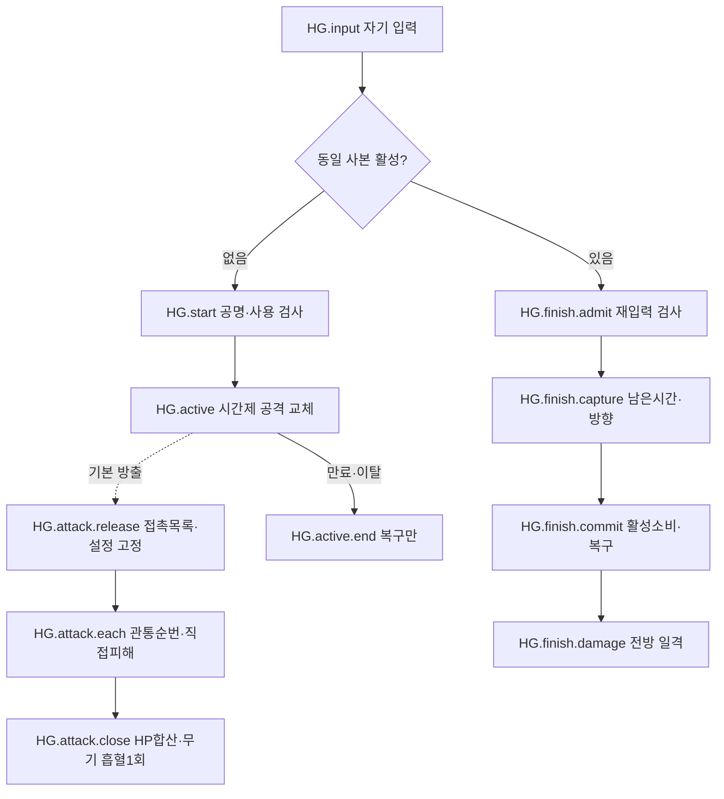

# Hello / Goodbye — 전체 작성 예시

[3단계 진입점·공통 계약](ai-skill-authoring-examples.tmp.md) · [자체 재검토](ai-skill-authoring-examples-review.tmp.md)

## 1. 범위·근거

문서 ID `example.hello-goodbye`. 일반 리워크의 기본형 Hello/Goodbye, 일반 꿰뚫는 송곳,
미미크리 무기를 실제 장착했을 때의 흡혈 연결을 작성한다. 개화·파편 침식은 보류다.
미미크리 방어구 재생·액세서리 부활 전체는 별도 장비 요구 N09-e로 남기되, 별도 사망 방지의 성공을
Hello의 실제 전투불능으로 오인하지 않는 경계는 포함한다. 후보 유물 긴 호흡 등을 자동 채택하지 않는다.

| 근거 ID         | 현재 원문·절                                                                                                               | 요구               |
| --------------- | -------------------------------------------------------------------------------------------------------------------------- | ------------------ |
| HG.src.fragment | [파편](../../core_enhanced/docs/content/abnormalities/nothing-there/fragment.md) 기본/마무리·장비 독립성, 10/20·10/22 정책 | N09-a/b            |
| HG.src.pierce   | [꿰뚫는 송곳](../../core_enhanced/docs/content/relics/piercing-damage-increase.md) Hello 적용·10/22 접촉 정책              | N09-c              |
| HG.src.weapon   | [미미크리 장비](../../core_enhanced/docs/content/abnormalities/nothing-there/equipment.md) 무기 흡혈·사망 방지와 분리      | N09-e 중 무기 연결 |
| HG.src.common   | S.use/time/targets/damage/heal/results/modify/cue                                                                          | C01~08/10~13       |

## 2. 작성 정의 — 값·공격 설정

| 정의·속성                          | 작성값·타입·시점                                                           | 미정/근거                                                                                     |
| ---------------------------------- | -------------------------------------------------------------------------- | --------------------------------------------------------------------------------------------- |
| HG.meta                            | 일반 합의 구조, 희귀도·장착 제한·호환성 미정(Sword 우선 방향)              | 카탈로그와 실제 적법 장착 검사 분리                                                           |
| HG.v.duration                      | 양수 전투 기간 `미정`                                                      | Hello 생성 때 만료 계산, Pause 진행 없음                                                      |
| HG.v.linePower                     | 비음수 직접 공격 위력 `미정`                                               | 공격 방출 때 고정. 피해식 최종 구성/타 modifier 합성 미정                                     |
| HG.v.length / width                | 양수 공간 길이 `미정`; 개념 단위=타일 거리                                 | 현재 경로의 1타일=1,000,000 데이터 단위는 backend 어댑터 근거이며 새 포맷 숫자 표현 선택 아님 |
| HG.v.finishBase / perSecond / cap  | 직접 일격 위력·시간당 증가량·상한 선택/값 `미정`                           | 현재 연결의 선형식 후보를 아래 HG.finish.amount에 명시. 최종 곡선·상한 정책은 미정            |
| HG.v.finishArea                    | 방향 있는 전방 타일 형상 `미정`                                            | 마무리 접수 방향에 고정. Hello 선분과 별도                                                    |
| HG.v.pierceCurve / increment / cap | 관통 증가 곡선·비율·상한 `미정`                                            | 현재 지원 후보=min(앞선접촉수×증가율,상한). 선형 지원이 최종 곡선 합의라는 뜻은 아님          |
| HG.weapon.base                     | 실제 장착 무기 정의/profile 참조                                           | archetype·배치층·저지·대공·피해type·무기효과를 보존. 사거리/형상·위력의 교체 필드만 명시      |
| HG.attack.profile                  | range=직선 길이/폭, delivery=즉시 선분 몸체접촉, target=방출 선택대상 방향 | 별도 물리투사체/비행시간/장애물충돌을 만들지 않음. 대공/피해type은 무기 참조                  |
| HG.attack.contactOrder             | 방출 때 후보 접촉 목록 snapshot, 선분 접촉순→동률 안정ID, 개체1회          | 처리 전 비활성 대상 건너뜀. 실제 접촉은 무적/회피/막 전부흡수여도 순번 증가                   |
| HG.mod.pierce                      | 실제 일반 꿰뚫는 송곳 장착 시 HG.attack의 원위력 증폭                      | 첫 보너스0, 매 공격 초기화. 새 피해·스택 생성 없음, Goodbye/장비proc 제외                     |
| HG.lifesteal.rate                  | 미미크리 무기 직접 기본 공격에 25%                                         | 파편 고유 효과가 아님. 무기 없으면 구독 없음                                                  |
| HG.lifesteal.cap / rounding        | 공격당 회복 상한·정수화 정책 `미정`                                        | 현 코드 내림은 구현 사실 J02. 콘텐츠 합의로 자동 확정하지 않음                                |

여러 공격 교체 효과가 동시에 적용될 때의 우선순위·합성, 다른 흡혈과의 합성은 HG.U7의 명시 계약 의존이다.
이 예시는 다른 교체 효과 없는 맥락을 먼저 대조한다. 전체 지원을 위해 그 조합을 무시해도 된다는 뜻은 아니다.

## 3. 상태와 두 입력

| 정의              | 입력·전이·결과                                                                                                | 소유·실패/종료                                                                                     |
| ----------------- | ------------------------------------------------------------------------------------------------------------- | -------------------------------------------------------------------------------------------------- |
| HG.input          | 자기 사용. 같은 직원·파편 사본의 활성 없음→HG.start, 있음→HG.finish.admit                                     | 새 시전/재입력을 이름으로 추정하지 않고 활성 참조·사용 종류로 분기                                 |
| HG.start          | S.use(수동, 공격태세/행동가능, 공명만충·전액소비, 요청키)→HG.active 생성·공격 기여 적용                       | 즉시 별도 공격 없음. 기존 공격 주기·windup 초기화/지연 없음                                        |
| HG.active         | 필드=직원/배치·파편 사본·활성 ID·시작/만료시각·기여 handle·종료여부                                           | 한시 버프 전체 동안 공명 양수획득 잠금. 기본공격/저지 가능, 집중 아님                              |
| HG.active.end     | 자연만료/수동소비/철수/실제전투불능/전투종료 → 이번 교체 기여·재입력 권리·사용 잠금 제거                      | 다른 효과의 기여를 지우지 않음. 자연만료/외부종료는 마무리 없음. 이미 방출된 독립 공격은 설정 유지 |
| HG.finish.admit   | 유효한 동일 활성, now<expiresAt, 공격태세·행동가능·HardCC/Silence 없음·다른 사용 잠금 없음                    | 자기 Hello 사용잠금만 예외. 추가 공명 조건/비용 없음. 거절은 활성/시간/기여 무변경                 |
| HG.finish.capture | 승인 확정 시 remaining=expiresAt−now, 시전자 위치/방향·필요 피해 입력을 고정                                  | 활성 consume 전에 읽음. 뒤에 종료된 활성에서 remaining을 읽지 않음                                 |
| HG.finish.commit  | 요청 중복/활성 claim 검사→capture→활성소비·교체해제→전방일격 확정                                             | 하나의 거래 의도. 준비/지연을 추가하지 않음. 같은 활성에서 마무리1회, 실패 시 일부만 소비 금지     |
| HG.finish.amount  | 최종 곡선=미정. 현재 선형을 명시 선택한 case에서는 `ceil(clamp(base + perSecond × remainingSeconds, 0, cap))` | cap 미선택/무상한을 빈 값으로 추정하지 않음. 정확한 상한·곡선 선택은 별도 의존                     |
| HG.finish.damage  | S.targets(고정 원점/방향, finishArea, 적)→S.damage(파편 직접스킬, 현재 작성경로 Physical, 위력)               | 무기 기본공격 아님. 관통 이력·무기 흡혈 없음. 실제 적중 결과/종료 사건 발행                        |

만료 시각과 같은 재입력은 만료를 먼저 반영해 거절한다. HardCC/Silence는 재입력을 막지만 이미 부여한 버프의
시간을 새로 시작하거나 자동 삭제하지 않는다. 죽음을 막아 같은 배치가 유지된 별도 death-prevent는 실제 퇴각/전투불능과 다르다.
공통 행동 계약이 중단한 미방출 기본 공격을 임의 재개하지 않는다. 변형 자체는 전투시계에 따라 유지/만료한다.

## 4. Hello 기본 공격과 흡혈의 전체 정산

| 단계 ID             | 읽는 값·동작·결과                                                                                               | 범위·순서                                                                                                               |
| ------------------- | --------------------------------------------------------------------------------------------------------------- | ----------------------------------------------------------------------------------------------------------------------- |
| HG.attack.release   | 정상 기본 공격의 방출 시 HG.active 유효 여부로 profile 선택. 원본 무기 source·위력·형상·관통 장착/값을 snapshot | 시작·만료가 진행 공격의 주기를 초기화하지 않음. 원기본+변형 공격을 동시에 발생시키지 않음                               |
| HG.attack.open      | action ID별 contactCount=0, S.results 집계 HPsum=0 열기                                                         | 포함=이 action의 직접 기본 공격 damage 결과, key=피해 발생ID. 반사·독·장비proc·별도스킬 제외                            |
| HG.attack.each      | 고정 접촉 목록의 살아 있는 대상마다 원위력에 관통 기여→S.damage→직접 실제HP손실 합산→접촉수+1                   | 기하 접촉과 실제 피해 분리. 몸체 여러 칸/여러segment로 개체 순번 중복 증가 금지                                         |
| HG.attack.close     | 해당 직접 접촉 결과 전부 정산→집계 닫기→HG.lifesteal.settle→공격 완료                                           | 한 대상마다 흡혈 cap 적용 금지. 장비 후속 효과 완료를 무조건 합산 대상으로 삼지 않음                                    |
| HG.lifesteal.settle | 무기 흡혈 구독이 있고 살아 있는 원천이면 `정수화(HPsum×25%, rounding)`에 cap1회→S.heal(자기, 흡혈출처)          | 무기 사본 source 보존, healing modifier 합성은 해당 공통 계약. 실제 회복은 maxHP 제한. cap/rounding 미정 선택에서는 V01 |
| HG.attack.cancel    | 방출 전 취소는 실제 피해/흡혈 없음. 이미 방출된 공격은 자체 결과 범위 유지                                      | Hello 종료로 이미 확정한 피해를 취소하지 않음. 닫힌 집계 재소비·다음공격 이월 없음                                      |

흡혈은 실제 HP 손실만 읽는다. 요청 피해·방어막 손실·overkill은 합산하지 않는다. HG.lifesteal의 회복 결과를 다시
같은 공격의 피해 합산이나 다른 기본 공격으로 분류하지 않는다. 무기 흡혈 외 장비의 직접 스킬 회복 자격까지 일괄 금지하지 않는다.

## 5. 예상 그래프와 편집

| 선택 요소   | 수정할 원본                                               | 읽기 전용·영향                                                          |
| ----------- | --------------------------------------------------------- | ----------------------------------------------------------------------- |
| B 변형      | HG.v.duration, HG.attack.profile의 교체 필드              | 현재 남은시간·기여 handle. 기간 변경은 유지 기회와 마무리 입력에도 영향 |
| D 관통 공격 | HG.v.linePower/length/width, 접촉 조건·관통 참조          | 현재 action 접촉 순번·실제HP손실. 발사체로 자동 변환하지 않음           |
| C/G 마무리  | HG.finish.amount 식·curve 참조, base/rate/cap, finishArea | commit에서 고정한 남은시간·계산 결과, 종료된 active 읽기 불가           |
| R 흡혈      | 공유 무기 흡혈 정의의 rate/cap/rounding 참조              | HPsum·실제 회복. 기본 무기공격과 Hello가 함께 소비하는 정의임을 표시    |

추적 예: `HG.v.increment→D의 modifier 역할→원본 기본피해 동작+유물 기여→action별 대상피해→HG.cue.contact`.
여러 결과를 합쳐 흡혈해도 HG.attack.close와 장비 HG.lifesteal.settle의 두 원본 역할을 보존한다.

| 편집 과제            | 전 → 후(case 전용)                                                | 기대 결과·진단                                                                               |
| -------------------- | ----------------------------------------------------------------- | -------------------------------------------------------------------------------------------- |
| HG.edit1 지역 시간식 | 선형 rate10→20, remaining2초/base100/cap1000                      | 일격120→140. 앞선 공격의 관통 보너스·흡혈과 무관, 원문 곡선 미정은 유지                      |
| HG.edit2 공유 무기값 | 무기 흡혈 rate25%→30%                                             | 일반 기본공격과 Hello 모두 영향, Goodbye는 영향없음. 사용처만 수정하려면 별도 명시 변형 작업 |
| HG.edit3 타입 오류   | remainingSeconds에 HP값 참조 → capture.remaining 복구             | V03 위치=HG.finish.amount 시간 피연산자. 다른 동작의 HP 계산은 변경하지 않음                 |
| HG.edit4 수명 오류   | 활성 종료 뒤 HG.active.expiresAt 읽기 → 종료 전 capture 결과 읽기 | V04가 종료 전이·읽는 식을 함께 가리킴. 의미를 보존한 교정이며 임의0 대체 아님                |
| HG.edit5 대상조건    | case airCapable의 공유 무기 참조를 다른 값으로 변경               | 무기/Hello의 대공 영향 함께 표시. 파편의 포신 외형으로 무기 분류·대공을 추정하지 않음        |

공통 변경·Undo/저장·오래된 결과 정책은 진입점 §4다. 그래프 위치 이동은 위 계산/기여 순서를 바꾸지 않는다.

`HG.edit6`은 실패 분류 과제다. 같은 원본을 저장하고 진단 요청은 할 수 있으나 다음을 구분한다.

| 입력/상황                                   | 원본 위치·진단                                   | 실행 산출물 판정                                                                                                                                                                        |
| ------------------------------------------- | ------------------------------------------------ | --------------------------------------------------------------------------------------------------------------------------------------------------------------------------------------- |
| 관통 곡선을 아직 결정하지 않음              | HG.v.pierceCurve, V01 미정                       | 필수 의존이므로 거부, 선형 자동선택 없음                                                                                                                                                |
| case용으로 타입이 올바른 비선형 곡선을 명시 | HG.v.pierceCurve, 현 overlay lower 대상 V05      | [현재 lower](../../core_enhanced/src/authoring/node_graph/lower/attack_overlay.rs)는 capped-linear 외 curve를 거부. 그 대상으로는 산출 거부, Core 전체의 비선형 능력 부재를 뜻하지 않음 |
| 미미크리 장착→회복까지 종단 증거 없음       | HG.lifesteal.settle, V06                         | 확인한 부분 경로만 표시, 미지원으로 단정하거나 성공 산출 주장 금지                                                                                                                      |
| rate 수정 후 이전 compile 응답 도착         | HG.lifesteal.rate의 원본리비전·무기의존지문, V08 | 이전 산출물로 최신 실행을 대체하지 않음. 환경실패도 원본 의미오류로 바꾸지 않음                                                                                                         |

V05의 원본 위치 연결은 새 작성/진단 설계이며 현재 UI에 이미 이 진단이 구현되었다는 뜻이 아니다.
현 lower의 거부 분기를 읽은 정적 사실과 새 표기에서의 변환/실행 미검증을 분리한다.

## 6. 연출과 남은 의존

| cue ID         | 사건·대상/위치·입력                                | 종료/미정                                                                   |
| -------------- | -------------------------------------------------- | --------------------------------------------------------------------------- |
| HG.cue.form    | HG.active 생성/종료, 시전자 신체 부착·활성ID       | 팔 포신 변형/복구 의도. 상태 갱신은 Core 활성 관측, asset/부착 세부 미정    |
| HG.cue.line    | attack.release의 고정 원점/방향·길이/폭, 접촉 결과 | 즉시 관통 표현. 실제 투사체 충돌을 새로 계산하지 않음, sound/animation 미정 |
| HG.cue.contact | 각 실제 접촉·피해 결과, action·대상·순번           | 피해0 접촉과 실제HP피해 표현 구분. 자산/표시강도 미정                       |
| HG.cue.finish  | finish.commit의 위치/방향/위력·결과, 생체 칼날     | 즉시 일격과 복구. 연출 때문에 판정 지연을 추가하지 않음                     |

연출 재생 핸들은 별개지만 gameplay와 함께 종료해야 하는 부착은 활성 종료 사건을 따른다. 단발 표현의 상세 잔류시간은 미정이다.

| 미정 ID | 필요한 결정/조사                                                     | 처리                                                              |
| ------- | -------------------------------------------------------------------- | ----------------------------------------------------------------- |
| HG.U1   | 지속·기본공격 위력·길이/폭                                           | V01, 필수 선택 의존                                               |
| HG.U2   | Goodbye 최종곡선·계수·상한 선택·범위                                 | 현재 선형 case로 최종합의 위장 금지                               |
| HG.U3   | 송곳 곡선/증가율/상한·다른 증폭 합성                                 | 해당 유물 선택 의존. 현재 한정 선형 지원과 임의곡선 미확인을 구분 |
| HG.U4   | 미미크리 공격당cap·rounding·다른 흡혈/회복 증폭 합성                 | V01. J02의 내림은 실제 코드 사실, 공식 정책 결정은 별도           |
| HG.U5   | 미미크리 실제 등록/장착→BasicLifesteal 연결, 최종 ApplyHeal/전투시험 | V06. 직선 집계 경로가 있다는 것과 장비 종단 지원은 다름           |
| HG.U6   | 개화/침식·후보 유물                                                  | V02 보류/미채택, 실행 분기에 빈 효과로 추가하지 않음              |
| HG.U7   | 다른 기본 공격 교체·흡혈과 동시 적용의 우선/합성                     | 관련 조합을 선택하면 미정 계약 의존으로 드러냄                    |
| HG.U8   | cue 자원·세부 재생·Unity 소비                                        | V07/V06, D05 허용 정책 유지                                       |

## 7. 수작업 사례·원문 대응

| 요구·원문 규칙            | 정의·속성                                             | 공통 계약                | 보존한 값·순서·소유/수명                        | 미정/공백            | 확인 사례       |
| ------------------------- | ----------------------------------------------------- | ------------------------ | ----------------------------------------------- | -------------------- | --------------- |
| N09-a 기본공격교체/복구   | HG.start/active/active.end/weapon.base/attack.release | S.use/time/modify        | 원무기출처·방출설정·주기불변·자기기여만제거     | U1/7                 | case1/6         |
| N09-b 재입력·잠금·만료    | HG.finish.admit/capture/commit                        | S.use/time               | 자기잠금만예외·공명추가0·남은시간고정후1회소비  | U2                   | case2/3·edit3/4 |
| N09-b 별도일격            | HG.finish.amount/damage                               | S.targets/damage         | 파편직접출처·즉시전방·원공격기여와분리          | 최종곡선/범위 U2     | edit1·case5     |
| N09-c 공격별관통순번      | HG.attack.contactOrder/each/mod.pierce                | S.targets/modify/results | 접촉snapshot·안정ID·첫0·피해0도접촉·공격별reset | 곡선/합성 U3         | case4/5         |
| N09-e 장착미미크리흡혈    | HG.attack.open/close/lifesteal.settle                 | S.results/heal           | 직접HP합산·overkill제외·cap1회·장비source       | cap/rounding/합성 U4 | case4·edit2     |
| N09-a/e 장비독립성        | HG.lifesteal.rate/finish.damage                       | S.modify/damage          | 미미크리없음흡혈없음·Goodbye는기본공격아님      | 다른장비전체는별도   | case5/6         |
| C07/12 동일원본·공유·진단 | §5 선택표·HG.edit1~5                                  | 진입점§4~5               | 일반무기/Hello 공유영향·수명끝참조진단          | 실제편집/포맷 미확인 | edit1~5         |
| C13 변형·접촉·일격연출    | HG.cue.*                                              | S.cue                    | 활성/action/대상·고정방향·복구·즉시판정         | U8·D05               | case1/2/4/6     |

| case     | 초기 상태·입력                                       | 기대 관측·반례                                                                                         | 요구/정의                   |
| -------- | ---------------------------------------------------- | ------------------------------------------------------------------------------------------------------ | --------------------------- |
| HG.case1 | 일반 기본공격 준비 중 Hello 시작→방출                | 주기 초기화 없이 방출 시 line 선택. 원기본+line 두번공격 금지                                          | N09-a, start/attack.release |
| HG.case2 | 만료10초인 활성에9초 재입력, 같은 요청 재전송        | remaining1초를1회 고정·활성소비·마무리1회. 재전송 추가공명/타격 없음                                   | N09-b, finish.*             |
| HG.case3 | 만료10초에 정확히 재입력, 또는9초에 Silence          | 만료 때 거절·마무리없음. Silence 거절 때 활성/기한은 보존                                              | N09-b, finish.admit/end     |
| HG.case4 | 한 공격 접촉 A무적/B/C, B와C만HP손실80/40            | A도 접촉순번, HPsum120. case cap20이면25%=30을cap1회로20. A요청량/막손실/overkill 제외                 | N09-c/e, attack.each/close  |
| HG.case5 | 다음 공격/Goodbye/미미크리 없는 무기                 | 다음공격순번0. Goodbye는 송곳/미미크리흡혈 없음. 무기없는데 파편이흡혈을 만들면 오동작                 | N09-a/c/e                   |
| HG.case6 | 변형 중 HardCC→시간만료, 별도사망방지 성공, 실제철수 | CC는 새 입력/공격 제한, 버프시계유지. 사망방지만으로 새Hello 초기화 안함. 실제철수는 기여/후속권리종료 | N09-a/b 및 N09-e 경계       |

원문→작성: 첫 시전/유지→HG.start/active/profile, 마무리→HG.finish._, 복구/시간→HG.active.end,
관통→HG.attack.contactOrder/mod.pierce/each, 장비 흡혈→HG.attack.close/lifesteal, 연출→HG.cue._.
역방향은 각 표의 HG.src/요구 열과 연결한다. 집계 수명·ID·표기 구조는 제안이고 새로운 공격/흡혈 효과가 아니다.
기존 Core의 추가 정적 근거는 진입점 J02. 실제 실행 시험·새 원본 컴파일·편집기/Unity는 수행하지 않았다.
