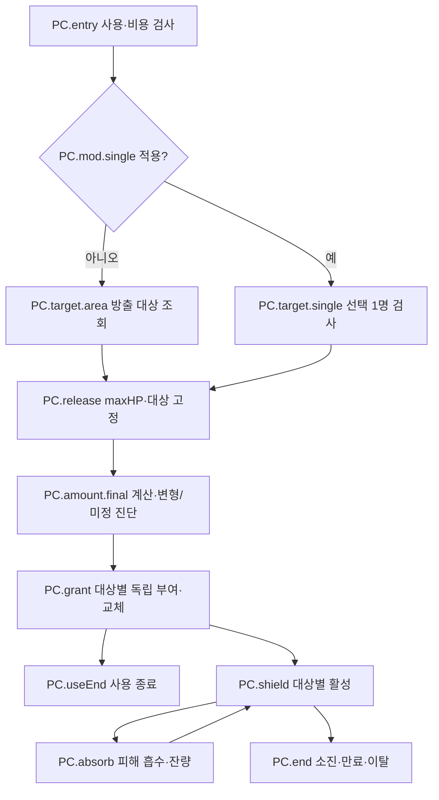

# 포큐버스 — 전체 작성 예시

[3단계 진입점·공통 계약](ai-skill-authoring-examples.tmp.md) · [자체 재검토](ai-skill-authoring-examples-review.tmp.md)

## 1. 범위·근거·상태

문서 ID `example.porccubus`, 표시명 `황홀의 포자막`. **엘리트 전체 잠정안**이다.
기본 파편, 일반 오롯한 축복, 쾌락의 고리의 생성량 연결을 전체 작성한다. 고리 병용의 미정 합성도 원본에 포함한다.
쾌락 무기의 공격/독·방어구 수치 전체는 이 사례의 실행 정의가 아니며 E07-e의 나머지 범위로 남긴다.
방어구가 바꾼 maxHP는 통합 능력치의 입력이다. 침식된 단일 전환의 패널티와 별도 파편 형태를 만들어 넣지 않는다.

| 근거 ID         | 현재 원문·읽은 절                                                                                                       | 요구         |
| --------------- | ----------------------------------------------------------------------------------------------------------------------- | ------------ |
| PC.src.fragment | [파편](../../core_enhanced/docs/content/abnormalities/porccubus/fragment.md) 개인 보호·흡수·유지, 10/22 두 정책 절      | E07-a/b      |
| PC.src.single   | [오롯한 축복](../../core_enhanced/docs/content/relics/single-target-conversion.md) 포큐버스 적용·10/22 비침식 수동 선택 | E07-b        |
| PC.src.ring     | [장비](../../core_enhanced/docs/content/abnormalities/porccubus/equipment.md) 쾌락의 고리                               | E07-b/e      |
| PC.src.common   | 진입점 S.use/time/targets/damage/shield/modify/cue                                                                      | C01~08/11~13 |

상단의 자격/교체 미정은 10/22 정책으로 해소된 범위만 반영한다. 옛 공용막·유물2배/4배·검증용20%/2.5배를 채택하지 않는다.

## 2. 작성 정의 — 값·대상·변형

이하 모든 ID는 이 문서의 작성 원본이다. 값/참조/실행을 분리한 검토 표이며 실제 파일 문법이 아니다.

| 정의·속성          | 종류·작성값과 읽는 시점                                                                                  | 출처·미정                                                                                      |
| ------------------ | -------------------------------------------------------------------------------------------------------- | ---------------------------------------------------------------------------------------------- |
| PC.meta            | 파편 정의, 잠정. 희귀도 Rare/GlobalExclusive/Shield는 원문 초안 상태로 보존                              | 최종 카탈로그 자격은 미정. 선택된 사용 맥락의 적법 장착은 S.use가 검사                         |
| PC.v.coefficient   | 비음수 무차원 개인량 계수 `미정`; 정의 상수                                                              | PC.src.fragment, PC.U1                                                                         |
| PC.v.duration      | 양수 전투 기간 `미정`, 0.001초 정밀도                                                                    | PC.U2. 효과 생성 때 기한 계산                                                                  |
| PC.v.area          | 시전자 중심 authored 범위 `미정`; 원형은 초안 방향                                                       | PC.U3. 고정3×3·전장전체로 대체 금지                                                            |
| PC.v.singleRange   | 단일 선택 사거리/형상 `미정`                                                                             | PC.src.single; PC.v.area 복사 금지                                                             |
| PC.v.singleFactor  | 일반 단일 전환 개인량 배율 `미정`                                                                        | PC.U4. 대상 수를 피연산자로 받지 않음                                                          |
| PC.v.ringRate      | 고리 생성량 증가율 `미정`                                                                                | PC.src.ring, PC.U5                                                                             |
| PC.target.eligible | active player 직원, 살아 있고 배치됨, Ground/Platform, 자신 포함; Guest/소환물/방어 오브젝트 제외        | 접수·방출 자격 검사. ‘자신 포함’은 authored Bool 조건                                          |
| PC.target.area     | S.targets(ctx, 중심=시전자 현재 위치@방출, PC.v.area, PC.target.eligible)                                | 결과는 이번 부여의 개체 ID 집합. 이후 동적 membership 없음                                     |
| PC.target.single   | 수동 선택한 1명; 접수 때 PC.target.eligible+PC.v.singleRange 검사                                        | 사전 선택은 임시 입력, 무효 선택은 거절. 방출의 필수 대상 무효는 S.use 공통 중단/무환불        |
| PC.amount.base     | `floor(시전자 통합 maxHP@방출 × PC.v.coefficient)` → 정수 보호량                                         | maxHP에는 이미 적용된 방어구 능력치 포함. 대상 maxHP·방어력·아군 수를 읽지 않음                |
| PC.amount.single   | 일반 단일만 적용: `floor(PC.amount.base × PC.v.singleFactor)`                                            | base의 내림과 별도 내림을 합치지 않음                                                          |
| PC.mod.single      | 실제 일반 오롯한 축복 장착 시 대상=PC.target.single, 개인량=PC.amount.single로 대체                      | 원래 다수 부여와 병행하지 않음. 집중/기간 연장/저지 변화 추가 없음                             |
| PC.mod.ring        | 제공자 장착 고리→eligible 막 생성 초기량 기여1회. 수혜자 고리는 읽지 않음                                | ring만의 반올림·다른 생성 modifier 합성은 PC.U5; 일반 개인막 외 분류도 미정                    |
| PC.amount.final    | 변형 없음=base, single만=single. ring 또는 single+ring이면 `미정〈생성량 합성식〉`에 정의 참조/계수 연결 | PC.U5. single 뒤 ring 적용 등 미합의 순서를 확정하지 않음. 선택 조합의 필수 실행 의존으로 진단 |

`PC.mod.ring`의 의미와 적용 위치는 표현되어 있지만 조합 산식이 비어 있는 상태다. 이를 1배로 바꿔 실행하지 않는다.
PC.v.area를 바꾸면 다수 대상만 달라지고 singleRange는 바뀌지 않는다. coefficient는 기본·단일·고리 조합의 공통 원본이다.

## 3. 사용·부여·개인 활성

| 정의       | 입력·흐름·결과                                                                                                                 | 소유·실패/종료                                                                                                            |
| ---------- | ------------------------------------------------------------------------------------------------------------------------------ | ------------------------------------------------------------------------------------------------------------------------- |
| PC.entry   | 기본 자기 사용, 일반 단일일 때 선택 아군 입력. S.use(ctx, 수동, 공격태세/행동가능, 공명만충, 전액소비, 요청키, 자격/비용 확정) | 같은 요청은 새 비용/부여를 만들지 않음. 승인 전 취소·잘못된 대상은 원본 게임 상태 무변경                                  |
| PC.release | 승인된 부여 방출에서 시전자 maxHP·최종 대상·생성 modifier를 고정. PC.amount.final 계산→대상별 PC.grant                         | 승인과 실제 방출이 분리되는 공통 사용에서는 중간 HardCC/필수대상 무효의 공통 취소를 따른다. 별도 준비시간을 발명하지 않음 |
| PC.grant   | S.shield(source, 대상 ID, 개인 최종량, PC.v.duration, PC.shield 정책)→대상별 활성/생성 결과                                    | source=`제공 직원+파편 사본`, 교체키=`source+대상+막 정의`는 추적을 위한 구체화 제안. 원문 ‘같은 출처’ 의미를 보존        |
| PC.shield  | 인스턴스 필드: 제공자 identity/배치·원천 사본, 대상 배치 ID, maxAmount, remaining, expiresAt, 종료여부                         | maxAmount=remaining=해당 개인량으로 생성. 별도 effect ID. 여러 아군의 잔량을 공유하지 않음                                |
| PC.replace | 같은 교체키의 기존 활성 종료(이유=replaced)→새 초기량·기한 설정                                                                | 이번 수혜자 집합에 없는 이전 활성은 그대로. 새 양이 작아도 원문 ‘새 잔량/시간 교체’; 합산·큰값선택 아님                   |
| PC.useEnd  | 모든 부여 결과 확정 후 사용 종료·공명 사용 잠금 해제                                                                           | 집중 없음. 일반 행동 가능. 생성한 개인막은 각자 수명으로 존속하며 사용 종료로 삭제하지 않음                               |
| PC.absorb  | 허용 피해에 대해 대상 자신의 방어/감면 후량 D를 읽음. 흡수=min(D,remaining), 잔량-=흡수, 초과=D−흡수                           | 초과는 같은 피해의 HP 적용으로 전달, 재감면 금지. HP비용/maxHP희생 우회. 다른 막 우선순위/특수 source 자격은 PC.U6        |
| PC.end     | 잔량0, 만료, 제공자/대상 철수·전투불능·사망, 전투종료에서 해당 활성1회 종료                                                    | 예약·부착 표현 정리. 단순 범위이탈·이동·HardCC/Silence만으로 생성된 막 종료 없음                                          |

부여 뒤 늦게 들어온 아군·재진입·시전자 이동·일반 HP 회복·장비 변경은 `PC.grant`를 다시 호출하지 않는다.
피격 CC를 막는 기능도 없다. 흡수량은 피해 결과의 막 손실이며 실제 HP 손실이 아니므로 흡혈·피격 회복의 근거를 바꾸지 않는다.
여러 막이 동시에 있는 경우는 미정 공통 우선순위 계약이 필요한 조합이다. 이 예시는 그 결정을 숨기지 않는다.

## 4. 예상 그래프·속성·추적

도식의 M은 base/single/ring 참조를 펼칠 수 있는 축약 표시다. 미정 조합에서 실행이 이어진다는 뜻은 아니다.

| 선택 요소     | 수정 가능한 원본                                | 읽기 전용·공유 영향                                                      |
| ------------- | ----------------------------------------------- | ------------------------------------------------------------------------ |
| M 개인량      | PC.v.coefficient, PC.amount.base의 식·시점      | 계산 예측량/실제 초기량. coefficient 소비자=base→single/final→모든 grant |
| A 수혜자      | PC.target.eligible, PC.v.area                   | 이번 방출 집합·인원수. eligible은 single도 참조                          |
| T 단일 선정   | PC.v.singleRange, 선택 자격 참조                | 현재 임시 선택. area와 별도                                              |
| S 개인막      | PC.v.duration, 교체/종료 정책 참조              | 실제 remaining·expiresAt·대상 ID. 잔량 직접 편집은 콘텐츠 수정 아님      |
| M의 고리 기여 | PC.v.ringRate, PC.amount.final의 미정 합성 자리 | 제공자 장비 출처와 영향 조합, 수혜자 장비 영향 없음                      |

편집은 진입점 §4의 변경 경로를 따른다. 예시 추적은 `PC.v.coefficient→M→grant의 amount 기여→각 effect ID→PC.cue.shield`다.
컴파일이 여러 부여를 하나의 반복으로 묶어도 수혜자별 결과에서 원본 PC.grant와 amount 기여를 함께 찾는다.

## 5. 편집 과제 — 콘텐츠 변경이 아닌 시험 조건

| 과제               | 전 → 후                                                    | 기대 영향·거부/보존                                                                                                  |
| ------------------ | ---------------------------------------------------------- | -------------------------------------------------------------------------------------------------------------------- |
| PC.edit1 미정 계수 | PC.v.coefficient=미정 → case 전용0.2                       | case maxHP1000이면 base200. 정식 원문 계수는 미정 유지. 같은 리비전의 계수 진단만 해소                               |
| PC.edit2 지역식    | case의 base=floor(maxHP×0.2) → floor(maxHP×0.25)           | maxHP1000에서200→250, 대상 조건/기간은 불변. 결과칸200을 수정하지 않음                                               |
| PC.edit3 대상조건  | case eligible.includeSelf=true → false                     | 동일 자격을 참조하는 area/single 모두 영향 표시. 게임 정책 변경이라는 차이를 명시하며 원본 합의에 자동 반영하지 않음 |
| PC.edit4 공유값    | coefficient=0.2 →0.3, case singleFactor=1.5                | base200→300, single300→450. ring 조합은 U5가 남으므로 숫자로 성공 표시하지 않음                                      |
| PC.edit5 타입 오류 | coefficient에 전투기간2초 입력 → 무차원0.2                 | V03 위치=coefficient와 base 피연산자. 오류 식 저장 가능/실행 거부; 교정 후 재검증                                    |
| PC.edit6 참조 오류 | duration 참조를 없는 PC.v.life로 수정 → PC.v.duration 복구 | V04 참조자=PC.shield.expiresAt. 미정 duration과 끊어진 참조는 다른 진단                                              |

각 과제는 별도 case 변경 집합이다. 공유 수정과 이 사용처만 복제는 별도 작업으로 제시한다.
오래된 case 컴파일 응답은 새 원본을 덮지 않으며 Undo는 식·참조·상태표시를 함께 되돌린다.

## 6. 연출·진단

| cue ID        | 확정 사건·부착·값                                                             | 수명·미정                                                                            |
| ------------- | ----------------------------------------------------------------------------- | ------------------------------------------------------------------------------------ |
| PC.cue.cast   | PC.release 승인된 방출, 제공자 위치/방향                                      | 포자막 부여 의도. effect/sound/animation 자원·상세 길이 미정                         |
| PC.cue.shield | PC.grant의 대상별 effect ID에 부착. 초기량/현재잔량을 생성·흡수 결과에서 읽음 | 생성/잔량갱신/소진·만료·교체·이탈 종료. 같은 시전의 다른 대상에 종료를 전파하지 않음 |
| PC.cue.hit    | PC.absorb의 실제 흡수 결과, 대상 현재 위치                                    | 단발 표현. 이 연출이 HP피해·CC면역을 만들지 않음                                     |

재생 시간은 기본적으로 해당 전투 효과를 관측하고, 상세 재생/보간·별도 표현 시간은 미정으로 둔다.
자산을 못 찾거나 연출이 미정일 때의 산출물 허용은 V07/D05로 보존한다.

| 미정 ID  | 타입·필요 위치                                    | 저장/실행 영향                                                                       |
| -------- | ------------------------------------------------- | ------------------------------------------------------------------------------------ |
| PC.U1~U3 | coefficient/기간/형상, base·shield·area           | V01. 해당 선택 실행의 필수 입력이므로 미정 상태 실행 산출 거부                       |
| PC.U4    | 일반 단일 배율/선택범위                           | 기본형만 선택하면 무관, 단일 전환 선택 시 V01                                        |
| PC.U5    | 고리 증가율·반올림·다른 modifier 및 단일과 합성식 | 고리 선택 조합에서 V01, 알고리즘을 임의 결정하지 않음                                |
| PC.U6    | 다른 막 우선순위·특수 피해 source의 흡수 자격     | 단독 일반 피해 대조와 분리. 해당 상호작용을 포함한 검증/실행에는 공통 계약 결정 필요 |
| PC.U7    | 침식된 단일 유물 패널티                           | V02 보류 변형. 일반 단일/기본 예시에 섞지 않음                                       |
| PC.U8    | cue 자원/상세 재생                                | V07, 허용 정책 미정                                                                  |

## 7. 수작업 의미 대조와 양방향 추적

| 요구·원문 규칙               | 정의·속성                     | 공통 계약        | 보존한 값·순서·소유/수명                                | 미정/공백              | 확인 사례     |
| ---------------------------- | ----------------------------- | ---------------- | ------------------------------------------------------- | ---------------------- | ------------- |
| E07-a 방출 수혜자·개인량     | PC.target/amount.base/release | S.use/targets    | release maxHP·대상 고정·floor·자신/Ground/Platform 포함 | U1~3                   | case1/2/6     |
| E07-a 독립흡수·초과HP        | PC.grant/shield/absorb        | S.shield/damage  | 대상별잔량·대상감면후1회흡수·재감면없음                 | U6                     | case1/4       |
| E07-a 부분재부여·늦은진입    | PC.replace/target.area        | S.shield/time    | 이번수혜자만새잔량/기한·밖기존유지                      | 없음(설계상); 실행별도 | case2/3       |
| E07-a 제공자/대상종료·HP비용 | PC.end/absorb/useEnd          | S.time/damage    | 사용종료≠막종료·이탈/죽음정리·비용우회                  | 특수source U6          | case4/5       |
| E07-b 단일전환·단계내림      | PC.mod.single/amount.single   | S.modify/targets | 선택1명·대상수미사용·두번floor                          | 배율/선택범위 U4       | case6·edit3/4 |
| E07-b/e 고리                 | PC.mod.ring/amount.final      | S.modify/shield  | 제공자생성기여1회·잔량재충전없음                        | 증가율/단일과합성 U5   | case7·edit4   |
| F04 일반/침식유물분리        | PC.mod.single/PC.U7           | S.modify         | 기본/일반단일만작성·침식패널티보류                      | U7                     | 조합선택 V02  |
| C07/12 수치·대상·공유·오류   | §4 선택표·PC.edit1~6          | 진입점§4~5       | 하나의원본·식/실행값분리·Undo/의존지문                  | 실제UI/포맷 미확인     | edit1~6       |
| C13 대상별연출               | PC.cue.*                      | S.cue            | effect별부착/잔량갱신/개별종료                          | U8·D05                 | case1/3/5     |

아래 값은 설명용 case이고 실행 시험이 아니다. 모든 시각은 전투 시간이며 별도 언급 없는 다른 막/유물은 없다.

| case     | 초기 상태·입력                                         | 기대 관측·반례                                                                     | 대응                                 |
| -------- | ------------------------------------------------------ | ---------------------------------------------------------------------------------- | ------------------------------------ |
| PC.case1 | release 때 A/B 포함, 개인량200; 방어 후 A400/B150 피해 | A막0·HP200감소, B막50·HP손실0. 공용400에서 차감하거나 방어 재적용 금지             | PC.amount/target/grant/absorb, E07-a |
| PC.case2 | A/B 부여 뒤 A범위이탈, C진입                           | A기존막 유지, C없음. 시전자 이동/재진입도 새 grant 없음                            | PC.target.area/PC.end, E07-a         |
| PC.case3 | A잔량40/B잔량90, 다음 release 대상B/C, 새개인량120     | A40·기존기한, B/C120·새기한. B210으로 합산 금지                                    | PC.replace, E07-a                    |
| PC.case4 | A막100, HP비용30 또는 maxHP희생                        | 막100 유지, 비용 계약대로 HP처리. 막으로 비용 면제 금지                            | PC.absorb/S.damage, E07-a            |
| PC.case5 | 부여 뒤 HardCC/Silence, 이후 제공자철수                | CC/Silence만으로 막 삭제 없음; 철수는 모두 종료. 일반행동과 효과수명 분리          | PC.useEnd/end, C05/06                |
| PC.case6 | maxHP1001, case coefficient0.2, singleFactor1.5        | base200, 단일300. 대상 수를 곱하지 않음. 고리 동시 선택은 U5 진단                  | PC.amount.*, E07-b                   |
| PC.case7 | 제공자/수혜자에 고리, 생성 뒤 고리 해제·HP회복         | 제공자 생성 기여만1회. 잔량 재충전 없음. 정확 초기량은 합성 미정이면 산출하지 않음 | PC.mod.ring, E07-b/e                 |

원문→작성 대응: 보호 자격/부여 시점→PC.target/release, 개인량→PC.amount, 독립 잔량/흡수→PC.shield/absorb,
재부여→PC.replace, 유지/종료→PC.useEnd/end, 단일→PC.mod.single, 고리→PC.mod.ring, 포자막 의도→PC.cue.*.
각 작성 행의 PC.src와 위 case가 역방향 근거다. PC source 키·명명·cue ID는 구조 제안이며 콘텐츠 추가 효과가 아니다.
현재 Core 재사용 범위는 진입점 J01, 편집/추적/Unity는 J04/V06이다. 전체 장비 E07-e를 이 사례 하나로 통과시키지 않는다.
