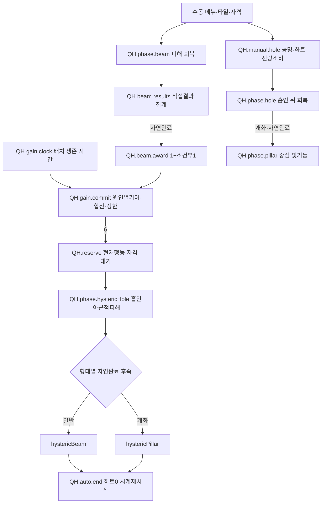

# 증오의 여왕 — 전체 작성 예시

[3단계 진입점·공통 계약](ai-skill-authoring-examples.tmp.md) · [자체 재검토](ai-skill-authoring-examples-review.tmp.md)

## 1. 범위·근거

문서 ID `example.queen-of-hatred`. 일반 리워크의 일반/개화형 광선·수동 블랙홀·자동 히스테릭을 작성한다.
선택된 유물 7개는 실제 적용 정의 또는 명시적인 미정 연결로 모두 보존한다. 회복 결과와 연결되는 전용 무기·브로치·결계도 포함한다.
정식 에고 침식은 별도 진입·공통 계약·연출 연결로 다루며 히스테릭과 합치지 않는다. 침식의 원정 시스템 전체를 재작성하지 않는다.

| 근거 ID          | 원문·읽은 절                                                                                                                                              | 요구                                                 |
| ---------------- | --------------------------------------------------------------------------------------------------------------------------------------------------------- | ---------------------------------------------------- |
| QH.src.fragment  | [파편](../../core_enhanced/docs/content/abnormalities/queen-of-hatred/fragment.md) 전체, 특히 10/21 작성 정책                                             | N02-a/b/c, F01                                       |
| QH.src.relics    | [연결표](../../core_enhanced/docs/content/abnormalities/queen-of-hatred/synergies.md) 및 §5의 개별 유물 원문                                              | N02-a/b/c·C11                                        |
| QH.src.gear      | [장비](../../core_enhanced/docs/content/abnormalities/queen-of-hatred/equipment.md) 기본 치료·결계·브로치                                                 | N02-e                                                |
| QH.src.corrosion | [현행 에고 침식](../../core_enhanced/docs/game_rules/relics.md#에고-침식과의-경계), [파편 원칙](../../core_enhanced/docs/content/principles/fragments.md) | F01. 옛 ‘모든 적 처형’을 무조건 즉사로 구현하지 않음 |

## 2. 작성 정의 — 값·자원·대상

| 정의·속성                                                       | 타입·값·읽는 시점                                                       | 상태·근거                                                                                                 |
| --------------------------------------------------------------- | ----------------------------------------------------------------------- | --------------------------------------------------------------------------------------------------------- |
| QH.meta                                                         | 일반/개화 형태 선택, 희귀도·장착제한·호환성 미정                        | 형태 선택은 실행 구성 입력, 임의 전환 중복실행 금지                                                       |
| QH.v.heartCap                                                   | 정수6                                                                   | 원문 합의. 초과 획득 버림                                                                                 |
| QH.v.gainPeriod                                                 | 양수 전투기간15초                                                       | 현재 작업값, 성급한 초침 적용 시 변환식 미정                                                              |
| QH.v.tick                                                       | 양수 전투기간0.5초                                                      | 모든 작성 단계의 현재 공통 작업값, 첫 즉시·끝 제외                                                        |
| QH.v.beamDuration / holeDuration / pillarDuration               | 전투기간2초/2초/3초                                                     | 원문 작업값. 자동 기본형의 후속 광선 기간은 별도 QH.v.hystericBeamDuration=미정                           |
| QH.v.selectionRange / beamShape / holePatterns / pillarPatterns | 선택 범위·방향형 광선·소비하트별 중심 타일 패턴 `미정`                  | 큰 소비량의 패턴은 작은 패턴 포함. 입력 사거리/피해·회복·흡인 범위는 구분                                 |
| QH.v.beamDamage / beamHeal                                      | 직접 요청량/계산식 `미정`, 필요한 능력치 참조 시점도 원본에 지정해야 함 | Attack 비율 등으로 임의 확정하지 않음                                                                     |
| QH.v.holeHeal / pillarDamage / pillarHeal / heartRates          | 기본 요청량/계산식·하트당 증가율 `미정`                                 | 확정 소비하트 H를 사용해 `ceil(base×(1+H×rate/100))`                                                      |
| QH.v.hystericDamage / shapes                                    | 자동 블랙홀·후속 공격의 위력/형상 `미정`                                | 회복 없음. 수동 회복식을 음수로 바꾸어 피해를 만들지 않음                                                 |
| QH.v.pullDistance                                               | 회차당 이동거리 `미정`                                                  | 범위 증폭과 실제 끌기 거리 분리                                                                           |
| QH.owner                                                        | 파편 사본+현재 직원 배치에 결합한 전투 상태                             | fields=hearts·gainElapsed·rememberedTile?·mode·pendingAuto·currentCast. 새 배치0/0/없음/normal/false/없음 |
| QH.target.enemy                                                 | 현재 범위의 유효 적                                                     | 피해 대상. 환상체 포함, 대공 등 미기입 세부는 공통 자격/작성 필터 의존                                    |
| QH.target.ally                                                  | 현재 범위의 살아 있는 유효 아군, 시전자 포함                            | 일반 회복·히스테릭 아군 피해에 사용. 무기 기본힐의 eligible과 별도 정의                                   |
| QH.target.pull                                                  | 현재 흡인 범위의 침식체 적                                              | 아군·환상체 제외. 강제이동 자격/지형/장애물 계약 준수                                                     |

각 phase는 필요한 위력/형상을 자기 정의에 참조한다. 소비하트가 0이어도 입력이 미정이면 0효과로 만들지 않는다.
현재 작업기간을 사용한 시간 대조와 최종 밸런스 결정은 다르다. 자동 블랙홀/개화 빛기둥은 해당 종류의 작업기간을 참조하며,
기본형 히스테릭 광선은 원문의 별도 미정 기간을 유지한다.

## 3. 하트·입력·예약 상태

| 정의           | 입력·전이·결과                                                                                                                                                    | 소유·실패/종료                                                                                        |
| -------------- | ----------------------------------------------------------------------------------------------------------------------------------------------------------------- | ----------------------------------------------------------------------------------------------------- |
| QH.lifecycle   | 새 전투/재배치→QH.owner 초기화. 전술 이동→기억/하트 보존                                                                                                          | 사망·철수·전투종료는 시전/예약/타이머/기억 정리. Retreat는 진입전 저장 복원, 중간전투 이어붙이기 아님 |
| QH.gain.clock  | 배치 생존 중 전투시간 누적. period 도달→기본획득1→QH.gain.commit                                                                                                  | 일반시전·기절·침묵 중에도 진행. 6예약/히스테릭 중 멈춤. Pause/미배치 시간 비축 없음                   |
| QH.gain.commit | 원인별 획득량에 수확 기여→모든 이번 보상 합산→min(QH.v.heartCap,기존+획득)→상한도달 판단                                                                          | 공명과 별도 자원. 한 완료/회차 발생ID는1회. QH.v.heartCap 도달이면 pendingAuto=true·gain 시계 중지    |
| QH.manual.beam | 수동 선택타일·형태, 공격태세/행동가능·공명만충·하트0~(QH.v.heartCap−1)·자동예약없음 → S.use 전액소비                                                              | 빈 유효 타일 가능. 승인 때 rememberedTile=선택타일. 실행중 하트획득으로 현재 공격 형태 변경 없음      |
| QH.manual.hole | S.use 수동·공격태세/행동가능, 기본형은하트3~(QH.v.heartCap−1), 개화형0~(QH.v.heartCap−1)·자동예약없음·공명만충·유효타일 → 공명+현재하트 전량소비·H 영수증·타이머0 | 두 자원과 입력 함께확정. 개화0소비도 타이머reset. 거절은 모두무변경, 기억타일은 변경하지 않음         |
| QH.reserve     | hearts=QH.v.heartCap에 pendingAuto를 유지, 새 수동 입력 거절                                                                                                      | 현재 진행 행동을 먼저 마침. 그 행동 중단이면 정리 뒤 검사. 예약 중 새 자동 공격을 중복 만들지 않음    |
| QH.auto.admit  | 기존행동/사용의무없음·새자동시전행동자격 검사→히스테릭 시작                                                                                                       | HardCC/Silence면 대기. 해제 뒤 시작, 추가공명 조건/소비 없음. 일반행동자격 우회 없음                  |
| QH.auto.aim    | 기억타일 유효면사용, 없거나무효면 시작시 시전자타일. 같은타일의 광선방향=시전자 당시바라봄                                                                        | 시전자→중심 방향/중심을 고정. 유닛이동·사망 추적 아님                                                 |
| QH.auto.end    | 자연완료 또는 실제강제중단→하트0·정상복귀·gain시계0부터 재시작                                                                                                    | 시작한 히스테릭 수동취소 거절. 미방출후속/보상 없음. 사망/철수/전투종료는 재시작 대신 lifecycle정리   |

일반 시전 도중 시간획득으로 6이 되어도 현재 사용을 끝낸 뒤 자동 시작한다. 새 수동 블랙홀로 예약을 취소하거나
하트를 소비해 폭주를 피하는 경로를 만들지 않는다. 시간획득과 수동 접수 같은 별도 동시 사건의 세부 경쟁은
공통 사건순서 계약의 확인 대상으로 유지하며 원본에 없는 우선순위를 여기서 숫자로 발명하지 않는다(QH.U6).

## 4. 단계 실행과 직접 결과 집계

`QH.cast`는 시전ID·소유사본·형태·entry종류·H/조준 영수증·현재단계·시작/만료·중단상태를 보유한다.
표의 괄호 시간/회차와 설명의 6개·0~5는 공유 정의를 현재 작업값으로 해석한 결과다. 별도 수정 원본이 아니다.
모든 광선/블랙홀 연속 시전은 표준 집중이며 기본 공격/기본 치료를 중지한다. 시전자 이동·외부중단은 S.time/use를 따른다.

| phase ID                | 원점/기간/회차                                                                              | 각 회차 효과·다음 단계                                                                                |
| ----------------------- | ------------------------------------------------------------------------------------------- | ----------------------------------------------------------------------------------------------------- |
| QH.phase.beam           | 시전자 방출원점+지정타일 방향 고정, QH.v.beamDuration/QH.v.tick 참조(현재2초,0/0.5/1/1.5초) | 현재 적에게 Magic 직접피해·현재 아군에게 직접회복. 결과는 QH.beam.results. 자연완료→QH.beam.award     |
| QH.phase.hole           | 선택 중심 고정, QH.v.holeDuration/QH.v.tick 참조(현재2초·반열린 주기)                       | 침식체 흡인→현재 위치 재조회→아군 회복. 기본형 자연완료면종료, 개화형이면pillar. 적피해·하트생성 없음 |
| QH.phase.pillar         | 앞 블랙홀 중심 고정, QH.v.pillarDuration/QH.v.tick 참조(현재3초)                            | 범위 적 Magic 직접피해·아군 회복. 소비H로 위력강화. 자연완료→종료, 하트보상없음                       |
| QH.phase.hystericHole   | 자동 중심 고정, QH.v.holeDuration/QH.v.tick 참조                                            | 침식체만흡인→재조회→아군/적에게 Magic피해. 회복없음. 자연완료→형태별후속                              |
| QH.phase.hystericBeam   | 시전자 고정원점→블랙홀중심 방향, QH.v.hystericBeamDuration(미정)/QH.v.tick 참조             | 아군/적 Magic피해, 회복없음. 자연완료→QH.auto.end                                                     |
| QH.phase.hystericPillar | 블랙홀 중심, QH.v.pillarDuration/QH.v.tick 참조                                             | 아군/적 Magic피해, 회복없음. 자연완료→QH.auto.end                                                     |

일반/개화의 일반 광선은 QH.phase.beam을 공유한다. 개화 수동 블랙홀은 hole→pillar, 자동 기본형은
hystericHole→hystericBeam, 자동 개화형은 hystericHole→hystericPillar다. 단계를 건너뛰거나 두 후속을 병행하지 않는다.
범위 내 환상체는 피해를 받지만 끌리지 않는다. 이동 실패/면역도 실제 결과로 구분하고 이후 조회는 현재 위치를 쓴다.
종료 시각에는 tick하지 않으며, 앞 단계 자연완료 뒤 다음 단계 첫 tick은 그 시작 시각에 발생한다.

| 집계/종료 정의   | 작성 의미                                                                                                                                                                                 |
| ---------------- | ----------------------------------------------------------------------------------------------------------------------------------------------------------------------------------------- |
| QH.beam.results  | 시전ID별 damaged=false/healed=false. 포함=QH.phase.beam의 직접 결과만. 실제 적 HP손실>0이면damaged, 실제아군회복>0이면healed. 중복키=결과발생ID. 장비결계·별도기본치료·다른시전·반사 제외 |
| QH.beam.award    | 마지막 결과 정산 뒤 자연완료에서만 집계닫기. base1 + (damaged AND healed ? bonus1 :0)을 원인별수확기여 후 한묶음으로 QH.gain.commit. 여러대상/tick별보상 아님                             |
| QH.cast.cancel   | 강제중단/허용수동취소→현재 단계·예약tick·종속효과/잠금 정리→종료1회. beam집계는 보상없이 폐기. 다음단계 없음. 이미 확정한 피해/회복은 유지                                                |
| QH.cast.complete | 마지막 단계 자연완료→종속효과 정리→해당 entry의 완료 처리1회. 일반 수동hole/pillar는하트보상없음                                                                                          |

Silence는 공통 규칙상 진행 중 시전을 취소하지 않고 새 자동/수동 시작만 막는다. 무아지경이 없다면 HardCC는 집중을 중단한다.
무아지경은 진행중 외부중단 보호만 변경하며 사망/철수·자발종료·만료나 새사용자격을 없애지 않는다.

## 5. 유물 7개와 회복 장비 연결 정의

| 정의           | 자격·정확한 원본 적용 지점·결과                                                                                        | 미정/금지                                                                                                        |
| -------------- | ---------------------------------------------------------------------------------------------------------------------- | ---------------------------------------------------------------------------------------------------------------- |
| QH.mod.chalice | [온기의 성배](../../core_enhanced/docs/content/relics/healing-increase.md)→비히스테릭 beam/hole/pillar의 S.heal 요청량 | 증가율25~40% 중 최종값·시점·합성/반올림 미정. 자기/흡혈 등 일반 자격도원문미정. 보호막직접증폭 아님              |
| QH.mod.warmth  | [남은 온기](../../core_enhanced/docs/content/relics/lingering-warmth.md)→같은직접회복 결과의 수혜자에 buff             | buff 종류/수치/기간·0/초과/자기회복·재부여 미정. 미정 buff를빈효과나공속으로만들지않음                           |
| QH.mod.range   | [넓어진 지평](../../core_enhanced/docs/content/relics/widened-horizon.md)→명시한 광선/블랙홀/빛기둥 효과형상           | 비정사각형·피해/회복/흡인 연동·하트별패턴 합성미정. 선택거리·끌기거리 자동확대금지. 히스테릭 아군피해도 확대대상 |
| QH.mod.harvest | [두 겹의 수확](../../core_enhanced/docs/content/relics/double-harvest.md)→완주1·동시성공1·시간1 각각×2                 | 한완주둘다성공이면총4, 그뒤cap6. 초기값0·보유하트·소비량을 두배로 만들지 않음                                    |
| QH.mod.clock   | [성급한 초침](../../core_enhanced/docs/content/relics/hasty-second-hand.md)→QH.v.gainPeriod                            | 변환식/단축률미정, 양수기간검사. tick0.5·공명주기·시전기간 변경안함                                              |
| QH.mod.shell   | [겹친 외피](../../core_enhanced/docs/content/relics/layered-shell.md)→`미정〈보호막생성 효과참조〉`                    | 파편에없는막 생성금지. 장비결계를확정연결로선택하지않음. 이연결선택시V01                                         |
| QH.mod.trance  | [무아지경](../../core_enhanced/docs/content/relics/unbroken-trance.md)→현재 QH.cast의 외부중단보호                     | CC상태부착면역·새사용허용아님. 시작전침묵이면여전히대기                                                          |

| 장비 정의             | 입력·결과·수명                                                                                                                                                                    | 미정/출처 구분                                                                                                                 |
| --------------------- | --------------------------------------------------------------------------------------------------------------------------------------------------------------------------------- | ------------------------------------------------------------------------------------------------------------------------------ |
| QH.gear.weapon        | Staff/Platform/저지0 순수힐러. 기본치료 기회마다 유효부상아군 중 낮은HP비율→큰결손→안정순서로1명, S.heal(무기기본치료). 대상없으면치료결과없음. 이때공격기회소비/재탐색시점은미정 | 회복량/범위/주기/windup·일부eligible미정. 적유무와무관. QH.cast 집중중기본치료중지, 히스테릭으로무기힐을아군피해로변환하지않음 |
| QH.gear.brooch        | 제공자가다른아군에게주는eligible직접회복 요청량+25%, source=장비. weapon/파편회복에적용                                                                                           | 자기·흡혈·maxHP증가·다른source제외. 다른증폭과합성/반올림미정. 결계량에다시직접25%추가금지                                     |
| QH.gear.armor.trigger | 자기아닌대상이회복전HP≤50%, 제공자직접회복의실제량>0, 대상별cooldown자격→결계요청                                                                                                 | action의회복집계/발동시점·재부여시기한처리미정. 피해집계나overheal·흡혈·HP비용취소를사용하지않음                               |
| QH.gear.armor.grant   | 실제회복량×작성비율로결계, 기존/신규큰값선택·합산없음. 대상별cooldown·기간                                                                                                        | 25%/5초/8초는첫prototype으로별도표시, 최종값/HPtype/다른막우선순위/정리미정. 선택조합필수공백으로진단                          |

회복 증폭→실제 회복 결과→결계의 기준량이라는 선행 관계는 고정한다. 증폭끼리 합산할지 곱할지는 미정이므로
성배+브로치를 임의로1.25×1.4로 계산하지 않는다. 결계가 생겼다는 결과를 광선의 별도 실제 회복 성공으로 세지 않는다.
파편만 선택했을 때 장비 미정은 무관한 의존이며, 장착 조합을 선택하면 해당 진단을 포함한다.

## 6. 정식 침식의 별도 연결

`QH.ego.entry`는 별도 버튼이나 세트 수집 입력이 아니다. [현행 공통 규칙](../../core_enhanced/docs/game_rules/relics.md#에고-침식과의-경계)이 발동 조건의 소유 문서로 연결한
[에고 침식 메모의 발동·시점 정책](../../core_enhanced/docs/tmp/ego_corrosion_system_design_notes_2026-08-19.ko.md)을 참조한다.
직원 트라우마가 공통 임계치 이상이고 적용 대상 파편의 정상 사용 자격을 통과하면 **실제 시전 시 일반 시전을 침식으로 대체**한다.
파생 4종 보유·별도 침식 입력은 요구하지 않는다. 임계치는 비음수 트라우마 값 미정이며 필수 공통 의존이다.

| 정의           | 입력·결과·경계                                                                                                                                                                                                                           |
| -------------- | ---------------------------------------------------------------------------------------------------------------------------------------------------------------------------------------------------------------------------------------- |
| QH.ego.admit   | 정상 수동 사용 접수의 공명만충 자격·전액소비 영수증 전달. 실제 시전에서 공명 재검사/이중소비 없음. Pause중 접수만으로 침식/연출 즉시실행 없음                                                                                            |
| QH.ego.replace | 실제 시전의 트라우마/적용자격 판정→정상 phase 대신 공통 침식 실행. 일반 광선·하트보상과 병행하지 않음. 자동 히스테릭/재입력은 정상 공명접수와 다른 사용종류이므로 이 규칙으로 자동 포함하지 않으며 정확한 종단 경계는 공통계약 후속 확인 |
| QH.ego.result  | 일반 위협 침식체·침식직원·적 일반소환물은 즉시처치, 엘리트/보스 위협 또는 환상체출처는 maxHP비율피해 우선. 초기25%·1회올림, 무적/대상가능 여부→일반막→생존하한→필수페이즈하한. 방어/일반감면 무시, 중립시설객체 제외                     |
| QH.ego.cost    | 직원즉시철수·종속활성정리, 이미방출한독립child는수명유지. attempt-local 트라우마100→결과commit의roster반영, 이후Breakdown유예는 공통저장계약                                                                                             |
| QH.ego.finish  | 침식처치/사망proc·반격/반사창·유물증폭/추가연쇄 억제, 웨이브정리/승리검사는유지. 환상체연출퇴장은새처치/보상/웨이브authority를만들지않음                                                                                                 |

원문 일부의 옛 세트/명시입력 문장과 현행 공통 소유 문서의 차이는 재검토 R01에 기록했다. 여기서 새 침식 정책을 만든 것이 아니다.
실제 시전 runtime 지점·게임 판정과 cue의 정확한 동기화는 아직 미확인/미정이다. 정상 사례는 침식대체가 발생하지 않는 맥락이다.

`QH.ego.cue`는 작은 빛 하강→바닥 접촉/암전→거대한 빛기둥의 순서다. 이름·자산·재생기간·정확한 판정 연결시점은 미정이다.
이 연결에서 일반 장비·유물·하트 보상을 실행하지 않는다. 공통 계약 전체의 실제 실행 지원과 미정 연출 허용은 미확인/미정이다.

## 7. 예상 그래프·속성·추적

모든 phase의 강제중단은 QH.cast.cancel로 연결한다. 도식이 단순해지도록 이 공통 종료선은 생략해 표시했지만
실행 원본의 종료 계약을 생략한 것은 아니다. 각 요소에서 해당 종료 정의로 이동할 수 있어야 한다.

| 선택           | 수정 위치                                   | 읽기 전용·공유 영향                                                           |
| -------------- | ------------------------------------------- | ----------------------------------------------------------------------------- |
| C 하트         | QH.v.heartCap·획득원인/기여·상한정책        | 현재하트/예약은실행상태. cap변경은자동조건/입력범위에도영향,6합의변경임을표시 |
| B 광선         | beamDamage/beamHeal/beamShape·기간·tick참조 | 실제결과는읽기전용. tick공유정의수정은블랙홀/빛기둥/자동단계에도영향          |
| H 비용         | 기본3~5/개화0~5조건·전량소비·H영수증참조    | 현재공명/하트를원본상수로덮지않음                                             |
| W 예약         | 대기/시작조건·aim fallback참조              | 현재진행행동·대기이유·예고타일                                                |
| R 결과집계     | 직접동작/출처필터·닫힘/보상조건             | 실제damaged/healed와집계종료는편집불가                                        |
| 회복 변형/장비 | QH.mod._·QH.gear._ 공유정의/합성공백        | 해당회복경로·결계기준·자기/타인구분,미정효과에경고표시                        |

추적 예: `QH.v.tick→각phase의회차역할→컴파일예약동작들→cast/phase/tick ID→직접heal결과→QH.cue.phase`.
두결과를 합쳐 보상하는 코드로 내려가도 `QH.beam.results`와 두 보상 원인 및 수확 기여를 모두 추적한다.

## 8. 편집·진단 과제와 연출

| 과제                | 전 → 후(case 전용)                                       | 기대/진단                                                                          |
| ------------------- | -------------------------------------------------------- | ---------------------------------------------------------------------------------- |
| QH.edit1 공유주기   | QH.v.tick=0.5초→1초                                      | 2초단계4회→2회(0/1),3초단계6회→3회. 자동획득15초·공명주기불변. 모든phase영향표시   |
| QH.edit2 지역대상   | hole.pullFilter에서환상체제외→포함                       | 게임합의변경차이를표시. 회복/피해필터까지몰래변경금지. 시험변경만보존              |
| QH.edit3 미정입력   | case beamHeal=미정→100HP                                 | 해당 V01해소, 다른형상/합성/연출진단유지. 최종콘텐츠수치확정아님                   |
| QH.edit4 잘못된단위 | tick에50%입력→0.5초복구                                  | V03 기대전투기간/실제비율·모든사용처를표시. 원본오류식저장·실행거부                |
| QH.edit5 잘못된참조 | beamAward 집계를 hole의종료결과로연결→beam.results로복구 | V04/V03: 다른entry집계·없는실제피해/회복필드. 같은Bool표현만으로자동호환시키지않음 |
| QH.edit6 미정유물   | shell의대상을정의되지않은막ID로입력                      | 기존미정과끊어진참조를구분. 실제막을자동생성하거나장비결계로추정하지않음           |

진입점 §4의 동일 원본·변경 묶음·Undo/저장 규칙을 적용한다. 오래된 응답은 request/리비전/의존 지문으로 구분한다.

| cue ID          | 사건·위치·매개변수                                                                                  | 수명·미정                                                                 |
| --------------- | --------------------------------------------------------------------------------------------------- | ------------------------------------------------------------------------- |
| QH.cue.forecast | owner의기억/fallback타일·현재하트·다음자동획득남은시간. 광선조준때최대가능보상으로6도달가능범위표시 | 임시조준과실제예약분리. 하트5일때타이머강조. 이동/기억변경에갱신,이탈정리 |
| QH.cue.phase    | phase진입→고정광선/블랙홀/중심빛기둥; cast/phase ID·방향·실제범위·기간                              | 각phase자연종료/중단으로표현종료. 자동아군피해범위를Core관측으로표시      |
| QH.cue.result   | damage/heal확정결과·대상·실제량·원인                                                                | 단발재생,회복0/피해0과실제성공구분. 보상UI는gain.commit결과사용           |
| QH.cue.ego      | §6의별도침식연출연결                                                                                | 히스테릭연출로재사용할지자산정책미정. 판정시간·전투/별도시계도명시미정    |

모든 cue의 실제 effect/sound/animation 자원·부착세부·blend는 미정이다. 예고/회복 판정을 Unity가 재추론하지 않는다.

| 미정 ID | 남은 값·의미·지원                                                      | 진단/영향                                                                                |
| ------- | ---------------------------------------------------------------------- | ---------------------------------------------------------------------------------------- |
| QH.U1   | 선택/효과형상·위력식/참조시점·하트별패턴/증가율·흡인거리               | V01, 선택entry의필수의존                                                                 |
| QH.U2   | 자동기본광선기간·자동위력/범위                                         | 해당자동경로의미정은정상광선만작성했다고검사에서빼지않음                                 |
| QH.U3   | 성배·브로치합성,남은온기buff,비정사각범위/하트패턴합성,초침식,외피대상 | 선택유물별 V01. 없는효과생성/임의기본값금지                                              |
| QH.U4   | 결계의최종수치·발동/집계시점·큰값교체기간·정리/막우선순위              | 장비연동선택시 V01. 첫prototype은설명조건과구분                                          |
| QH.U5   | 실제유물/장비등록·모든동시사건·Unity소비                               | V06, J03은일부코드경로확인                                                               |
| QH.U6   | 서로독립인시간획득/수동입력등동시사건의공통선행관계                    | 기존공통계약을추가확인하고없으면정책대기. 현재시전대기·완료보상합산·끝tick제외는이미정함 |
| QH.U7   | 연출자산·정식침식시점/자격계약의실행연결                               | V07/V06. 히스테릭과침식공통정책혼동금지                                                  |

## 9. 수작업 사례와 양방향 대응

| 요구·원문 규칙           | 정의·속성                                | 공통 계약                  | 보존한 값·순서·소유/수명                                | 미정/공백               | 확인 사례       |
| ------------------------ | ---------------------------------------- | -------------------------- | ------------------------------------------------------- | ----------------------- | --------------- |
| N02-a 사본하트/시계/기억 | QH.owner/lifecycle/gain/manual           | S.use/time                 | 배치초기화·이동유지·성공광선만기억·시간15작업값         | 독립동시사건 U6         | case1~5/8       |
| N02-a/c 예약·제어대기    | QH.reserve/auto.admit/auto.aim           | S.use/time                 | 현재행동끝대기·CC/Silence자격·공명추가0·fallback        | 전체실행 U5             | case3/7/8       |
| N02-b 광선·완주보상      | QH.phase.beam/beam.results/award         | S.damage/heal/results      | 직접실제결과·완주1+조건1·원인합산뒤cap                  | 위력/형상 U1            | case1/2/3/5     |
| N02-b 하트소비·강화      | QH.manual.hole/v.holePatterns/heartRates | S.use/targets              | 접수전량소비H·ceil식·기본3~5/개화0~5·시계reset          | 계수/패턴 U1            | case4           |
| N02-b 단계/흡인          | QH.phase.hole/pillar/target.pull         | S.targets/time/damage/heal | 침식체흡인→재조회·2초→3초·일반회복자신포함              | 공간/흡인 U1            | case4·edit2     |
| N02-c 자동단계/중단      | QH.phase.hysteric*/auto.end/cast.cancel  | S.time/damage              | 즉시첫회차/끝제외·아군피해자신포함·중단0/reset·재개없음 | 자동광선기간/위력 U2    | case6/7/8       |
| N02-a/b/c·C11 유물7개    | QH.mod.*                                 | S.modify                   | 수확원인별×2·초침획득기간만·무아지경진행보호            | U3 선택별공백           | case5/7·edit6   |
| N02-e 회복장비           | QH.gear.*                                | S.heal/results/shield      | 타인증폭→실제량→결계·overheal제외·큰값·cooldown         | U4·기본치료시계         | case9           |
| F01 정식침식             | QH.ego.*                                 | P01/02/06·S.cue            | 정상접수영수증→실제시전대체·하트폭주와분리              | 임계치/종단/시퀀스 미정 | case10          |
| C07/12/13 편집·예고·실행 | §7 선택표·edit1~6·cue.*                  | 진입점§4~6                 | 공유주기영향·집계읽기전용·원본→phase→cue                | U5/7·D05                | edit1~6·case1/6 |

| case      | 초기 상태·입력                                                     | 기대 관측·반례                                                                                                                               | 대응                                |
| --------- | ------------------------------------------------------------------ | -------------------------------------------------------------------------------------------------------------------------------------------- | ----------------------------------- |
| QH.case1  | 하트4·일반광선2초,실제적피해/아군회복둘다양수                      | 0/.5/1/1.5판정,끝2초tick없음. 완료에1+1한번→6,현재광선아군공격변환없음·이후자동예약                                                          | N02-a/b/c, phase.beam/results/award |
| QH.case2  | 하트5·빈유효타일광선완주                                           | 실제결과0이어도기본1→6. 두결과보너스없음                                                                                                     | manual.beam/beam.award              |
| QH.case3  | 광선도중시간획득으로6,이후HardCC로광선중단                         | 이미준피해/회복유지·완주보상없음. 현재시전정리뒤예약대기,CC해제후자동시작. 추가공명소비없음                                                  | reserve/auto.admit/cast.cancel      |
| QH.case4  | 개화하트0·수동블랙홀성공                                           | 공명전액·하트0소비도시계reset. hole2초→중심pillar3초. 하트완료보상없음,기억조준불변                                                          | manual.hole/phase.hole/pillar       |
| QH.case5  | 수확장착·하트3·광선둘다성공완료                                    | 완주2+보너스2=4를합쳐cap6. 중간5에서사용자입력끼우기/초과1저장금지                                                                           | mod.harvest/gain.commit             |
| QH.case6  | 히스테릭중수동취소·Silence·HardCC                                  | 수동취소거절,Silence만으로진행중단없음. 보호유물없으면HardCC중단→하트0·미방출취소·재개없음                                                   | auto.end/cast.cancel                |
| QH.case7  | 무아지경장착·시작전침묵/시작후HardCC                               | 시작전자동대기유지. 시작후집중중단보호가작동해도CC상태부착면역으로해석금지                                                                   | mod.trance/auto.admit               |
| QH.case8  | 기억없는자동·시전자타일·현재방향동쪽                               | 블랙홀은현재타일,기본후속광선방향동쪽. 이후유닛이동을추적하지않음                                                                            | auto.aim                            |
| QH.case9  | 다른아군HP40/100,case기본힐100+브로치25%,결계prototype25%          | 요청125→실제60→결계기준60. overheal65·브로치직접결계증폭없음. 정확결계발동시점/반올림은U4,성배병용은U3                                       | N02-e, gear.*                       |
| QH.case10 | 공통침식자격 충족·정상광선입력을Pause중접수·공명소비→재개→실제시전 | Pause접수만으로침식연출없음. 실제시전에서침식대체·공명두번소비없음·정상광선/완주하트보상없음. 세트/별도버튼요구금지. 정확runtime연결은미검증 | F01, ego.admit/replace              |

원문→작성: 시간/하트→owner/gain, 광선→manual.beam/phase.beam/results/award, 수동블랙홀→manual.hole/hole/pillar,
자동폭주→reserve/auto._/hysteric_, 예고→cue.forecast, 유물7개→mod._, 장비→gear._, 정식침식→ego.*.
역방향 근거는 각 표의 QH.src/요구와 위 case다. 정의명·집계키·도식은 구조제안이며 새 게임효과가 아니다.
모든 시나리오는 문서 수작업 대조다. 실제 Core의 추가 정적 확인은 진입점 J03이며 실행·UI·Unity는 미검증이다.
