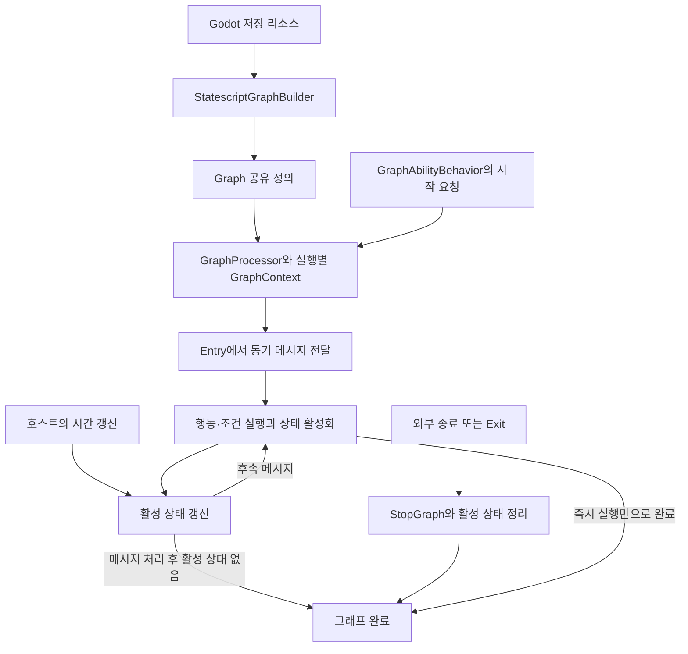

# Forge Statescript 설계 참고와 적용 기준

2026-10-21 사용자 합의: **Forge Statescript를 스킬 노드 그래프의 설계 참고 프로젝트로 삼고,
우리에게 필요한 수명·상태·취소 처리 원리와 검증 사례를 가져온다.**

참고의 중심은 엔진 독립적인 Forge 본체이며, Godot 통합판의 편집기와 샘플은 작성 사례로 활용한다.
우리 게임의 판정은 현행 콘텐츠와 [공통 스킬 그래프 계약](common-skill-graph-contract.md)을 따른다.
라이브러리 도입이나 C# 코드 이식, Godot 전환을 결정한 것은 아니다.
기존 **그래프 → Core 의미 검증·컴파일 → IR → RON → 로드·실행** 목표를 유지한다.
이 문서의 채택은 설계 기준 확정이며 해당 기능의 구현 완료를 뜻하지 않는다.

## 처음 작업하는 사람과 AI의 읽기 순서

참고 사본을 둔 목적은 반복되는 웹 탐색을 줄이고 같은 소스 버전에서 설계를 비교하는 것이다.
우리 게임의 스킬을 완전히 표현하는 데 필요한 원리를 가져오되, 전체 Forge 분석을 선행 작업으로 만들지 않는다.

1. [프로젝트 목적](project-purpose.md)과 [작업 파이프라인](skill-authoring-pipeline.tmp.md)에서
   현재 범위·완료 상태·다음 작업을 확인한다. 이 문서에 단계 상태를 별도로 복제하지 않는다.
2. 아래 실행 구조 안내와 채택 원리·차이를 읽어 공통 흐름을 파악한다.
   로컬 사본의 `git rev-parse HEAD`를 고정 커밋 표와 대조한다. 사본이 없으면 복구 절차를 따른다.
3. 현재 파편의 게임 규칙과 기존 그래프·노드 계약을 먼저 확인하고, 필요한 동작에 해당하는 Forge 파일과
   테스트만 찾아 읽는다. 아직 관계없는 노드·Godot 편집기·물리·연출 모듈까지 전수 조사하지 않는다.
4. 참고한 동작을 우리 타입·출처·수명·실패 계약과 대조한다. 채택한 원리, 다르게 구현할 이유,
   기대 결과와 근거 파일을 이 문서의 관련 항목에 추가한다. 확정된 공통 의미는 공통 그래프 계약에 반영한다.
5. 구현·검증 결과와 다음 작업은 기존 파이프라인에 남긴다. 읽은 코드의 설명이나 Forge 테스트의 존재를
   우리 구현·검증 완료로 기록하지 않는다.

이미 확인한 구조는 관련 소스나 전제가 바뀔 때 갱신한다. Forge 설명서 전체를 번역하거나
파일마다 요약 문서를 만드는 대신, 이 안내에서 필요한 근거 코드로 이동할 수 있게 유지한다.

## 검토한 소스 기준

후속 작업은 아래 버전의 관련 코드와 테스트부터 확인한다. 새 버전을 참고하면 변경된 의미를
대조하고 이 기준을 갱신한다. `main`의 이후 변경을 이미 합의한 계약으로 자동 수용하지 않는다.

| 프로젝트                                                                                                         | 검토한 커밋                                | 용도                                             |
| ---------------------------------------------------------------------------------------------------------------- | ------------------------------------------ | ------------------------------------------------ |
| [Forge](https://github.com/gamesmiths-guild/forge/tree/8a5447ea298ffdd74bec97df910675e1b350f041)                 | `8a5447ea298ffdd74bec97df910675e1b350f041` | 실행기, 상태, 효과 소유권, 종료와 재실행, 테스트 |
| [Forge for Godot](https://github.com/gamesmiths-guild/forge-godot/tree/56c55837919b852d502254569978fa0f01664ab6) | `56c55837919b852d502254569978fa0f01664ab6` | 그래프 작성, 저장 리소스와 로더, 보호막 샘플     |

두 커밋의 날짜는 2026-10-18이며 검토·채택일과 구분한다. 문서·소스·테스트 코드를 읽은 결과를
근거로 삼으며, Forge 샘플 실행·테스트 통과·성능은 이번 검토의 확인 범위에 포함하지 않는다.

## 로컬 참고 사본

2026-10-21부터 저장소 루트의 `references/` 아래에 검토 버전의 독립 Git 사본을 보관한다.
평소에는 아래 로컬 소스와 테스트를 먼저 읽고 검색한다. 위 고정 커밋 링크는 출처 확인과 사본 복구에 사용한다.

| 사본 위치                 | 바로 읽을 자료                                                                                                                                                                                                                                                                                                       |
| ------------------------- | -------------------------------------------------------------------------------------------------------------------------------------------------------------------------------------------------------------------------------------------------------------------------------------------------------------------- |
| `references/forge/`       | [Statescript 설명](../../references/forge/docs/statescript/README.md), [실행기](../../references/forge/Forge/Statescript/GraphProcessor.cs), [효과 노드](../../references/forge/Forge/Statescript/Nodes/State/EffectNode.cs), [실행기 테스트](../../references/forge/Forge.Tests/Statescript/GraphProcessorTests.cs) |
| `references/forge-godot/` | [수명 연결 설명](../../references/forge-godot/docs/statescript/subgraphs.md), [그래프 로더](../../references/forge-godot/addons/forge/core/StatescriptGraphBuilder.cs), [보호막 샘플](../../references/forge-godot/forge_samples/demos/03_statescript/graphs/shield.tres)                                            |

두 사본은 위 커밋에 detached HEAD로 고정하고 `origin`은 각 공식 GitHub 저장소를 가리킨다.
임시 검토 폴더에 의존하지 않으며 Git 메타데이터와 라이선스를 함께 보존한다.
루트 `.gitignore`에서 두 사본을 제외하므로 다른 환경에서 우리 저장소를 받았을 때는 별도로 복구해야 한다.
참고 소스는 제품 빌드·의존성에 포함하지 않는다.

사본이 없는 환경에서는 저장소 루트에서 다음 명령으로 복구한다. 기존 폴더가 있으면 먼저 상태와
커밋을 확인하고 덮어쓰지 않는다.

```sh
git clone https://github.com/gamesmiths-guild/forge.git references/forge
git -C references/forge checkout --detach 8a5447ea298ffdd74bec97df910675e1b350f041
git clone https://github.com/gamesmiths-guild/forge-godot.git references/forge-godot
git -C references/forge-godot checkout --detach 56c55837919b852d502254569978fa0f01664ab6
```

갱신할 때는 `git fetch origin`으로 후보를 받은 뒤 현재 고정 커밋과 변경 내용을 비교한다.
검토한 새 버전을 채택할 때 사본의 체크아웃, 위 커밋 표·출처 링크·복구 명령, 영향받는 적용 기준을 함께 갱신한다.
일상적인 참고 작업에서 자동 `pull`이나 최신 버전 체크아웃으로 검토 기준을 바꾸지 않는다.

## Statescript 실행 구조 안내

아래는 고정 버전의 Statescript를 읽기 위한 구조 지도다. 우리 Core의 확정 클래스 구조나
전체 Forge 기능 목록을 뜻하지 않는다. 먼저 실행 흐름을 보고 필요한 책임의 소스로 이동한다.



Godot 리소스 변환은 그래프를 만드는 한 경로이며 Forge 본체에서는 코드로 `Graph`를 구성할 수도 있다.
`GraphAbilityBehavior`는 능력 시작·갱신·종료를 실행기에 연결하고, 그래프 완료 시 해당 능력의 종료를 요청한다.
즉시 메시지는 연결을 따라 동기적으로 깊이 우선 전달된다. 지속 상태는 활성 집합에 남아 호스트의 갱신을 받는다.
완료 판정은 메시지 전달 도중 잠시 활성 상태가 없어진 순간이 아니라 관련 처리가 끝난 경계에서 수행한다.

| 확인할 책임               | 먼저 읽을 로컬 파일                                                                                                                                                                                                 | 읽을 때 확인할 점                                                             |
| ------------------------- | ------------------------------------------------------------------------------------------------------------------------------------------------------------------------------------------------------------------- | ----------------------------------------------------------------------------- |
| 그래프 정의               | [Graph.cs](../../references/forge/Forge/Statescript/Graph.cs)                                                                                                                                                       | 노드·연결·변수 정의, 연결 검증과 실행 상태의 분리                             |
| 능력과 그래프 연결        | [GraphAbilityBehavior.cs](../../references/forge/Forge/Statescript/GraphAbilityBehavior.cs)                                                                                                                         | 시작·갱신·종료 전달, 완료 콜백과 재시작 지연                                  |
| 실행과 시간 진행          | [GraphProcessor.cs](../../references/forge/Forge/Statescript/GraphProcessor.cs)                                                                                                                                     | 시작, 활성 상태 갱신, 자연 완료와 강제 정리                                   |
| 실행별 데이터             | [GraphContext.cs](../../references/forge/Forge/Statescript/GraphContext.cs), [GraphVariableDefinitions.cs](../../references/forge/Forge/Statescript/GraphVariableDefinitions.cs)                                    | 실행 변수·개체 공유 변수·노드별 상태·실행 세대, 필요한 시점에 계산하는 입력값 |
| 즉시 행동과 분기          | [ActionNode.cs](../../references/forge/Forge/Statescript/Nodes/ActionNode.cs), [ConditionNode.cs](../../references/forge/Forge/Statescript/Nodes/ConditionNode.cs)                                                  | 메시지를 받아 실행·분기하고 이후 전달하는 경계                                |
| 지속 상태의 수명          | [StateNode.cs](../../references/forge/Forge/Statescript/Nodes/StateNode.cs), [StateNodeContext.cs](../../references/forge/Forge/Statescript/Nodes/StateNodeContext.cs)                                              | 활성·비활성, 재입력, 중단, 정리 중 재진입                                     |
| 전달과 종속 수명          | [OutputPort.cs](../../references/forge/Forge/Statescript/Ports/OutputPort.cs), [SubgraphPort.cs](../../references/forge/Forge/Statescript/Ports/SubgraphPort.cs)                                                    | 동기 전달, 실행 세대 확인, 종속 상태 정리 신호                                |
| 구체적인 효과 관리        | [EffectNode.cs](../../references/forge/Forge/Statescript/Nodes/State/EffectNode.cs), [EffectNodeContext.cs](../../references/forge/Forge/Statescript/Nodes/State/EffectNodeContext.cs)                              | 적용한 핸들 보관, 자연 종료와 강제 제거의 차이                                |
| 작성 데이터와 실행 그래프 | [StatescriptGraph.cs](../../references/forge-godot/addons/forge/resources/statescript/StatescriptGraph.cs), [StatescriptGraphBuilder.cs](../../references/forge-godot/addons/forge/core/StatescriptGraphBuilder.cs) | Godot 저장 형식과 C# 객체 구성의 경계, 우리 컴파일 방식과의 차이              |

예를 들어 수명 종료·취소를 다룰 때는 `StateNode`·`SubgraphPort`·`EffectNode`와
[효과 정리 테스트](../../references/forge/Forge.Tests/Statescript/Nodes/State/EffectNodeTests.cs)를 함께 읽는다.
재입력을 다룰 때는 [재입력 테스트](../../references/forge/Forge.Tests/Statescript/Nodes/StateNodeRetriggerTests.cs),
실행 독립성과 완료 순서를 다룰 때는 [실행기 테스트](../../references/forge/Forge.Tests/Statescript/GraphProcessorTests.cs)를 확인한다.
화면·샘플이 필요할 때만 Godot 통합판으로 범위를 넓힌다.

소스 검색은 저장소 루트에서 예를 들어 다음처럼 범위를 지정한다.

```sh
rg -n "StopGraph|RunStamp|PendingStart" references/forge/Forge/Statescript
rg -n "retrigger|removes_active_effects" references/forge/Forge.Tests/Statescript
```

## 가져올 설계 원리

아래의 ‘적용 기준’은 우리 시스템의 설계 결정이다. Forge의 클래스·포트 이름과 구현 방식을
그대로 요구하지 않으며, 기존 노드·참조·계약에 같은 의미가 있으면 그 경로를 보완한다.

| 항목                       | Forge에서 확인한 방식                                                | 우리 적용 기준                                                                                                                    |
| -------------------------- | -------------------------------------------------------------------- | --------------------------------------------------------------------------------------------------------------------------------- |
| 정의와 실행 상태 분리      | 그래프 정의를 공유하고 `GraphContext`에 변수·노드 상태를 보관        | 스킬 정의와 이번 사용·활성·대상별 상태를 분리한다. 공유 정의에 경과 시간이나 효과 핸들을 기록하지 않는다.                         |
| 즉시 행동과 지속 상태 구분 | Action은 즉시 실행하고 State는 활성 기간 동안 갱신                   | 피해 적용, 채널링, 지속 효과, 사건 구독의 실행·완료·취소 의미를 구분한다.                                                         |
| 실행 연결과 수명 연결 구분 | Event 출력과 Subgraph 출력의 종료 전파 의미가 다름                   | 실행 순서 연결만으로 소유권을 추론하지 않는다. 소유자 참조와 종료 전파 범위를 그래프 계약·IR에 명시한다.                          |
| 적용한 효과의 식별         | `EffectNode`가 적용한 효과 핸들을 보관하고 종료 시 남은 효과를 제거  | 이번 활성의 효과·구독·타이머를 식별하고 자기 소유 범위만 정리한다. 중첩 효과의 기여분 제거는 우리 중첩 정책을 따른다.             |
| 종료 사유 구분             | 자연 효과 종료 이벤트와 강제 중단의 동작을 구분                      | 자연 만료·사용자 취소·강제 중단·실패를 구분한다. 공통 정리와 정상 완료 후속 효과를 같은 사건으로 취급하지 않는다.                 |
| 이전 실행과 재실행 격리    | 실행 세대 확인과 정리 완료 후 재시작으로 이전 메시지의 간섭 방지     | 오래된 콜백·핸들·타이머가 새 활성에 작용하지 않게 한다. 구체적인 ID·큐·세대 표현은 Core 설계에서 정한다.                          |
| 종료 중 안전한 정리        | 재진입을 막고 일부 정리에서 예외가 나도 다른 활성 상태의 종료를 시도 | 중복 종료는 추가 효과를 만들지 않아야 한다. 정리 실패가 다른 소유 자원의 누락이나 성공 보고로 이어지지 않도록 처리 계약을 정한다. |

근거: [Statescript 개요](https://github.com/gamesmiths-guild/forge/blob/8a5447ea298ffdd74bec97df910675e1b350f041/docs/statescript/README.md),
[수명 연결](https://github.com/gamesmiths-guild/forge-godot/blob/56c55837919b852d502254569978fa0f01664ab6/docs/statescript/subgraphs.md),
[효과 노드](https://github.com/gamesmiths-guild/forge/blob/8a5447ea298ffdd74bec97df910675e1b350f041/Forge/Statescript/Nodes/State/EffectNode.cs),
[실행기](https://github.com/gamesmiths-guild/forge/blob/8a5447ea298ffdd74bec97df910675e1b350f041/Forge/Statescript/GraphProcessor.cs).

## 우리 계약으로 보완할 부분

1. **컴파일 오류는 산출물 생성을 막는다.** Godot의
   [그래프 로더](https://github.com/gamesmiths-guild/forge-godot/blob/56c55837919b852d502254569978fa0f01664ab6/addons/forge/core/StatescriptGraphBuilder.cs)는
   리소스에서 C# 실행 그래프를 구성하며 일부 잘못된 연결을 경고 후 건너뛴다.
   우리는 미정 실행 값·잘못된 연결·미지원 동작을 원본 위치의 오류로 남기고 실행용 IR·RON 발행을 막는다.
   미완성 편집 원본의 저장은 계속 허용한다.
2. **대상별 상태는 명시적으로 분리한다.**
   [실행 상태](https://github.com/gamesmiths-guild/forge/blob/8a5447ea298ffdd74bec97df910675e1b350f041/Forge/Statescript/GraphContext.cs)는
   노드 ID별 상태를 보관하며, 활성 노드 재입력은 기본적으로 무시하거나 재시작한다.
   대상 목록을 순회했다는 이유로 대상마다 독립된 지속 상태가 생긴다고 가정하지 않는다.
   장판의 대상·입장 회차별 체류 시간, 재진입 초기화와 효과 출처를 우리 계약으로 표현한다.
3. **전투 시간과 같은 시점의 우선순위를 정의한다.**
   [Forge 타이머](https://github.com/gamesmiths-guild/forge/blob/8a5447ea298ffdd74bec97df910675e1b350f041/Forge/Statescript/Nodes/State/TimerNode.cs)는
   전달받은 경과 시간을 누적한다. 이 구현을 우리 시간 정밀도·Pause·만료 우선 규칙의 대체물로 삼지 않는다.
   시간 표현과 이벤트 처리 순서는 Core 계약에서 정하고 저장·재로드 후에도 보존한다.
4. **종료는 이미 확정된 결과의 일괄 취소가 아니다.**
   적용한 피해·지불한 비용과 종료 시 제거할 지속 상태를 구분한다.
   독립적으로 남아야 하는 효과를 시전자나 제어 상태의 종료에 잘못 종속시키지 않는다.
5. **Subgraph의 의미를 재사용 함수와 혼동하지 않는다.**
   검토한 Subgraph 출력은 종속 상태의 수명을 관리하는 연결이다.
   저장 가능한 공통 부분 그래프·매개변수화·호출별 상태 분리는 별도의 요구와 계약으로 검토한다.
   Forge의 반복·연결 규칙도 우리 반복·분기·합류 계약을 대체하지 않는다.

파고드는 천국은 [기존 P1 계약](common-skill-graph-contract.md#집중종속-장판체류-둔화--p1-2026-10-21)을 대조 사례로 쓴다.
집중은 장판의 수명을 소유하고, 대상의 입장 상태는 체류 진행과 진입 효과를 관리한다.
이미 부여한 기절은 강제 이탈 후에도 해당 장판 종료까지 유지하므로 입장 상태와 수명을 분리한다.
이는 기존 게임 동작의 소유권 표현이며 Forge를 이유로 파편 판정을 변경하는 것이 아니다.

웃는 시체의 산 P2에서는 `EffectNode`의 효과 핸들 보관·종료 정리와 `EffectNodeTests`의
강제 종료 시 효과 제거·자연 완료 사건 미발생 사례를 대조했다. 채택한 원리는 활성의 효과 소유권이다.
우리 [대상 상태 계약](common-skill-graph-contract.md#일회-대상-조회시간제-대상-상태--p2-2026-10-21)은
조회 후 대상별 활성을 따로 만들며 도발·속도·공격 제한을 함께 정리한다. 일회 조회의 사용 완료와
대상 상태의 수명은 분리한다. `target-ended`는 모든 종료 사유의 정리 후 사건이며 Forge의 자연 완료 출력과 다르다.
검증은 [대상 상태 모델 검사](../tests/model/target.spec.ts)의 참조·흐름 진단과 저장 왕복에 한정한다.
실제 여러 적·출처의 효과 정리와 오래된 콜백 격리는 P8에서 실행으로 확인한다. 외부 소스 코드를 제품에 복사하지 않았다.

P3에서는 고정 사본의 `LoopTimerNode.cs`·`LoopTimerNodeTests.cs`와 앞서 확인한 `EffectNode.cs`의
자연 완료/강제 정리 구분을 대조했다. 한 실행의 타이머 문맥, 재시작 시 누적 초기화,
중단된 이전 실행의 나머지 콜백을 버리는 원리를 사본 자원과 단계 집중 계약에 반영한다.
Forge의 동적 주기 재조회, 0 이하 주기에서 정지, 마지막 주기 뒤 완료 발행은 그대로 가져오지 않는다.
우리 작성 주기는 양수이며 장판 종료와 같은 시각의 판정은 제외한다. 여왕의 즉시 첫 판정,
음양의 한 주기 뒤 첫 판정은 원문 정책이다. 실제 HP 결과 집계·자원 예약 우선순위·두 영역 예산은
우리 [P3 계약](common-skill-graph-contract.md#실제-결과사본-자원단계-집중두-영역--p3-2026-10-22)에 명시했다.
`tests/model/p3.spec.ts`는 잘못된 완료·출처·주기 연결과 편집/저장을 검사한다.
Forge 실행 테스트를 우리 런타임 검증으로 세지 않으며 타이머·HP 변화·중복 콜백 실증은 P8에 남긴다.

P4는 같은 고정 버전의 `StateNode.cs`와 재진입 테스트를 대조했다. 실행 중 재진입의 무시/재시작과
종속 Subgraph 정리 원리를 관계 회차·행동 실행·준비 입력에 적용한다. 우리 전투 원장·보호막 사용 기록은
활성 재시작으로 지우지 않으며 두건 확정은 준비 트리 종료와 별도의 원자적 지불/방출 경계다.
탐욕의 순차 사출도 타이머 재시작으로 대체하지 않고 실제 탄환 정산을 기다린다.
[P4 계약](common-skill-graph-contract.md#관계행동-계획입력-확정전투-원장--p4-2026-10-22)과
[작성 모델 검사](../tests/model/p4.spec.ts)에 참조·종료·중복 사례를 남겼다. Forge 테스트를 이번에 실행하지 않았으며,
모델 검사를 전투 수명 실증으로 세지 않는다. 외부 코드를 제품에 복사하지 않았다.

## 단계별 반영과 검증

작업 순서와 상태는 [스킬 조립기 파이프라인](skill-authoring-pipeline.tmp.md)에서 관리한다.
별도 구현 트랙이나 단계별 승인 절차를 추가하지 않는다.

| 적용 시점            | 반영할 내용                                                               | 확인할 결과                                                   |
| -------------------- | ------------------------------------------------------------------------- | ------------------------------------------------------------- |
| 현재 작성 단계 P1~P6 | 필요한 노드에서 소유자·활성·대상별 수명, 종료 사유와 독립 잔류를 명시     | 잘못된 참조·수명 연결을 진단하고 편집·저장 왕복에서 의미 보존 |
| P7 Core 계약·컴파일  | 실행별 상태 모델, 수명 소유권, 종료 전파, 시간·동시 사건 규칙을 IR에 반영 | 원본 위치를 가리키는 컴파일 진단, 오류 시 산출물 미발행       |
| P8 실행 연결·검증    | 실제 효과·구독·타이머 정리와 이전 실행 격리 검증                          | IR·RON 재로드·실제 실행에서 같은 결과                         |

향후 관련 구현의 검증에서는 다음 관측 결과를 사용한다. Forge 테스트를 그대로 복제하거나
테스트 파일의 존재를 우리 기능의 통과 근거로 삼지 않는다.

- 같은 스킬을 두 주체가 실행해도 변수·타이머·효과가 섞이지 않는다.
- 서로 다른 적의 입장·이탈·재진입이 다른 적의 체류 진행도를 바꾸지 않는다.
- 부모 상태를 종료하면 종속 효과·구독·타이머가 정리되며 독립 잔류 효과는 유지된다.
- 취소 시 자연 완료 전용 효과가 발생하지 않고, 중복 종료도 효과·환불·완료 사건을 중복 발생시키지 않는다.
- 취소 직후 재사용해도 이전 실행의 정리·콜백이 새 활성에 영향을 주지 않는다.
- 같은 시점의 만료·입력·주기 사건은 합의한 우선순위를 따르고 Pause 동안 진행하지 않는다.
- 잘못된 연결과 미정 실행 값은 편집 원본에 보존되지만 실행 산출물로 발행되지 않는다.

참고 테스트: [실행과 종료](https://github.com/gamesmiths-guild/forge/blob/8a5447ea298ffdd74bec97df910675e1b350f041/Forge.Tests/Statescript/GraphProcessorTests.cs),
[효과 정리](https://github.com/gamesmiths-guild/forge/blob/8a5447ea298ffdd74bec97df910675e1b350f041/Forge.Tests/Statescript/Nodes/State/EffectNodeTests.cs),
[활성 상태 재입력](https://github.com/gamesmiths-guild/forge/blob/8a5447ea298ffdd74bec97df910675e1b350f041/Forge.Tests/Statescript/Nodes/StateNodeRetriggerTests.cs).

## 소스 활용

검토 버전의 [Forge 라이선스](https://github.com/gamesmiths-guild/forge/blob/8a5447ea298ffdd74bec97df910675e1b350f041/LICENSE)와
[Godot 통합판 라이선스](https://github.com/gamesmiths-guild/forge-godot/blob/56c55837919b852d502254569978fa0f01664ab6/LICENSE)는 MIT다.
실제 코드·리소스를 가져올 때는 해당 출처·버전·필요 고지를 함께 관리하고 포함된 제삼자 파일의 조건도 확인한다.
현재 채택 범위는 설계 원리와 검증 사례다. 외부 소스는 로컬 참고 사본으로 보관하며 제품 코드나 빌드 의존성에 편입하지 않았다.

## P5 표식 구독과 작성 가독성 대조 — 2026-10-22

고정 사본의 `EffectNode.OnActivate/OnRestart/OnDeactivate`와 `EventListenerNode.OnActivate/OnDeactivate`를
읽었다. 효과 핸들을 소유한 상태가 정리하고, 재시작 때 이전 핸들을 먼저 분리·제거하며, 활성 중에만 사건을
구독하는 원리를 채택한다. 우리 감염은 파편 사본, 나비 스택은 무기 사본의 수명을 따르므로 같은 그래프 활성
하나에 전부 묶지 않는다. 사망 이전·치명타격 우선순위·기폭의 재전파 금지는 우리 콘텐츠의 명시 계약이며,
Forge의 동기 이벤트를 그대로 연결해 같은 트랜잭션에서 새 숙주가 재전파하도록 만들지 않는다.
현재 모델 검사는 저장소 출처 불일치·중복 구독·잘못된 소비 경계를 검증하며 실제 전투 수명 검사는 P8에서 수행한다.

Godot 보호막 예제 화면과 `variables.md`의 입력 property/resolver·고정 threshold 원칙을 기사 그래프와 대조했다.
우리 초기 문제는 생성 순서 격자와 모든 입력의 별도 노드가 합쳐져 시작·비용·효과 사이를 추적하기 어렵다는 점이다.
명시적 연결 방향 정렬, 실행 연결 집중 표시, 입력 옆 출처·고정값 표시와 직접 수정, 읽기 배율의 노드 이동을 추가했다.
이 단계는 실제 값 노드와 연결을 보존한다. 별도 값 노드 제거와 직접값/참조 전환은 아직 구현하지 않았으며 P6에서
검증·공유 의미를 유지하는 방식을 다룬다. 작은 창의 긴 노드 하단과 많은 미사용 선택 입력도 남은 개선 대상이다.
Forge UI를 실행했다고 주장하지 않으며, 사본의 문서·샘플 PNG·관련 편집 구현을 비교 근거로 사용했다.

## P6 입력 고정값 표시 대조 — 2026-10-22

고정 사본 `variables.md`의 입력 property와 상수 resolver 원리, `StatescriptGraphNode.cs`의
`AddInputPropertyRow` 및 `ApplyInputPropertyConfigInternal` 경계를 다시 대조했다. Forge는 입력별
상수/해석기 설정을 편집 이력과 함께 바꾼다. 우리 저장 형식은 입력 리터럴 union을 갖지 않고 typed edge로
생산자를 참조하므로 이를 일반 `values` 필드처럼 바꾸면 원본 참조와 단위 진단을 잃는다.
이 단계에서는 단독 상수를 입력 옆으로 접는 표시와 원본 값 편집을 선택했다. 공유·변경 대상은 계속 보이고,
복제에는 접은 값도 포함한다. 탐욕의 왕에서 두 시간 카드와 두 선을 접은 전후를 같은 위치·배율에서 확인했다.
표시의 복잡성은 줄지만 빈 공간 압축과 저장 형식의 직접값/참조 전환은 구현한 것으로 보고하지 않는다.

### 다음 기본 공격 준비와 방출 결과 — 2026-10-22

고정 사본의 `EffectNode.OnRestart`는 기존 적용 핸들을 먼저 분리·제거한 뒤 새 효과를 적용한다.
`subgraphs.md`의 Subgraph/Event 포트 구분처럼 적용 동작과 독립 결과의 수명을 구분하는 원리를 재사용했다.
우리 `PreparedBasic`은 동작 종료 뒤 남는 준비를 별도 기록으로 소유하고, 실제 기본 공격 시작에서 결속하며
release에서 소비한다. 취소 시 복원과 같은 출처 재부여의 교체는 Core의 행동/사본 정체성으로 판단한다.
이미 결속한 공격을 재시전 때문에 교체하지 않는 정책, 준비의 무기 피해 출처, 공격당 한 번의 처치 보상은
우리 파편 계약이며 Forge의 효과 갱신 동작을 그대로 적용한 것이 아니다. 실제 검증 결과는 파이프라인에 기록한다.

### 패링의 선점·종료와 상시 구독 — 2026-10-22

고정 사본의 `TimerNode.OnUpdate`는 자연 만료에 `OnTimerEnd`를 발생시키고,
`EventListenerNode`는 활성 기간에만 구독하며 `deactivateOnEvent`로 첫 사건 후 종료할 수 있다.
이 상태별 종료 원리는 재사용하되, 패링은 사후 event listener만으로 구현하지 않는다.
Core 피해 확정 전 선점 지점에서 성공을 확정하고 실패 예약을 제거한 뒤 실제 면역 종료를 예약한다.
상시 감면·반사는 장착 파편 사본에서 파생하며 패링 창·빈틈의 유한 수명과 구분한다.
새 컴파일 경로는 성공/실패의 실제 종료에 사용 의무를 해제한다. 기존 native Parry의
유한 감면 전체 지속 계약은 별도 설정으로 보존한다. 두 사본의 HEAD는 기존 기준과 같다.

### 범위 지원의 소속 변화와 단일 연결 — 2026-10-22

고정 사본의 `Nodes/State/ConditionMonitorNode.cs`와 `ConditionMonitorNodeContext.cs`를 확인했다.
조건이 달라질 때 이전 subgraph를 비활성화한 후 새 쪽을 켜고, 이전 쪽 정리가 노드를 끝냈으면 전환을 멈춘다.
이 소속 변화와 종료의 원리를 Core의 기존 sustained 재조정에 적용했다. 기본 오라는 범위 이탈 시 해당 기여를 제거하고,
단일 집중 연결은 authored 선택 범위 이탈·대상 무효화 때 전체 집중과 사용 의무를 같은 전이에서 종료한다.
Core는 authoritative 전투 사건과 트랜잭션으로 처리하며 Forge의 프레임 polling이나 bool을 장착 판정으로 복사하지 않는다.
장착 전환은 실제 유물 inventory와 기존 effective plan/recipe 실행 경로에 연결한다. 두 고정 사본의 HEAD는 기존 기준과 같다.

### 독립 장판의 유한 주기 — 2026-10-22

`Forge/Statescript/Nodes/State/LoopTimerNode.cs`와 `LoopTimerNodeContext.cs`를 확인했다.
활성 인스턴스마다 시간·횟수를 소유하고, 사건 처리 중 종료되면 남은 반복을 버리는 원리를 채택한다.
Forge의 갱신 간격 누적·동적 주기 재조회는 그대로 옮기지 않는다. Core는 접수된 유한 밀리초 일정과
독립 전달 소유권을 사용한다. 그래프의 즉시/한 주기 뒤 정책을 보존하고 생성 시각 기준의 반열린
수명 `t < E`로 예약한다. 주기가 수명보다 길어도 발동 없이 정리하며, 종료·취소 실패는 기존 전투
트랜잭션에서 상태·큐·결과와 함께 복구한다. 상태 종료 때 마지막 반복을 내는 Forge의 loop-count
완료 방식과 달리, 이 장판 계약은 종료 시각에 피해/회복을 발생시키지 않는다.

### 독립 장판의 진입 회차와 상태 기여분 — 2026-10-22

`ConditionMonitorNode`의 활성 시 첫 평가를 전이로 다루는 규칙과 이전 상태 정리 뒤 전환하는 흐름을 다시 확인했다.
Core 장판은 생성 순간의 대상도 새 진입으로 만들며, 이탈로 닫힌 관계의 체류 시간을 재진입에 넘기지 않는다.
Forge의 프레임별 조건 갱신을 복제하지 않고 전투 사건의 authoritative 위치와 유한 체류 경계 예약을 사용한다.
장판 종료는 관계 이탈 사건으로 대체하지 않는다. 기여분은 장판·대상·정의별로 소유하고 서로 다른 장판의 수명을
한 상태 이름으로 합치지 않는다. 둔화·받는 피해 증가·기절의 결합은 기존 Core 스탯·피해·제어 경로를 따른다.
[실제 예제의 실행·복구·화면 검증](../artifacts/p8-ground-status-20261022/verification.json)에 적용 범위와 근거를 남겼다.

### 유한 타격의 방출과 독립 상태 — 2026-10-22

고정 사본 `EffectNode.OnDeactivate/OnRestart`의 소유 핸들 정리와 재적용 전 분리를 다시 확인했다.
같은 기절 이름을 전투 전체 수명 하나로 합치지 않고 적용 기록별로 정리하는 원리를 채택했다.
Core의 타격 Flow는 Released를 다음 동작 경계로 사용하고, 부착한 상태는 별도 유한 sustained 기록이 소유한다.
따라서 Flow 종료나 시전자 철수가 이미 부착한 기절·약화를 조기 제거하지 않는다. 반열린 만료·가장 강한 동일 정의
선택·기절 성공 뒤 약화·외부 취소 보호는 우리 콘텐츠 규칙이며 Forge 노드의 활성 기간을 그대로 복사하지 않는다.
기절 부착이 다른 행동을 취소하다 실패하는 경우는 상태·큐·사용 의무를 기존 전투 트랜잭션으로 함께 복구한다.
[범위 타격 실행 근거](../artifacts/p8-strike-20261022/verification.json)에 경계와 실제 검사를 남긴다.

### 일회 도발·무기 성장 실행 연결 비교 — 2026-10-22

고정 사본 `EffectNode.OnActivate/OnRestart/OnDeactivate`와 적용 핸들 목록을 다시 대조했다.
기존 핸들을 비운 뒤 제거하여 새 적용을 함께 지우지 않는 원리를, 나중 도발의 묶음 교체와
이전 도발 비복원에 적용한다. Forge의 노드 활성 수명과 달리 우리 일회 범위 조회는 빈 집합도
완료하며 사용 잠금을 풀고, 대상별 도발 상태만 별도 수명을 유지한다. 실제 이동 접촉의 저지 금지,
공격 시작·방출 연속 거리, 장비 사본의 Run 성장과 저장 복원은 게임 원문에 따른 별도 실행 계약이다.
무기 성장 상태를 도발 활성에 넣지 않고 기존 장비 소유 Run 자원에 연결하여 사용 종료로 지우지 않는다.

### 집중의 종속 장판 정리와 점진 상태 — 2026-10-22

고정 사본의 `SubgraphPort.EmitDisableSubgraphMessage`와
`Effect_node_does_not_emit_OnComplete_when_deactivated_by_parent_subgraph` 검사를 대조했다.
부모 종료가 소유 효과를 정리하고, 강제 정리를 효과의 자연 완료로 재해석하지 않는 원리를 적용한다.
우리 집중은 기존 area ID·출처·관계 회차로 종속 상태를 소유하며 직접 취소와 시전자 이탈에 자기 범위만 정리한다.
Forge의 호스트 갱신 루프 대신 실제 전투 시간의 다음 정수 둔화 경계·체류 도달·만료 사건을 예약한다.
정리 중 실패는 기존 전투 트랜잭션의 상태·큐·사실 복구로 처리하며, 종료한 회차의 예약이 재시전한 집중을
변경하지 않는지 실제 그래프 전투 검사로 확인한다. Forge 테스트를 실행한 결과로 대체하지 않는다.

## 출처별 감염망과 즉시 기폭 적용 — 2026-10-22

고정 사본 [GraphProcessor.UpdateGraph/BufferActiveNodes](../../references/forge/Forge/Statescript/GraphProcessor.cs)의
활성 집합 복사·RunStamp 검사와 [UpdateReentrancyTests](../../references/forge/Forge.Tests/Statescript/UpdateReentrancyTests.cs)를 대조했다.
현재 순회의 후보를 먼저 고정하고, 새 실행 세대가 이전 순회의 남은 작업을 받지 않는 원리를 채택했다.
Core에서는 전파 후보와 승인 시 숙주·중심·위력을 고정하며, 숙주별 세대가 지난 주기 예약을 거절한다.

차이는 시간과 실패 처리다. Forge의 호스트 delta 갱신 대신 정수 밀리초의 유리수 위력 적분과
숙주별 절대 시각 예약을 사용한다. 감염 위력의 성장과 주기 피해는 서로 다른 시계다.
게임 규칙에 따라 파편 사본별 망을 분리하고, 피격/사망 전파와 소비 기폭의 사망 전파 억제를 구분한다.
후보 고정만으로 원자성을 주장하지 않으며, Core의 기존 전투 트랜잭션으로 위력·숙주·예약·공명·피해를 함께 복구한다.

검증은 `presence_runtime_same_process_clone_and_failed_transaction_preserve_hosts_power_and_deadlines`,
`presence_runtime_consumed_generation_cannot_damage_a_rebuilt_network`,
`presence_runtime_unrepresentable_burst_rolls_back_cost_consumption_and_queue`와
즉시 종료 전 침식 시작 판정을 확인하는 회귀 검사로 수행했다. Forge 테스트 자체를 실행한 결과는 아니다.

## 무기 사본 스택·독립 폭발과 구체 작성 화면 — 2026-10-22

감염망에서 대조한 후보 스냅샷·실행 세대 원리를 타일 폭발에도 적용했다. 접수 스냅샷과 방출된 전달의
수명을 나누고, 다음 차례의 대상만 실행 시점에 조회한다. Forge의 호스트 갱신 대신 Core의 절대 전투 시각
예약과 유한 전달 티켓을 사용한다. 구체의 호스트 시간 정지는 해당 방출만 소유하며, 만료 시 피해와 해제를
한 거래에서 처리한다. 취소 주입·시전자 이탈·전투 종료·동일 프로세스 복제로 검증했다.

구체 화면에서 새 장착 조건 카드가 연출 시간 카드와 겹치는 문제를 직접 확인했다. 원인은 기존 배치에
새 노드를 임의 좌표로 추가한 것이다. 고정 Godot 사본의
[OnBeginNodeMove/OnEndNodeMove](../../references/forge-godot/addons/forge/editor/statescript/StatescriptGraphEditorDock.GraphOperations.cs)와
[ApplyLayoutConfigCore 및 되돌리기](../../references/forge-godot/addons/forge/editor/statescript/StatescriptGraphNode.cs)를 다시 대조했다.
배치만 바꿀 때는 노드 ID·연결·설정값을 유지한다는 기존 편집 원칙을 적용해 조건·연출 시간·범위 카드의
간격을 정리했다. 신규 예제 생성은 모든 노드를 만든 뒤 기존 `placeExample` 배치를 거친다.

검증은 같은 구체 그래프에서 장착 조건 참조를 따라가고 임계치 6→9 편집, 실행 취소, 저장·재열기,
Core 컴파일을 반복한다. 카드 쌍의 실제 DOM 겹침 검사와 960×640/1280×800/1920×1080 밝고 어두운
화면의 직접 관찰을 함께 사용한다. 긴 설명은 실제 장착 조건·전량 소비·단일 대체·위력 공식·정지 시간을
남겨 줄이고, 종료와 실패 처리의 자세한 계약은 원문과 공통 계약에 유지한다.

### 사본 자원·단계 집중 연결에서 재확인한 종료 순서 — 2026-10-22

고정 사본 `Forge/Statescript/GraphProcessor.cs`의 `StopGraph`(167행 이후)와
`FinalizeGraph`(242행 이후), `StateNodeRetriggerTests.cs`의 재시작/같은 갱신 회차 검사를 읽었다.
Forge는 종료 시작에 실행 표식을 바꾸고 하위 상태를 정리한 뒤 완료 알림과 대기한 재시작을 처리한다.
자연 종료와 강제 중지는 별도 경로이며 재시작한 타이머에 이전 갱신의 경과 시간을 소급하지 않는다.

우리 사본 카운터의 자동 집중은 이 정리 순서를 참고한다. 기존 집중·종속 예약을 닫고 자연 완료일 때만
실제 피해/회복 보상을 한 번 확정한 뒤 상한 자동 요청을 검사한다. 새 주기는 복귀 시점부터 시작하고
오래된 예약은 새 회차에 적용하지 않는다. Forge의 예외 이후 계속 정리하는 방식과 달리 우리 전투는
기존 원자 이벤트 경계에서 상태·사실·예약을 함께 복구한다. 자동 집중의 수동 취소 금지와 침묵의
새 시작 거부/진행 유지 차이는 우리 파편·공통 계약에서 정하며 Forge 완료 콜백으로 대신하지 않는다.

### 단계 집중 화면의 값과 제목 중복 — 2026-10-22

실제 여왕 그래프에서 하트 주기를 15→12초로 편집하자 설정값은 바뀌지만 제목의 `15초`는 남았다.
고정 Godot 사본 `StatescriptGraphNode.Bind`의 `Title = resource.Title`과
`StatescriptGraphNode.PropertyEditors.AddInputPropertyRow`의 별도 값 편집 구조를 대조했다.
제목은 작성자의 표현이고 수치의 원본은 입력값이라는 구분을 유지한다. 사용자 제목을 값 편집 때
자동으로 덮어쓰지 않고, 제공 예제의 주기 카드·연결 변경 카드·구간 제목에서 중복 수치만 제거했다.
노드 ID·수치·배치·연결을 보존하고 같은 편집·Undo·저장·재열기 과제를 다시 검사한다.
세 검증 그래프의 RON은 원본 문서 해시만 달라지며 실행 정의·의미 지문·출처 연결은 같다.

### P8 시간제 공격 교체와 수동 마무리 — 2026-10-22

이번 연결에서는 Forge의 `StateNode.cs`의 재입력 처리와
`StateNodeRetriggerTests.cs`의 기본 무시·명시적 재시작·자식 재입력 사례를 다시 대조했다.
Forge는 활성 상태의 재입력을 기본적으로 무시하거나 `RestartOnRetrigger`로 재시작하지만,
우리 그래프의 `lookup → permission → claim → capture-time → finish → area-damage`는
기존 타이머를 갱신하지 않는 한 번의 후속 사용이다. 이 차이를 일반 상태 재시작으로 축약하지 않는다.

Core의 출처가 같은 활성 조회와 트랜잭션을 재사용해 권리 확보·잔여 밀리초 캡처·출처별 교체 해제·
즉시 마무리를 묶었다. 활성 중 같은 일반 입력을 받을지는 공격 교체의 명시적 설정으로 기록한다.
자연 만료/이탈은 별도 정리이며 마무리를 실행하지 않는다. Forge의 종료 중 재진입 차단 원리는
권리를 소비한 활성의 중복 입력 거절과 실패 시 전체 복원으로 대조한다. 외부 구현을 제품에 복사하지 않았다.

### Hello 예제의 카드 겹침 교정 — 2026-10-22

실제 편집 화면에서 공명 조건 카드가 활성 조회 제목을 덮는 것을 확인했다. Forge Godot의
`StatescriptGraphNode.NodeSetup.cs`는 시작/실행/조건 포트를 나누고,
`StatescriptGraphNode.PropertyEditors.cs`는 입력 속성을 노드 내부의 접을 수 있는 행으로 구성한다.
이미 채택한 내부 값 편집·타입 연결 구분은 유지하고, Hello 생성기와 저장 예제의 초기 배치에 기존
의존성 배치 함수를 적용했다. 시작→재입력→만료 구간 순서와 카드 높이를 반영한다.
연결·값·ID를 지우거나 의미를 한 카드에 숨기지 않는다. 세 창 크기×두 테마의 같은 편집 과제에서
조회 제목·포트, 장착 조건 참조·관통 증가량을 다시 읽을 수 있음을 직접 확인했다.
Forge 편집기 코드를 비교한 것이며 Forge 앱 실행 검증을 주장하지 않는다.

### 관계 세대와 유한 행동 계획 — 2026-10-22

고정 사본의 `RepeatNode.cs`, `LoopTimerNode.cs`와 각각의 실행 테스트를 대조했다.
Forge의 반복은 매 차례 개수를 다시 읽고 첫 반복을 즉시 처리할 수 있으며, 반복 타이머는 마지막
주기 후 완료를 통지한다. 중간 콜백이 그래프를 멈추면 같은 갱신에 남은 반복도 중지한다.

우리 관계·행동 계획은 중간 종료 뒤 후속 작업을 버리는 원리를 사용하되, 첫 실제 공격의 검 수와
단계 소비 영수증으로 횟수를 고정한다. 타수 증가를 같은 총시간의 개별 타격으로 배분하고,
명시된 간격 반복은 첫 지연 여부를 보존한다. 유한 유지 공격은 만료와 같은 시각의 공격·자기 피해를
제외한다. 가호 교체에는 별도 세대를 발급해 이전 타이머를 재사용하지 않는다.
Forge의 가변 개수·무제한 타이머 기본값을 우리 작성 값의 대체값으로 가져오지 않았다.
원자 복구, 사본별 전투 재고, 피해 출처와 공명 사용의 수명은 Core 계약으로 별도 검증한다.

기사 비용·자기 피해 편집에서 예제 제목의 고정 수치가 실제 값과 어긋나는 것을 화면으로 확인했다.
Godot 사본의 `StatescriptGraphNode.Initialize`는 저장 제목을 그대로 표시하고,
`UpdateInputPropertyFoldableTitle`은 입력 편집기의 현재 요약을 별도로 갱신한다.
우리도 제작자가 붙인 이름을 수치 변경 때 자동 덮어쓰지 않으며, 제공 예제의 해당 두 제목에서만
고정 수치를 빼고 현재 필드 값을 읽도록 수정했다. 동일 편집·복원 과제의 24개 최종 화면에서 확인했다.

### 일시정지 입력 계획과 방출 후 효과 — 2026-10-22

`EffectNode.cs`의 `OnActivate`는 효과 적용 중 그래프가 종료될 수 있음을 검사하고,
`OnRestart`는 보유 핸들을 먼저 비운 뒤 제거하여 재진입에 의한 중복 정리를 막는다.
이를 입력 계획의 준비·확정·유한 발사 수명과 대조했다. 우리 실행기는 준비 단계에서 피해를 실행하지 않고,
검증·공명/재고 비용·모든 발사와 성공 기억을 후보 트랜잭션으로 확정한다. 같은 시각의 시전 단계만
현재 시전 ID로 식별해 처리하며 다른 공격/충돌은 재개 후 처리한다. 재전송 영수증과 단절 후 정지 유지도
별도 소유 상태로 둔다. 이는 Forge의 재시작 정책을 그대로 적용한 것이 아니라 현재 게임의 원자적 입력 계약이다.

이미 방출한 탄환은 시전자 이탈에도 남는 유한 효과다. 피해 처리 중 임시로 작업 큐에서 꺼낸 탄환도
공명 사용의 효과 수명에서 사라지지 않도록 처리 중 출처를 유지한다. 적중 뒤 독립 상태와 유물 폭발은
자기 수명·출처로 남으며, 종료와 제거가 새 시전 권한을 생성하지 않는다. 관련 검증은 입력 계획의 실제
전투·취소 주입·재접속 사례에 기록하며 Forge 자체 실행을 검증했다고 표현하지 않는다.

### 순차 보구와 집중 종료 — 2026-10-22

고정 사본의 `GraphProcessor.StopGraph`, `StateNode` 재입력 계약과 `LoopTimerNodeContext`를
대조했다. 활성 회차의 정리와 새 회차의 실행을 분리하는 원리는 유지하며, 이전 회차의 예약이
다시 발사하거나 새 회차를 종료하지 않게 한다. 우리 보구 재입력은 현재 남은 발수를 고정하는
별도 명령이고 직접 중단은 미방출분을 폐기한다. 방출된 발사체는 독립 전달 수명을 유지한다.

Forge의 호스트 delta 누적 대신 Core의 정수 시각에서 생성·비용·붕괴를 처리한다. 다음 표적
선택은 앞 발의 피해·상태·사망·회수가 끝난 뒤로 예약한다. 최대 HP 직접 비용은 피해 파이프라인을
거치지 않으며 같은 시각의 치명 비용이 새 방출보다 우선한다. 런의 사본별 부채와 퇴각 복원은
우리 게임 계약으로 추가했고 Forge 그래프 상태의 수명으로 대신하지 않는다. 실제 검사는
작업 파이프라인의 `prepared_volley_` 항목에 기록하며 Forge 자체 실행을 검사한 것은 아니다.

### 긴 카드의 편집 행과 삽입 위치 — 2026-10-22

`StatescriptGraphNode.PropertyEditors.AddInputPropertyRow`의 `BuildColumnedFoldable`,
입력별 fold key와 `UpdateOutputVariableBadge`를 다시 읽었다. 입력의 접기/펼치기와
현재 값 표시를 분리하는 원리는 유지한다. 우리 선택 입력의 펼치기는 문서·실행 취소를
바꾸지 않으며 연결된 입력은 항상 표시한다. Forge에 포커스 자동 이동이 있다고 해석하지 않는다.

실제 탐욕 편집에서 긴 카드의 하단 행이 최소 창 밖에 남는 문제는, 값을 편집하는 버튼에
포커스가 오면 그 행을 캔버스 안으로 이동하는 것으로 고쳤다. 줌과 문서 좌표를 변경하지 않아
글자 크기와 작성 이력은 유지한다. 공통 값 예제는 카탈로그 카드 폭에 맞춘 열 간격을 사용한다.
자동 경유 삽입은 기존 카드를 덮지 않는 공간에 배치하고 한 번의 편집/되돌리기로 처리한다.
수동으로 지정한 삽입 좌표까지 자동 재배치하지 않는다. 새 선택 입력 연결선은 React Flow의
포트 측정 이후 표시하며 문서의 연결 확정은 원래 트랜잭션에 남긴다. 이는 우리 UI의 측정 순서
문제에 대한 교정이며 Forge 자원 바인딩을 복제한 실행 구조가 아니다.

개선 전후 실제 화면과 같은 사용자 과제의 결과는 작업 파이프라인의 탐욕 최종 검증에 기록했다.

### 두 설치 영역과 교집합의 소유권 대조 — 2026-10-22

`Forge/Statescript/Nodes/State/EffectNode.cs:78–135`를 실제로 읽었다. Forge는 활성화에서 적용된 효과 handle을 모으고, 적용 도중 노드가 비활성화되면 방금 얻은 handle도 제거한다. 비활성화는 그 노드가 보유한 효과만 제거하며, 재시작은 기존 handle 목록을 먼저 비운 뒤 제거·재적용해 새 기여분을 잘못 제거하지 않도록 한다.

우리의 `sustained/paired_areas.rs`는 같은 사본의 영역 쌍과 교집합 상태 activation을 함께 소유하고, 교체·이탈·종료 때 자기 activation만 해제한다. 설치 시전은 곧 끝나므로 Forge 노드 활성 수명을 그대로 가져오지 않고 독립 출처를 사용한다. 새 생성 실패의 복원은 기존 전투 트랜잭션이 담당하며, 여러 사본의 가장 강한 공격 속도 기여분은 기존 대상 상태 합성기가 선택한다. 공개 철수 호출 직후 정리 누락을 발견해 같은 철수 처리 안에서 쌍을 정리하도록 보완했다. 최종 실행·화면 검증 결과는 작업 파이프라인의 음·양 항목에 기록한다.

### 독립 이동 효과의 적용·출처 — 2026-10-22

`Forge/Statescript/Nodes/Action/ApplyEffectNode.cs:51–76`의 실제 코드를 읽었다. effect/target/context 입력을 해석해 적용하며, 적용 도중 그래프가 종료·재시작될 수 있어 기존 RunStamp일 때만 출력 handle을 쓴다. 우리도 작성 정의와 개별 효과 실행을 구분하며 사망 후속 동작이 기존 활성에 잘못 쓰이지 않도록 단조 activation과 별도 독립 출처를 보존한다.

우리 합체형 이동 효과는 같은 시각의 폭발 대상 처리가 끝난 뒤 사망 씨앗을 모두 생성·합체하고 탐색한다. 원래 시전이 끝나거나 소유자가 철수해도 방출 효과를 유지하므로 Forge action 출력이나 그래프 활성 수명을 그 수명으로 대체하지 않는다. 명시적 전장 지형 capability·배치 비용 전 검사·실패 bucket 복원·HP 없는 비저지 효과·최초 생성 Attack 고정은 우리 계약이다. Forge에 같은 합체/사망 생성 구현이 있다고 주장하지 않는다.

### 사건 전 상태 캡처와 전환의 출처 — 2026-10-22

`Forge/Effects/EffectsManager.cs:230–306`을 실제로 읽었다. 활성 효과 목록의 사본을 업데이트하고
만료된 효과 handle을 제거하며, 정의/질의에 맞는 활성 적용 handle을 조회하는 경계를 제공한다.
우리도 상태 정의와 각 적용 activation을 구분한다. 방향 공격은 타격 전에 실제 냉기 적용을 캡처하고,
피해 뒤 빙결이 성공할 때만 그 적용들을 제거한다. 실패한 전환에서 선행 상태를 지우지 않는다.
전환의 공개 출처는 원래 적용과 현재 파편 사본을 함께 보존한다. Forge에 동일 냉기/혹한 전환이나
잔영 생성 정책이 있다고 해석하지 않으며, 같은 사건의 사망 생성 우선순위와 후속 계보 제외는
우리 콘텐츠 계약으로 구현한다. 검증 중 발견한 실제 둔화 반영 누락은 상태 handle 생성만 검사하던
범위를 실제 이동 속도 확인으로 확장해 교정했다.

### 지원 범위 전환과 감면 축적 — 2026-10-22

`Forge/Effects/EffectsManager.cs:230–306`의 업데이트 사본과 정의별 활성 handle 조회를 다시 대조했다. 정의와 적용 소유자를 분리하고 조회가 수명을 진행시키지 않는 원칙을 유지한다. 태아의 범위/단일 전환은 한 효과의 실제 유물 변경 계획에서 결정하며, 단일 전환 뒤 사라진 원형 범위에 확대를 적용하지 않는다.

흑조의 감면 축적은 Forge 효과 스택을 피해량 저장소로 간주하지 않고 공통 피해 공식에서 이 출처의 실제 차이를 측정한다. 런타임 직원·파편·유물 사본이 축적을 소유하며 공개 조회는 수량과 사본만 관찰한다. 성공 패링의 내부 실행 허가로만 소비된 양을 방출하고 공개 출처 관찰값으로 실행 허가를 복원하지 않는다. 취소 복원은 기존 전투 트랜잭션이 맡는다. Forge에 같은 축적·방출 규칙이 있다고 주장하지 않는다.
