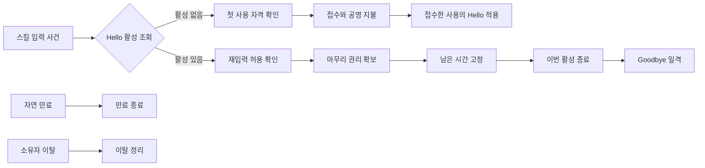

# Hello / Goodbye 노드 편집

상단 **노드 → 그래프 목록 → hello-goodbye.node-graph.json**으로 저장 폴더의 스킬을 연다.
**새 그래프**는 빈 문서를 만든다. 이 예제는 최신 TypeScript 노드 편집기에 있으며,
처음 만든 **스킬** 작업 공간의 중첩 블록 편집기와는 별개다.

[콘텐츠 명세](hello-goodbye-spec.md)의 입력·상태 활성·재입력 조건·종료 과정을
29개 노드·46개 연결·세 구간으로 작성했다. 노드 종류와 포트가 의미를 결정하며
표시 이름은 자유롭게 바꿀 수 있다. 현재는 의미 작성과 정적 검증 단계이며,
게임 실행·전투 시뮬레이션·Core 내보내기는 제공하지 않는다.
목표는 스킬 그래프의 의미에 맞게 Core를 수정하는 것이다.
[프로젝트 목적](project-purpose.md#스킬-노드-그래프의-목표)을 따른다.
여러 스킬에 적용할 기준과 현재 전용 노드의 일반화 과제는
[공통 스킬 그래프 계약](common-skill-graph-contract.md)에 정리했다.

## 읽고 수정하기

1. 처음 열면 **Hello / Goodbye 입력**을 85% 배율로 표시한다. 오른쪽 **Hello 활성 조회**에서
   활성 없음은 첫 사용, 활성 있음은 아래 재입력 구간으로 이어진다.
2. 왼쪽 **그래프 탐색**에서 구간 또는 노드를 선택하면 확대 이동한다. **전체 보기**는 전체 구조 확인용이다.
3. 오른쪽 표시 이름·속성·메모를 편집하고 **변경 적용**으로 확정한다. 미적용 입력은 저장 시 먼저 확정한다.
4. 포트를 끌거나 포트 이름을 눌러 연결한다. 다른 타입은 연결할 수 없고, 타입이 맞아도 잘못된 분기는 진단한다.
5. Undo/Redo와 **저장**으로 `content/*.node-graph.json`에 기록한다.
   별도 사본은 **JSON 내보내기 → 다운로드 확인**을 사용한다.

## 입력에서 시작과 종료까지

그림은 실행 흐름만 요약한다. 실제 그래프에는 요청·허가·활성·상태·시간·위력·범위 연결과
기본 공격·연출 경로도 있다. 자연 만료와 이탈은 Goodbye를 발생시키지 않는다.

| 노드 종류                 | 입력과 성공 결과                                                      | 실패·중복·변경 범위                                                               |
| ------------------------- | --------------------------------------------------------------------- | --------------------------------------------------------------------------------- |
| `skill-request`           | 입력 ID, 직원 ID, 장착 스킬 출처 ID, 입력 시각을 묶은 요청과 흐름     | 비용·자격·상태를 바꾸지 않음                                                      |
| `skill-lookup`            | 요청의 직원·출처·상태 선언이 같은 활성 조회. 있음/없음 중 하나로 분기 | 조회만 수행. 활성은 있음 분기, 비활성 결과는 없음 분기에서만 유효                 |
| `skill-resonance-qualify` | 요청·비활성 결과·공명 조건·비용 명세로 자격 검사                      | 실패 시 거절 분기. 통과에만 허가, 비용 미소비                                     |
| `skill-resonance-admit`   | 최신 자격·공명을 재검증해 접수·비용·이번 사용을 확정                  | 거절은 무변경. 성공에만 사용 참조·지불 결과. 요청당 한 번                         |
| `skill-resonance-install` | 접수한 사용에 Hello 활성·타이머·공격 교체 적용                        | 추가 소비·추가 공격·주기 초기화 없음. 접수 뒤 취소는 무환불                       |
| `skill-permission`        | 같은 요청·활성의 소유자와 출처를 대조하고 재입력 정책 확인            | 공명 만충·추가 소비 없음. 거부·미정 정책에는 후속 흐름 없음                       |
| `skill-claim`             | 허가와 살아 있는 활성을 재검증해 마무리 권리를 원자적으로 확보        | 활성마다 한 요청만 성공. 수락 시각·잔여 시간을 보존. 실패·중복에는 후속 흐름 없음 |
| `skill-capture-time`      | 권리를 확보한 활성의 선택 시점 잔여 시간을 고정                       | 수락 시점은 보존값, 방출 시점은 방출 직전 유효성 재확인. 이후 대상별 재계산 없음  |
| `skill-finish`            | 지정한 이번 활성의 타이머와 출처 한정 공격 교체 종료                  | 수동 종료는 마무리 권리 필요. 이미 종료된 활성에는 후속 흐름·연출 중복 없음       |
| `skill-area-damage`       | 흐름의 직원·장착 스킬 출처와 고정 위력·범위로 파편 직접 스킬 피해     | 무기 기본 공격 흡혈·Hello 관통 이력 상속 없음                                     |

이 표의 원자성과 한 번만 처리하는 규칙은 **Core가 구현해야 할 연산 계약**이다.
정적 검사로 동시 실행의 안전성을 증명하거나 실제 비용·피해를 계산한 것은 아니다.
첫 접수의 비용과 사용 자격은 함께 확정하고, 이후 효과 설치를 별도 노드로 표현한다.
**접수 완료 뒤 취소는 공명을 환불하지 않는다.** 모든 방출 실패를 접수 전 무변경으로 처리하지 않는다.
Hello는 **공명 조건 = 만충**, **비용 = 현재량 전부**를 연결했다.
저장 상한은 공명량 노드에 미정으로 두고 설정·조회가 그 한 원본을 참조한다.
다른 소비 방식과 유지·단계 비용 예제는 [공명 작성 계약](common-skill-graph-contract.md#공명-노드와-연결-타입의-확장)을 따른다.

요청·허가·활성 값은 저장 파일에 실행 결과로 저장되지 않는다. 그래프는 그 값을 만들고
사용할 관계를 작성한다. 흐름은 원래 요청의 직원·장착 스킬 출처를 유지하며,
만료·이탈 사건은 해당 활성의 직원·출처를 제공한다. 같은 상태 선언을 사용하는 다른 직원이나
다른 장착 스킬의 활성은 별개다. 프레임과 표시 이름은 실행 스코프가 아니다.

## 상태와 연출

**Hello 상태 선언**은 상태의 종류를 식별한다. 실제 활성과 타이머·마무리 권리는
**Hello 적용**의 성공에서 생기는 의미다. 상태 선언의 값이 비어 있어도 누락된 활성 데이터가 아니다.

선언을 선택하면 **연결된 상태 구성**에 적용 동작, 유지 시간, 공격 설정,
조회·관찰 노드가 나타난다. 밑줄 이름으로 이동해 편집할 수 있다. 미적용 입력이 있으면
먼저 적용하거나 취소한다. 요약은 중계 노드를 따라 현재 그래프에서 계산하고 별도로 저장하지 않는다.
빈 시간은 **값 미정**, 빠진 연결은 **연결 없음**이다. 여러 적용 동작도 각각 표시한다.

| 역할             | 예                                   | 의미                         |
| ---------------- | ------------------------------------ | ---------------------------- |
| 상태 선언        | Hello 상태 선언                      | 상태 종류 참조               |
| ▶ 시작 사건      | Hello / Goodbye 입력, 자연 만료      | 독립 사건의 흐름 시작        |
| 조건 확인        | 활성 조회, 첫 사용 자격, 재입력 허용 | 요청·활성에 조건 적용        |
| 실행 동작        | Hello 적용, 마무리 권리, 상태 종료   | 입력 흐름에 따라 변경        |
| 설정값 / 값 계산 | 유지 시간, 공격 설정 / Goodbye 위력  | 명시한 단위의 설정 또는 계산 |
| 연출             | 포신 변형, 생체 칼날, 정상 모습 복귀 | 실제 사건의 외형 설명        |

기본 공격의 실행은 설치한 공격 교체가 소유한다. **Hello의 개별 기본 공격**은
공격 표시 사건이며 추가 공격을 만들지 않는다. 무기 효과와 호환 관통 유물의 범위는
**관통 기본 공격 설정**에 명시한다. 실제 HP 피해의 공격별 합산·관통 이력의 공격별 수명은
공통 전투 연산의 계약이며 아직 실행하지 않는다.

연출 사건은 점선으로 연결하고 실행 포트에 연결할 수 없다. 외형 설명을 바꿔도 피해·시간·직원 위치는
바뀌지 않는다. 일격 완료·자연 만료·이탈 정리는 **정상 모습 복귀** 연출을 공유한다.

## 연결과 진단

| 검사         | 작성 진단                                                                         |
| ------------ | --------------------------------------------------------------------------------- |
| 단위·의미    | 요청·비활성 결과·첫 사용 허가·후속 허가·상태·활성·시간·위력·범위·연출을 구분      |
| 분기 값      | 모든 실행 경로가 값을 만든 정확한 분기를 통과해야 함. 반대 분기·우회·순환은 진단  |
| 요청 일치    | 재입력 요청과 활성을 조회한 요청이 다르면 진단                                    |
| 시작 상태    | 첫 사용 허가가 참조한 상태와 시작할 상태가 다르면 진단                            |
| 활성 수명    | 마무리 권리 확보 / 만료 / 이탈의 흐름과 활성 참조·종료 원인이 일치해야 함         |
| Goodbye 순서 | 같은 흐름의 잔여 시간 고정과 같은 활성의 수동 종료를 모두 거쳐야 일격에 사용 가능 |
| 참조 삭제    | 필수 입력 누락 또는 적용 동작 없는 상태를 진단. Undo로 복원                       |
| 미정 값      | 빈 수치와 미정 정책은 진단을 남기고 저장 가능. 0으로 대체하지 않음                |

노드 ID로 관계를 판정하며 중계 노드도 추적한다. 진단에서 해당 노드로 이동할 수 있다.
이는 현재 노드 집합의 작성 검사이며 임의 그래프의 모든 동작을 증명하는 실행 분석기는 아니다.

## 미정 정책과 다음 Core 작업

2026-10-20 사용자 합의에 따라 예제의 재입력은 **공통 수동 재입력**,
동시 입력은 **만료 우선**으로 작성했다.
공격 태세에서 행동 가능할 때만 허용하고 Hard CC·Silence 중에는 거절하며,
해당 스킬 자신의 사용 잠금만 예외로 처리한다. 처리 시각이 만료 시각과 같거나 늦으면
재입력을 거절한다. [공통 전투 규칙](../../core_enhanced/docs/game_rules/combat.md#활성-스킬의-수동-재입력)이 기준이다.

잔여 시간 고정 시점, 이탈 정책, 위력 곡선·계수와 범위·방향·유지 시간은 미정으로 남긴다.
노드 속성의 선택지는 작성 가능한 대안이며 콘텐츠 합의를 대신하지 않는다.
마무리 권리 확보 뒤 중단·취소, 진행 중 기본 공격의 전환, 공격 교체 간 우선순위,
구체적인 동작 종료 경계는 [원문 미정 항목](hello-goodbye-spec.md)을 따르며
현재 그래프가 완결된 실행 명세라고 주장하지 않는다.
시간제 Hello 교체가 남아 있으면 공명 잠금은 유지한다. 교체가 끝나도 남은 Goodbye 동작의
의무가 있으면 함께 고려하며, 이 공통 사용 수명 자체는 미정이 아니다.

후속 Core 대조는 요청의 출처 식별, 상태 활성 저장소와 수명, 접수·비용 확정과 후속 효과 설치,
원자적 마무리 권리, 정확한 활성의 종료, 피해 출처·공격별 집계 순서로 진행한다.
이번 변경에는 Core 코드나 실행 어댑터가 없다. 재사용 가능한 공통 연산 계약을 먼저
고정하고, 미정 정책을 합의한 뒤 실제 Core의 충족 여부와 필요한 변경을 확인한다.

## 파일과 책임

`node-graph` version 1 구조를 유지했다. 새 예제는 새 종류·포트를 사용하며 저장 폴더의 예제도
같이 갱신했다. 남은 노드·프레임과 동일 연결의 ID를 보존하고, 교체된 진입점은 새 계약으로 작성했다.
사용자의 다른 저장 파일을 자동으로 변환하지 않는다.
이전 `skill-use`, `skill-overlay`, `skill-reinput`, `skill-qualify`, `skill-begin`은 기존 파일 열기를 위해 유지하며,
새 예제는 입력·조회·조건·권리 확보로 나눈 계약을 사용한다. 새 종류를 모르는 구버전 앱은 거부한다.

전체 복사·붙여넣기는 내부 참조 ID를 함께 바꾸며 일부 복사에는 빠진 입력 진단이 남는다.
카탈로그와 예제는 `src/nodes/core/skill-catalog.ts`, `resonance-catalog.ts`, `hello-goodbye.ts`,
작성 검사는 `skill-validation.ts`, `resonance-validation.ts`, 문서·이력·저장은 기존 GraphSession이 소유한다.

## 공명 노드 확장 검증 (2026-10-20)

공명 작성 노드 14종·연결 타입 9종과 각 타입의 경유 노드를 추가했다.
Hello는 만충 조건·전량 비용을 명시한 29개 노드·46개 연결로 옮겼다.
고정량·비율·선택량·횟수·유지·단계 비용 등을 비교하는 검증 예제 9개를 저장 폴더에 추가했다.
기존 23개 노드 파일은 자동 변환 없이 다시 열고 동일하게 내보내는 검사를 유지한다.

- `npm run check`, `npm run build`, 전체 모델 테스트 89개 통과.
- UI는 세 크기·두 테마에서 총 66개 시나리오 범위를 확인했다.
  첫 실행은 64개 통과, 최소 창의 전체 보기 잘림으로 2개 실패했다.
  최소 배율을 20%에서 5%로 확장하고 모든 노드가 캔버스 안에 들어오는 검사를 추가했다.
  영향받는 Hello 전체 보기·선택과 공명 화면 24개를 재실행하여 모두 통과했다.
  나머지 42개는 첫 실행의 통과 결과를 유지한다.
- 최종 UI 실행의 접근성 검사 72회: 위반 0, 브라우저 오류·경고 0, 문서 overflow 0.
  `aria-prohibited-attr`·`color-contrast` incomplete는 각각 72회이며 대상 목록을 기록했다.
  React Flow controls의 ARIA 수동 확인은 남아 있다. 세 크기·두 테마의 실제 PNG에서
  공명 비율·주기·부족 정책·지불 결과의 한글과 배치·패널 스크롤을 확인했고,
  최소 창의 Hello 전체 보기 잘림이 해결된 것도 직접 확인했다.
- [검증 요약](../artifacts/resonance-nodes-20261020/verification.json),
  [최종 UI 보고서](../artifacts/resonance-nodes-20261020/final-ui/report.json),
  [최소 창 비율 편집](../artifacts/resonance-nodes-20261020/minimum-light-resonance-percent.png),
  [최소 창 Hello 전체 보기](../artifacts/resonance-nodes-20261020/minimum-light-hello-overview.png),
  [큰 어두운 창 주기 비용](../artifacts/resonance-nodes-20261020/large-dark-resonance-periodic.png).
- WSL Chromium 기준이다. Windows WebView2·Tauri IPC·네이티브 대화상자·한글 IME·전체
  스크린리더 검증은 남아 있으며 승인된 이미지 기준이 없어 `ui:compare`는 실행하지 않았다.
  비용 계산·차감·주기 실행과 동시 접수의 원자성은 후속 Core 구현·실행 검증 대상이다.

## 공통 정책 반영 검증 (2026-10-20, 공명 노드 확장 전)

공통 수동 재입력과 만료 우선 합의를 예제·카탈로그 설명에 반영했다.
수치와 나머지 미정 정책은 유지하고, 기존 문서의 노드·연결·프레임 ID와 배치는 변경하지 않았다.

- `npm run check`, `npm run build`, 모델 테스트 70개 통과.
- 재입력 정책 표시·변경·Undo, 만료 정책 표시, 잘못된 분기 진단과 저장 시나리오 6개 통과.
  960×640·1280×800·1920×1080, 밝게/어둡게에서 확인했다.
- 접근성 검사 24회에서 위반 0, 브라우저 오류·경고 0, 문서 overflow 0.
  `aria-prohibited-attr`와 `color-contrast`의 incomplete는 각 24회다.
  React Flow controls와 대비 수동 확인 대상을 기록했으며, 세 크기·두 테마의 PNG를 직접 열어
  정책 값·설명·줄바꿈과 패널 스크롤을 확인했다. 전체 스크린리더 검증을 대신하지 않는다.
- [검증 기록](../artifacts/common-skill-contract-20261020/verification.json),
  [Playwright 보고서](../artifacts/common-skill-contract-20261020/ui/report.json),
  [최소 밝은 화면](../artifacts/common-skill-contract-20261020/minimum-light-goodbye-permission.png),
  [기본 어두운 화면](../artifacts/common-skill-contract-20261020/default-dark-goodbye-claim.png).
- WSL Chromium 검사다. Windows WebView2·Tauri IPC·네이티브 대화상자·한글 IME는 미검증이며,
  승인된 시각 기준 이미지가 없어 `ui:compare`는 실행하지 않았다. 게임 실행 정책의 검증은 후속 Core 작업이다.

## 의미 분해 검증 (2026-10-20, 공통 정책 반영 전)

입력·조회·자격·허용·권리 확보·상태 시작을 구분하고 예제를 23개 노드·36개 연결로 갱신했다.
이전 복합 노드 문서는 고정 fixture로 열기·내보내기 보존을 확인했다.

- `npm run check`, `npm run build` 통과.
- 모델 테스트 70개 통과. 잘못된 분기, 경유 연결, 요청·상태 불일치, 권리 확보 우회,
  수동 종료 우회, 순환, Undo 및 예제 파일과 생성기 일치를 포함한다.
- Hello / Goodbye·기본 노드 편집·저장 폴더 UI 84개 확인.
  첫 배치 78개 통과 후, 기존 예제의 노드 수 20개를 기대하던 저장 폴더 검사 6개를
  23개로 갱신하여 모두 재검사했다. 두 실행 사이 제품 소스 변경은 없다.
- 960×640, 1280×800, 1920×1080 × 밝은/어두운 테마.
  새 조회·허용·권리 확보·잘못된 분기, 속성 편집, 참조 요약, 파일 왕복과 Undo를 확인했다.
- 최종 통과 시나리오의 axe 검사 198회, 자동 위반 0개, 브라우저 오류·경고 0개,
  문서 전체 넘침 0개. 실행·검사 입력 110개 파일이 작업 폴더와 동일하다.

PNG를 직접 열어 여섯 환경의 새 노드와 속성 설명, 미정 선택값, 한글 줄바꿈,
포커스 표시와 진단 이동을 확인했다. 큰 화면 전체 보기는 구조 확인용이며 개별 노드는 탐색으로 확대한다.
axe `incomplete`는 숨겨진 포커스 18회, ARIA 속성 192회, 색 대비 188회다.
대상은 React Flow 컨트롤, 콘텐츠 목록·경로, 대화상자의 배경과 포커스 가드,
그래프·속성 패널의 텍스트 등을 포함한다. 이미지와 키보드 동작을 검토했으며
완전한 스크린리더 접근성 확인을 대신하지 않는다.

WSL Chromium 검사다. Windows WebView2·Tauri IPC·네이티브 파일 대화상자·한글 IME는
미검증이며 검토된 기준 이미지가 없어 `ui:compare`는 실행하지 않았다.
스킬 실행기와 Core는 구현·실행하지 않았다.

- [활성 조회](../artifacts/hello-semantics-20261020/default-dark-hello-active-lookup.png)
- [재입력 허용](../artifacts/hello-semantics-20261020/default-light-goodbye-permission.png)
- [마무리 권리](../artifacts/hello-semantics-20261020/large-dark-goodbye-claim.png)
- [잘못된 분기 진단](../artifacts/hello-semantics-20261020/minimum-dark-hello-wrong-branch.png)
- [전체 구성](../artifacts/hello-semantics-20261020/large-light-hello-overview.png)
- [검사·수동 확인 대상·소스 집계](../artifacts/hello-semantics-20261020/verification.json)
- [첫 UI 보고서](../artifacts/hello-semantics-20261020/batch/report.json),
  [저장 폴더 재검사](../artifacts/hello-semantics-20261020/folder-recheck/report.json)

아래 기록은 의미 분해 이전 단계의 검증 이력이다.

## 상태 연결 요약 검증 (2026-10-20)

상태 선언의 속성 패널에 적용 동작·유지 시간·공격 설정·참조 사건을 추가했다.
입력 출처 조회는 작성 진단과 공유하며 중계 노드를 따라가고 순환에서는 멈춘다.
요약에서 노드로 이동하면 해당 속성과 캔버스를 함께 보여 주고 표시 이름 입력에
키보드 포커스를 옮긴다. 미적용 편집 중에는 이동을 잠근다.
소스·설정 114개 파일이 Linux 검증 폴더와 일치하며, 기존 저장 예제는 변경하지 않았다.

`npm run check`, `npm run build`, 모델 테스트 63개를 통과했다.
관련 UI는 세 창 크기 × 두 테마에서 72개 시나리오를 확인했다.
전체 실행의 66개 통과 후, 복수 적용 fixture의 단일 실행 출력 제약과
가져오기 정렬 비교를 수정하여 남은 6개를 다시 통과했다.
제품 코드는 두 실행 사이에 변경하지 않았다.
검사는 읽기·이동의 문서/이력 보존, 값 수정·삭제·Undo/Redo,
0초와 미정의 구별, 빈 연결, 복수 적용과 긴 한글 이름을 포함한다.

최종 시나리오 기준 axe 162회에서 자동 위반 0건, 브라우저 오류·경고 0건이다.
`incomplete`는 숨겨진 포커스 18회, ARIA 속성 156회, 색 대비 152회다.
기존 대화상자 포커스 가드·React Flow Controls 등의 수동 확인 대상도 기록했다.
각 크기·테마의 실제 PNG에서 새 요약의 줄바꿈·포커스·패널 스크롤을 확인했다.
자동 검사로 접근성 전체가 보장되지는 않으며 Windows WebView2·Tauri IPC·
네이티브 파일 대화상자·한글 IME·스크린 리더 전체 검증은 남아 있다.
기준 이미지가 없어 `ui:compare`는 실행하지 않았다.

- [기본 화면과 키보드 포커스](../artifacts/hello-state-summary-20261020/default-light-state-summary-navigation.png)
- [끊어진 설정 연결](../artifacts/hello-state-summary-20261020/minimum-light-state-summary-missing-setting.png)
- [복수 적용과 긴 이름](../artifacts/hello-state-summary-20261020/default-dark-state-summary-multiple.png)
- [연결이 없는 상태](../artifacts/hello-state-summary-20261020/minimum-dark-state-summary-empty.png)
- [최종 검사 집계와 소스 일치](../artifacts/hello-state-summary-20261020/verification.json)

## 역할 표시 정리 검증 (2026-10-20)

예제 생성 코드와 저장 폴더 예제의 **Hello 변형**을 **Hello 상태 선언**으로 변경했다.
저장 파일은 제목 한 곳만 변경했고, 20개 노드·26개 연결·3개 구간과 모든 ID·설정값·
메모·좌표를 보존했다. 다른 사용자 파일의 표시 이름은 자동 변경하지 않는다.
카탈로그의 역할 표시는 문서·이력·저장 데이터와 분리되어 있다.

기존 Linux 검증 폴더의 소스·설정 등 112개 파일이 원본과 일치하는 것을 확인한 뒤 재사용했다.
`npm run check`, `npm run build`, 모델 테스트 61개와 관련 UI 테스트 60개를 통과했다.
UI 검사는 Hello / Goodbye·기존 노드 편집·콘텐츠 폴더를 세 창 크기와 두 테마에서 확인했다.
역할·설명을 읽고 키보드로 노드를 선택해도 문서·미저장 상태·이력이 바뀌지 않는지 검사했다.

새 표식의 밝은 테마 대비 부족을 발견해 본문 색상 토큰으로 수정한 뒤 재검사했다.
최종 브라우저 오류·경고는 0건, axe 132회 검사에서 자동 위반은 0건이다.
`incomplete`는 숨겨진 포커스 18회, ARIA 속성 126회, 색 대비 122회로 남았다.
대표 PNG에서 한글·역할 표식·설명 줄바꿈·포커스·연결·구간 배치를 직접 확인했다.
전체 보기는 작은 개요이며 노드 선택 시 확대해서 읽는다. 속성 패널은 창 높이에 따라 스크롤한다.
위력 편집 촬영의 100·20은 테스트 입력이며 저장 폴더 예제에는 반영하지 않았다.
검토된 기준 이미지가 없어 `ui:compare`는 실행하지 않았다.
Windows WebView2·Tauri IPC·네이티브 파일 대화상자·한글 IME·스크린 리더 전체 검증은 별도다.

- [처음 열리는 화면](../artifacts/hello-roles-20261020/default-light-hello-entry.png)
- [상태 선언과 포커스](../artifacts/hello-roles-20261020/minimum-light-hello-state-role.png)
- [상태 선언과 연결 목록](../artifacts/hello-roles-20261020/default-light-hello-state-role.png)
- [값 계산](../artifacts/hello-roles-20261020/default-dark-goodbye-power-editor.png)
- [검사 보고서](../artifacts/hello-roles-20261020/ui/report.json)
- [파일 보존·소스 일치 확인](../artifacts/hello-roles-20261020/verification.json)

## 진입점 배치 정리 검증 (2026-10-20)

새 예제와 `content/hello-goodbye.node-graph.json`의 시작 사건을 왼쪽에 정렬하고,
설정값을 흐름 아래에 배치했다. 저장 파일은 좌표만 변경했으며 ID·연결·설정·메모 보존을 확인했다.
스킬 사건에 시작 표식을 추가하고, 첫 사용 노드가 있는 문서는 해당 위치를 85% 배율로 연다.
전체 보기와 노드 이동은 문서·미저장 여부·편집 이력을 바꾸지 않는다.

WSL의 별도 작업 폴더에서 `npm run check`, `npm run build`, 모델 테스트 61개와
Hello / Goodbye·노드 편집·콘텐츠 폴더 UI 테스트 54개를 통과했다.
세 창 크기와 두 테마에서 시작 화면·전체 보기·재입력·종료 구간의 대표 PNG를 직접 확인했다.
브라우저 오류·경고 0건, axe 108회 검사에서 위반 0건이었다.
`incomplete`는 숨겨진 포커스 18회·Controls의 ARIA 속성 102회·색 대비 92회로,
대표 화면을 수동 검토했으며 스크린 리더 전체 검증을 뜻하지 않는다.
검토된 비교 기준 이미지가 없어 `ui:compare`는 실행하지 않았다.
Windows WebView2·Tauri IPC·한글 IME 검증은 별도다.

- [처음 열리는 화면](../artifacts/hello-entry-20261020/default-light-hello-entry.png)
- [종료 구간](../artifacts/hello-entry-20261020/large-dark-hello-endings.png)
- [검사 보고서](../artifacts/hello-entry-20261020/ui/report.json)

## 초기 구현 검증 기록 — 2026-10-20

WSL의 별도 작업 폴더에서 Linux 의존성으로 검사했다. 검사한 `src/`, `tests/`, `scripts/`
87개 파일과 작업 폴더의 원본이 동일함을 확인했다. Windows의 `node_modules`는 공유하지 않았다.

| 검사                                                                                | 결과                                             |
| ----------------------------------------------------------------------------------- | ------------------------------------------------ |
| `npm run check`                                                                     | 타입·린트·포맷 통과                              |
| `npm run build`                                                                     | 프런트엔드 빌드 통과                             |
| `npm test`                                                                          | 58개 통과. 새 스킬 모델 10개 포함                |
| `npm run ui:inspect -- tests/ui/hello-goodbye.spec.ts tests/ui/node-editor.spec.ts` | 42개 통과. 새 시나리오 12개, 기존 노드 회귀 30개 |
| 브라우저 진단                                                                       | 오류 0, 경고 0                                   |
| axe 자동 검사                                                                       | 78회, 위반 0                                     |

960×640, 1280×800, 1920×1080의 밝은·어두운 테마에서 전체 보기, 구간 이동,
속성 수정, 연출 설명, 참조 삭제 진단을 촬영했다. 각 크기·테마의 대표 PNG를 직접 열어
한글·패널 스크롤·선택 표시·연결선·진단 이동을 확인했다. 최소 창에서 전체 그래프의
문자는 작으므로 개요로 사용하고 그래프 탐색으로 노드를 확대한다.
기존 프레임·연결 추가 대화상자도 직접 검토했다.

모델 검사는 이름 변경·복사·삭제·복원 후 참조 보존, 단위가 다른 연결 거부,
다른 활성이나 실행 경로의 결과 참조 진단, 미정 값 보존, 잘못된 값의 원자적 거부를 포함한다.
UI 검사는 실제 입력·Undo/Redo·다운로드·다시 열기와 연출 수정 시 게임 노드 보존을 확인한다.

axe의 `incomplete`에는 Controls 컨테이너의 ARIA label(72회), 겹친 SVG/프레임의
색 대비(70회), Radix 대화상자 뒤의 숨겨진 포커스 대상(6회)이 남았다. 대표 이미지에서
문자 대비·대화상자·포커스 표시를 검토했으나 이것을 자동 판정 완료로 바꾸지 않았다.
스크린 리더와 숨겨진 영역 전체의 Tab 순서는 이번 검증 범위가 아니다.
검토된 기준 이미지가 없어 `ui:compare`는 실행하지 않았다.

증거는 `artifacts/hello-goodbye-nodes-20261020/`에 보존했다.

- [전체 그래프](../artifacts/hello-goodbye-nodes-20261020/chromium-large-light-hello-overview.png)
- [위력 속성 편집](../artifacts/hello-goodbye-nodes-20261020/chromium-default-light-goodbye-power-editor.png)
- [참조 삭제 진단](../artifacts/hello-goodbye-nodes-20261020/chromium-minimum-dark-hello-reference-diagnostic.png)
- [연출 설명 편집](../artifacts/hello-goodbye-nodes-20261020/chromium-minimum-light-hello-presentation.png)
- [UI 검사 보고서](../artifacts/hello-goodbye-nodes-20261020/ui/report.json)

Windows WebView2·Tauri IPC·네이티브 파일 대화상자·한글 IME와 Core 전투 실행은 검증하지 않았다.

## 효과 타일 범위 편집

‘Goodbye 전방 범위’를 선택하면 속성 패널의 격자에서 효과 타일을 포함/제외할 수 있다.
위쪽이 전방이고 ◎가 기준 타일이다. 기준 타일도 눌러 포함 여부를 바꾼다. 보기 이동으로
격자 바깥 타일을 작성할 수 있으며 보기를 움직이는 것만으로 문서는 바뀌지 않는다.
‘변경 적용’ 전에는 임시 선택이고, ‘취소’로 되돌린다. 적용한 범위는 한 번에 실행 취소된다.

장판도 같은 타일 기반 규칙을 따른다. 현재 노드는 범위 설정이며 장판 생성·추적·반복 피해를
실행하는 기능은 아니다. 이전 도형 파일은 재지정 안내와 함께 원래 값을 보존한다.
타일을 선택하고 적용할 때만 이전 도형 속성을 교체한다.
