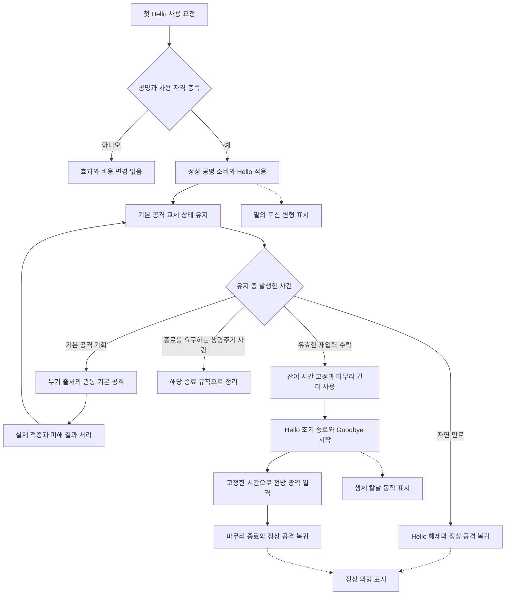

# Hello / Goodbye 스킬 작성 명세

2026-10-20 · 콘텐츠 기반 상세 사례 1

아무 것도 없는의 기본형 파편을 **일시적 기본 공격 교체와 수동 마무리**로 표현한다.
플레이어는 Hello의 관통 기본 공격을 오래 유지하거나, 남은 시간을 포기해 Goodbye의 위력을 얻는다.
게임 판정과 외형 연출을 분리하며 기존 Core 문법으로 표현 범위를 제한하지 않는다.

상위 범위는 [일반보스 요구사항 NB10](normal-boss-skill-requirements.md#nb10-아무-것도-없는)이다.
아래 개념 이름과 도식은 편집기 작성 모델의 제안이며 실행 코드나 최종 저장 스키마가 아니다.

## 콘텐츠 근거와 범위

| 근거                                                                                       | 가져오는 의미                                                    |
| ------------------------------------------------------------------------------------------ | ---------------------------------------------------------------- |
| [스킬 파편](../../core_enhanced/docs/content/abnormalities/nothing-there/fragment.md)      | Hello 유지·재입력 Goodbye·자연 만료·피해 출처·포함하지 않는 효과 |
| [미미크리 장비](../../core_enhanced/docs/content/abnormalities/nothing-there/equipment.md) | 무기 기본 공격의 실제 HP 피해 합산·공격당 흡혈 상한              |
| [관통 피해 증가 유물](../../core_enhanced/docs/content/relics/piercing-damage-increase.md) | 개별 공격의 관통 순서별 증폭·공격 간 초기화·Goodbye 제외         |
| [전투 규칙](../../core_enhanced/docs/game_rules/combat.md)                                 | 전투 시간·첫 사용의 공명 소비·행동 제한·철수·방출된 효과의 수명  |

동작 합의는 완료된 요구로 취급하고 밸런스 수치는 매개변수로 둔다.
현재 문서끼리 다른 표현이나 이 상세화에 필요한 연결 지점은 끝의 정합성 표에 남긴다.
개화형·침식형, 방어구의 재생, 액세서리의 부활·적대적 변태는 이 스킬의 동작에 추가하지 않는다.

## 반드시 보존할 동작

| ID   | 요구                                                                                                                                  |
| ---- | ------------------------------------------------------------------------------------------------------------------------------------- |
| HG01 | 첫 Hello 사용은 공명 만충과 공통 사용 자격을 검사하고 정상 공명 비용을 지불한다. 실패한 입력은 변형을 만들지 않는다.                  |
| HG02 | 유한한 시간 동안 기본 공격을 긴 직선 관통 공격으로 교체한다. 시작 자체의 추가 공격·공격 주기 초기화·원래 공격과의 이중 실행은 없다.   |
| HG03 | 변형은 별도 집중이 아니며 공통 행동 가능 규칙에 따라 기본 공격과 저지를 계속한다. 전투 정지 중에는 지속 시간이 흐르지 않는다.         |
| HG04 | Hello 공격은 장착 무기의 직접 기본 공격 출처를 유지한다. 실제 직원·무기 종류·배치·저지 수를 외형에 맞춰 바꾸지 않는다.                |
| HG05 | 활성 Hello에 대한 재입력으로만 Goodbye를 사용한다. 추가 공명 만충·소비·Hello 재시전·지속시간 갱신을 요구하지 않는다.                  |
| HG06 | Goodbye는 포기한 잔여 시간에 따라 강해지는 전방 광역 일격이다. 해당 Hello에서 한 번 사용하며 파편의 직접 스킬 피해다.                 |
| HG07 | 자연 만료는 원래 기본 공격으로 복귀한다. 자동 Goodbye·만료 후 보관된 마무리 권리는 없다.                                              |
| HG08 | 미미크리 장착 시 Hello의 실제 HP 피해 합계를 기존 무기 흡혈에 연결하고 공격당 상한을 한 번 적용한다. Goodbye는 그 흡혈 대상이 아니다. |
| HG09 | 관통 피해 증가 유물은 한 기본 공격 안에서 뒤이어 맞는 적의 피해를 증폭한다. 다음 기본 공격은 초기화하고 Goodbye에 넘기지 않는다.      |
| HG10 | 재생·부활·추가 스탯 버프·HP 1 생존·종료 후 피해/약화·처치에 의한 변형 연장을 기본 파편에 더하지 않는다.                               |

## 게임 판정과 연출

| 보이는 모습                | 실제 판정                                   | 요구하지 않는 게임 객체               |
| -------------------------- | ------------------------------------------- | ------------------------------------- |
| 팔이 포신처럼 변형         | 해당 직원의 한시적 기본 공격 교체 상태 설치 | 새로운 직원·Gun 장비·소환 유닛        |
| 포신에서 긴 관통 공격 표시 | 개별 기본 공격의 직선 대상 판정과 직접 피해 | 연출만을 근거로 한 별도 투사체 물리체 |
| 팔이 생체 칼날로 변형      | Goodbye 시작과 전방 광역 일격               | 별도 무기 아이템 생성·장착 교환       |
| 정상 모습으로 복귀         | 이 Hello가 부여한 공격 교체 해제            | 직원 despawn·재배치·부활 처리         |

관통 공격이 실제 비행 시간을 가지는지는 공격 전달 방식의 명세다. 포신·탄환처럼 보인다는 이유로
자동 결정하지 않는다. 한 공격 안의 관통 순서가 유물 계산에 필요하다는 점은 보존한다.

연출은 `변형 시작`, `기본 공격 방출/적중`, `마무리 시작/적중`, `변형 종료` 같은 실제 사건에 연결한다.
연출 지연으로 마무리용 잔여 시간이 계속 줄거나, 애니메이션 재생 횟수로 피해가 중복되면 안 된다.
외형만 복잡한 부분은 표현 계층에 두고, 실제 타격 수·판정 시점이 있는 부분만 실행 의미로 둔다.

## 작성 단위와 소유 상태

한 스킬을 하나의 오래 실행되는 공격으로 뭉치지 않는다. 아래 수명을 구분하고
[공통 사용 수명](common-skill-graph-contract.md#사용-잠금과-효과-수명)을 적용한다.
시간제 Hello 교체가 남아 있으면 사용 잠금을 유지한다. Goodbye로 교체를 끝낸 경우에도
남아 있는 마무리 동작의 사용 의무가 끝나야 하며, 효과 정산 완료와 사용 종료는 구분한다.

| 작성 단위            | 소유 내용                                                                            | 수명과 경계                     |
| -------------------- | ------------------------------------------------------------------------------------ | ------------------------------- |
| 파편 정의            | Hello 공격 profile, 지속 시간, Goodbye 범위·위력 함수, 연출 연결                     | 콘텐츠 정의                     |
| 이번 Hello           | 적용 직원·파편 사본·이번 활성 식별, 시작/종료 시각, 공격 교체, 마무리 사용 가능 여부 | 변형 시작부터 종료까지          |
| 개별 Hello 기본 공격 | 무기 출처, 실제 관통 순서, 피해 결과, 흡혈용 합계                                    | 해당 기본 공격과 그 결과 처리   |
| 이번 Goodbye         | 연결된 Hello, 고정된 잔여 시간, 마무리 범위/방향 정보, 진행 결과                     | 재입력 수락에서 마무리 종료까지 |
| 별도 장비·유물       | 흡혈 비율/상한, 관통 증폭 함수                                                       | 각 장비·유물의 자기 규칙        |

`이번 활성 식별`은 한 Hello에서 사용한 권리가 다른 Hello로 넘어가지 않게 하는 논리적 참조다.
특정 ID 포맷이나 서버 저장 방식을 요구하지 않는다. 공격 교체를 해제할 때도 이 활성의 변경을
제거해야 하며, 다른 출처의 공격 변경을 무조건 옛 무기 값으로 덮어쓰는 방식은 명세의 의미가 아니다.
복수 공격 교체 간 우선순위는 관련 공통 규칙과 연결할 항목이다.

## 입력과 값의 경계

| 값              | 의미와 단위                       | 생산 지점                       | 소비 지점                   |
| --------------- | --------------------------------- | ------------------------------- | --------------------------- |
| `helloDuration` | 변형 유지 시간, 시간 단위         | 조정값을 이번 활성에 적용       | 변형 만료 계산              |
| `helloEndTime`  | 이번 변형의 전투 종료 시각        | 실제 변형 적용 시점과 유지 시간 | 남은 시간 조회              |
| `remainingTime` | 마무리에서 포기한 잔여 시간       | 재입력 처리의 명시된 고정 지점  | Goodbye 위력 함수           |
| `goodbyePower`  | 잔여 시간에 따른 일격 위력        | `F(remainingTime, 조정값)`      | 마무리 직접 피해            |
| `pierceOrder`   | 한 공격 안의 관통 순서            | 개별 기본 공격의 실제 관통 판정 | 관통 피해 증가 유물         |
| `actualHpLost`  | 대상 HP가 실제 감소한 양, HP 단위 | 피해 적용 결과                  | 미미크리 흡혈의 공격별 집계 |

남은 시간은 유효한 활성에 대해 `max(0, helloEndTime - captureTime)`으로 표현할 수 있다.
이 식은 만료된 활성에 0초 Goodbye를 허용하는 규칙이 아니다. 먼저 재입력 자격을 검사한다.
`captureTime`을 입력 접수·수락·방출 중 어디에 둘지는 정합성 표의 명시적 연결 지점이다.
한 번 고정한 값은 이후 연출 시간이나 피해 대상별 처리 시간으로 다시 계산하지 않는다.

`F`는 기본 위력·증가 곡선·상한을 가진 조정 가능한 함수다. 다른 조건이 같을 때 더 많은 시간을
포기한 경우 위력이 낮아지지 않아야 한다. 선형식이나 임의 계수를 확정하지 않는다.
단위가 다른 거리·타수·시간 값을 이름 없는 숫자로 연결하지 않는다.

2026-10-20 후속 합의: 작성기에서 `시간에 따른 위력`의 선형/상한 있는 선형을 선택한 경우,
기본 위력·초당 증가량·상한은 0 이상의 정수로 작성한다. 고정 잔여 시간은 0.001초 정밀도를
유지하며 계산하고, 상한 적용까지 포함한 최종 위력을 한 번 올림한다. 예를 들어 기본 위력 0,
초당 증가량 10, 잔여 1.25초라면 위력은 13이다. 이 값은 설명용 가정이며 Goodbye 밸런스가 아니다.
직접 입력한 소수 위력을 올림해서 저장하지 않으며 잘못된 입력으로 거절한다. 일반 피해 산술의
방어력·감산·실제 HP 손실 반올림은 이 합의에 포함하지 않는다. 상세 규칙은
[시간별 위력 계약](common-skill-graph-contract.md#시간에-따른-위력의-정수최종-올림-계약)을 따른다.

## 실행 흐름

실선은 게임 판정, 점선은 그 판정을 보여주는 연출 연결이다.
재입력 수락 경로는 해당 활성에 대해 한 번만 성립한다. 연출 종료가 입력 수락의 성공 조건은 아니다.

도식의 기본 공격 반복은 변형 상태를 한 번 사용한 뒤 자동 공격 기회를 처리하는 의미다.
각 공격을 새로운 Hello 시전으로 계산하거나, 실제 행동 불가 상태에서도 강제 공격하는 의미가 아니다.
Goodbye 중의 기본 공격 허용 여부와 정확한 전환 시점은 공통 행동 규칙에 연결한다.
생명주기 종료 경로는 무료 Goodbye를 만들지 않으며 이미 방출한 독립 효과의 수명을 별도로 취급한다.

## 절차별 명세

### 첫 시전

1. 첫 사용 자격·공명·대상 입력 조건을 확인한다. 자기 변형이지만 조작 방식이 self 선택인지
   별도 입력 없는 사용인지를 이번 문서에서 임의로 UI 동작으로 고정하지 않는다.
2. 최종 입력 접수에서 공명을 전량 소비하고 사용 자격을 만든다. 준비 단계가 있다면
   이후 취소는 환불하지 않는다. Hello의 효과 적용 시점과 접수 시점을 구분해 작성한다.
3. 현재 기본 공격을 Hello profile로 교체하고 변형 종료 시각을 기록한다.
4. 적용 자체는 별도 피해를 주거나 기본 공격 주기를 초기화하지 않는다.
5. 연출은 변형 적용을 표시한다. 장착 무기와 직원의 실제 identity는 보존한다.

### Hello 유지와 기본 공격

1. 전투 시간으로 유지 시간을 계산한다. Pause 중에는 시간과 자동 공격이 진행하지 않는다.
2. 공통 행동 규칙에 따라 기본 공격할 때 Hello profile을 사용한다.
3. 해당 기본 공격의 출처는 장착 무기의 직접 기본 공격이다.
4. 관통 피해 증가 유물이 있다면 이번 공격의 순서로 증폭한다. 새 기본 공격의 첫 대상은 다시 시작한다.
5. 미미크리라면 실제로 줄인 HP를 이번 공격 단위로 합산해 기존 흡혈 비율과 공격당 상한을 적용한다.
   요청 피해·overkill을 합계로 쓰거나 대상마다 공격당 상한을 새로 적용하지 않는다.
6. 위 두 조합이 없어도 변형과 마무리는 동작한다. 장비·유물 효과는 파편 자체 능력으로 복제하지 않는다.

### 재입력과 Goodbye

1. 요청이 현재 직원·파편 출처의 활성 Hello를 가리키고 아직 마무리를 사용하지 않았는지 확인한다.
   2026-10-20 사용자 합의로 공격 태세·행동 가능 상태에서만 허용하며 Hard CC·Silence 중에는 거절한다.
   Hello 자신의 사용 잠금만 예외다. 재입력 처리 시각이 만료 시각과 같거나 늦으면 거절한다.
2. 유효한 수락에서 명시된 시점의 잔여 시간을 한 번 고정하고 해당 활성의 마무리 권리를 사용한다.
   거절된 요청을 마무리 사용으로 기록하지 않는다.
3. Hello를 조기에 끝내고 고정된 시간으로 Goodbye의 위력을 계산한다. 새 공명을 소비하지 않는다.
4. 전방 타일 패턴에 파편의 직접 스킬 피해 일격을 적용한다. 실제 효과 타일을 직접 지정하며 도형의 길이·폭·각도로 근사하지 않는다. 기준 위치와 방향의 입력·고정 방식은 별도 속성이다.
5. 마무리 사용 뒤 원래 기본 공격으로 복귀한다. Hello의 관통 이력이나 무기 흡혈을 이 피해에 적용하지 않는다.

권리 사용·값 고정·전이의 논리적 경계를 함께 표현해야 한다. 어느 구현 기법으로 이를 묶을지는
후속 실행기의 책임이며 이 명세가 Core 트랜잭션·메시지·저장 포맷을 새로 정의하지 않는다.

### 만료와 외부 종료

| 사건                    | 보존할 의미                                                                    | 세부 연결                                             |
| ----------------------- | ------------------------------------------------------------------------------ | ----------------------------------------------------- |
| 자연 만료               | 변형 해제, 정상 기본 공격 복귀, 마무리 권리 소멸                               | 만료 시각부터 재입력 거절. 같은 시각에도 만료 우선    |
| Goodbye 사용            | 잔여 시간을 마무리에 사용하고 이번 Hello 종료                                  | 정확한 공격 전환·방향 고정 지점 확인                  |
| 전투 정지               | 경과 시간이 멈춤, 변형을 취소하거나 연장 보상하지 않음                         | 전투 시간 사용                                        |
| 강한 군중 제어          | 일반 공격/새 행동 제한과 이미 부여한 시간제 상태의 수명을 구분                 | Hello 시간제 버프는 유지, 새 Goodbye 재입력은 거절    |
| 침묵                    | 일반 공격·이미 적용한 상태와 새 스킬 시작 제한을 구분                          | Hello는 유지, 새 Goodbye 재입력은 거절                |
| 철수·전투불능·전투 종료 | 해당 전투 개체/활성의 정리 경계를 명시, 마무리를 보관하거나 자동 발동하지 않음 | 철수 규칙과 부활 액세서리 경계를 대조                 |
| 이미 방출한 효과        | 상태 종료와 독립 전달의 종료를 동일시하지 않음                                 | 실제 전달 방식이 독립 효과인 경우 공통 수명 규칙 적용 |

## 조정값과 시험용 예시

| 항목           | 조정할 값                                           | 현재 취급                                                 |
| -------------- | --------------------------------------------------- | --------------------------------------------------------- |
| Hello 시간     | 유지 시간                                           | 값 미기입                                                 |
| Hello 공격     | 길이·폭·피해 profile·공격 주기·관통 대상/한도       | 기존 무기와의 교체 속성을 명시할 자리                     |
| Goodbye        | 전방 범위·기본 위력·시간별 증가 곡선·상한·행동 시간 | `F`와 범위 설정으로 표현, 새 기본값 없음                  |
| 미미크리 흡혈  | 비율·공격당 회복 상한                               | 장비 원문의 25%를 참고, 상한 미기입; 파편에 복사하지 않음 |
| 관통 피해 증가 | 순번별 증가 곡선·상한                               | 유물 정의를 참조, 파편에 내장하지 않음                    |

숫자는 아래 동작 비교를 설명하기 위한 가정이다. 최종 밸런스나 새 콘텐츠 기본값이 아니다.

- Hello를 10초로 가정하고 전투 시간 4초에 잔여 시간을 고정하면 마무리 입력은 6초를 받는다.
  8초에 고정하면 2초를 받는다. 같은 조건에서 `F(6초) >= F(2초)`이며 실제 피해 수치는 결정하지 않는다.
- 현실 시간으로 5초 동안 Pause했더라도 전투 시간이 같으면 같은 잔여 시간을 받는다.
- 한 기본 공격이 A·B·C를 순서대로 관통하면 유물 이력도 그 공격 안에서 진행한다.
  다음 공격의 A는 첫 순번이다. 세 대상의 방어력이 다를 수 있어 실제 HP 감소량의 대소는 보장하지 않는다.
- 한 미미크리 기본 공격의 실제 HP 피해가 40과 60이면 흡혈 계산의 입력 합계는 100이다.
  기존 25% 기준의 상한 적용 전 요청량은 25이며, 공격당 상한과 자기 결손 HP는 별도로 적용한다.

## 작성 모델의 확인 사례

이 표는 후속 편집기·실행 연동의 수용 사례다. 이번 문서 작성에서 전투 테스트를 실행했다는 뜻이 아니다.

| 사례                                         | 기대 결과                                                          | 요구       |
| -------------------------------------------- | ------------------------------------------------------------------ | ---------- |
| 자격을 만족하지 않는 첫 입력                 | 비용·변형·추가 공격 없음                                           | HG01       |
| 첫 Hello 적용                                | 공격 교체만 적용, 공짜 공격·주기 초기화 없음                       | HG02       |
| 호환 무기에 미미크리 미장착                  | 변형·마무리 가능, 파편 자체 흡혈 없음                              | HG04·08·10 |
| 변형 중 여러 번 기본 공격                    | 각 공격은 무기 출처, 관통 이력과 흡혈 합계는 공격별 독립           | HG04·08·09 |
| 전투 정지 뒤 재개                            | 정지 중 Hello 잔여 시간 불변                                       | HG03       |
| 유효한 재입력 수락                           | 잔여 시간 한 번 고정, 추가 공명 소비 없이 일격                     | HG05·06    |
| 같은 Hello에 중복 재입력                     | Goodbye가 두 번 생성되지 않음                                      | HG06       |
| 자연 만료 후 재입력                          | 보관된 마무리나 자동 일격 없음                                     | HG07       |
| 잔여 시간 고정 뒤 연출이 길어짐              | 이미 고정한 위력 입력 불변                                         | HG06       |
| Goodbye 적중                                 | 파편 직접 스킬 피해, 미미크리 흡혈·관통 유물 이력 없음             | HG06·08·09 |
| Hello·Goodbye 외형 전환                      | 실제 직원 위치·저지 수·무기 종류·부활 횟수 불변                    | HG04·10    |
| 상태의 표시 이름 변경                        | 그 상태를 가리키는 입력·시간 값·종료 연결 유지                     | 작성 참조  |
| 상태 생산 부분 삭제                          | 참조하는 재입력·잔여 시간 계산에 진단, 의미를 문자열로 숨기지 않음 | 작성 참조  |
| 시간 값 대신 거리 값을 위력 시간 입력에 연결 | 단위 불일치 진단                                                   | 작성 값    |
| 유물 연결 제거                               | Hello·Goodbye 기본 동작은 유지, 유물 증폭만 제거                   | HG09       |

## 원문 정합성과 연결 확인

사용자가 확인한 동작 합의를 다시 여는 목록이 아니다. 현재 문서가 상세 실행 의미를 충분히
기록하지 않은 곳과 원문 사이의 차이를 추적한다. 이번 작성에서는 임의 정책을 채택하지 않는다.

| 항목                     | 원문의 상태                                                                                          | 이 명세에서의 처리                                                                                |
| ------------------------ | ---------------------------------------------------------------------------------------------------- | ------------------------------------------------------------------------------------------------- |
| Hello 중 공명            | 공통 전투 규칙은 시간제 버프 동안 양수 공명 획득·충전을 잠금. Goodbye 추가 소비 없음                 | 버프·남은 마무리 동작의 사용 수명을 적용. 충전 허용으로 읽히는 옛 서술은 최신 공통 규칙을 따름    |
| 잔여 시간 고정·동시 만료 | 만료 시각부터 재입력 거절은 2026-10-20 합의. 잔여 시간 고정 시점은 미정                              | `captureTime`의 수락/방출 선택은 남기되 만료 경계를 미정으로 되돌리지 않음                        |
| 입력 자격·방향           | 재입력은 공격 태세·행동 가능·Hard CC/Silence 없음, 자기 사용 잠금 예외로 합의. 방향 선택 방식은 미정 | 재입력 자격은 공통 계약 적용. 첫 선택·버튼·조준 방식은 별도로 남김                                |
| 진행 중 기본 공격과 전환 | 교체가 이미 준비/방출한 공격에 적용되는 시점은 본문에서 후속 경계로 명시                             | 개별 공격과 활성의 수명을 구분. 실제 전달이 정해지기 전 모든 공격을 취소하거나 소급 변경하지 않음 |
| 군중 제어·침묵·이탈·부활 | 새 재입력 제한은 합의. 수락 뒤 종료·부활과의 상세 연결은 필요                                        | 시간제 상태와 행동 가능 여부를 분리. 부활·재배치가 마무리 권리를 자동 재생성한다고 가정하지 않음  |
| 복수 공격 교체           | 다른 교체 효과와 합성은 개요에 후속 항목으로 남음                                                    | 자기 활성의 교체 해제만 표현하고 전역 공격 profile 복원 우선순위는 별도 연결                      |
| 유물의 호환 범위         | 관통 피해 증가만 현재 채택. 긴 호흡 등은 후보                                                        | 다른 후보를 자동 활성화하지 않음. 지속시간 증가를 Goodbye에 환산하는 방식도 새로 확정하지 않음    |

## 이 사례에서 필요한 편집 표현

스킬 사용 입력, 지속 상태, 개별 기본 공격, 후속 입력, 자연 만료를 서로 다른 진입점으로 볼 수 있어야 한다.
같은 Hello를 참조하는 값과 종료 경로를 연결하고, 피해 출처·상태 소유자·시간 기준을 속성으로 드러낸다.
상태 하나가 유지된다는 이유로 기본 공격까지 하나의 긴 시전 노드 안에 숨기지 않는다.

연출은 게임 판정에 연결된 별도 정보로 편집한다. 포신·칼날 애니메이션을 바꾸어도
타격 수·피해 출처·직원 위치가 바뀌지 않고, 실제 시간/피해 구조를 바꾸려면 해당 판정을 편집해야 한다.
연출의 길이가 게임 동작 시간을 결정하는 콘텐츠라면 그 시간 의존을 명시적으로 연결한다.

기존 편집기의 상태·사건·흐름과 노드 연결 기반을 활용할 수 있지만, 현재 자유 문자열 속성만으로
이 참조·단위·출처·수명을 모두 검증할 수 있다고 보지 않는다. 이 문서까지를 작성 명세로 인수하고,
구체적인 노드·속성·저장 형식과 Core 대응은 후속 작업에서 다룬다.

## 타일 범위 작성

2026-10-20 합의에 따라 Goodbye와 장판을 포함한 스킬 효과 범위는 타일 기반이다.
Goodbye 원문의 ‘전방의 넓은 범위’는 부채꼴·직사각형을 요구하지 않는다. 편집기에 추가됐던
도형 선택·길이·폭·각도는 제거하고 효과 타일을 직접 선택한다. 실제 타일 배치는 여전히
미정이며 예제에 임의의 공격 범위를 채우지 않는다.
[공통 타일 패턴 계약](common-skill-graph-contract.md#스킬-범위와-장판의-타일-패턴-계약)을 따른다.
