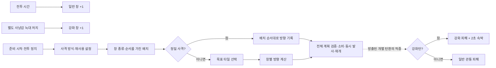

# 두건 기본형 · 조립 모델 검토

2026-10-19. 현재 두건 예제, 편집 문서 모델, 그래프와 최신 콘텐츠 합의를 대조했다.
검토 대상은 **창 획득 → 배치·조준 → 소비·동시 발사 → 탄환별 적중**이다.

현재 조립기는 큰 흐름과 적중 효과를 표현할 수 있다. 다음 구현에서 먼저 필요한 것은
**사격 계획의 구조와 실제 참조, 준비·확정·중단의 경계**다. 노드의 선은 실행 순서를
보여주지만, 앞 입력에서 만든 결과가 다음 블록에 올바르게 전달되는지는 아직 검사하지 않는다.

## 기준과 검토본

- 현재 규칙: [두건 파편 · 2026-10-19 합의](../../core_enhanced/docs/content/abnormalities/little-red/fragment.md#current-2026-10-19).
- 효과 구분: [태그·유물 연결](../../core_enhanced/docs/content/abnormalities/little-red/synergies.md).
- 비교한 기존 예제: [examples.ts](../src/skill/examples.ts)의 `exampleSkill("hood")`.
- 작성/검증 경계: [model.ts](../src/skill/model.ts), [validation.ts](../src/skill/validation.ts), [graph-model.ts](../src/skill/graph-model.ts).
- 편집 가능한 결과: [두건 검토본 JSON](examples/hood-review.skill.json).

앱의 **스킬 → 열기**에서 검토본 JSON을 선택하면 된다. 기존 예제와 비교할 수 있도록 별도 파일로
작성했다. 사격 설정 입력, 집중 사격의 방향 계산, 일반탄 적중 경로를 보완했다.
빈 초기값·수명·피해 수치는 그대로 남겼다. 이 검토본의 결과 이름·조건·계산은 설계 문자열이며
실행 수식이나 새 schema를 선언하지 않는다. 아래 미정 규칙의 추천안도 JSON에 확정값으로 넣지 않았다.

## 원문에서 이미 결정된 것

| 항목              | 현재 합의                                                          | 검토 결과                                                      |
| ----------------- | ------------------------------------------------------------------ | -------------------------------------------------------------- |
| 창 획득 시계      | 일반 창 획득과 별도 늑대 출현은 전투 진행 시간. 배치·조준 중 정지  | 입력 중 시간 진행을 다시 결정할 필요가 없음                    |
| 보상              | 시간으로 일반 창 1개씩, 별도 사냥감 늑대 처치로 강화 창 기본 1개   | 기존 표식 적이나 액세서리 현상금으로 대체하지 않음             |
| 늑대 약점         | 두건 계열 파편·무기에서 나온 피해를 50% 더 받음                    | 장착자의 모든 피해 증가가 아니며 늑대 쪽 조건부 받는 피해 규칙 |
| 준비 시작         | Core가 전투를 정지하고 현재 일반·강화 창 수로 배치 준비            | 시작 사건의 조건 문자열에 행동이 섞여 있음                     |
| 배치              | 보유 수만큼 타일 선택. 좌클릭 일반 / 우클릭 강화. 배치 순서 보존   | 임의 타일 입력의 종류·수량·순서를 구조로 담아야 함             |
| 재사용            | 마지막 배치만 재사용, 방향은 다시 입력                             | 배치와 사격 계획을 별도 값으로 다뤄야 함                       |
| 정밀 사격         | 배치 순서대로 방향 기록. 클릭만으로 발사·피해가 나지 않음          | 조준 순서와 발사 순서를 혼동하면 안 됨                         |
| 집중 사격         | 유효 목표 타일 하나에서 창별 방향 계산                             | 사람의 선택과 계산을 검토본에서 분리                           |
| 확정              | 전체 입력·보유량 검증 뒤 소비·모든 탄환 발사·전투 재개를 함께 확정 | 일반 순차 블록으로 분해해 부분 확정하지 않음                   |
| 적중              | 재개된 전투에서 관통·피해 처리. 각 탄환이 같은 적을 맞힐 수 있음   | 동시 발사와 동시 적중은 다름                                   |
| 탄환별 효과       | 일반탄 관통 피해 / 강화탄은 더 강한 관통 피해 + 2초 속박           | 일반탄 경로를 보완하고 피해·속박을 구분                        |
| 확정 전 단절      | 임시 배치·조준 폐기, 미소비, Core의 정지 상태 유지                 | 일반 취소와 별도 경로로 보존                                   |
| 확정 후 응답 유실 | 이미 확정한 소비·발사는 유지                                       | 재전송 중복 방지의 식별 규칙은 별도 미정                       |
| 프로세스 종료     | 전투 상태 소실 시 노드 진입 전 저장 경계로 복귀                    | 조준 중간 상태를 디스크에 새로 저장하는 요구가 아님            |
| 연출              | 두건의 위치 이동은 연출. 실제 직원 배치·점유·저지 위치는 유지      | 창/형상을 소환 유닛으로 자동 모델링하지 않음                   |

개화형과 전용 유물 효과는 기본 탄환에 합치지 않는다. 강화 창 획득량 2배도 해당 유물 적용 때의
수정이며 기본 보상 1개를 바꾸지 않는다. 강화탄 속박에 슬러그탄의 기절이나 깨진 균형을 자동 연결하지 않는다.

## 현재 예제와 조립기의 빈틈

| ID  | 관찰                                                 | 실제 제작에서 생기는 문제                                      | 이번 처리 / 후속 작업                                                            |
| --- | ---------------------------------------------------- | -------------------------------------------------------------- | -------------------------------------------------------------------------------- |
| H01 | 분기가 읽는 사격 방식의 입력 단계가 없음             | 무엇이 분기를 결정하는지 그래프에 안 보임                      | 검토본에 사격 설정 입력 추가                                                     |
| H02 | 배치 입력의 결과가 이름 한 줄                        | 창 종류·수량·순서·원점의 보존 여부를 확인할 수 없음            | 메모에 합의 보존. 구조가 있는 배치 목록 필요                                     |
| H03 | 집중 사격 입력 하나가 타일 선택과 방향 계산을 겸함   | 사람이 고른 값과 계산한 값의 책임이 섞임                       | 입력 → 계산 두 블록으로 분리                                                     |
| H04 | 두 분기가 같은 `사격 계획` 문자열을 생성             | 경로별 결과의 타입·합류·사용 가능 시점을 검사하지 않음         | 분기 결과를 받는 명시적 참조 필요                                                |
| H05 | 확정 블록에 소비·발사를 긴 문장으로 작성             | 어떤 목록을 소비/발사하는지, 누락·중복 발사가 있는지 검사 불가 | 검토본에 원자적 경계 보존. 실제 계획을 받는 확정 연산 필요                       |
| H06 | `탄환 발사` 블록에는 정의/출처/적중 처리 참조가 없음 | 발사한 탄환과 뒤 적중 사건이 서로 연결되지 않음                | 탄환 종류와 적중 처리의 안정적인 ID 연결 필요                                    |
| H07 | 기존 예제에는 강화탄 적중만 존재                     | 일반탄 경로가 빠져 기본 공격 전체를 읽을 수 없음               | 검토본 적중 사건에 일반/강화 분기와 일반 피해 추가                               |
| H08 | 준비 시작·단절 복구가 조건/메모에만 있음             | 정상 흐름 외 취소·실패·확정 후 상태를 표현/검증 못 함          | 준비 단계의 성공·취소·단절 결과와 소유 수명 필요                                 |
| H09 | 늑대 생성과 출처 한정 약점 연산이 없음               | 강화 창 획득 사건만으로 늑대가 존재하는 것처럼 읽힐 수 있음    | 별도 적 생성·피해 조건 기능의 필요를 기록. 가짜 대기/피해 블록으로 대체하지 않음 |
| H10 | `timer`에 주기·시계 속성이 없고 조건 문장에만 기입   | 주기가 미정이어도 해당 진단이 나오지 않음                      | 사건 설정의 전투 시계·주기 입력 필요                                             |
| H11 | 상태의 소유 대상은 선택 가능하지만 타입·상한은 없음  | 두 스택의 보유/소비와 재사용 배치 같은 목록을 구분 못 함       | 정수 스택과 구조 목록, 소유 범위·수명을 구분                                     |
| H12 | 진단은 빈 문자열·끊어진 상태 참조·빈 절차 중심       | `공명량 미정`이나 존재하지 않는 결과 이름도 채워진 값으로 취급 | 결과 참조·타입·단위·확정 경계 진단을 단계적으로 추가                             |

`commit` 뒤에 `projectile`을 추가하는 임시 수정은 하지 않았다. 그렇게 그리면 소비가 먼저
확정되고 발사가 나중에 실패할 수 있는 다른 의미가 된다. 한 묶음의 계획을 함께 검증·확정하는
구조가 있어야 합의한 경계를 표현할 수 있다. 이때 조립기 문서 편집의 Undo 트랜잭션과
게임 실행 중 소비·발사 트랜잭션은 서로 다른 책임이다.

## 실제 화면에서 확인한 불편

| ID  | 재현과 관찰                                                                                                                     | 개선 방향                                                                                                                     |
| --- | ------------------------------------------------------------------------------------------------------------------------------- | ----------------------------------------------------------------------------------------------------------------------------- |
| V01 | 960×640에서 준비 분기를 펼치면 긴 가로 흐름 전체를 맞추느라 글자가 매우 작아짐. ‘선택 동작 보기’도 가로 길이 때문에 읽기 어려움 | 전체 개요와 단계 편집의 배율을 구분하고 선택 단계 중심 확대를 제공. 구조 편집 후 전체 맞춤으로 읽던 위치가 바뀌는 동작도 점검 |
| V02 | 사격 설정·창 배치·정밀 조준·목표 선택이 모두 ‘플레이어 입력’이라는 제목                                                         | 종류와 별도로 짧은 사용자 단계 이름을 표시. 의미를 확인하려고 매번 속성을 열지 않게 함                                        |
| V03 | 배치·계산·확정 메모가 한 줄 입력에 들어가 핵심 규칙이 화면 밖으로 잘림                                                          | 메모와 긴 설명은 여러 줄 편집. 노드에는 짧은 요약 유지                                                                        |
| V04 | 분기 선의 ‘참/아니면’만으로 정밀/집중이나 강화/일반의 의미가 바로 드러나지 않음                                                 | 구조가 있는 조건을 도입할 때 실제 선택지 이름을 경로에 표시                                                                   |

[기본 크기 개요](../artifacts/hood-review-20261019/hood-review-overview-default-light.png),
[최소 크기 준비 흐름](../artifacts/hood-review-20261019/hood-review-preparation-minimum-light.png),
[큰 화면 준비 흐름](../artifacts/hood-review-20261019/hood-review-preparation-large-dark.png),
[일반/강화 적중](../artifacts/hood-review-20261019/hood-review-impact-minimum-dark.png)을 직접 확인했다.
선택한 적중 흐름을 확대하면 다른 사건 행이 화면 밖으로 나가는 것은 캔버스 이동 결과다.
모든 사건을 항상 같은 배율로 읽을 수 있다고 평가하지 않았다.

## 검토본을 읽는 순서

점선은 필요한 탄환 연결의 의미를 설명한다. 현재 편집기의 서로 다른 사건 행 사이에는
이런 실제 참조가 없다. 이 도식과 검토본을 실행 가능한 코드로 취급하지 않는다.
늑대 생성/약점과 중단 경로는 현재 블록으로 표현되지 않는 별도 요구다.
강화 피해 → 속박의 나열은 기존 예제의 순서를 유지한 검토용 표현이다. 치명상 이후 속박 적용 등
동일 적중 내부의 세부 처리 순서를 이 검토로 확정하지 않는다.

## 아직 사용자가 정해야 할 규칙

아래는 **추천안**이며 채택되지 않았다. 주기·피해 계수 같은 수치는 이후 조정해도 되지만
다음 조작·실패 정책은 입력 모델을 구현하기 전에 정하는 편이 좋다.

| 결정             | 추천안                                                             | 다른 선택과 영향                                                                                             |
| ---------------- | ------------------------------------------------------------------ | ------------------------------------------------------------------------------------------------------------ |
| 일반 취소        | 최종 확정 전 Esc: 임시 배치·조준 폐기, 미소비, 전투 재개           | 정지 유지도 가능하지만 취소 후 계속 멈춘 상태를 끝내는 별도 조작이 필요. 연결 단절의 정지 유지 합의는 그대로 |
| 재사용 불일치    | 종류별 수량/유효 타일이 안 맞으면 이유를 표시하고 직접 배치로 전환 | 유효한 배치를 보존하고 부족분만 보충할 수도 있음. 이 경우 순서·삭제·종류 교체 정책 추가 필요                 |
| 창 0개           | 준비 시작 불가와 이유 표시                                         | 기본 1발 허용은 새 원점·피해·비용 규칙까지 필요                                                              |
| 배치 중복·영벡터 | 중복 배치는 별도 결정. 원점과 목표가 같은 방향 입력은 재선택 요구  | 중복 배치 허용은 집중 효율에 영향. 직전 방향 재사용 같은 자동 보정은 아직 근거 없음                          |
| 연속 강화탄 속박 | 2초 속박의 재부여 정책을 공통 제어 규칙과 맞춰 확정                | 갱신·중첩·무시를 구분해야 함. 미채택 0.5초 연장/4초 상한을 적용하지 않음                                     |

그 밖에 초기 보유량·전투 간 유지·상한·상한 초과 보상, 늑대 출현/행동/퇴장·처치자 인정·여러
착용자의 소유권, 공명 비용·사용 자격, 배치 범위·공중/장애물·탄환 기하·피해 수치,
전투 종료·소유자 이탈 정리는 계속 미정이다. 이 검토가 값을 새로 정하지 않는다.

## 문서 간 충돌도 확인됨

1. [작성 모델 §7.5](../../core_enhanced/docs/skills/skill_authoring_model.ko.md)는 맵 앵커와
   정지 중 사격 판정, 단절·소비 경계 미정을 설명한다. 현재 파편 본문의 자유 타일 배치,
   전투 재개 시 동시 방출, 단절 정책과 달라 **현재 두건의 기능 명세로 그대로 사용하면 안 된다.**
   공통 기술 개념은 참고하되 후속 구현 문서를 작성할 때 최신 합의로 다시 대조해야 한다.
2. [장비 문서의 ‘파편과의 결합’](../../core_enhanced/docs/content/abnormalities/little-red/equipment.md)은
   아직 파편의 현상금 표식과 액세서리 늑대의 공유·막타 무관 창 획득을 기술한다.
   현재 파편은 별도 사냥감 늑대이며 액세서리와 구분하고 처치자 인정도 미정이다.
   이 문단의 재합의가 필요하며, 검토본에 과거 결합을 가져오지 않았다.

## 다음 구현을 위한 최소 범위

먼저 **사격 계획 한 개가 입력에서 확정까지 전달되는 경로**를 구현 대상으로 잡는다.
현재 엄격한 version 1 형식을 변경할 때는 지원 버전·기존 파일 보존 정책도 함께 정한다.

1. 사격 설정, 순서가 있는 배치 목록, 창별 원점·종류·방향의 사격 계획을 구분한다.
2. 결과를 표시 이름 대신 안정적인 ID로 참조한다. 분기에서 선택된 결과만 뒤에서 읽게 한다.
3. 준비 상태의 전투 정지 소유권과 성공·취소·단절 경계를 표현하고, 확정 블록이 계획을 받게 한다.
4. 탄환 정의/출처와 개별 적중 처리 연결을 붙인다. 두건 전용 문자열 해석으로 우회하지 않는다.

완료 판단은 다음 사례로 한다.

- 결과 이름을 바꿔도 연결 유지, 생산 블록 삭제 시 소비 블록에 진단, Undo 후 같은 연결 복구.
- 방향 대신 타일을 연결하거나 분기 밖에서 없는 결과를 읽으면 진단.
- 재사용은 배치만 가져오고 양쪽 모드에서 새 방향을 작성. 정밀 입력 클릭은 실제 발사를 만들지 않음.
- 창 종류·수량·타일 중 하나라도 무효이면 전체 확정 거부. 부분 소비·부분 발사 없음.
- 정상 확정은 두 모드 모두 같은 시점에 전체 방출. 적중은 각 탄환의 사건으로 처리.
- 확정 전 단절은 미소비·정지 유지, 확정 후 응답 유실과 재전송은 중복 소비·발사 없음.

마지막 세 항목은 Core/호스트 연동 단계의 검증 기준이다. 편집기 검사만으로 통과를 선언하지 않는다.

## 검증 기록

`npm run check`가 통과했다. `npm run ui:inspect -- tests/ui/hood-review.spec.ts`로
960×640, 1280×800, 1920×1080 각각 밝은/어두운 테마의 6개 검사를 통과했다.
실패·건너뜀·불안정 재시도와 브라우저 오류·경고는 모두 0개다.

검토본을 실제 스킬 화면에 열어 사건·분기·속성·미정 값을 확인하고, JSON 다운로드 후 원문과
동일한 문서가 나오는지 검사했다. 재현 시나리오는 `tests/ui/hood-review.spec.ts`다.
브라우저 검사는 실제 전투 진행·타일 선택·조준을 실행하는 것이 아니라 **설계 문서의 편집과 표시**를 확인한다.

[원본 보고서](../artifacts/hood-review-20261019/final/report.json)와
[집계](../artifacts/hood-review-20261019/summary.json), 크기·테마별 PNG를 보존했다.
자동 접근성 위반은 0개이며 변환된 노드 등의 대비 판단 `incomplete` 6회는 직접 이미지로
읽기와 배경을 검토했다. 자동 통과나 접근성 전체 검증 완료로 간주하지 않는다.
검토본의 작성 진단 8개는 상태 초기값·수명 4개와 일반/강화 피해 수치·유형 4개다.
문장 속 주기·공명·소유 정책 미정까지 8개로 모두 집계된다는 뜻은 아니다.

제품 코드와 기본 예제를 변경하지 않아 이번에는 프런트엔드 빌드·기존 전체 모델 검사를
반복하지 않았다. 검토용 JSON·UI 재현 시나리오·문서를 추가했고 문서 형식은 기존 parser로 검증했다.
WSL Chromium 결과이며 Windows WebView2·Tauri·실제 한글 IME·Core 실행은 미검증이다.
