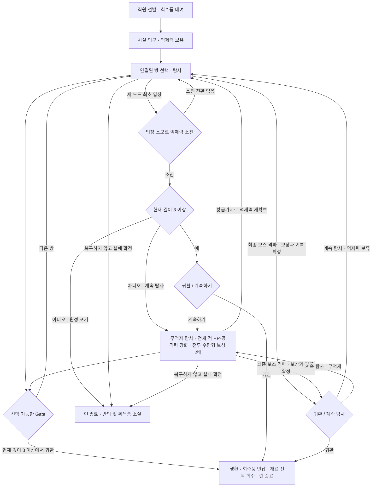

# 원정 흐름과 클리포트 억제력

[게임 설계서](../game_rulebook.md) · [시설 지도](run-and-map.md) · [회수와 저장](results-and-save.md) · [합의 기록](../decisions/game_rulebook_next_expedition_2026-09-27.md)

2026-10-03까지 합의한 차기 목표 설계다. 구현 완료나 개별 조우의 밸런스 검증 완료를 뜻하지 않는다.

## 원정의 목적과 반복

여러 런에 걸쳐 같은 시설의 정보를 조금씩 밝혀 가며 서로 다른 경로와 환상체를 탐사한다.
전체 맵은 여러 방으로 구성되고 방 안에는 활동 노드가 있다. 층은 방의 깊이이며 입구 0층, 공개 최종보스 8층이다.
흉탄은 마탄 옆 같은 층의 별도 방이라는 예외이며 [이번 원정의 마탄 완료](run-and-map.md#보스-분류와-연속-조우)로 접근한다.
우회 탐사까지 포함한 방문 방 수를 무조건 8개로 제한하지 않는다. 시설 깊이와 원정 중 방문 수를 구분한다.
전체 연결 구조와 방 내부의 노드 생성은 [시설 지도](run-and-map.md#전체-시설-지도)를 따른다.

관리자는 원정을 넘어 동일 인물로 유지하며, 탐사에는 매번 새로운 수감자를 선발한다.
회사는 원정 종료 후 정보 유출 방지를 명목으로 생존한 탐사 인력을 살처분하므로 직원 개인의
성장·부상·트라우마를 다음 원정에 계승하지 않는다. 성공적으로 회수한 장비·파편 중
합계 최대 2사본을 다음 원정에 대여하고, 영구 탐사 기록과 회수 자산은 각 보존 규칙을 따른다.
성공 귀환과 인력 처분의 관계는 [원정 종료와 탐사 인력 처분](results-and-save.md#원정-종료와-탐사-인력-처분)을 따른다.

## 억제 장치와 소모

부대는 휴대형 클리포트 억제 장치를 가지고 시설에 들어간다. 황금가지와 억제 장치를 연결해
환상체의 힘을 억제하고, 황금가지 회수로 원정 중 억제력을 보충하는 설정을 사용한다.
이는 이 게임에서 채택한 설정이며 원작 전체의 기술 관계나 약화 비율을 확정하는 설명은 아니다.

억제력은 **새로운 활동 노드에 최초 입장을 확정할 때 소모하는 작전 한계**다. 방 사이 이동 자체에는 비용이 없다. 미리보기·입장 확인 화면을 여는 것만으로는 소비하지 않으며,
실제 입장을 최종 확정할 때 해당 노드에 작성된 소모량을 한 번 적용한다. 현실 시간에 따라 줄어드는 타이머로 쓰지 않는다.

| 행동 | 억제력 소모 |
| --- | --- |
| 새로운 전투·Event·정비·상점·본사 연락·SavePoint·보상 노드 최초 입장 | 노드별 작성 소모량을 한 번 적용. 부활 전투로 전환한 노드도 동일 |
| 시작 노드·Gate 및 방 간 하강·지정 횡단 이동 | 소모 없음. 방 이동과 다음 활동 노드 입장을 이중 청구하지 않음 |
| 완료한 노드 통과·지도 확인·편성·장비 변경·고민하는 시간·입장 전 취소 | 소모 없음 |
| 이미 입장한 미해결 노드 재입장 | 추가 소모 없음. 미해결 노드도 최초 입장 기록 유지 |
| 전투 후퇴 | 전투에서 생긴 손실만 복원. 최초 입장 소모는 반환하지 않으며 추가 억제력 소모 없음, 후퇴 기회 1회 소비·최대 2회 |
| 노드 활동 해결·입장 후 활동 거절·취소·실패 | 추가 소모나 최초 입장 비용 반환 없음. 노드 완료 여부는 별도 진행 규칙 적용 |

정비 등 한 노드에서 여러 작업을 해도 최초 입장 때만 차감한다. 일반전 노드를 부활 전투로 전환해도
같은 노드의 최초 입장 기록을 지우거나 입장 비용을 중복 청구하지 않는다. 알·촉매제의 부화 비용은 별도다.
잔량보다 소모량이 크면 잔량을 0까지 낮추며, 억제력 0에서도 새 노드에 입장할 수 있다.
시한부 직원의 [Breakdown 유예](results-and-save.md#breakdown의-유예)는 실제 잔량 감소가 아니라
해당 최초 입장의 **규정 소모량 전부**를 누적한다. 억제력 소진·보충이 유예를 정지하거나 되돌리지 않는다.

입장 확정 시 소모·최초 입장 기록·시한부 유예를 함께 반영하고, 소진 선택은 노드의 전투·보상·정비 등
활동을 시작하기 전에 처리한다. 귀환을 선택하면 그 노드의 활동 보상이나 완료를 얻지 않는다.
시한부 사망으로 진행 불가가 된 경우에는 기존 런 실패·복구 판정을 적용한다.
입장 전 화면에서 비용·예상 잔량·무억제 강화 여부와 시한부 직원의 예상 잔여 유예·사망 위험을 보여준다.
구체적인 노드별 소모량과 활동 취소·실패·소진의 처리 구현은 NEXT-03·17에서 다룬다.
일반전·엘리트·일반 보스·부활은 패배 확정 즉시 노드를 소비하고 실패 통과하며 성공 보상·격파 기록을 얻지 않는다.
패배 후 재도전은 없고 결과 전 후퇴만 최대 2회 허용한다.
게임 종료의 미확정 노드 복구는 입장 비용·유예까지 입장 전으로 되돌리는 별도 규칙이다.

초기량은 **필요한 성장 노드를 선택해 탐사하면 중반 이후 부족해지는 흐름**을 조정 기준으로 삼는다.
성장에만 집중하면 작전 여유가 부족하고, 성장을 생략한 빠른 하강은 직원이 약해 전투가 어려워야 한다.
부활 전투에 투자할지, 황금가지를 회수해 탐사를 연장할지도 이 선택에 포함한다.
이는 특정 깊이에서 반드시 소진시키는 규칙이 아니다. 최초 보유량·노드별 소모량·보충량·상한은
노드 수·성장곡선·보상과 함께 실제 플레이로 조절한다. 황금가지의 물리적 소모와 장치의 가용 억제력은 구분한다.

## 소진과 귀환

Gate 및 억제력 소진에 따른 **선택형 성공 귀환은 현재 3층부터 허용**한다.
방문한 방 수가 아니라 시설 지도에 작성된 깊이를 기준으로 하며, 같은 깊이의 횡단 방문으로
귀환 조건을 충족하지 않는다. 깊이 3의 방을 먼저 클리어해야 하는 조건은 아니다.

| 상황 | 처리 |
| --- | --- |
| 깊이 1~2에서 선택 가능한 Gate에 도달 | 다음 방 이동만 가능하며 성공 귀환은 불가. 목적 방의 깊이가 3이어도 이동 전 현재 층에서는 귀환할 수 없음 |
| 깊이 3 이상에서 선택 가능한 Gate에 도달 | 억제력 잔량과 무관하게 `귀환 / 다음 방`을 선택한다 |
| 깊이 1~2에서 억제력이 소진됨 | 성공 귀환은 불가. 무억제 탐사를 계속하거나 원정을 포기한다. 소진 자체는 즉시 실패가 아님 |
| 깊이 3 이상에서 억제력이 소진됨 | `귀환 / 계속하기`를 선택한다 |
| 소진 시 귀환 선택 | 성공적으로 생환하고 런을 종료한다. 회수품을 반납하되, Gate 이용 전 현재 방의 신규 클리어 기록은 만들지 않는다 |
| 소진 시 계속하기 선택 | 억제력 없이 런을 지속한다. 일반 침식체를 포함한 전체 적의 HP·공격력이 조우별 1.5~2배가 되고, 해당 전투 승리의 지정 수량형 보상은 기존 총량의 2배가 된다 |
| 계속하기 이후 | 깊이 3 이상에서 도달한 선택 가능한 Gate에서 귀환할 수 있다. 재보충·재소진은 필수 조건이 아니다 |
| 최종 보스 격파 | 보상·격파 기록·해당 방 클리어와 영구 탐사 기록을 확정한 뒤, 억제력 잔량과 무관하게 `귀환 / 계속 탐사`를 선택한다 |
| 전멸 등 실패 조건 성립 | 기존 체크포인트 복구 기회를 적용하고, 실패가 확정되면 런을 종료하고 반입·획득 회수품을 잃는다 |
| 자발적 원정 포기 | 성공 귀환 정산을 하지 않고 런을 종료한다. 현재 원정의 반입·획득 회수품은 소실되고 재료 선택 회수도 하지 않는다 |

Gate가 아닌 임의의 위치에서 상시 귀환하는 기능은 아니다. 억제력이 없는 상태를 유지한다고
소진 선택을 계속 다시 열어 주지는 않으며, 깊이 3에 진입한 것만으로 소진 귀환 선택을 다시 열지도 않는다.
깊이 3 이상에서 도달한 선택 가능한 Gate의 귀환 선택은 유지한다.
일반 방의 Gate는 연결 경로의 노드를 해결해 도달하면 이용 가능하며, 추가 노드 해결 수나 일반 보스 처치를 요구하지 않는다.
이 이동 가능 조건과 성공 귀환의 깊이 조건은 구분한다. 귀환 불가 화면에는 깊이 3부터 가능함을 표시한다.
공개 최종 보스와 숨겨진 최종 보스 모두 격파 후 귀환 여부를 선택한다.
일반 방은 선택 가능한 Gate를 통해 다음 방 이동 또는 귀환을 확정할 때 클리어와 영구 탐사 기록을 남긴다.

최종 보스 승리 후 귀환을 선택하면 그 보상을 포함한 회수품을 정산하고 원정을 종료한다.
계속 탐사를 선택하면 전투 밖에서 새 장비·파편을 장착하고 기존 지도에서 연결된 방의 미해결 노드를
탐사할 수 있다. 최대 깊이 8과 상승 금지, 노드 최초 입장 비용은 유지한다. 같은 층의 연결된 방은
양방향 이동과 재방문이 가능하며, 재방문으로 노드 완료·입장 비용을 초기화하지 않는다.
실제 연결과 개별 진입 조건이 맞으면 같은 원정에서 다른 최종 보스에 도전할 수도 있지만 이를 보장하지 않는다.
이후 귀환은 선택 가능한 Gate·억제력 소진·다른 최종 보스 승리의 기존 자격과 선택 시점을 따른다.
계속 탐사를 선택한 것만으로 보상을 시설 밖에 반납하거나 재료를 창고에 보관하지 않는다.
이후 실패하면 최종 보스 보상을 포함한 원정 회수품도 기존 규칙대로 잃고, 확정한 영구 기록은 유지한다.

소진 선택을 제시하는 정확한 화면·처리 시점과 다른 결과의 동시 발생 우선순위는 NEXT-17에서 정한다.
게임 종료 후 이어하기는 모든 진행 중 노드의 미확정 상태를 입장 전으로 복원하고, 이미 결정된 승패와 노드 소비는 결과 화면 확인 여부와 무관하게 유지한다.
승패 전 종료 복구는 수동 후퇴 횟수를 쓰지 않고 이미 사용한 횟수도 되돌리지 않는다.
입장 비용·Breakdown·재료 소비·결과를 함께 복원하며 수동 후퇴의 비용 유지와 구분한다.
기존 SavePoint와 런당 명시적 불러오기 최대 3회는 유지한다.
전투를 진입 전으로 되돌리는 Battle Retreat, 직원 한 명의 철수, 시설 밖으로 생환하는 귀환은 별개다.
깊이 3까지의 빠른 회수 원정이 깊은 탐사보다 항상 효율적인지, 첫 성공 귀환까지의 실제 시간과
초반 실패 부담은 플레이 검증 대상으로 남긴다. 현재 귀환 기준은 깊이 3이며 임의로 2로 낮추지 않는다.

### 무억제 강화와 보상

무억제 상태에서는 **일반 침식체·엘리트·일반 보스·최종 보스·알 부활 환상체를 포함한 전체 적의
HP·공격력을 1.5~2배로 강화**한다. 조우별로 배율을 작성하고 진입 전에 공개하며,
매 시도마다 숨겨진 무작위 배율을 추첨하지 않는다. 구체적인 조우별 배율은 플레이로 검증한다.
이동 속도·공격 속도·사거리·저지 요구량은 이 강화의 대상이 아니며 패턴도 추가하거나 변경하지 않는다.
부활 단계에 따른 강화는 유지하면서 **부활 단계 배율과 무억제 배율을 곱한다**.
예를 들어 각각 1.5배라면 기준 HP·공격력의 2.25배다(2026-10-14 사용자 선택).
구체적인 단계별·조우별 수치는 플레이 검증 대상으로 남긴다. 봉인 해제와의 스탯 중복 금지는 아래 별도 규칙을 유지한다.

무억제 전투에 승리하면 **엔케팔린·장비 가루·환상체 파츠·XP를 기존 지급 총량의 2배**로 받는다.
기본 보상과 달성한 보너스 목표의 해당 수량을 포함하며, 총량에 한 번 적용한다. 기존량에 2배를
더해 3배로 지급하는 뜻이 아니다. 파편·알·장비·유물의 수량이나 선택 횟수, 황금가지 수량 및
억제력 보충량에는 적용하지 않는다. 상점·정비와 유물 보상 노드의 비전투 활동에는 적용하지 않는다. 스트레스 전투에는 적 강화와 해당 보상 배율을 적용한다.
보상 배율의 상세 지급 경계는 [무억제 전투 보상](growth-and-rewards.md#무억제-전투-보상)을 따른다.

강화와 보상 배율의 적용 여부는 **노드 최초 입장 비용 반영 후, 해당 전투 진입 시의 억제력 상태**로 함께 확정한다.
입장 비용으로 잔량이 0이 되고 계속하기를 선택했다면 그 전투부터 무억제 강화와 보상 배율을 적용한다.
무억제 봉인 보스 승리로 억제력을 보충해도 이미 적용된 전투 보상 배율은 유지한다. 후퇴·이어하기·복구는 각 진입·저장
시점의 상태를 따르며, 결과 화면에서 배율을 다시 선택하거나 보상을 중복 적용하지 않는다.
부활 선택·출전 준비 화면에는 강화 적용 여부, HP·공격력 배율과 변경값, 보상 배율·대상을 보여준다.

목표는 **소진 후 남은 모든 노드를 도는 것이 보통의 편성에 항상 최선이 되지 않게 하는 것**이다.
충분히 강한 편성이 위험을 감수하고 무억제 탐사를 활용하는 전략은 허용한다. 추가 전투 선택률,
부상·사망, 성공 귀환까지 실제 회수한 보상과 조기 귀환의 가치를 함께 검증한다.
무손실 후퇴를 통한 선별 도전과 부활 비용까지 포함해 위험 대비 보상을 조절한다.

## 일반 보스와 황금가지 봉인

일반 보스는 지나치거나 격파할 수 있다. 모든 일반 보스를 다음 방 입구의 필수 관문으로 두지 않는다.
황금가지로 봉인된 일반 보스는 다음 선택을 제공한다.

| 선택 | 결과 |
| --- | --- |
| 봉인을 건드리지 않고 통과 | 해당 황금가지를 포기하고 전투를 피한다 |
| 황금가지를 회수하기 위해 봉인 해제 | 억제되던 보스가 깨어나 강화된 일반 보스 전투가 시작된다. 승리 후 황금가지 획득과 억제력 보충을 확정한다 |

**일반 보스 출현 노드는 고정**하며 새 원정에도 유지한다. 황금가지는 **매 원정 재생성**하고,
**원정 시작 때 시설 연결과 실제 이동 조건에 맞는 사전 작성 배치안 하나를 선택**한다.
배치안은 여러 개 작성하며, 고정 출현 노드의 **즉시 조우 가능한 일반 보스**를 배정 대상으로 삼는다.
개별 보스마다 독립적으로 황금가지 유무를 무작위 추첨하는 방식은 사용하지 않는다.
황금가지를 배정받은 대상은 봉인형으로 등장하며, 배정받지 않은 대상은 기존 일반형 조우를 따른다.
기존에 선정한 봉인 후보는 **웃는 시체의 산·아무 것도 없는·탐욕의 왕·파고드는 천국** 네 종이다.
배정 자격은 즉시 조우 가능 여부를 따라야 하며, 선행 사건 등 별도 조건이 필요한 조우에는 배정하지 않는다.
조건부 조우를 황금가지 배정을 위해 즉시 전투형으로 변경하지 않는다.
배치안은 시설 연결과 실제 이동 조건상 도달 가능한 위치를 사용하고, 주요 하강 경로마다 황금가지에 도전할
기회를 두어 특정 분기에만 몰리지 않게 작성한다. 깊이·이동 경로와 예상 소모를 함께 고려한다.
갈림길 선택으로 일부 가지를 포기하는 것은 허용하며, 한 원정에서 모든 가지를 회수할 수 있게 보장하지 않는다.
원정 중 경로 선택에 맞춰 가지를 이동하거나 재배정하지 않는다. 같은 원정의 배치안과 배정 결과는
지도 재확인·후퇴·재접속·저장 복구로 재선택하지 않고 유지한다.
허용되는 시설 연결·이동 조건에 맞는 배치안을 준비하며, 적합한 배치안이 없을 때
개별 보스 무작위 배정으로 대체하지 않고 배치안 작성 누락으로 다룬다.
구체적인 배치안·가지 수·깊이별 간격·경로별 분포와 배치안 선택 가중치는 플레이 검증 대상으로 남긴다.
선택된 배치안의 **황금가지 위치는 미탐사 방까지 포함해 원정 시작부터 전체 지도에 공개**한다.
가지 표식만으로 방 이름·컨셉·보스 정체를 추가 공개하지 않으며, 이 정보는 기존 지도 가시성 규칙을 따른다.
표식에는 회수 여부와 현재 경로에서의 도달 가능 여부를 구분해 표시한다.

**부대의 억제력이 이미 없는 상태라면, 황금가지 봉인 해제로 스탯을 추가 증가시키지 않는다.**
무억제 상태의 공통 보스 강화만 적용한다. 억제력 소진 강화와 봉인 해제의 스탯 강화를 중복하지 않는 예외다.
무억제 강화 자체에는 패턴 변화가 없다. 봉인 해제 고유의 패턴 변화 여부는 별도 미결 사항이며,
스탯 중복 금지로 이를 자동 제거하지 않는다. 강화 수치와 봉인 해제 고유의 세부는 NEXT-18에 남긴다.

황금가지 획득과 억제력 보충은 **봉인 보스 승리 판정 즉시 확정·저장**한다.
황금가지는 원래 시설의 봉인에서 획득한다. 해당 보스를 알로 부활시켜 격파해도
황금가지를 다시 지급하지 않으며, 부활 전투 보상으로 억제력을 보충하지 않는다.
봉인 해제 순간에는 가지나 보충 효과를 지급하지 않는다. 보충량은 임시 조절값으로 취급하며,
구체적인 수치는 초기 억제력·노드별 소모량·상한과 함께 실제 플레이로 검증한다.
봉인 전투에도 공통 무손실 후퇴를 허용한다. 후퇴하면 봉인·황금가지를 봉인 해제 전 상태로 복원하되,
최초 입장 비용과 그때의 시한부 유예 진행은 유지한다. 가지나 보충 효과를 얻지 않으며 후퇴 자체로
억제력은 추가 소모하지 않지만 후퇴 기회 1회를 소비한다. 억제력 소모와 소진 선택은 입장 때, 가지 보충은 승리 판정 즉시
처리한다. 노드 완료에 억제력을 다시 차감하지 않으며 세부 처리 구현은 NEXT-17에서 다룬다.

## 생환 후 다음 원정

성공 귀환 시 가져간 장비와 새로 획득해 보유 중인 장비를 모두 반납하고, 다음 원정에 장비·파편 합계 최대 2사본을 선택 대여한다.
종류별 할당 없이 0~2개를 선택하며 시작 직원 3명의 기본 세트와 별도다.
대여해 가져간 회수품은 실패하면 소실되고, 생환하면 다시 대여 가능 목록에 들어간다.
일반 강화는 시설 밖에서 초기화하며 회수한 파편의 개화는 유지한다.
시설 안의 메인터넌스가 주는 강화 효과가 밖에서는 사라진다는 설정이다.

클리어한 방의 고정 정보는 생환 여부와 무관하게 영구 탐사 기록으로 남긴다.
원정 중 정보 공개 범위가 늘어나도 해당 원정의 황금가지 배치안은 다시 선택하지 않는다.
사본 보관·직원과 다른 자원의 계승 범위는
[회수와 대여](results-and-save.md#원정-귀환과-회수품-대여) 및 [남은 결정](open-decisions.md)을 따른다.

재료는 성공 귀환 시 종류 합계 파츠 최대 2개와 별도 부활 촉매제 최대 1개를 선택해 공용 창고에 저장한다.
초기 플레이테스트 값이며 장비·파편의 최대 2사본 대여와 별도다. 정비 개화와 부화 화면에서
소지분·창고분을 직접 선택해 소비하며 사전 반입이나 원정별 추가 사용 한도는 없다.
알·가루·엔케팔린·침식 촉매제와 일반 회복·전투 소모품은 원정 간 보존하지 않는다.
[재료 회수와 공용 창고](results-and-save.md#재료-회수와-공용-창고)
