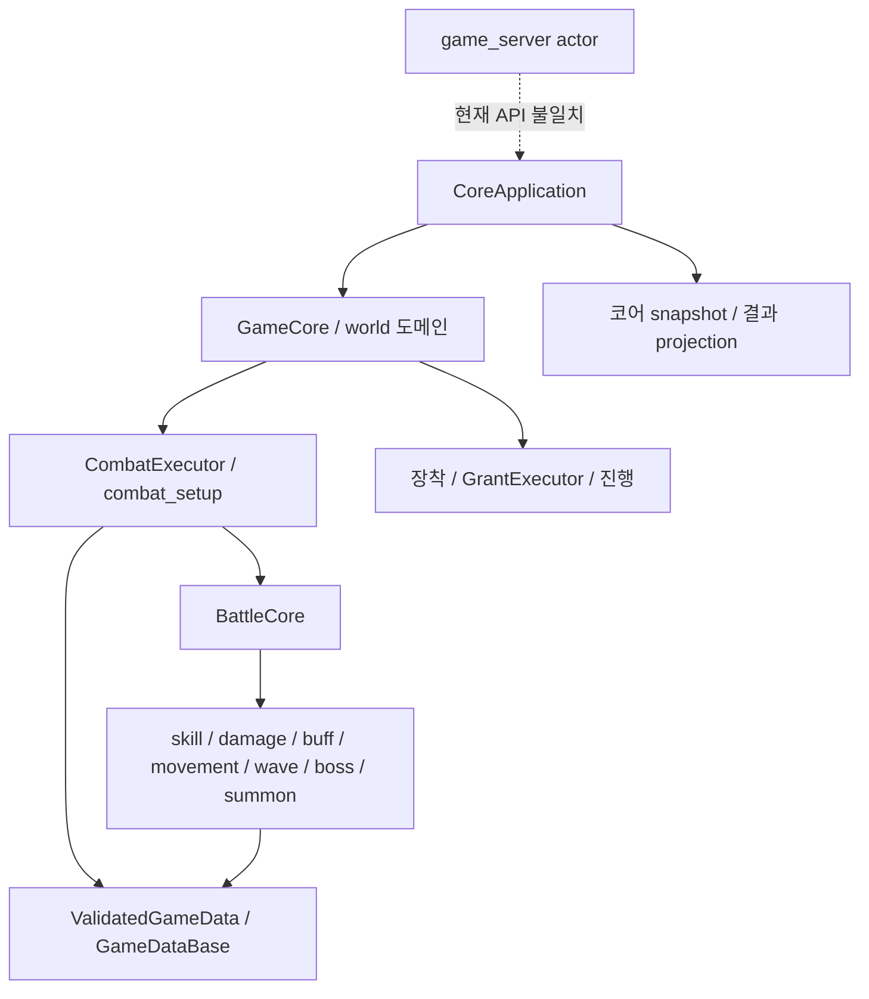
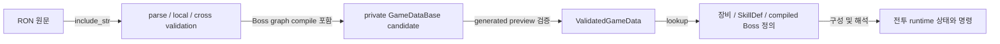
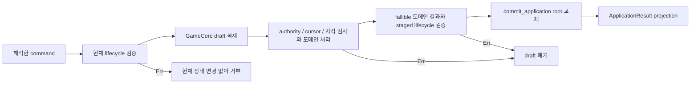

# 신규 정책 설계 검토를 위한 프로젝트 지도

2026-10-04 참조 정리: 아래 조사 결과는 2026-09-06 당시 구조·정책의 기록이다.
현재 게임 정책은 [게임 룰북](game_rulebook.md)·`game_rules/`를 따른다. 과거 동작 설명을 현재 요구로 승격하지 않는다.

## 1. 읽기 안내와 기준 상태

이 지도는 **현재 코어의 책임·상태 수명·실행 흐름을 이해하고 필요한 원문을 선택하는 입구**다.
유물·성장·침식 변경을 구현하기 전의 설계 검토 자료이며, 현재 설계 승인이나 구현 가능성 판정은 아니다.
먼저 2~3절로 구조를 잡고, 4절에서 실제 경로를 읽은 뒤 5~7절에서 검토 목적에 맞는 원문으로 이동한다.

후속 목표는 커뮤니티 제작자가 엔진이 지원하는 **명령·행동·조건·효과를 조합하여 보스·장비(무기 포함)·파편·유물을 RON으로 제작**하는 것이다.
지원하는 조합 안의 콘텐츠마다 전용 코드를 추가하지 않는 방향이며, 엔진 공통 기능을 확장하는 것은 가능하다.
현재 표현력이 충분한지, 어떤 기능을 추가할지는 후속 AI가 판단한다. 사용자는 필요시 전면 재작성도 고려한다.
후속 검토는 **현재 구조 유지·부분 재설계·전면 재작성**을 목표 충족, 재사용, 전환 비용·위험에 비추어 비교할 수 있다.
이 지도는 선택을 미리 결정하거나 새 아키텍처·구현 계획을 설계하지 않는다.

| 기준 | 내용 |
| --- | --- |
| 조사일 | 2026-09-06, Asia/Seoul |
| Git root / 코어 root | `simulator/` / `simulator/core_enhanced/` |
| 기준 HEAD | `f318414fb0156a67e04c5479000c2a2683fc0c09` |
| 실제 기준 | 위 HEAD **및 조사일의 미커밋 작업 트리**. HEAD만 체크아웃한 코드와 동일하지 않음 |
| 관련 수정 | 코어 application/world/battle/data/resources, Cargo 설정, 네 주요 계약 문서, 서버 actor·persistence·main, live 장비·파편·스킬·조우·run policy 등 |
| 관련 미추적 | `src/application.rs`, `world/application.rs`, `resources/equipment_loadout.rs`, boss/wave/summon 관련 추가 구현, `encounter_progression.rs`, 서버 `player_profile_store.rs`, boss/summoned-unit RON, 정책·콘텐츠 노트 및 이 Goal 등 |
| 관련 삭제 | 과거 battle validation/death 분리 파일, `abnormality_research.rs`, `.cargo/config.toml` 등. 삭제된 파일을 현재 실행 경로로 사용하지 않음 |
| 실행 모드 / 쓰기 | `investigation_only`; 이 지도와 [기존 Goal 네 문서](goals/project_architecture_map/PLAN.md)만 수정 |

**코드 확인**은 현재 원문에서 호출자·구현·변경 대상·소비자를 연결했다는 뜻이며 실행 검증을 뜻하지 않는다.
**현재 명세**는 기존 계약, **승인된 변경 목표**는 사용자 결정 기록, **추론**은 확인된 구조로부터의 해석이다.
**미확인**(사실 근거 부족), **미결정**(정책 보류), **비범위**(의도적 제외)를 구별한다.
2~4절의 설명은 별도 표시가 없으면 코드 확인이며, 연결의 단절도 확인한 결과로 기록한다.

사용자 확인(2026-09-06): 장비·스킬 파편 설계 완료, 유물 설계 중. 설계 완료는 구현·live data 반영 완료가 아니다.
[파편·장비 노트](skills/abnormality_skill_fragments_design_notes.md) 서문은 완료 상태와 함께 포큐버스의 보호 범위·공용 보호량,
아무 것도 없는의 개화 효과·침식 연출 등 보류된 세부를 별도로 남긴다.
[유물 콘텐츠 노트](skills/run_relic_content_design_notes.ko.md)는 역할 분류·설계 순서이며 개별 목록·수치는 후속 상태다.

코어를 중심으로 `game_server/src`의 호출·출력·저장 경계와 `game_resources/data`의 대표 데이터를 조사했다.
Unity 계약·클라이언트 구현과 실제 화면 소비는 조사 근거에서 제외한다. 서버의 출력 생산까지만 설명한다.
테스트 작성·실행, 빌드·check·clippy·probe·benchmark·서버 실행·fixture 생성·설치는 수행하지 않았다.
사용자가 `all test` 전체 통과를 확인했다고 보고했으며, 이 지도의 AI 재실행 결과나 현재 서버 통합 검증으로 취급하지 않는다.

전달할 압축본 또는 GitHub 코드는 **지도와 같은 미커밋 변경을 포함하는 상태**여야 한다. GitHub에서는 해당 변경을 포함한
실제 전달 commit과 위 조사 기준을 대조해야 한다. 서버·데이터·정책 원문도 접근 가능하게 하거나 누락 범위를 표시한다.
아래 링크는 이 파일 기준 상대 링크이며, 심볼이 기본 탐색 키다. 코어 링크 `../src/…`는 Git root의
`core_enhanced/src/…`, 서버·데이터 링크 `../../game_server/…`, `../../game_resources/…`는 Git root의 형제 프로젝트다.
압축·업로드·공개는 이 작업에서 수행하지 않았다.

## 2. 전체 책임과 데이터 조합 구조

### 2.1 호출 의존과 경계

다음 그림의 실선은 **호출/해석 의존**, 점선은 **현재 확인된 API 단절**이다. 상태 소유는 3절 표에서 따로 설명한다.

| 책임 | 원문과 심볼 | 읽을 이유 |
| --- | --- | --- |
| 외부 코어 포트 | [src/application.rs](../src/application.rs): `CoreApplication`, `ApplicationCommand`, `ApplicationResult`, `ApplicationSnapshotKind`, `ApplicationCheckpoint` | command 문서 해석, 오류·결과의 공개 shape, tick·재접속·저장 포트 |
| application 권한 | [world.rs](../src/game/world.rs): `GameCore`, `execute_with_transport_context`; [world/application.rs](../src/game/world/application.rs): `execute_application`, `commit_application`, `behavior_owner` | root 복제·도메인 분배·일괄 commit. world는 라이브러리 내부 구현 |
| 단계와 허용 동작 | [resources/state.rs](../src/game/resources/state.rs): `GameState`; [world/state.rs](../src/game/world/state.rs): `LifecycleContext`, `validate_application_context`; [action_capability.rs](../src/game/world/action_capability.rs), [battle_capability.rs](../src/game/world/battle_capability.rs) | lifecycle와 optional node/battle context의 일관성, 공통 및 payload 자격 검사의 소유 위치 |
| 맵·런·조우 진행 | [node_flow.rs](../src/game/world/node_flow.rs): `handle_confirm_enter_node`, `plan_complete_current_node`; [world/state.rs](../src/game/world/state.rs): `RunState`; [encounter_progression.rs](../src/game/encounter_progression.rs) | 맵 선택·노드 진입/완료·Floor 이동과 run-local source reward 진행 |
| 전투 준비 / orchestration | [events/combat.rs](../src/game/events/combat.rs): `CombatExecutor`; [world/combat.rs](../src/game/world/combat.rs): `plan_explicit_combat_node_with_state`, `commit_planned_live_battle_start` | preview의 authored 배치·웨이브·정책을 실제 scenario와 session으로 바꾸는 경계 |
| 전투 실행 | [battle/core/mod.rs](../src/game/battle/core/mod.rs): `BattleCore`; [sim.rs](../src/game/battle/core/sim.rs): `BattleExecutionState`, `process_event_inner` | 시간별 event queue, runtime instance, 계산과 결과 판정의 소유 |
| 공간 계산 | [battlefield/mod.rs](../src/game/battle/battlefield/mod.rs), [movement/mod.rs](../src/game/battle/core/movement/mod.rs), [build.rs](../src/game/battle/core/build.rs): `build_runtime_field` | authored tile/route와 runtime body·점유를 구분. 이동 세부 알고리즘의 적합성 평가는 별도 |
| 인벤토리·성장·공유 지급 | [inventory.rs](../src/game/resources/inventory.rs): `Inventory`, `OwnedEquipment`; [equipment_loadout.rs](../src/game/resources/equipment_loadout.rs): `EquipmentLoadoutTransition`; [grant_state.rs](../src/game/world/grant_state.rs): `EconomyGrantState`; [reward.rs](../src/game/reward.rs): `GrantExecutor` | 장착 두 장부, 재화/파편/직원/UUID의 공통 지급 경계 |
| 비전투 도메인 | [world/shop.rs](../src/game/world/shop.rs): `purchase_offer`; [world/event_node.rs](../src/game/world/event_node.rs), [world/headquarters.rs](../src/game/world/headquarters.rs), [world/visual_novel_triggers.rs](../src/game/world/visual_novel_triggers.rs) | 상점·이벤트·채용·대화의 도메인별 소유. 전투 효과와 같은 범용 명령 체계라고 가정하지 않을 것 |
| 출력 / 저장 | [world/snapshot.rs](../src/game/world/snapshot.rs): `get_run_snapshot_dto`; [world/active_run.rs](../src/game/world/active_run.rs): `export_active_run_checkpoint` | 파생 읽기 모델과 durable checkpoint를 구분 |

**확인된 단절 D01:** [서버 actor](../../game_server/src/game/player_game_actor/mod.rs)는 `game_core::game::world::GameCore`를 import하여 직접 소유한다.
반면 현재 [코어](../src/game/world.rs)의 `GameCore`는 `pub(crate)`이고 공개 소유자는 `CoreApplication`이다.
[서버 main](../../game_server/src/main.rs)의 `load_game_data_from_ron`은 `GameDataBase::load_live_embedded()`와 bare `Arc<GameDataBase>`를 사용하지만
현재 loader는 [data/mod.rs](../src/game/data/mod.rs)의 `ValidatedGameData::load_live_embedded()`다.
[서버 handlers](../../game_server/src/game/player_game_actor/handlers.rs)는 rollback capture/restore를 호출하지만 현재
[active_run.rs](../src/game/world/active_run.rs)에서 그 포트는 `#[cfg(test)]`다. 서버 저장소가 import하는 `ActiveRunCheckpointExport`의 world 재수출도 test 한정이다.
이는 현재 소스의 가시성·호출 규약 불일치이며 컴파일 명령으로 얻은 진단이 아니다.
이하 서버 경로는 **서버 파일에 작성된 처리와 현재 코어 내부 경로를 각각 설명**한다. 연결된 서버 실행 성공을 주장하지 않는다.

### 2.2 authored 정의에서 공통 실행까지

이 그림은 **데이터 변환/전달**을 뜻한다. [live_ron.rs](../src/game/data/live_ron.rs)의 `gameplay_ron_sources!`,
`GameplayRonSourceSet::embedded`, `ParsedGameplayRon::into_validated`와 [data/mod.rs](../src/game/data/mod.rs)의
`load_live_sources`, `from_validated_live_catalogs`, `try_validate_generated_combat_preview_contracts`를 순서대로 읽는다.
manifest schema는 1이며 manifest 외 24개 source를 macro inventory가 소유한다. 파싱·local/cross 참조·Boss compile 뒤에도
generated preview 검증 전에는 opaque publication token을 반환하지 않는다. 실패는 `LiveRonError`의 파일·domain·object·field·cause로 반환된다.
`include_str!`이므로 이 production 경로의 데이터 수정에는 재컴파일이 필요하다. 외부 pack 직접 로딩·hot reload·제작 프로그램은 확인된 기능이 아니다.

| 콘텐츠 | 정의·조합 | 실행·공유 경계와 확인한 제한 |
| --- | --- | --- |
| 장비 | [equipment_data.rs](../src/game/data/equipment_data.rs): `EquipmentMetadata`, `WeaponCombatProfile`; [stats.rs](../src/game/stats.rs): `TriggeredEffects`, `TriggerType`, `Effect`; [ability.rs](../src/game/ability.rs): `AbilityActivationBinding` | Permanent modifier는 stat pipeline, 발생형 effect는 trigger dispatcher, proc는 공통 SkillDef 실행으로 연결. 무기 profile은 기본 공격·배치·저지의 입력 |
| 파편·스킬 | [skill_fragment_data.rs](../src/game/data/skill_fragment_data.rs): `SkillFragmentEffectDef`; [ability.rs](../src/game/ability.rs): `SkillDef`, `SkillStepDef`, `SkillStepCondition`, `SkillStepRepeat`, `SkillEffectDef` | 파편이 skill ID/형태를 선택. 스킬은 순서 있는 step, 조건, 반복, Instant/Projectile/TileArea 전달을 조합. `sim.rs::build_skill_step_commands`가 damage/heal/stat/buff/interrupt/extra attack를 명령으로 해석. 전술 자원은 `record_skill_step_live_signals` → session 소비 |
| 보스 | [boss_runtime_data.rs](../src/game/data/boss_runtime_data.rs): `BossRuntimeCatalogData`, `BossControlNodeData`, `BossTaskData`, `BossConditionData`; [boss RON](../../game_resources/data/boss_runtime/base.ron) | encounter phase → actor behavior → State 또는 PatternCall → task/result/transition. 매개변수·선택·cooldown·우선순위·loop guard를 compile. runtime target/movement/summon/wake는 BattleCore에 연결 |
| 웨이브·소환 | [pve_data.rs](../src/game/data/pve_data.rs), [scenario.rs](../src/game/battle/scenario.rs): `ScenarioWaveActivation`; [summoned_unit_data.rs](../src/game/data/summoned_unit_data.rs) | 시간·group clear·actor HP/defeat/point의 조건 wave와 Boss Summon이 [spawn_kernel.rs](../src/game/battle/core/spawn_kernel.rs)의 spawn 경계를 공유. wave 진행 권한과 소환 batch 수명은 별도 |
| 유물 | [승인 목표](tmp/run_relic_system_design_notes_2026-08-21.ko.md)의 효과 태그·독립 사본·3슬롯·연쇄 | 확인한 catalog inventory, inventory/loadout, SkillDef/effect, runtime owner, checkpoint에는 신규 유물 aggregate/실행 경로가 없음. 옛 Artifact를 복원하는 요구가 아님 |

공통 기능과 전용 처리를 혼동하지 않기 위한 대표 읽기:

- [skills/base.ron](../../game_resources/data/skills/base.ron)의 `queen_of_hatred_magical_beam`은 복수 TileArea step을 공통 실행기로 처리한다.
  [skill_fragments/base.ron](../../game_resources/data/skill_fragments/base.ron)의 `fragment_freischutz_black_round`는 ActiveSkill 참조,
  `fragment_white_night_trace`는 명시적인 BasicAttackModifier placeholder다. 전체 설계의 live 반영 완료 근거가 아니다.
- [pve/encounters.ron](../../game_resources/data/pve/encounters.ron)의 `suppress_little_red`는 `little_red_reference_encounter`를 bind한다.
  [combat_setup/boss_runtime.rs](../src/game/combat_setup/boss_runtime.rs)의 `resolve_boss_runtime_setup_with_preview`는 actor slot을 wave/spawn의 unit ref로 해석한다.
  [boss_runtime.rs](../src/game/battle/core/boss_runtime.rs)의 `admit_state_tasks`는 AcquireTarget/MoveToTarget/RejoinForwardRoute 등을 공통 task 분기로 처리한다.
  ID를 lookup/binding하는 사실 자체는 콘텐츠별 전용 행동 분기가 아니다. 확인한 이 경로에서 Little Red 이름으로 전투 행동을 고르는 분기는 없었다.
- 동일 boss RON의 `cwbs_reference_summon_cycle`은 `NONPRODUCTION REFERENCE ONLY`로 표시된다. bundle에 있는 reference 정의와
  실제 출시 콘텐츠의 완성도를 동일시하지 않는다. `RepathToProtectedObjective`는 schema vocabulary에 있지만 validator/compiler가
  미구현으로 거부한다. enum 존재만으로 실행 지원을 판정할 수 없는 구체적 사례다.
- 도메인 특수 처리는 존재한다. 예를 들어 [world/shop.rs](../src/game/world/shop.rs)의 `is_wandering_monolith_shop`은
  RunPolicy의 특정 shop ID와 층 조건을 판정하고 `purchase_offer`는 Monolith 구매를 일반 GrantEffect와 별도로 처리한다.
  이를 보스·장비 전체가 ID별 hardcode라는 주장으로 확대하지 않는다.

**확장 위치 안내:** 기존 문법의 콘텐츠 추가는 RON 정의·ID 참조·local/cross validation·preview publication을 통과해야 한다.
새 공통 동작은 해당 enum/schema와 validator/compiler, `sim.rs` 또는 Boss task interpreter·command 처리·state/projection 경계를 함께 읽어야 한다.
이는 현재 코드 위치 안내이며 추가할 기능 목록이나 새 schema 설계안이 아니다. 커뮤니티 콘텐츠 전체의 표현 가능성 평가는 후속 검토에 남긴다.

## 3. 상태 소유와 수명

`GameCoreState`의 직접 필드라는 사실과 “런 동안 유지된다”는 개념 수명은 다르다. 아래의 저장은 durable SavePoint와
같은 process의 active battle 보존을 구분한다. `checkpoint`라는 이름의 네트워크 현재 상태 projection은 durable 저장이 아니다.

| 상태 / 물리 owner | 생성·변경·제거 | 저장·실패·재시도·재접속 보존 |
| --- | --- | --- |
| 정적 catalog / `GameCore.game_data: Arc<GameDataBase>` | 검증한 publication에서 생성; world와 BattleCore가 공유 | runtime 진행을 RON에 되쓰지 않음. 재시작은 새 publication과 저장 graph의 호환성 검증 필요 |
| 런·맵 / `GameCoreState.run: Option<RunState>` | starter 선택에서 생성; map/node/Floor/encounter handlers가 변경. `RunState`가 map/progression/facility/encounter/recruitment/session cache/attempt를 소유 | checkpoint·battle entry snapshot에 포함. Floor 전환의 carry-forward와 node-local 제거는 `RunState::with_persistent_run_state_from`, node completion 확인 |
| 직원 / `GameCoreState.roster: EmployeeRoster`의 `Employee` | definition → UUID 직원; level/XP, condition, loadout, fragment, psychology를 보유. 사망 record는 남음 | run-local이지만 `RunState`의 필드가 아님. checkpoint/retreat 복원 대상. 전투 HP와 별개 |
| 보유·장착 / `GameCoreState.inventory`, 직원 `loadout.item_slot` | `OwnedEquipment`는 instance UUID·metadata·enhancement·`equipped_to`; slot은 instance/base/type 참조. `EquipmentLoadoutTransition`이 두 장부를 함께 변경 | checkpoint·entry snapshot은 inventory와 roster 모두 복사. 사망 시 `recover_assets_for_new_deaths`가 장비 회수, active fragment 해제, 소비 modifier 제거 |
| 파편 / `GameCoreState.skill_fragments: SkillFragmentInventory` + 직원 `SkillFragmentLoadout` | 보유 count와 progress는 **fragment ID별** BTreeMap. 직원은 baseline IDs와 active ID를 보유. 강화/개화가 ID별 progress 변경 | checkpoint/retreat에 포함. 신규 유물의 독립 사본 소유·장착·효과 수명과 구별해야 함. 유물 목표에는 자체 레벨·강화가 없음 |
| 조우 attempt / `RunState.abnormality_attempts` | `start_abnormality_attempt`가 전투 진입 때 증가(기본 최대 3). node 완료 때 제거 | 전투 패배 결과 후 재시도는 증가한 횟수와 반영한 직원 상태 유지. Retreat는 entry snapshot으로 횟수까지 되돌림 |
| 전투 session / `GameCoreState.active_battle: Option<ActiveBattleSession>` | battle UUID/revision, preview, BattleCore, execution, entry snapshot, attempt roster, TP, deployment, playback/focus | 같은 process 재접속은 이 객체 유지. 완료 시 `CombatBattleState`로 요약하고 active session 제거. durable SavePoint에는 미포함 |
| 전투 직원 상태 / `ActiveBattleSession.employee_attempt` | entry roster 복제; `processed_incapacitations: HashSet<UnitInstanceId>`로 전투불능마다 한 번 condition 반영 | 재배치 뒤에도 같은 attempt roster 유지. 결과 생성 시 `employee_conditions`, 결과 확정 시 root roster로 복사. Retreat는 폐기 |
| 전투 유닛 / `BattleCore.units[UnitInstanceId]` | roster UUID와 별도 runtime ID. `spawn_scenario_group`가 profile/스탯/공명/locks 초기화. lifecycle Active/Dead/Withdrawn/Despawned | 재배치 salt로 새 ID; 퇴장 객체는 남을 수 있으나 active field와 구별. HP는 roster condition으로 직접 write-back하지 않음 |
| 재배치 / `ActiveBattleSession.live_deployment` | employee → runtime ID, ready time·비용·철수 HP 정책; 전투 시간으로 cooldown | 철수는 HP 정책 저장, 전투불능은 다른 cooldown. Pause 동안 시간 정지. 새 runtime의 스탯·공명·임시효과는 새로 구성 |
| 효과·스택·횟수 / `BattleCore.buffs`, `active_skill_casts`, `ability_proc_states`, projectile/area maps | buff는 caster/target/buff key; cast는 pending·step delivery; proc key는 source/ability/binding과 count/ready time | 새 BattleCore에서 빈 상태. 철수는 owner runtime item과 관련 buff·미방출 cast/FollowCaster area 제거; 방출 projectile/GroundFixed area는 별도 수명. proc key의 runtime item ID는 재배치 때 달라짐 |
| rollback / `ActiveBattleSession.entry_snapshot: BattleEntrySnapshot` | 전투 진입 전 캡처; Retreat가 소비 | 런/roster/inventory/재화/파편/UUID/VN/trigger/checkpoint 복원. profile·run peak는 snapshot 소유 아님. 패배 재시도와 다른 경로 |
| SavePoint / `GameCoreState.run_checkpoint: RunCheckpointState` | 완료 SavePoint에서 `RunCheckpointPayload::capture`, V5 bytes cache 생성 | map/진행/장비/직원/파편/재화/UUID 등 복원. load 횟수는 payload 밖에서 증가(최대 3); active battle 제외 |
| 난이도 권한 / `GameCoreState.run_power_authority` | Certified power를 시작/전투 진입/Floor 발현에서 사용 | model version/current anchor는 checkpoint 세대와 복원, run peak는 단조 유지. 유물 평가 입력은 현재 없음 |
| 영구 profile / `GameCoreState.player_profile`, 서버 별도 store | `PlayerProfileState::merge`는 등록 ID union, 기록 max, 완료 bool OR | checkpoint·entry snapshot 밖. 서버 파일은 설치 단위 영구 profile이며 런 저장과 별도 transaction. D01 때문에 현재 end-to-end 연결은 검증 주장 불가 |

원문: [world/state.rs](../src/game/world/state.rs)의 위 owner 타입·capture/restore,
[employee.rs](../src/game/employee.rs)의 `EmployeeCondition`, `Employee::apply_incapacitation`,
[core/build.rs](../src/game/battle/core/build.rs)의 `spawn_scenario_group`, `withdraw_unit`,
[core/types.rs](../src/game/battle/core/types.rs)의 `RuntimeUnit`, `RuntimeItem`, `AbilityProcKey`,
[skill_fragment.rs](../src/game/skill_fragment.rs)의 `SkillFragmentInventory`,
[encounter_compendium.rs](../src/game/encounter_compendium.rs)의 `PlayerProfileState`.

**추론:** 기존 `max_triggers_per_battle`라는 이름만으로 “재배치해도 동일 사본의 전투당 횟수 보존”을 충족한다고 볼 수 없다.
`spawn_scenario_group`는 새 unit ID로 runtime item ID를 만들며 `should_fire_triggered_ability`는 그 source를 key로 횟수를 센다.
신규 유물의 사본 identity와 일시 스택/전투당 사용 횟수를 어떻게 연결할지는 후속 검토 사항이다.

## 4. 대표 실행 흐름과 확정·거부·복원 경계

### 4.1 데이터 → 실행 정의

1. [live_ron.rs](../src/game/data/live_ron.rs)의 embedded source set이 manifest와 catalog를 읽는다.
   `parse_gameplay_ron_sources` → `into_validated`에서 local 규약·중복 key/UUID·cross reference·RunStart·wave·map 규약 등을 검사한다.
2. Boss/summoned 정의는 검증 중 compile하고 `ValidatedGameplayRon`이 결과를 보유한다.
   [data/mod.rs](../src/game/data/mod.rs)의 `from_validated_live_catalogs`가 catalog Arc를 candidate에 옮긴다.
3. candidate로 generated combat preview를 검증한 뒤 `ValidatedGameData`를 반환한다. 오류 때 실패한 publication을 기본값으로 대체하지 않는다.
4. `CoreApplication::new` → GameCore → `CombatExecutor`/BattleCore가 catalog를 읽는다.
   스킬은 `get_by_id`, 장비는 metadata·weapon profile, Boss는 compiled encounter를 소비한다.
   서버 startup의 이전 loader 호출은 D01 때문에 이 경로와 현재 일치하지 않는다.

### 4.2 외부 입력 → application commit → 출력

서버 파일의 경로: [session.rs](../../game_server/src/game/player_game_actor/session.rs)의 WebSocket text 해석
→ `PlayerGameClientMessage::Command` → `PlayerBehaviorCommand::from_transport` → `handle_command`
→ `ExecutePlayerBehavior` actor message. 인증된 actor가 없으면 거부한다.
[handlers.rs](../../game_server/src/game/player_game_actor/handlers.rs)는 session 및 host recovery를 처리하고
`execute_with_transport_context`를 직접 호출하도록 작성되어 있다. 이 호출면과 현재 공개 API 사이가 D01이다.

현재 코어 경로: [application.rs](../src/application.rs)의 `ApplicationCommand::from_document`/`try_new`
→ `CoreApplication::execute` → [world.rs](../src/game/world.rs)의 `execute_with_transport_context`
→ [world/application.rs](../src/game/world/application.rs)의 `execute_application`.

`execute_behavior_draft`는 필요한 battle UUID/revision authority와 event cursor를 검증하고, 공통·battle capability preflight와
도메인 validation 후 owner별 handler로 dispatch한다. 잘못된 target·재화 부족·stale authority·미래/퇴거된 cursor 등의 `Err`는
outer draft를 publish하지 않는다. 성공은 root state/run seed를 교체한다. 이 구조는 request ID의 중복 실행 제거를 자동 의미하지 않는다.
`source_command_id`는 event 출처 문맥에도 전달된다.

도메인 결과는 outer commit 안에서 준비하지만, 공개 `ApplicationResult::from_behavior`는 `CoreApplication::execute`에서 commit 후 만든다.
여기서 projection 문제가 생기면 `AcceptedRecoveryPending`으로 표현한다. “모든 serialization이 반드시 commit 전”이라고 확대하면 안 된다.
서버의 기존 `behavior_result_to_command_result`([state.rs](../../game_server/src/game/player_game_actor/state.rs))는
command result/side message/후행 snapshot 여부를 나누며, handlers의 `emit_command_execution_result`가 보낸다.
현재 공개 ApplicationResult adapter로 전환된 연결을 확인한 것은 아니다.

### 4.3 보유·장착·형태 → 전투 구성 → 사용

1. [world/maintenance.rs](../src/game/world/maintenance.rs)의 `handle_equip_item`은
   [helpers.rs](../src/game/world/helpers.rs)의 `plan_equip_item_payload`로 문맥·직원·장비·장착 후 파편 호환성을 검사한다.
   현재 허용 문맥은 recovery restriction 없는 ViewingMap/NodeConfirm 또는 Maintenance다.
   `EquipmentLoadoutTransition::equip`이 이전 직원/교체 장비를 해제하고 새 slot·`equipped_to`를 함께 바꾼다.
2. `handle_equip_skill_fragment`는 보유 수량·equip limit·무기 호환성을 검사해 직원 active ID를 변경한다.
   [skill_fragment.rs](../src/game/skill_fragment.rs)의 `apply_to_profile`은 baseline BasicAttackModifier를 적용하고,
   active fragment의 `awakened`가 참이면 awakened skill, 아니면 upgrade level 이하의 가장 높은 skill 또는 imitation skill을 선택한다.
   현재 progress에는 사용자가 고르는 개화 전/후 선택 필드가 없다.
3. [node_flow.rs](../src/game/world/node_flow.rs)의 `handle_confirm_enter_node_inner`는 map 진입 전 entry snapshot을 캡처한다.
   [world/combat.rs](../src/game/world/combat.rs)의 `plan_explicit_combat_node_with_state` →
   [events/combat.rs](../src/game/events/combat.rs)의 `resolve_live_combat_setup_plan_with_authored_policy`가 preview·mission·scenario를 검증한다.
   공식 live mission은 DefenseRoute 경로이며 unsupported non-live 조합은 오류다. 최초 player 배치는 비어 있고 이후 DeployUnit으로 구성한다.
4. `commit_planned_live_battle_start`는 attempt 증가, Certified peak 기록, battle UUID 생성, active session 설치 후 time 0을 처리한다.
   [player_spawns.rs](../src/game/combat_setup/player_spawns.rs)의 `battle_unit_draft_for_employee`가 장착·강화 입력을 draft에 담고,
   [stat_pipeline.rs](../src/game/battle/stat_pipeline.rs)가 파편/소비 modifier를 반영한 profile, growth, 장비 Permanent,
   강화 modifier, scenario scale, trauma 기준 시작 HP를 구성한다. 무기 profile은 기본 공격·target/range·저지 자격에 연결된다.
5. [build.rs](../src/game/battle/core/build.rs)의 `spawn_scenario_group`가 runtime unit/item과 시작 공명을 만들고,
   [sim.rs](../src/game/battle/core/sim.rs)·[basic_attack.rs](../src/game/battle/core/basic_attack.rs)·trigger/skill 경로가 실제 소비한다.
   잘못된 장착이나 setup은 outer application commit 전에 거부된다.

### 4.4 파편 시전 → Pause/tick → 효과·적중·피해·처치

핵심은 **입력 접수 / 준비 cast / ability 호출 / step release·impact**가 서로 다른 시점이라는 점이다.

| 순서 | 현재 처리와 상태 변경 | 근거 |
| --- | --- | --- |
| 입력 자격 | `handle_activate_skill`은 배치된 employee→unit을 찾고 player-selected focus 일치, target, readiness를 검사. manual 모드·active combatant·skill ID·공명 만충·action lock 및 Hard CC/Silence/Defense/FieldWorking 검사 | [world/combat.rs](../src/game/world/combat.rs): `handle_activate_skill`; [sim.rs](../src/game/battle/core/sim.rs): `resolve_manual_skill_base_request`; [core/mod.rs](../src/game/battle/core/mod.rs): `skill_start_disabled_reason` |
| 준비 cast | `start_manual_skill_cast`는 frozen battle time에서도 `ManualCastStart`, pending skill, action locks와 `ManualCastEnd` 예약을 만든다. focus 0도 끝 시각은 +1ms. 이 함수는 공명을 0으로 만들지 않음 | [sim.rs](../src/game/battle/core/sim.rs): `start_manual_skill_cast` |
| command 확정 | world handler가 TP signal·attempt reconciliation, player focus 복구, battle revision+1과 update를 준비한 뒤 outer commit | [world/combat.rs](../src/game/world/combat.rs): `handle_activate_skill` |
| 시간 진행 | host tick 포트 → `simulation_delta_for_tick`: paused면 진행 없음, 배속 비율·remainder로 battle delta 계산. blocking VN도 host tick을 막는다. elapsed/event-bucket 포트는 별도 경로이며 host playback gate와 동일하다고 가정하지 않음 | [application.rs](../src/application.rs): `advance_active_battle_for_host_tick`; [world/combat.rs](../src/game/world/combat.rs): `advance_active_battle_for_server_tick_after_seq_draft`; [world/state.rs](../src/game/world/state.rs) |
| 준비 종료 | `process_event_inner::ManualCastEnd`가 pending start sequence 일치를 확인하고 필요시 blocked-until로 재예약. pending을 take하여 `invoke_ability_with_accepted_target_tile` 호출 후 공명=0, 공명 gain lock·평타 회복 시간 갱신 | [sim.rs](../src/game/battle/core/sim.rs): `ManualCastEnd` 분기 |
| step 실행 | ability/cast 상태와 step event → 조건·반복·retarget → 전달. 이전 step 피해 결과가 pending이면 defer하고 delivery 결과 후 재개. Instant 명령, Projectile/TileArea runtime과 impact가 같은 step effect 처리를 사용 | [sim.rs](../src/game/battle/core/sim.rs): `execute_skill_step`, `build_skill_step_commands`; [skill_runtime/cast.rs](../src/game/battle/core/skill_runtime/cast.rs): `previous_step_damage_gate`, `resolve_skill_step_delivery`; [projectile.rs](../src/game/battle/core/skill_runtime/projectile.rs), [area.rs](../src/game/battle/core/skill_runtime/area.rs) |
| 피해와 연쇄 | `BattleCommand::ApplyDamage` → `execute_committed_damage` → `calculate_damage` → HP/event/result stats·death. 기본 공격의 확정 hit만 OnAttack/OnHit를 수집; ordinary skill/buff 피해가 이 두 trigger를 다시 수집하는 구조가 아님 | [commands.rs](../src/game/battle/core/commands.rs), [damage_runtime.rs](../src/game/battle/core/damage_runtime.rs), [damage.rs](../src/game/battle/damage.rs) |
| 사망 | `finalize_unit_death`가 Dead/HP0·wave death epoch·buff 제거·graveyard·UnitDied를 처리하고 OnDeath, killer OnKill, 살아 있는 동료 OnAllyDeath를 dispatch | [death_runtime.rs](../src/game/battle/core/death_runtime.rs), [triggers.rs](../src/game/battle/core/triggers.rs) |

`commands.rs::process_commands_with_modifier_source`에서 `BattleCommand::UnitDied` 분기는 아무 작업도 하지 않는다.
사망은 HP 변경 경로에서 확정하므로, 이 명령을 추가하는 것만으로 적 kill·wave 진행을 수행할 수는 없다.

현재 `TriggerOccurrenceContext`, `CooldownSource`, `DamageSourceSnapshot`, cast/step/delivery ID,
`BattleEventCause::Parent`는 출처를 표현하는 서로 다른 용도다. `ability_proc_states`는 cooldown/횟수,
proc roll identity는 확률의 결정론 입력이다. **동일 유물 사본·같은 효과가 한 연쇄 경로에서 재방문됐는지 검사하는 상태와는 다르다.**
피해 증폭 검토는 [damage.rs](../src/game/battle/damage.rs)의 `DamageModifiers::merge`, `calculate_damage`에서
종류별 증폭·관통·치명타·저항·감소·minimum 처리를 읽는다. 현재 모든 산술이 단순 합산이라는 뜻이 아니다.

**침식 연결 질문:** 목표는 Pause 입력 자체로 침식을 실행하지 않고 실제 시전에서 일반 파편을 대체한다.
현재 preparation과 ability 호출/공명 소모 경계를 위와 같이 구분한 뒤, 판정·대체·소비·연출 정지의 정확한 위치를 후속 검토가 결정해야 한다.
현재 모든 command를 Resume 뒤로 미루는 입력 큐는 이 경로에 없다.

### 4.5 직원·attempt: 배치, 철수, 재배치, 후퇴

`handle_deploy_unit`은 [helpers.rs](../src/game/world/helpers.rs)의 `roster()`를 사용한다. active battle이 있으면
**attempt roster**를 반환하므로 전투 중 누적 condition이 재배치 자격에 반영된다.
position/weapon·배치 zone/점유·condition·TP/cooldown을 검사한 뒤 `with_staged_tactical_world_mutation`에서
새 instance salt를 사용해 배치하고 TP 지불·deployed map·revision을 함께 확정한다.

`handle_withdraw_unit` → `BattleLiveCommand::WithdrawUnit` → `build.rs::withdraw_unit`은 lifecycle을 Withdrawn으로 바꾸고
target/locks/미방출 공격·pending cast, runtime items·관련 buff와 FollowCaster area를 정리한다.
방출 projectile과 GroundFixed area는 독립적으로 유지된다. world는 철수 시 HP 정책·재배치 비용·ready time을 저장한다.
유닛 HP0/Dead는 `unprocessed_deployed_employee_incapacitations` → `reconcile_employee_attempt`가
instance마다 `Employee::apply_incapacitation`을 한 번 적용하고 deployed map을 정리한다.
이는 runtime 죽음과 영구 직원 사망을 분리한다. physical damage=6이 직원 Dead이며 살아 있는 직원의 trauma=100은 Breakdown이다.
`EmployeeCondition::eligibility`는 Dead, physical damage=5인 Critical, Breakdown 직원의 전투 투입을 막는다.

패배 후 재시도는 `CompleteCombatResult`가 attempt condition을 root에 반영하고 `return_to_node_confirm_for_combat_retry`로 돌아간다.
새 attempt는 새 BattleCore이며 이전 battle temporary state는 유지하지 않는다.
반대로 `RetreatBattle`은 `BattleEntrySnapshot::restore`로 진입 전 상태를 복원하며 보상·노드 완료를 만들지 않는다.
일반 전투와 이벤트 내부 전투는 `commit_planned_live_battle_start`의 entry snapshot 구성 위치를 함께 읽어야 한다.
같은 process 재접속은 rollback/retry가 아니며 active attempt·runtime을 그대로 보존한다.

### 4.6 적 사망 → wave/승리 → 결과 → 보상·직원·진행

1. `finalize_unit_death`의 `note_wave_actor_death`를 [wave_runtime.rs](../src/game/battle/core/wave_runtime.rs)가 소비한다.
   `ActorDefeated`는 binding 뒤 death epoch의 증가를 요구하며 단순 부재/despawn과 다르다. `GroupCleared`는 spawned group의 비활성을 검사한다.
2. [sim.rs](../src/game/battle/core/sim.rs)의 `step_battle_execution_with_post_spawn_setup`은 같은 시각 event bucket을 처리하고
   `settle_wave_triggers`/`run_boss_runtime_boundary`를 거친 뒤 `compute_terminal_outcome`을 검사한다.
   wave는 우선순위·stable trigger ID로 정산한다. Boss runtime은 staged microstep loop, bounded limit과 wake/deadline으로 진행한다.
3. `AllRequiredEnemyGroupsDefeated`는 아직 spawn되지 않은 required group도 검사하므로 현재 전장 적 제거만으로 항상 승리하지 않는다.
   동시에 여러 terminal이 성립하면 Defeat 우선, 다음 authored priority와 outcome ID로 고른다.
   소환 removal의 `Kill`은 현재 일반 death path, `Despawn`은 철수 정리 후 Despawned다. 침식의 부가효과 없는 kill과 같지 않다.
4. finished signal → `finalize_battle_execution` → world의 `combat_battle_state_from_live_result`.
   attempt reconciliation 후 `employee_conditions`를 결과에 담고 `transition_finished_live_battle_to_result`가 active battle을 제거한다.
   **CombatResult 표시 단계와 보상/노드 진행 확정은 별도**다.
5. `handle_complete_combat_result` → `plan_player_victory_combat_result_completion`은 직원 condition·사망 자산 회수·생존 XP,
   소비 modifier duration, reward options, source reward/encounter progression, node completion을 준비한다.
   자동 전투 보상은 ClaimAll이며 ChooseOne이면 거부한다. `EconomyGrantState`/`GrantExecutor`가 재화·장비·파편·XP를 처리한다.
6. `commit_planned_player_victory_combat_result_completion`은 도메인 staged state·encounter progression·node/Floor 이동·profile 등록을 반영하고
   outer application commit으로 확정한다. `CombatRewardsGranted`가 outcome과 내부 completion을 함께 운반한다.
   재호출은 이미 CombatResult가 아닌 문맥에서 거부된다.
7. 패배는 보상 없이 직원 결과를 반영한다. 가능한 attempt가 남으면 재시도, 소진/회복 필요는 node 진행·제한 경로,
   FinalBoss 패배나 생존자 부재 등은 failure 후보로 처리한다. 유효 checkpoint와 남은 load가 있으면
   `AwaitingRunFailureDecision`, 아니면 `RunFailed`로 확정한다.

원문 중심은 [world/combat.rs](../src/game/world/combat.rs),
[node_flow.rs](../src/game/world/node_flow.rs)의 `plan_complete_current_node_with_encounter_progression`, `commit_combat_result_node_completion`,
[encounter_progression.rs](../src/game/encounter_progression.rs), [grant_state.rs](../src/game/world/grant_state.rs)다.
기존 BossOmen·source reward·Monolith 반복 경로는 현재 구현을 설명하는 근거다. 이를 신규 일반 보스 재조우/유물 획득 정책으로 채택하지 않는다.

### 4.7 저장·로드·재접속

| 경로 | 무엇을 확정·복원하는가 | 실패와 제한 |
| --- | --- | --- |
| 완료 SavePoint | [node_flow.rs](../src/game/world/node_flow.rs)의 `commit_node_completed_with_recovery` → `apply_staged_recovery_effect` → `save_completion_checkpoint_if_needed` → `save_run_checkpoint`; node 진행·생존 직원 trauma 회복 뒤 payload와 V5 cache 생성 | outer draft에서 실패하면 전체 operation 폐기. Gate 회복은 이 함수에서 SavePoint checkpoint를 생성하지 않음 |
| 코어 저장 export | [active_run.rs](../src/game/world/active_run.rs): `export_active_run_checkpoint`는 마지막 완료 SavePoint를 검증해 bytes, loads_used, run_peak 반환 | 현재 전투·최근 매 command 전체를 저장하지 않음. V5 write + checksum, V4는 별도 import adapter만 유지 |
| 명시적 Load | `handle_load_run_checkpoint`: ViewingMap/NodeConfirm/failure decision의 허용 문맥, graph·load limit 검증 → payload 복원과 loads_used+1 | map/model/anchor·inventory 양방향 ownership·fragment·roster/recruitment/진행 참조를 검증. profile/run peak를 payload로 되감지 않음 |
| process 재시작 Continue | 공개 `CoreApplication::continue_from_active_run_checkpoint` → 내부 import/graph 검증 → player identity 주입·seed 복원·ViewingMap | loads_used 증가 없음. active battle 복원 아님. 현재 catalog/저장 graph 불일치는 오류 |
| 서버 durable publication | [active_run_store.rs](../../game_server/src/persistence/active_run_store.rs)의 `ActiveRunStore::publish`는 host envelope V4·Base64 bytes·checksum·monotonic metadata, temp/backup 교체·sync·lock을 소유 | handlers는 before/after checkpoint를 비교하고 저장 실패 때 이전 코어 상태 복원을 의도. 현재 rollback 포트가 test 전용이므로 D01의 단절을 해결한 실동작이라고 볼 수 없음 |
| 서버 profile | [player_profile_store.rs](../../game_server/src/persistence/player_profile_store.rs): envelope V3, `bootstrap`, `merge_and_persist`, dirty/retry/fatal, Standard completion journal | active-run과 별도 파일/transaction. profile 저장 실패와 active-run rollback은 같은 의미가 아님. 현재 연결 제한은 D01 |
| 같은 process 재접속 | 서버 Detach는 자동 Pause·tick 취소, active battle이면 TTL로 actor를 종료하지 않음. Attach는 setup + 현재 update를 요청. 코어 공개 포트는 `pause_active_battle_for_disconnect`, `active_battle_reconnect` | 현재 runtime/attempt/playback/focus 유지, 명시적 Resume 필요. 이것은 SavePoint load와 별개이며 서버 현재 호출은 이전 API |

출력은 [world/state.rs](../src/game/world/state.rs)의 `battle_setup_snapshot_dto`, `live_checkpoint_dto`,
`battle_update_dto_after_or_resync`와 [snapshot.rs](../src/game/world/snapshot.rs)의 `get_run_snapshot_dto`에서 읽는다.
setup은 scenario/catalog 참조, live checkpoint는 현재 units/TP/deployment/playback 등의 projection이다.
event cursor와 `battle_state_revision`은 다른 축이다. mutation authority는 battle UUID+revision,
history cursor는 [event_log.rs](../src/game/battle/event_log.rs)의 bounded history를 읽기 위한 위치다.
미래 cursor는 오류, 퇴거된 cursor는 일반 경로에서 resync 필요 오류이며 recovery projection은 현재 checkpoint와 보유 delta로 재동기화를 안내한다.
읽기 전용 recovery는 revision을 증가시키지 않는다. 서버 이후 Unity 소비는 비범위다.

## 5. 승인된 변경 목표와 현재 구조의 연결

모든 연결 지점은 **검토 후보**다. 아래 표는 신설 타입·모듈·event bus·schema를 확정하지 않는다.
정책 출처는 [유물/성장 결정 기록](tmp/run_relic_system_design_notes_2026-08-21.ko.md)과
[침식 결정 기록](tmp/ego_corrosion_system_design_notes_2026-08-19.ko.md)이며 현재 canonical로 승격된 문서가 아니다.
유물의 목표 효과는 전투 안으로 한정하며 소유·장착·분쇄는 별도의 비전투 관리다. 유물 자체 레벨·강화는 없고,
방어구·액세서리의 자체 특수 효과도 허용한다. 모든 장비 효과를 유물로 옮기는 변경으로 해석하지 않는다.

| 관점 / 승인된 변경 목표 | 현재 근거·연결 위치 | 차이와 후속 검토 질문 |
| --- | --- | --- |
| 태그로 기존 효과 증폭·새 효과 부여, 새 효과도 다른 유물이 강화 | `SkillStepDef`/`SkillEffectDef`, 장비 `TriggeredEffects`, `SkillFragmentCompatibilityRequirements`와 `compatibility_report` (2.2, 4.4) | 기존 파편 capability tag 필드는 있으나 `from_combat_profile`이 빈 tag slice를 넘김. 요구 조건 검사와 효과 태그 생성/변환 그래프는 다름. 실제 효과 집합·활성 판정을 어디서 계산할 것인가? |
| 한 연쇄 경로에서 동일 유물 사본의 같은 효과 재방문 금지; 새 기본 공격은 새 연쇄 | `TriggerOccurrenceContext`, runtime item source, damage/cast/delivery identity, `BattleEventCause`, `ability_proc_states` (3, 4.4) | 현재 출처·확률·cooldown·횟수 기록을 경로별 순환 방지로 볼 근거 없음. 발동 원인·사본·효과·경로를 어떤 범위로 구분할 것인가? |
| 같은 효과의 동일 종류 피해 증폭 합산, 공통 상한 없음 | `DamageModifiers::merge`, `calculate_damage`, `stat_pipeline` (4.3~4.4) | 현재 단계별 관통/치명/저항/증폭/감소와 목표 합산의 적용 단위 비교 필요. 모든 산술을 합산으로 바꾸는 목표가 아님 |
| 직원당 공용 3슬롯, 독립 사본, 직원 단위 중복/비호환 제한 | `OwnedEquipment`/양방향 장착, `SkillFragmentInventory`의 ID별 count/progress, `GameCoreState` (3) | 신규 유물 사본/3슬롯 owner 없음. 한 사본 다중 사용 금지·직원 사이 이동·순서 독립 비호환을 어디서 검사할 것인가? 다른 직원 조합에는 비호환 제한을 확대하지 않음 |
| 요구 태그 없으면 장착 유지·슬롯 점유·효과만 비활성, 최초 선장착도 가능 | 현재 장착 후 파편 compatibility 검사와 snapshot profile (4.3) | 기존 “비호환 파편 장착 거부”와 유물의 “요구 태그 미충족 허용”을 구별해야 함. 새로 부여된 태그까지 포함해 활성 효과를 어떻게 안정적으로 구성할 것인가? |
| 런 공용 무제한 보관, Safezone/Maintenance 무료 장착·이전, 직원 사망 회수 | `is_loadout_action_context`, `EquipmentLoadoutTransition`, `recover_assets_for_new_deaths` (3, 4.3, 4.5) | 기존 제한 문맥·사망 회수·양방향 장부와 연결 후보. 장비 해제로 유물 slot이 닫히지 않는 목표 및 독립 소유 반영 필요 |
| 판매 금지, Maintenance 분쇄→기존 장비 가루, 장착 중이면 사용자 확인 후 자동 해제 | `world/maintenance.rs::handle_dismantle_equipment`, `GrantEquipmentMaterial`, `world/shop.rs` (2.1, 4.3) | 유물 관리 경로 없음. 현재 분쇄/상점/재료 지급의 경계를 검토하되 분쇄량과 실제 사용자 확인 UI는 미결정/비범위 |
| 전투마다 누적 상태 초기화, 재배치 임시 stack 초기화·전투당 횟수 보존, checkpoint 보유·장착 복원 | `BattleCore` maps, `AbilityProcKey`, runtime item 재생성, `RunCheckpointPayload` (3, 4.5, 4.7) | 전투 instance key와 독립 소유 사본을 혼동하지 않을 것. retry/retreat/재접속/로드 각각의 보존 범위와 저장 전환을 검토 |
| 무기만 일반 강화, 무기 공격력·주문력 성장과 파편의 Attack/SpellPower/Hybrid 계수 | `UnitStats`, `EquipmentEnhancementRecipeMetadata`, `stat_pipeline`, `SkillEffectDef::Damage`, `build_skill_step_commands` (4.3~4.4) | 현재 UnitStats에 별도 주문력 없음; Damage는 고정 amount 입력이며 목표 계수 모델 없음. live `standard_armor` 강화 recipe 존재. 무기 제공 스탯과 파편 참조·기존 저장 전환을 검토 |
| 파편 일반 강화 제거, 개화 전/후 Maintenance 선택, 가루 유지·환상체 파츠 추가 가능 | `SkillFragmentProgress`, `upgrade_with_dust_policy`, `awaken_with_dust_policy`, `apply_to_profile` (4.3) | 현재 강화·개화 누적/가루 소비와 awakened 자동 선택이 있음. 독립 선택 상태·복수 종류 재료 조건은 확인한 경로에 없음. 기존 진행/보상/저장 전환은 미결정 |
| 침식: 공통 trauma 임계 이상+만충+일반 시전 자격, 최종 보스 파편 제외, 세트 무관, 실제 시전 대체 | attempt condition, fragment origin, manual readiness·pending·ManualCastEnd (4.4~4.5) | 직원 침식 자동 대체 경로 없음. `GameDataBase.corroded_employee_data`의 적 catalog는 이 정책의 구현이 아님. 임계 숫자는 미결정; Pause 입력과 실제 대체·소모 시점을 함께 검토 |
| 침식: 연출 동안 battle tick 정지, 기본 속도, Resume/변경 명령으로 해제 불가, 읽기 허용, 서버 duration 자동 종료 | host tick playback gate, blocking VN, `BattlePlaybackState`, capability와 public query (4.2, 4.4, 4.7) | 현재 플레이어 Pause와 신규 강제 연출 정지는 다름. duration/소유 시간과 disconnect 결합을 검토하며 별도 command queue를 확정하지 않음 |
| 침식: 직원 Withdrawn, 현재 전장 적 kill, 유물/장비/파편 처치 및 적 사망 효과 미발동, wave·승리 정상 | `withdraw_unit`, `finalize_unit_death`, death epoch, wave settlement/terminal (4.4~4.6) | 현재 일반 death가 trigger를 함께 발생시킴. 소환 Despawn도 kill 대체가 아님. 상태 제거·효과 억제·정상 처치 진행을 분리할 경계 검토 필요 |
| 침식 대가: attempt trauma100→결과 roster 반영→Breakdown 시한부, 연출 뒤 재투입 불가 | `BattleEmployeeAttemptState`, `apply_post_battle_resolution_to_state`, `EmployeeCondition`, node completion/checkpoint (3, 4.5~4.7) | 즉시 적 사망으로 전투가 끝나도 직원 대가가 결과에 포함되는 순서 필요. 현재 Breakdown 자격 차단은 있으나 시한부 node counter/live 필드는 없음(D02) |
| 활성 유물 Certified power, 이후 Endless 난이도, 효과·조건·출처 표시 | [combat_power.rs](../src/game/combat_power.rs): `certified_combat_power_for_roster`; `RunPowerAuthorityState`; [snapshot.rs](../src/game/world/snapshot.rs): `get_skill_catalog_snapshot_dto`, employee/inventory snapshot | 현재 persistent 스탯·level·평타 범위/주기·저지·active skill 유무 가중. 유물 활성 효과 평가 없음. 조건부 효과 가중·수식은 미결정. catalog의 effects_count/전달정보는 유물 변경 이력 설명이 아님 |
| 유물 획득·일반 보스 재조우 | reward/`EconomyGrantState`, encounter progression, map selection·BossOmen/Monolith (4.6) | 획득처·빈도·후보·선택 방식 보류. 일반 보스 장비/재화 파밍 목적만 확인. 현행 조우나 개별 알 연출에서 방식·횟수·보상을 도출하지 않음 |

## 6. 불일치, 부재, 미결정과 확인 한계

| ID / 분류 | 관찰과 영향 | 다시 읽을 근거 |
| --- | --- | --- |
| D01 코드 간 단절 | 서버는 이전 공개 코어/loader/rollback/result 표면에 의존. 현재 코어 public boundary와 불일치. 서버 흐름도에 가상의 정상 연결을 만들 수 없음 | 2.1·4.2·4.7의 양쪽 구현. [core_runtime_contract.md](core_runtime_contract.md)의 Transport-Neutral Core Public Projection도 core-only cutover이며 외부 migration/compatibility PASS를 주장하지 않는다고 명시 |
| D02 현재 명세와 구현 차이 | 룰북은 Breakdown 후 node countdown·사망·snapshot·checkpoint를 요구하고 live 의도 2를 기록. `EmployeeCondition`은 physical_damage/trauma만, `RunPolicyData`/live run policy에는 해당 limit 없음. node completion은 psychology 진행·회복·checkpoint를 처리하며 해당 counter가 없음 | [조사 당시 룰북](archive/game_rulebook_legacy_2026-10-04.md)의 직원 condition 절; [employee.rs](../src/game/employee.rs), [node_flow.rs](../src/game/world/node_flow.rs), [world/state.rs](../src/game/world/state.rs), [run_policy_data.rs](../src/game/data/run_policy_data.rs), [run policy](../../game_resources/data/run/policy.ron). 침식 대가의 시간 제한을 현재 구현 완료로 보면 안 됨 |
| D03 명세 사이 불일치 | data loading 계약의 Durable runtime documents는 strict Core payload V4라고 기술. 현재 core runtime 계약 및 codec은 V5 write + V4 import | [data_loading_contract.md](data_loading_contract.md)의 Durable runtime documents; [core_runtime_contract.md](core_runtime_contract.md)의 Durable active-run host boundary; [active_run.rs](../src/game/world/active_run.rs). 서버 envelope V4와 core payload V5는 별도 version 축 |
| D04 설계·명세·live 상태 차이 | 파편·장비 설계 완료 보고와 live placeholder 공존. 룰북도 BasicAttackModifier placeholder를 active 전환 완료로 보지 않음. 무기만 강화/주문력/파편 강화 제거/형태 선택은 승인된 미래 변경 | [파편·장비 노트](skills/abnormality_skill_fragments_design_notes.md), [조사 당시 룰북](archive/game_rulebook_legacy_2026-10-04.md)의 스킬 파편·장비 절, [fragment RON](../../game_resources/data/skill_fragments/base.ron), [equipment RON](../../game_resources/data/equipments/base.ron), 4.3·5절 |
| D05 제한적으로 확인한 기능 부재 | 유물 소유/실행/저장, 효과 태그 변환·사본별 경로 순환 제한, 직원 침식 대체·연출 정지는 조사한 정의/owner/실행/저장에 없음 | 2.2·3·4·5절. `relic/Artifact/corrosion/SpellPower/breakdown_collapse_node_limit` 검색은 위치 확인 보조로 사용했으며 이름만으로 부재를 결론내리지 않음. `GameDataBase.corroded_employee_data`와 도감의 적 등록은 침식 자동 대체와 다름 |
| D06 기존 수명과 목표 차이 | 장비 proc의 runtime item 기반 횟수와 신규 유물의 재배치 보존 횟수는 같지 않음. source attribution/event parent는 순환 방지 보증이 아님 | 3절 마지막 설명, `build.rs::spawn_scenario_group`, `sim.rs::should_fire_triggered_ability`, `triggers.rs::TriggerOccurrenceContext` |
| D07 schema와 실행 지원 차이 | `RepathToProtectedObjective`는 알려진 vocabulary지만 compile 시 거부. reference RON의 존재도 전체 콘텐츠 완성 증거 아님 | 2.2의 Boss 정의·검증·실행 연결 |

미결정으로 남기는 항목: 대표 유물·정식 태그/비호환 조합·수치·분쇄량·조건부 전투력 가중, 획득 정책,
일반 보스 재조우 방식/빈도/보상, 파편 기존 진행·보상·저장 전환, 개화 추가 재료 목록/수량,
침식 임계 숫자·개별 연출·duration·표시 외형. 과거 참고 예시는 채택된 정책으로 취급하지 않는다.
삭제된 알 설계/handoff 문서는 입력으로 사용하거나 복원하지 않았다.

미확인/비범위: 실제 빌드·runtime·성능·배포 상태, 외부 서버 adapter 전환과 통합 성공, Unity의 소비 일치,
전 콘텐츠/명령의 표현력·coverage, 제작 도구·외부 pack 로딩·배포 체계. 필수 경로의 API 단절(D01)은 조사 공백이 아니라
양쪽 원문을 읽어 확인한 결과다. 이 범위에서는 접근할 수 없는 필수 원문 때문에 남긴 조사 공백은 없다.

## 7. 목적별 최소 읽기 순서와 근거 색인

| 목적 | 읽는 순서와 이유 |
| --- | --- |
| 전체 구조 파악 | 이 지도 1~3절 → [application.rs](../src/application.rs)의 공개 포트 → [world/application.rs](../src/game/world/application.rs)의 transaction → [world/state.rs](../src/game/world/state.rs)의 owner → 4.6~4.7의 결과/복원. 이후 관심 domain으로 이동 |
| 데이터 기반 제작 검토 | 1절의 목표·역할 구분 → 2.2 → [live_ron.rs](../src/game/data/live_ron.rs)·[data/mod.rs](../src/game/data/mod.rs)의 publication → [ability.rs](../src/game/ability.rs)와 [equipment_data.rs](../src/game/data/equipment_data.rs) → [boss_runtime_data.rs](../src/game/data/boss_runtime_data.rs) → 각각의 4절 소비자. 문법, 조합, 공유 실행, 의도적 미지원의 경계를 비교 |
| 유물·성장 검토 | [유물 정책](tmp/run_relic_system_design_notes_2026-08-21.ko.md)의 대화 결정/보류 → [유물 콘텐츠 상태](skills/run_relic_content_design_notes.ko.md) → 5절 → [equipment_loadout.rs](../src/game/resources/equipment_loadout.rs), [skill_fragment.rs](../src/game/skill_fragment.rs), [stat_pipeline.rs](../src/game/battle/stat_pipeline.rs) → trigger/damage → checkpoint·Certified power. 사본/효과/성장/저장을 함께 판단 |
| 침식 검토 | [침식 정책](tmp/ego_corrosion_system_design_notes_2026-08-19.ko.md) → 4.4의 manual start/end·Pause/공명 → 4.5의 attempt/철수 → 4.6의 death/wave/result → D02의 Breakdown → 4.7의 시간·재접속. 세트 조건·즉시승리·일반 소환으로 바꾸지 않을 것 |
| 보스 실행 검토 | [조우 콘텐츠 노트](skills/abnormality_design_notes.ko.md)는 목표 맥락만 → `suppress_little_red`/`little_red_reference_encounter` 데이터 → [combat_setup/boss_runtime.rs](../src/game/combat_setup/boss_runtime.rs)의 actor binding → [boss_runtime.rs](../src/game/battle/core/boss_runtime.rs)의 `run_boss_runtime_boundary` → wave/summon/terminal. 특정 ID lookup과 전용 행동 분기를 구별 |
| 저장·서버 검토 | D01부터 → 서버 `session.rs`/`handlers.rs`/`state.rs` → 현재 `CoreApplication` → [active_run.rs](../src/game/world/active_run.rs)·`RunCheckpointPayload` → 두 서버 store. network checkpoint, durable checkpoint, entry rollback, permanent profile을 구분 |

명세 색인: [game_rulebook.md](game_rulebook.md)는 gameplay, [core_runtime_contract.md](core_runtime_contract.md)는 runtime ownership/commit/time,
[skill_target_contract.md](skill_target_contract.md)는 cast/target/delivery, [data_loading_contract.md](data_loading_contract.md)는 loading/validation이다.
Unity 관련 절/외부 링크로 조사 범위를 넓히지 않는다. 현재 명세와 목표 정책의 차이는 5~6절을 함께 읽는다.

조사 과정과 마지막 기준 대조는 [EXPERIMENTS](goals/project_architecture_map/EXPERIMENTS.md),
불일치 판단은 [EXPERIMENT_NOTES](goals/project_architecture_map/EXPERIMENT_NOTES.md),
작성과 분리한 M01~M10 문서 검토는 [COMPLETION_AUDIT](goals/project_architecture_map/COMPLETION_AUDIT.md)에 기록한다.
