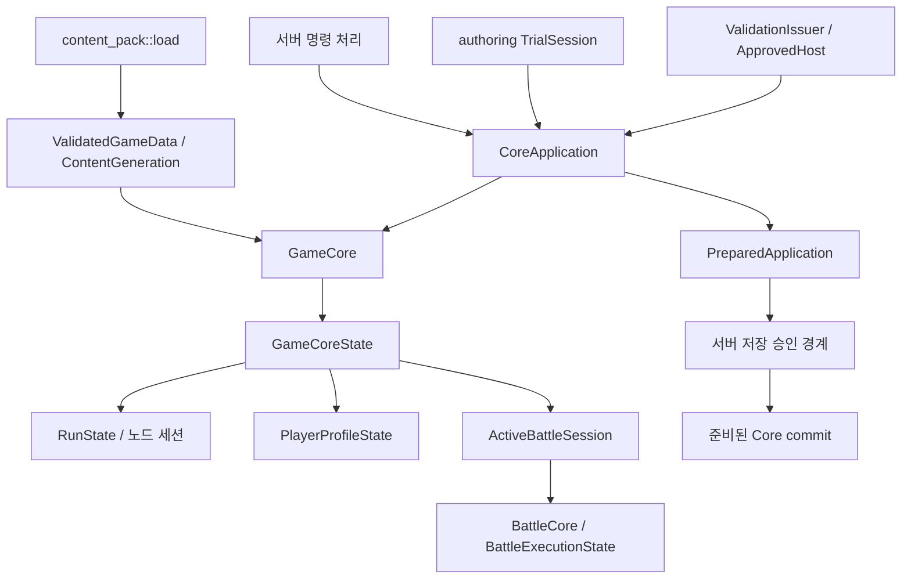

# Core 시스템 지도와 상세 조사 순서

작성·갱신일: 2026-10-18 · 단계: 선정 Core 리팩토링·성능 영향 검토 완료·성능 최적화 후순위·구형 Unity 조사 제외

이 지도는 현재 작업 트리에서 **어떤 시스템이 어떤 상태·흐름을 조사할지** 정한다.
물리적 모듈 분리안이나 구조 결함 판정이 아니다. 기준과 재개 상태는 [출발점](README.md),
판단 방식은 [리팩토링 기준](../refactoring_criteria.ko.md)을 따른다.

## 1 범위와 근거 수준

- 지도 작성 시 입력: Core `src/**`, `tests/**`, Core manifest·build script, workspace manifest·lock의 기존 파일 457개.
  소스·테스트 트리 453개와 빌드 입력 4개이며, Rust 파일은 build script를 포함해 427개다.
- 기준선은 HEAD `2f725172edbffd27c5078d29000a1a2ba6ddc4d9` 위의 **기존 수정·신규 파일을 포함한 작업 트리**다.
  [입력 해시](evidence/map_001/baseline.json)와 [기존 변경 목록](evidence/map_001/git-status-before.txt)을 연결한다.
- [파일별 조사 담당](evidence/map_001/inventory.tsv)은 457개 입력 전체를 배정한다.
  `primary_review_owner`는 조사 담당이며, 그 파일의 모든 상태를 독점 소유한다는 의미가 아니다.
- 주요 진입점·상태 선언·핵심 연결 함수는 본문을 확인했다. 나머지는 모듈 구성과 참조를 기준으로 배정했다.
  전 파일 본문 감사, 모든 호출 경로의 정확성 검증, 테스트 통과를 뜻하지 않는다.
- `docs/goals/**` 본문과 과거 완료 선언은 읽지 않았다. 서버는 애플리케이션 소비·저장 경계만 읽었고,
  데이터 원본 전체·Unity 소비자 구현은 상세 조사하지 않았다. 외부 파일은 457개 집계 밖이다.
- 지도 작성 단계에서는 제품 변경과 빌드·테스트 실행이 없었다. 당시 [확인 결과](evidence/map_001/verification.json)에서
  입력 누락·추가·삭제·내용 변경이 없음을 확인했다. [조사 메모](MAP_REVIEW_NOTES.ko.md)에 제한과 재개 근거를 남겼다.
- 후속 B1의 변경·실행 근거는 [구현 기록](S07_B1_IMPLEMENTATION.ko.md)을 따른다.
  새 `world/tests/combat_reward_quantity.rs`는 S07의 보상 경계 회귀를 소유하며 X02 검증 지원에 연결한다.
  기존 파일별 목록은 지도 시점의 증거로 보존한다.
- [통합 준비 대조](INTEGRATION_READINESS_REVIEW.ko.md)에서 현재 458개와 기존 변경 20개를 확인했다.
  이후 X02 event fixture 한 파일을 교정해 지도 대비 변경 경로는 21개다. 입력 배정은 그대로이며 전수 의미 감사는 아니다.

이하 소스 경로는 별도 표기가 없으면 `core_enhanced/src/` 기준이다. 함수명은 검색 가능한 근거 위치다.

## 2 실행 루트와 상태 소유 관계

위 그림은 확인한 소유·사용 연결을 요약한다. 모든 명령이 같은 저장 경로를 거친다는 뜻은 아니다.
서버 handler에는 query·continue·복구·준비된 변경을 처리하는 분기가 있고, Core에는 직접 실행 API도 있다.

| 원본·상태 | 현재 소유 위치와 수명 | 연결되는 조사 담당 |
| --- | --- | --- |
| 공개 실행과 준비된 변경 | `application.rs`의 `CoreApplication`, `PreparedApplication`; 준비 객체가 app에 대한 배타 참조와 commit 자료를 보유 | S01, S04, S07 |
| 검증된 데이터 세대 | `game/data/mod.rs`의 `ValidatedGameData(Arc<ContentGeneration>)`; 검증·게시된 데이터를 Core가 보유 | S02, S11, 모든 도메인 |
| 게임 상태 묶음 | `game/world.rs`의 `GameCore`, `world/state.rs`의 `GameCoreState`; lifecycle·원정·profile·경제·VN·전투가 함께 들어 있음 | S01이 전체 연결, 각 도메인이 자기 필드·전이 조사 |
| 원정과 노드 | `RunState`, `node_session`, `active_node_content`; map·progression·시설·encounter·활동 세션을 연결 | S03, S06 |
| 영구 profile와 저장 표현 | `PlayerProfileState`, checkpoint·continue 관련 상태; Core의 상태 의미와 서버 파일 게시 책임은 별도 | S04, S03, S05 |
| 직원·사본·재화 | inventory·roster·fragment·relic·crafting 상태; 실행 중 원정 상태와 profile vault의 이관 경계 포함 | S05, S04 |
| 전투 세션 | `ActiveBattleSession`; BattleCore·실행 상태·authority revision·진입 snapshot·전술 자원·상호작용 보유 | S07, S08 |
| 전투 내부 상태 | `BattleCore`; 유닛·이벤트 큐·시나리오·이동·효과·cast·projectile·object 등 | S08이 컨테이너·수명, S09/S10이 처리 규칙 |
| 전투 종료 후 전달 상태 | `confirmed_combat_result`, `combat_reward_continuation`, `BattleEntrySnapshot` | S07, S03, S04, S06 |

`world/state.rs`, `resources/state.rs`, `behavior.rs`, `battle/core/mod.rs`는 여러 계약이 만나는 파일이다.
파일을 한 시스템으로 이동하는 것보다 필드·전이·생산자·소비자별 책임을 먼저 조사한다.

## 3 시스템별 지도

기존 실행 지침의 11개 영역에 S01–S11 식별자를 붙이고, 공통 기반·검증 지원에 X01–X02를 추가했다.
S07의 대표 진입·정산·복원 경계는 [상세 조사·계획](S07_COMBAT_BOUNDARY_REVIEW.ko.md)을 작성했다.
지도 작성 당시 나머지는 경계 지도 상태였다. 이후 조사·구현 상태는 §6과 README를 따른다.
대표 조사 완료를 전투 내부 전체 감사 완료로 확대하지 않는다.

| ID · 책임 | 주요 진입점·소스 | 소유 규칙과 다른 시스템에 넘기는 계약 |
| --- | --- | --- |
| S01 애플리케이션 실행 | `application.rs`, `game/behavior.rs`, `game/enums.rs`, `world.rs`, `world/application.rs`, `action_capability.rs`, `helpers.rs` | command·오류·응답, 자격 판정과 prepare/commit. `ApplicationOwner`는 MapRun·활동·Battle·복구·Profile 등의 처리 책임을 구분. 도메인 전이는 S03–S07과 함께 확인 |
| S02 콘텐츠 로딩·검증 | `game/data/**`, `content_pack::load_with_runtime_safety`, `bin/package_official_content.rs`, `consume_content_pack.rs` | 입력 snapshot·raw/resolve·검증·게시 데이터. S11의 승인·제작 입력과 모든 런타임 도메인의 읽기 계약. 개별 데이터 schema 의미는 해당 도메인 공동 담당 |
| S03 원정·지도 진행 | `game/map/**`, `boss_omen.rs`, `encounter_progression.rs`, `expedition_lifecycle.rs`, `monolith.rs`, `revival.rs`; world의 `node_flow`, `map_content`, `map_encounters`, `facility`, `facility_rooms`, `headquarters`, `mastered_elite_sweep`, `revival`, `expedition_lifecycle` | 출발·지도·노드·층 진행·원정 종료. `StagedNodeCompletion`과 `CombatResultNodeCompletion`으로 전이 자료를 표현. 활동 완료는 S06, 전투 완료는 S07, 영구 이관은 S04/S05와 연결 |
| S04 영구 상태·저장·복원 | `game/encounter_compendium.rs`; world의 `active_run.rs`, `active_run/**`, `expedition_recovery.rs`, `snapshot.rs` | profile·도감·checkpoint·continue의 의미와 codec. `export_active_run_checkpoint`, `continue_from_active_run_checkpoint` 및 호스트 저장 결과 연결. 명시적 checkpoint load와 durable continue를 같은 전이로 가정하지 않음 |
| S05 직원·장비·성장·경제 | `employee`, `growth`, `material_economy`, `recruitment`, `resources/**`, `skill_fragment/**`, `relic/**`, `stats`; world의 `grant_state`, `relic_runtime` | 사본 ID·소유·장착·성장·지급·소비. `Inventory`, `OwnedEquipment`, `EconomyGrantState` 등. 활동 명령은 S06, 전투 구성은 S07, 효과 실행은 S10이 소비. 유물 compiler·publication은 S02/S11과 공동 경계 |
| S06 노드 활동·이벤트·VN | `dealer`, `dealer_games`, `relic_reward`, `reward`, `reward_policy`, `visual_novel`; world의 `maintenance`, `shop`, `reward`, `event_node`, `dealer`, `relic_reward`, `visual_novel_flow`, `visual_novel_triggers` | 세션 생성·선택·지급·종료·VN queue. `commit_shop_session`, `claim_current_reward_session`, `assemble_visual_novel_session`. 경제 효과는 S05, 노드 완료는 S03, 전투 후 보상 continuation은 S07과 연결 |
| S07 전투 진입·결과 정산 | `combat_preview/**`, `combat_setup/**`, `events/**`, `combat_power`, `range_preview`, `stress_combat`, `wave_resolution`; world의 `combat`, `battle_capability`, `battle_interaction`, `tactical_preview` | 원정 상태에서 전투를 구성하고 live authority·진입 snapshot·최종 정산·응답·후속 보상 연결을 관리. `handle_explicit_combat_node`, `transition_finished_live_battle_to_result`, `settle_combat_result`, `handle_complete_combat_result` |
| S08 전투 실행 기반 | `battle/core/mod.rs`, `sim.rs`, `queue.rs`, `build.rs`, `commands.rs`, `ids.rs`, `types.rs`, `spawn_kernel.rs`, `death_runtime.rs`, `summon_runtime.rs`, `wave_runtime.rs`; battle 공용 타입·scenario·기록·runtime facts | `BattleCore`의 시간·순서·유닛 수명·종료·command. `start_battle_execution`, `step_battle_execution`, `step_battle_execution_until`, `finalize_battle_execution`; S09/S10의 상태 처리를 실행 순서 안에서 호출하고 S07에 결과 전달 |
| S09 전장·이동·저지 | `battle/battlefield/**`, `battle/tile_range.rs`, `core/movement/**`, `spatial.rs`, `tactical_relocation.rs`, `tactical_stance.rs`, `tactical_swap.rs` | 공간·경로·점유·충돌·저지·전술 위치. movement의 engine/planner/lifecycle/rapier backend를 함께 조사. 유닛 수명은 S08, 대상·사거리 소비는 S10, 외부 요청·preview는 S07 |
| S10 공격·스킬·효과 | `game/ability/**`; `battle/core/skill_runtime/**`, basic attack/heal·targeting·damage·projectile·effective skill/delivery·object·boss·sustained·relic·resonance·value expression 처리; `battle/damage`, `buffs`, `cooldown`, `skill_source`, `stat_pipeline` | 정의→시전→전달→해결→취소→후속 효과. `FlowState` 등 실행 상태는 BattleCore가 보유. schema/compiler는 S02/S11, 장착 유물·fragment는 S05, typed resource·식 평가 기반은 X01 |
| S11 콘텐츠 제작·실험·모드 검증 | `authoring/**`, `mod_validation.rs`, `mod_validation/**`, `bin/author_content.rs`; world/core의 authoring lifecycle·observation | 작성·진단·preview·TrialSession·승인 세대·host 선택. `TrialSession`은 `CoreApplication::new_for_authoring`을 통해 실제 실행을 사용. S02 게시와 S01 실행 경계를 별도 엔진으로 재구현하지 않는지 상세 확인 |
| X01 공통 런타임 기반 | `lib.rs`, `owned_collections.rs`, `runtime_safety*`, `runtime_observation*`, `game/determinism`, `managers`, `resource/**`, `value_expr/**`, `battle/runtime_control`, world/core의 `resource_runtime`, `world/state.rs`, `game/mod.rs` | 결정론·ID·예산·취소·관측·공통 컨테이너·typed resource·식 평가. 공통 구현 담당을 지정하고 실제 수명·정책은 사용 도메인과 공동 조사 |
| X02 빌드·테스트·계약 fixture | manifest·lock·`build.rs`, `tests/**`, `world/tests/**`, `battle/core/tests/**`, `world/combat_trace.rs`, `bin/generate_*_contract_fixture.rs` | 선택 target·feature·fixture·진단 trace·외부 계약 검증 연결. 각 시스템 내부 테스트는 해당 모듈 담당을 유지하며, 공통 테스트 묶음은 흐름별 상세 조사 때 배정 |

### 혼동하기 쉬운 공통 경계

- `game/resource/`는 typed resource의 owner와 Run/Attempt/Deployment/Activation/Delivery/Chain 수명을 다룬다.
  `game/resources/`의 inventory·경제·장착·세션 타입과 구분한다. 전자는 X01, 후자는 S05를 주 조사 담당으로 둔다.
- 유물은 S05의 소유·장착, S02/S11의 정의 검증·게시, S07의 전투 전달, S10의 효과 실행으로 이어진다.
  `relic`이라는 이름만으로 하나의 시스템에 전부 넘기지 않는다.
- 보스·소환·독립 object도 정의·구성·전투 수명·효과 실행을 나눈다. S08의 컨테이너 소유와 S10의 효과 규칙은 함께 검토한다.
- 공용 DTO·enum은 S01/X01 배정만으로 의미가 해결되지 않는다. 변경 후보가 생기면 실제 생산 도메인과 소비자를 기록한다.
- 관측·trace는 실행 결과 확인 수단이다. 게임 상태나 정산의 권위와 같다고 가정하지 않는다.

## 4 생산자·소비자와 저장 경계

| 흐름 | 확인한 생산자 → 소비자 | 보존·추가 조사할 계약 |
| --- | --- | --- |
| 콘텐츠 입력 → 실행 | `content_pack/mod.rs` loader·snapshot → 검증·게시 → `ValidatedGameData` → GameCore | 승인한 세대·실행이 참조하는 세대·설정의 정체성. S02/S11 |
| 명령 → 도메인 상태 | `CoreApplication::prepare_command_with_generation` → world prepare → `PreparedApplication::commit` → Core commit | 거절·취소 때 변경 여부, 결과 공개와 commit 순서. API가 존재한다는 사실만으로 모든 분기의 원자성을 판정하지 않음. S01 |
| 준비된 변경 → 호스트 저장 | 서버 `player_game_actor/handlers.rs` → `publish_prepared_application_bound`; `player_profile_store/application_intent.rs`의 accepted intent | 서버 계약은 accepted 이후 준비된 Core를 한 번 commit하도록 요구. 실제 crash/recovery와 모든 분기 검증은 미실행. S01/S04 |
| 원정 → 전투 | `world/combat.rs::handle_explicit_combat_node` → combat setup·`events/combat` → `BattleCore`·`ActiveBattleSession` | roster·사본·fragment·relic·power·정책·typed resource 전달과 entry snapshot. S05/S07/S08 |
| 전투 종료 → 정산 | `transition_finished_live_battle_to_result` → `settle_combat_result` → `ConfirmedCombatResult`·CombatResult phase | 전투 종료 경로에서 먼저 정산하고 receipt를 보관. 완료 버튼에서 처음 정산한다고 해석하면 안 됨. 실패·재호출 경계는 첫 상세 조사 대상. S07 |
| 결과 확인 → 다음 단계 | `handle_complete_combat_result` → 저장 receipt의 응답·다음 phase·보상 continuation | 정산과 사용자 확인을 구분하고 중복 지급·누락·취소·재개 의미 조사. S07/S06/S03 |
| 보상 → 노드·원정 종료 | `world/reward.rs` claim/exit → 경제 적용·continuation·node completion → 필요 시 원정 terminal settlement | 보상 지급과 노드 완료, 원정 종료의 서로 다른 전이. S06/S05/S03 |
| 원정 종료 → 영구 이관 | `world/expedition_lifecycle.rs::settle_expedition_terminal` → profile vault·active marker·run 자원 정리 | 귀환·실패·포기에서 이관/폐기 규칙, 서버 저장 표현. S03/S04/S05 |
| 저장 → 계속 실행 | `world/active_run.rs` export/continue, continuation·v7/v8 모듈 → GameCore 복원 | codec 버전·지원 범위·load 횟수·정체성·profile 연결. 파일명이 현재 schema 버전을 증명하지 않음. S04 |
| 제작 실험 → 실제 실행 | `authoring::validate` → 제작 콘텐츠 token, `TrialSession` → CoreApplication | 생산 loader와 실행 경로 재사용, 실험 전용 설정·관측·세션 수명. S11/S02/S01 |

외부 저장 경계의 제한적 읽기 입력은 [외부 입력 목록](evidence/map_001/external-inputs.json)에 별도로 기록한다.
Unity의 DTO 소비와 공식 데이터의 전체 의미는 이번 지도에서 검증하지 않았다.

## 5 포함·제외·미확인과 검증 지원

### 목록 배정과 의미 조사의 차이

파일 목록의 미배정은 0개다. 이는 `game/mod.rs`의 모든 모듈, world 처리 모듈, battle 하위 그룹,
공개 실행·제작·공통 기반·테스트·빌드 입력의 조사 담당이 있다는 뜻이다.
공유 테스트의 정확한 흐름별 담당, 모든 DTO 소비자, 각 branch의 실패·취소·복원 의미는 아직 미확인이다.
삭제된 파일은 현재 입력에 포함하지 않고 기존 Git 상태에 남긴다.

### 실제 테스트와 빌드 선택

- Core manifest는 명시적 CLI target을 등록한다. 계약 fixture 생성기는 `test-fixtures` feature가 필요하다.
- `test-fixtures`는 제작·테스트용 bare data 구성 경계를, `runtime-observation`은 선택 관측 경로를 구분한다.
  `event_log_checks`도 opt-in이므로 기본 실행으로 해당 경로를 검증했다고 판단하지 않는다.
- `tests/common`, `tests/skill_test/common`은 fixture·실행 지원을 제공한다. battle showcase·skill runtime·live skill·
  relic public·RON·CLI 테스트와 모듈 내부 테스트를 상세 조사 흐름에 맞춰 선택한다.
- `build.rs`의 build identity는 Core만이 아니라 server 소스·공식 데이터·runtime safety 설정·manifest 등도 사용한다.
  후속 코드 변경의 빌드 영향과 검증 입력은 Core 수정 파일 목록만으로 결정하지 않는다.

### 제외한 goals 영역으로 연결되는 현재 의존

`docs/goals/**`를 제외해도 현재 테스트·빌드가 그 아래 입력을 참조하는 사실은 남는다.
다음은 **현재 소스에 있는 참조만** 확인한 목록이며 해당 외부 본문은 읽지 않았다.

| 현재 참조 위치 | 제외 영역에서 참조하는 종류 |
| --- | --- |
| workspace `Cargo.toml`, Core `build.rs` | mod validation·expedition lifecycle probe crate와 manifest |
| `mod_validation.rs`, `game/data/content_pack/tests.rs` | cache hooks/tests, issuer generation lifetime 테스트 코드 |
| `authoring/trial/tests/u09_structural*`, `u10_causal.rs` | 구조·인과 효과 fixture |
| `world/tests/checkpoint_validation.rs`, `u17_revival.rs` | 과거 저장 형식 fixture |
| `world/tests/u12_lifecycle/cost.rs` | 비용 검증 입력 manifest |

따라서 “Core 테스트만 실행하면 제외 영역을 사용하지 않는다”는 전제는 성립하지 않는다.
실제 구현 검증 단계에서 선택 명령의 필수 입력을 확인하고, 제외 정책과 필요한 검증의 충돌이 있으면 그때 구체적으로 처리한다.
이 지도에서는 해당 테스트의 유효성·통과 여부를 주장하지 않으며 외부 입력 이동을 구현 후보로 확정하지도 않는다.

## 6 상세 조사 우선순위

지도 작성 당시에는 실패를 재현하지 않았고 아래 순서를 **공유 상태와 경계 파급을 줄이기 위한 조사 순서**로 정했다.
후속 S07 조사에서 보상 수량·Continue 불일치 B1을 재현했고 [교정·검증·완료 검토](S07_B1_IMPLEMENTATION.ko.md)를 마쳤다.
R1 공통 후처리 조립 통합과 [S01 대표 실행 경계 조사·개선 계획](S01_APPLICATION_BOUNDARY_REVIEW.ko.md)을 마쳤다.
S01 D1에서 실행 구조를 유지하며 직접 실행·prepared·Trial acceptance의 실패 보존 범위를 문서·주석에 구분했다.
[S04 대표 저장·복원 조사](S04_PERSISTENCE_BOUNDARY_REVIEW.ko.md)에서 Continue/SavePoint와 journal writer/reader를
연결하고 18개 테스트를 확인했다. S04 D1 저장 지원 범위·원정 identity 문서 교정과 완료 검토도 마쳤다.
[S03/S06 상점·이벤트 대표 조사](S03_S06_NODE_ACTIVITY_REVIEW.ko.md)에서 공통 노드 완료·세션 수명·실패·복원을
비교하고 25개 테스트를 확인했다. [S05 사본 취득·소비·귀환 조사](S05_OWNERSHIP_ECONOMY_REVIEW.ko.md)도
마쳤으며 19개 테스트로 소유·환급·반납·대여 경계를 확인하고 실행 구조를 유지한다.
[S02/S11 데이터 검증·게시·승인 조사](S02_S11_CONTENT_PUBLICATION_REVIEW.ko.md)에서 token·승인 권위·세대 수명을
연결하고 19개 테스트를 확인했다. D1 수식 게시 설명 주석 교정·완료 검토도 마쳤고 기존 테스트 근거를 재사용했다.
[S08 대표 조사·개선 계획](S08_BATTLE_LIFECYCLE_REVIEW.ko.md)에서 timestamp·queue·유닛 수명·terminal과 설계 품질을 확인하고 25개 테스트를 통과했다.
유닛 생성 조립 R1·wave commit 주석 D1은 후속 구현과 영향 테스트 16개·분리된 완료 검토를 마쳤다.
R2 buff 정리 통합도 영향 테스트 18개·분리된 완료 검토를 마쳤다.
[S09 대표 조사·개선 계획](S09_MOVEMENT_BLOCKING_REVIEW.ko.md)에서 이동/저지·전술 위치의 상태 소유권과 실패 경계를 확인하고 기존 32개 검증 근거를 재사용했다.
S09 R1 무효 중단 경로 제거·D1 교정과 영향 테스트 17개·분리된 완료 검토도 마쳤다.
[S10 대표 조사·개선 계획](S10_ATTACK_SKILL_EFFECT_REVIEW.ko.md)에서 공격/스킬·전달·효과 정산·취소 수명과 설계 품질을 확인하고 기존 35개 통과 근거를 재사용했다.
S10 R1 합산 통합·D1 교정과 집중 테스트 13개·분리된 완료 검토도 마쳤다.
현재 선정 대표 조사·개선 범위는 **최종 통합 검토까지 완료**했다.
[최종 검토](FINAL_INTEGRATION_REVIEW.ko.md)에서 다섯 연결 조건·후속 영향·설계 효과와 필수 잔여 없음을 확인했다.
후속 실행 요청으로 [성능·자원 1차 측정](PERFORMANCE_RESOURCE_MEASUREMENT.ko.md)을 수행했다.
[S01-P1 snapshot 조사](S01_SNAPSHOT_COST_REVIEW.ko.md)에서 Core/서버 소비 경계·생성/직렬화 비용과 내부/계약 후보를 분리했다.
[X01-P1 concurrent 조사](X01_CONCURRENT_COST_REVIEW.ko.md)에서 단계별 비용을 분리했으며 마지막 완료 lane에서 step이 지배적이다.
[S01-P2 구현](S01_TEMPLATE_BORROW_IMPLEMENTATION.ko.md)에서 단일 borrowed resolver와 두 읽기 호출의 사본 제거·7개 영향 테스트·전체 JSON 동등성을 확인했다.
[X01-P2 step 조사](X01_STEP_COST_REVIEW.ko.md)에서 사건 처리와 후보/검증 비용을 구분하고 AttackStart dispatch를 다음 비용 owner로 좁혔다.
[실사용 성능 검토](PRACTICAL_PERFORMANCE_REVIEW.ko.md)에서 저사양 PC 단일 플레이를 우선하고 기존 원자료·실제 발행 경로를 대조했다.
전체 snapshot은 보통 전투 tick마다 생성되지 않으며, 64세션 묶음은 한 프레임 지연이 아니다. 대상 저사양 PC의 실제 영향은 미확인이지만
현재 근거로 필수 성능 최적화를 선정할 이유도 부족하다. S10-P2·S01-P3·S01-C1은 후순위로 두고 실제 지연·규모 변화가 확인될 때 재개한다.
이후 사용자가 현재 Unity 구현이 오래된 기준임을 확인했으므로 **S01-C2 구형 reader 조사·호환 맞추기는 이번 후속에서 제외**한다.
현재 선정 범위에 새 필수 작업은 없다. 실제 Core 문제·변경 부담·새 기능 요구가 생기면 해당 시스템만 재개한다.
Unity 재구현 시 현재 Core의 유효 공개 계약을 기준으로 연동하며 구형 reader를 Core 변경·완료 차단의 근거로 삼지 않는다.
기존 기준 초과·S01-P2 지연 불확실성·P01 비교 불가와 typed resource 미확인은 보존하며 저사양 지원·Unity 통합 완료를 주장하지 않는다.
[통합 준비 기록](INTEGRATION_READINESS_REVIEW.ko.md)은 선정 개선 종결·후속 영향·연결 조건·잔여 범위를 소유한다.
X02의 event fixture 시작 입력 오류를 교정했고 네 feature generator의 실제 출력 확인과 분리 검토를 마쳤다.
[X01 복사·결정론·관측 기록](X01_COPY_DETERMINISM_OBSERVATION_REVIEW.ko.md)은 현 구조 유지·기존 성공 18개 재사용·관측 feature 13개 검증과 인계를 소유한다.
[X01 수치식 기록](X01_VALUE_EXPRESSION_REVIEW.ko.md)은 선택 입력 86개·기존 성공 30개 재사용과 현 구조 유지 판단을 소유한다.
[X01 실행 제어·자원 수명 기록](X01_RUNTIME_RESOURCE_REVIEW.ko.md)은 현 구조 유지, 선택 입력 71개 일치·기존 성공 28개 재사용과 미확인 범위를 소유한다.
새 실패·사용자 우선순위·선행 조건이 확인되면 변경한다. 시스템 전체를 매번 완전히 조사해야만 다음 단계로 가는 고정 절차는 아니다.

| 순서 | 영역 | 선택 이유와 조사 범위 |
| --- | --- | --- |
| 선행 지도 완료 | S01 실행 루트·공유 상태 | prepare/commit과 소유 컨테이너를 확인. S01 상세 감사가 끝났다는 뜻은 아님 |
| 1 | S07 전투 진입·결과 정산 | 원정·경제·실시간 전투·정산·저장·보상을 잇는 실제 경계. 처음부터 전투 전체를 재설계하지 않고 한 흐름에서 구조 문제 유무 판단 |
| 2 | S01/S04 준비·저장·복원 | 1에서 확인한 결과의 공개·commit·durable continue를 연결. 저장 호스트의 실제 소비 계약을 필요한 범위에서 추적 |
| 3 | S03/S06 원정·활동 전이 | 전투 외 노드와 원정 terminal 전이를 연결하여 동일 상태의 서로 다른 owner 경계 비교 |
| 4 | S05 소유·경제·성장 | 활동·전투·귀환 사이의 사본과 자원 전달을 기준으로 세부 작업 분할 |
| 5 | S02/S11 게시·제작·승인 | 위 흐름에서 사용한 데이터 세대·정의·실험 경계를 깊게 조사. 앞 단계의 필수 schema 확인은 즉시 수행 |
| 6 | S08 전투 수명·순서 | 대표 조사 25개·R1 생성 조립/D1 영향 16개·R2 buff 정리 영향 18개 검증과 각 완료 검토를 마침 |
| 7 | S09 이동, S10 효과 | S09 대표 조사·R1/D1·17개 영향 검증 완료. S10 대표 조사·R1/D1 구현·13개 영향 테스트·완료 검토 완료. 이후 X01 실행 제어·자원 수명 대표 조사·유지 판단 완료 |
| 각 단계 동반 | X01/X02 | 실행 제어·자원 lease 수명·실패 전파 대표 조사와 연결 X02 확인 완료. 수치식 compile/capture/evaluate/실제 소비 대표 조사도 유지 판단으로 완료. 공통 상태 복사·결정론·선택적 관측 대표 조사·관측 feature 13개 검증도 완료. X01 잔여 대표 경계·X02 CLI/trace 근거를 연결했고 event fixture B1 교정·4개 생성 출력 확인 완료. 최종 통합 검토까지 완료. 제한·재개 조건은 최종 기록을 따름 |

### 첫 상세 조사: S07 전투 진입부터 결과 확인까지

**시작 위치:** 이 절 → `world/combat.rs`의 네 핵심 함수 → `world/state.rs`의 전투 관련 상태 →
`application.rs`/`world/application.rs`의 해당 명령 prepare/commit → 관련 기존 테스트.

1. 대표 지원 흐름을 고른다: 전투 노드 진입 → live 실행 종료 → 정산 receipt → 결과 확인 → 보상 또는 노드 진행.
   같은 흐름의 거절·실패·취소·재호출·저장 후 재개를 계약상 지원되는 범위에서 확인한다.
2. 단계마다 입력·원본 상태·임시 계획·쓰기 위치·commit·응답·다음 소유자를 표로 만든다.
   `ActiveBattleSession`, `BattleEntrySnapshot`, `ConfirmedCombatResult`, `combat_reward_continuation`을 우선 추적한다.
3. S01의 publication, S03의 node completion, S05의 지급·사본, S06의 보상, S08의 terminal 결과,
   S04의 export/continue를 필요한 만큼 연결한다. 전투 효과 전체나 서버 전체 감사로 넓히지 않는다.
4. 실제 계약과 기존 테스트를 대조해 유지·개선 후보·오류·미확인·후속을 구분한다.
   파일 크기나 여러 시스템 참조만으로 문제를 확정하지 않는다.
5. 후보가 확인되면 근거·보존 동작·작업 경계·선행 조건·필요 검증·분리된 완료 검토를 포함한 계획을 만든다.
   후보가 없으면 유지 판단과 조사 근거를 남긴다. 임의 외부 변조 방어를 추가하지 않는다.

**완료된 산출물:** [S07_COMBAT_BOUNDARY_REVIEW.ko.md](S07_COMBAT_BOUNDARY_REVIEW.ko.md).
대표 지원 흐름의 정적 조사와 공개 API 대조 실험을 통해 B1 오류·R1 구조 개선 후보를 구분했다.
B1은 최종 옵션 공유·Continue 비교 교정과 관련 테스트 55개, probe 6건·별도 완료 검토까지 마쳤다.
R1도 기존 helper 재사용과 변경 후 영향 테스트 15개·별도 완료 검토를 마쳤다.
S01의 일반 명령·tick·거절·준비 취소와 commit·공개 대표 경계 조사를 마쳤고 기존 테스트 21개를 확인했다.
모든 action·query 내부와 저장 호환성 전체를 조사한 것은 아니다. D1 문서 교정과 완료 검토도 마쳤다. S04 대표 조사·D1, S03/S06 상점·이벤트와 S05 사본 취득·소비·귀환 대표 조사도 마쳤으며 S02/S11 대표 조사·D1 주석 교정·완료 검토도 마쳤다. S08 대표 수명·순서 조사와 25개 집중 검증·개선 계획도 마쳤다. S08 R1 생성 조립 통합과 D1 교정·영향 테스트 16개·분리된 완료 검토를 마쳤다. R2 buff 정리 통합·영향 테스트 18개·분리된 완료 검토도 마쳤다. S08 선택 개선은 완료했다. S09 대표 이동·저지·전술 위치 조사와 R1/D1 구현·영향 테스트 17개·분리된 완료 검토도 마쳤다. S10 공격·스킬·효과 대표 조사와 R1/D1 구현·13개 영향 테스트·분리된 완료 검토도 마쳤다. X01 실행 제어·자원 수명 대표 조사와 연결 X02 검증 지원 확인도 마쳤으며 현 구조를 유지한다. X01 수치식 대표 조사·유지 판단도 마쳤다. 공통 상태 복사·결정론·선택적 관측 대표 조사와 집중 검증도 마쳤다. 통합 준비와 X02 event fixture B1 교정·검증도 마쳤다. 최종 통합 검토도 마쳐 선정 대표 조사·개선 범위를 종료했다. 모든 Core 경로·외부 제품의 검증 완료로 확대하지 않는다.
지도 단계·상세 조사 단계의 과거 입력 증거와 [B1 구현 증거](S07_B1_IMPLEMENTATION.ko.md)는 각각 보존한다.
[R1 구현·검증·완료 검토](S07_COMBAT_BOUNDARY_REVIEW.ko.md#r1-구현과-완료-검토)는 상세 조사 기록의 후속 절에서 확인한다.

성능 후속에서는 기존 공개 guard·전투 측정 도구를 교정했고 게임 실행 코드는 바꾸지 않았다.
선정 기능 리팩토링의 완료와 새 성능 finding을 구분한다. 전체 측정은 [1차 기록](PERFORMANCE_RESOURCE_MEASUREMENT.ko.md),
후속 snapshot 소비·비용·설계 판단과 미확인은 [S01 조사](S01_SNAPSHOT_COST_REVIEW.ko.md)가 소유한다.
concurrent 단계 비용·동일 출력 대조·새 구현 우선순위와 열린 성능 후속은 [X01 조사](X01_CONCURRENT_COST_REVIEW.ko.md)가 소유한다.

S01-P2의 구현·동작/구조 검토와 최초 지연 증가·교차 비교·성능 수용 보류는 [구현 기록](S01_TEMPLATE_BORROW_IMPLEMENTATION.ko.md)이 소유한다.
이후 X01-P2의 후보 준비·사건 처리·retained/commit 및 root dispatch 귀속을 완료했으며 기존 snapshot/concurrent 기준 초과는 남아 있다.

[X01-P2 기록](X01_STEP_COST_REVIEW.ko.md)은 임시 단계/사건 계측·동일 출력·buffer 재사용 0회와 소유권 유지 판단을 소유한다.
2026-10-18 사용자 지시와 저사양 PC 단일 플레이 우선순위에 따른 [실사용 검토](PRACTICAL_PERFORMANCE_REVIEW.ko.md)를 완료했다.
S10-P2 세부 계측은 후순위이며 S01-C2 구형 Unity 조사는 후속 사용자 확인에 따라 제외했다. 과거 보고서의 고정 후속보다
[현재 README](README.md#1-현재-상태와-다음-행동)와 [성능 판단 기준](../refactoring_criteria.ko.md#74-성능과-자원)을 우선한다.
