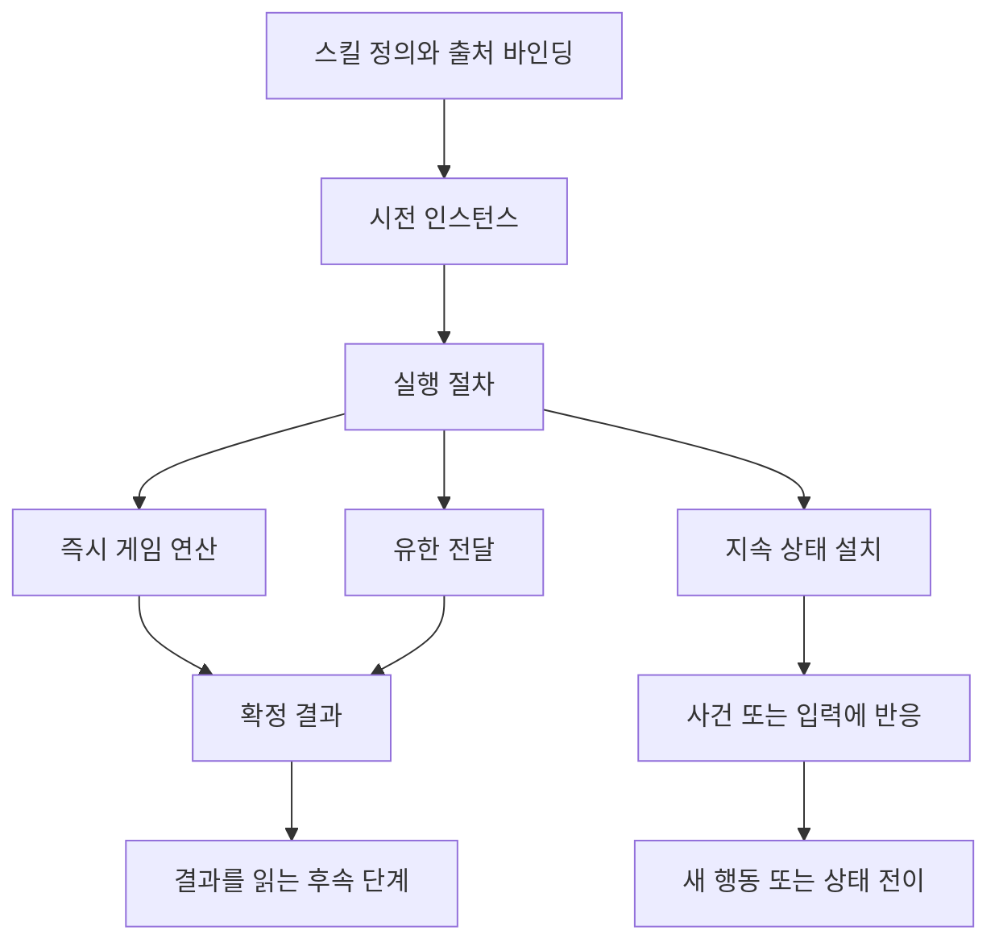

# 스킬 작성·실행 모델

2026-09-27 · v0.4 · 구현하면서 개선하는 설계 기준안 / 제품 구현·실행 검증 전.

개발 진입점은 [ROADMAP_STATUS](../roadmaps/content_authoring/ROADMAP_STATUS.md) 하나다.
이 문서는 스킬 모델의 기준 문서이며 별도 로드맵이나 구현 지시서가 아니다.
사용자는 모델을 먼저 설계·검토하되, **현재 안을 최종 동결하지 않고 실제 구현·검증 과정에서 계속 개선**하기로 했다.
선택한 구현 범위의 의미와 검증 기준을 명시하고, 발견한 변경은 이 기준안과 해당 계획에 반영한다.
기존 R06 WP02 부분 구현 상태와 동결 증거는 유지한다.
[R06 범위 대조·후속 계획](../goals/content_authoring_value_expressions_reassessment/successors/r06_scope_20260927_001/REVIEW_AND_PLAN.ko.md)에
이 모델과 동결 계약의 차이, 확정한 집계 정책, 다음 구현 범위를 기록했다.

## 1. 확정한 방향과 이번 설계의 지위

사용자가 채택한 방향:

- 공통 게임 기능을 조합해 프로그래밍 방식으로 스킬을 작성한다. 마인크래프트 문법을 복제하지 않는다.
- 제작자 함수 정의·인자 전달·반환·일반 재귀 호출 체계를 현재 요구로 두지 않는다.
- 본편의 매력을 위해 필요한 전용 시스템은 허용한다. 어려운 내부 기능을 모두 모드 제작 API로 공개하지 않는다.
- 공개 공통 기능은 조합 가능하게 만들고, 전용 스킬은 지원하는 완성 형태와 명시적 조정값만 공개한다.
- 공식 콘텐츠를 모드로 교체·변형하는 권한은 유지한다. 전용 모듈의 내부 수정 권한과는 구분한다.
- 직원은 배치 타일에 고정된다. 배치된 같은 전투 개체의 위치 변경은 **전술 이동·교대 명령으로만** 가능하다.
  자율 이동·적 추격·스킬 연출에 따른 직원 이동을 기본 기능으로 두지 않는다. 철수·재배치는 별도 생명주기다.
- 검토·계획은 현재 대화, 제품 구현은 별도 대화에서 수행한다.
- 모델 전체의 영구 확정을 구현 선행 조건으로 요구하지 않는다. 사용자 확정 gameplay를 바꿔야 할 때는 별도로 확인한다.

아래 구성·타입 이름·예시는 이 방향을 구체화한 **설계안**이다. 사용자 합의와 같은 지위로 자동 승격하지 않는다.
현재 schema에서 실행 가능한 RON이라고 주장하지 않으며, 기존 동결 Plan을 이 문서로 덮어쓰지 않는다.
기술 구조는 구현 기준 후보로 제시하고, 원문 미정 gameplay는 §10에서 따로 관리한다.

입력은 [콘텐츠 원문](abnormality_skill_fragments_design_notes.md)과
[전체 콘텐츠 검토·공개 범위 합의](../goals/content_authoring_value_expressions_reassessment/execution/single_goal/handoffs/AUTHORING_SYSTEM_CONTENT_REVIEW_20260927.ko.md)다.
원문 SHA-256은 `dfbfbe4f52d7b08fb51777586c3c9b5c3e6f8f9774c7479354e337c0584e2ff6`.
기존 [작성 구조](../roadmaps/content_authoring/roadmap/architecture/02_AUTHORING_AND_COMPILER.ko.md)와
[실행 구조](../roadmaps/content_authoring/roadmap/architecture/03_RUNTIME.ko.md)를 재사용·구체화한다.
원문 수치·밸런스·입력 UI를 확정하거나 외부 원작 자료로 빈 내용을 보충하지 않는다.

## 2. 모델의 중심: 정의, 시전, 전달, 지속 상태

**스킬은 시작 조건과 실행 절차를 가진 정의이며, 실행 중에는 시전·전달·지속 상태가 각각의 수명을 가진다.**
모든 것을 하나의 오래 살아 있는 시전으로 만들지 않는다.

| 개념 | 의미와 소유 내용 | 예 |
| --- | --- | --- |
| SkillDefinition | 불변 정의 ID/버전, 시작 조건, 입력, 비용, 절차, 공개 조정값·수정 지점 | 풍운승려 스킬 한 종류 |
| SourceBinding | 실행자, 제공한 사본, 자원 소유자, 수혜자, 처치 귀속, 원인 | 파편이 교체했어도 Hello 기본 공격의 제공자는 무기 |
| ActionInstance | 접수된 시전/공격 한 번, 제어 진행, 지역 값, 유한 후속 작업 | 풍운승려 시전 한 번 |
| OperationOccurrence | 같은 정의의 단계/효과가 실제 실행된 한 번 | 반복 3타 중 두 번째 타격 |
| DeliveryInstance | 방출된 탄환·지점 공격 등의 경로, 충돌, 지역 상태, 완료 | 앞 대상을 맞힌 결과를 기억하는 마탄 한 발 |
| ActivationInstance | 설치·변신·오라 등 유지되는 상태와 구독·modifier·객체 handle | Hello 유지 상태, 작은 친구 |
| Receipt | 특정 처리의 확정 결과. 소유 범위와 읽을 수 있는 시점이 정해짐 | 실제 HP 손실, 실제 소비량, 사망 사실 |

정의의 effect ID는 실행 occurrence ID가 아니다. 반복·다중 탄환의 같은 효과를 혼동하지 않는다.
직원 identity, 현재 전투 유닛 identity, 장비/파편 사본 identity도 구분한다.
아래 그림은 의미 관계이며 실제 Rust 타입의 새 이름을 강제하지 않는다.



### 2.1 정의에 들어갈 구성

| 구성 | 계약 |
| --- | --- |
| Entry | 직접 시전, 기본 공격, 확정 사건 반응, 활성 상태 재입력. 허용 실행 주체와 입력 종류 명시 |
| Admission | 사용 자격, 비용, 대상/방향/타일 유효성, 행동 제한. 성립하지 않은 요청은 상태를 바꾸지 않음 |
| Bindings | 읽을 시전자·대상·원천 사본·기존 상태·입력. 임의 세계 객체 포인터를 전달하지 않음 |
| Spatial contract | 배치 위치와 공격 원점, 선택 범위와 효과 범위, 방향·고정/추종·대상 재선정 시점 구분 |
| Action constraints | 준비/방출/유지 단계별 기본 공격·저지·새 스킬·전술 명령의 병행. 공통 전투 규칙 안에서 검사 |
| Flow | 실행 순서·분기·유한 반복·병행·대기와 결과 이름 |
| State declarations | 타입, 초기값, owner, lifetime, 변경 권한, 종료/복원 정책 |
| Effect sites | 피해·회복·자원·상태·설치 등의 안정된 주소, 태그, 수정 허용 속성 |
| Exposure | 공개 조합 기능 / 재사용 가능한 전용 완성 스킬 / 내부 전용 기능 |
| Presentation | 연출 ID와 관측 사건. VFX 개체가 유닛 판정이나 피해 발생의 진실이 되지 않음 |

정의의 계수·지속 시간 같은 설정은 데이터 속성이다. 이것을 제작자 함수의 매개변수 호출 체계로 확장하지 않는다.
기본 공격·장비 패시브도 공통 연산과 상태 계약을 소비하되, 모든 패시브를 플레이어의 수동 시전으로 취급하지 않는다.
보스 장기 행동 선택은 기존 보스 제어가 담당하고, 선택된 스킬을 같은 실행 포트로 요청한다.

### 2.2 기존 15개 분해 축과의 대응

[15개 축 원문](run_relic_content_design_notes.ko.md#15개-공통-분해-축)을 콘텐츠 검토 기준으로 유지한다.
`전체 흐름 → 단계·분기·병행 → 개별 효과 → 15개 축` 순서로 적용한다.
15개의 필드·정식 태그·독립 엔진으로 기계적으로 옮기지 않는다. 해당 없음과 미정도 구분한다.

| 원문 축 | 모델에서 소유할 의미 |
| --- | --- |
| 1. 사용·조작 방식 | Entry와 활성 상태 재입력, host 선택 포트 |
| 2. 대상·선정 | Query의 자격·우선순위·수 제한·고정/재선정, 저지 관계 |
| 3. 공간 구조 | 배치 타일·공격 원점·방향·선택 범위·효과 범위 |
| 4. 전달·매개 | Delivery/Activation/객체의 실제 capability와 연출 구분 |
| 5. 시간 구조 | 준비·지연·유지·주기와 각각의 기준 시점/시계 |
| 6. 반복·발생 구조 | Flow의 유한 반복·순차/병행, occurrence별 효과량 |
| 7. 효과의 종류 | 공통 게임 연산과 제한된 피해 전 중재 |
| 8. 효과량·참조 기준 | ValueExpr의 subject·단위·계수·평가 시점 |
| 9. 집계·분배·공유 | typed 집계 입력, 대상별 적용/총량 분배, 공유 pool |
| 10. 자원·축적 | owner×lifetime 상태와 원자적 획득·소비·갱신 |
| 11. 비용·위험 | Admission 비용, HP 비용/자해 구별, 명시된 실패 결과 |
| 12. 조건·분기·연계 | Branch/EventBinding의 판정·확률·인정 단위·순서·인과 |
| 13. 행동 병행·제약 | 단계별 기본 공격·저지·새 스킬·전술 이동/교대 명령의 허용 여부 |
| 14. 종료·존속 | Action/Delivery/Activation 종료, 이동·철수·재배치·사망별 잔존 |
| 15. 출처·소유·귀속 | SourceBinding, 제공 사본·실행자·자원 owner·수혜자·처치 귀속 |

소환물 HP·저지·동시 존재 수, 변신 복귀, 공유 자원 참가/이탈은 관련 정의의 하위 계약으로 보충한다.
축의 자리가 있다고 그 하위 정책과 실행 기능까지 구현된 것은 아니다.

## 3. 실행 규칙

아래 실행 구조와 개별 효과는 §2.2의 분해 축으로 대조한다.

### 3.1 최소 Flow

| 연산 | 의미 |
| --- | --- |
| Sequence | 앞 단계가 선언한 완료 지점에 도달한 뒤 다음 단계 실행 |
| Branch | 그 시점에 읽을 수 있는 조건으로 한 경로 선택. 선택하지 않은 경로의 결과는 존재하지 않음 |
| Repeat / ForEach | 시작 시 확정한 유한 횟수 또는 유한 목록을 처리. 순차 실행과 병행 실행을 구분 |
| Parallel + JoinAll | 여러 작업을 시작하고 지정한 유한 자식 작업이 모두 완료되면 합류. 결과 정렬은 정의 순서 |
| Delay | 명시한 기준 시점부터 battle time만큼 대기. 공격 속도가 모든 대기를 자동 가속하지 않음 |
| Query / Capture | 타입이 있는 유한 대상을 조회하거나 읽을 수 있는 값을 그 시점의 불변 지역 값으로 고정 |
| Start + Await | 게임 연산을 시작하고 반환된 handle의 명시한 완료 지점을 기다림 |
| Install / Transition / Remove | 지속 상태를 설치·전이·해제. 자기 handle과 선언된 권한만 변경 |

임의 jump, 무한 while, 재귀 함수, 임의 callback은 공개하지 않는다. 반복 내부의 1회 실행은 새로운 occurrence다.
주기 오라·장기 변신은 무한 Repeat 대신 Activation과 scheduler가 담당한다.
최초 공개 병행 합류는 JoinAll로 충분하다. Race/JoinAny는 대표 콘텐츠에서 필수로 확인되지 않아 제외한다.
동시 실행은 같은 시각에 예약 가능한 의미이지 여러 스레드가 전투 상태를 임의 변경한다는 뜻이 아니다.

### 3.2 완료와 결과

완료는 최소한 **접수 / 방출 / 제어 절차 종료 / 소유한 유한 효과 해결 완료**를 구분한다.
현재 ActionHandle의 terminal과 effects_settled 구별을 재사용한다.

- Start가 성공했다고 피해가 적용된 것은 아니다. Await는 무슨 handle의 어떤 지점을 기다리는지 명시한다.
- 풍운승려의 회복은 `bite` 전달의 피해 해결을 기다린다. 자기 Action 전체 종료를 기다리면 회복 단계 자신 때문에 교착하므로 거부한다.
- 부모의 완료 집합에는 소유한 유한 전달과 후속 단계만 들어간다. 설치한 함정의 미래 수명 전체를 포함하지 않는다.
- 마탄은 각 충돌의 결과가 확정된 뒤 다음 충돌의 위력을 정한다. 모든 대상을 동시에 계산하는 광역 효과와 다르다.
- 흉탄의 한정된 자식 탄환은 동일 시전의 전달 집합에 속한다. 새로운 파편 시전이나 추가 비용으로 세지 않는다.
- 발사 후 무대상이 되거나 빗나가면 결과가 0인 정상 완료가 가능하다. 이후 단계·완료 정산을 생략하지 않는다.

이름 붙인 결과는 `receipt(bite).actual_hp_loss`처럼 시스템이 제공하는 필드를 읽는 것이다.
제작자 함수 반환값 체계가 아니다. 읽기 규칙은 다음과 같다.

1. 완료 전에 최종 결과를 읽을 수 없다. action prefix는 **이미 완료한 부분만**이며 최종 결과가 아니다.
2. 같은 effect ID의 반복 결과는 특정 occurrence 또는 반복 완료 요약으로 선택한다. 암묵적인 '마지막 값'은 없다.
3. Branch에서 생성되지 않을 수 있는 결과는 optional로 다루거나 양쪽 경로에서 공통 결과를 정의한다.
4. Parallel의 형제 결과는 합류 전 읽지 못한다. 서로의 결과를 기다리는 순환도 거부한다.
5. 결과의 요청 피해량·실제 HP 손실·과잉 피해·회복 요청량·실제 회복량·자원 지불량을 구분한다.
6. `유효 적중`, `피해 사건 수`, `서로 다른 대상 수`, `HP 손실이 있는 타격 수`는 별도 필드다.

결과는 후속 소비자가 필요한 요약만 보존한다. 전투 전체 로그를 게임 상태 저장소로 사용하지 않는다.
지연 전달에는 필요한 고정 값·출처를 넘기고, 지속 상태에는 필요한 작은 값/handle만 명시적으로 이전한다.
끝난 모든 시전의 전체 receipt를 Run 종료까지 계속 쌓는 설계는 하지 않는다.

### 3.3 종료와 오류

기존 준비 중 Hard CC·철수·명시된 재입력 등의 gameplay 종료 규칙과 runtime 안전 오류는 별개다.
안전 한도 초과 시 특정 스킬만 자동 취소하는 기능은 도입하지 않는다.

| 상황 | 처리 계약 |
| --- | --- |
| 접수 전 부적격·선택 대상 없음 | 거부 이유 반환, 비용·상태 무변경 |
| 방출 후 대상 소실·빈 범위 | 전달 계약에 따라 miss/no-target 결과와 정상 완료 |
| 기존 gameplay 중단 | 아직 시작하지 않은 후속 제어와 이미 방출된 전달의 수명을 구분. 자동 환불 추가 없음 |
| 설치 상태 종료 | 소유한 modifier·구독·예약·객체 handle을 정확히 정리. 다른 원천의 효과는 유지 |
| 잘못된 schema·미지원 연산 | 게시/조합 검증에서 거부하고 원문 위치·지원 범위를 진단 |
| 실행 중 불변식·안전 한도 위반 | 기존 원자적 경계를 보존하고 해당 전투를 오류 상태로 중단. 정상 보상 처리 금지 |

대상이 원래 없었던 경우와 필요한 owner/capture가 누락된 내부 오류를 모두 0으로 바꾸지 않는다.
전투 오류 처리·모드 거부·캐시는 [기존 확정 정책](../plans/runtime_safety_observability/LAB_STRESS_PROPOSAL.ko.md)을 따른다.
20분 시험과 새 메모리 숫자를 이 모델의 완료 조건에 추가하지 않는다.

### 3.4 고정 배치에서의 행동 병행과 시간

직원은 자동으로 접근하거나 적을 추격하지 않는다. 직원 이동을 요구하는 일반 Flow 연산을 추가하지 않는다.
적의 경로 이동, 탄환 이동, 허용된 소환물의 행동은 각각의 도메인 규칙이며 직원 고정 배치와 구별한다.
[전투 규칙](../game_rules/combat.md)의 전술 이동·교대 명령이 같은 전투 개체의 위치·방향 변경을 소유한다.

| 단계별 확인 항목 | 설계 경계 |
| --- | --- |
| 기본 공격 병행 | 준비·방출·유지 각각에서 허용 여부 확인. 루돌타 병행과 Hello 공격 교체를 구분 |
| 저지 | 시전 중이라는 이유만으로 저지 수를 0으로 만들지 않음. CC·태세·개별 효과의 명시 규칙 사용 |
| 새 스킬·재입력 | 공통 행동 자격과 현재 activation의 허용 입력을 함께 검사 |
| 전술 이동·교대 | 전투 명령의 비용·대기·시전/집중 제한을 검사. 스킬의 허용 플래그로 전역 제한 우회 불가 |
| 철수 | 기존 자발적 철수 규칙 유지. 전술 이동 금지를 철수 금지로 확대하지 않음 |

현재 코드의 `FocusPermissions.allows_move`를 근거로 자유 이동이 필요하다고 해석하지 않는다.
해당 필드의 실제 consumer와 전술 명령 제한은 구현 대조에서 확인한다. 이번 문서로 코드 의미를 바꾸지 않는다.
제약은 그 상태가 소유한 handle로 설치·해제하고, 상태 하나의 종료가 다른 제한까지 해제하지 않게 한다.

기본 공격 간격, 스킬 준비 시간, 투하 간격, 총 기회 수, 상태 지속 시간은 별도 값이다.
공격 속도는 계약상 연결된 시간에만 적용한다. 이동·교대의 대기 역시 공통 전투 명령 소유다.
일시정지 중 battle time이 멈추는 기존 규칙과 두건 입력 진행에 필요한 host 포트는 유지한다.

## 4. 값·대상·집계 모델

### 4.1 계산은 읽기 전용

ValueExpr는 타입이 있는 상수·stat/HP/resource/time/result 참조와 유한 산술·집계다.
피해 적용·자원 소비·상태 변경은 별도 게임 연산이다. 수식 평가가 숨은 mutation을 만들면 안 된다.
정수/비율·단위·반올림·overflow·0 나눗셈 규칙은 R06 계약과 연결하며 이번 문서로 바꾸지 않는다.

일반 피해의 명시적 입력은 `Source.Attack`이다. 대상 기반 식은 `Target.MaxHP`처럼 작성한 경우에만 사용한다.
Magic 피해와 SpellPower 계수는 동의어가 아니다. UI의 '공격력 기반' 안내에도 실제 subject와 시점을 표시한다.

대상 선정 시점, 공격 위치 고정 시점, 수치 평가 시점은 서로 독립이다.
현재 R06의 Snapshot은 release 시점 고정이고 Live는 해당 소비 지점의 관측이다.
새 모델이 Snapshot을 cast 시작으로 바꾸거나 전체 스킬의 기본값을 몰래 교체하지 않는다.
일반 피해식의 시점은 작성값/지원 descriptor에 명시한다. 원문 미정은 콘텐츠 정책으로 남긴다.

같은 광역 effect의 실제 대상 목록과 수치 입력은 그 effect의 변경 전에 확보하는 기존 D02 규칙을 유지한다.
순차 관통은 대상마다 별도 충돌 occurrence를 두어 앞 결과 확정 뒤 다음 수치를 읽는다.
release에 알 수 없는 미래 대상 HP를 Snapshot에서 읽는 조합은 지원하지 않는다.
고정 공격력과 명중 시 대상 HP를 섞는 확장이 필요하면 별도 고정 값 binding 계약을 설계하며,
현재 AmountExpr 전체의 moment만으로 이미 표현 가능하다고 주장하지 않는다.

### 4.2 유한 집합의 생산과 집계

`조회 → 명시한 member의 값 읽기 → 필요한 키로 묶기 → 축약`을 분리한다.

| 입력 집합 | member에서 읽을 것 | 실제 소비 예 | 생산 책임 후보 |
| --- | --- | --- | --- |
| 실제 효과 대상 | Unit identity, 명시적 stat/HP, 관측 타일 | 현재 D04의 resolved target 집계 | R06 현 adapter, R10 전달 |
| 소유한 상태/효과 | host, 원천 사본, 자원 owner, 스택 | 탐욕 팔찌의 소비 가능한 효과 선택·소비량 | R05/R11/R14 |
| 타일 | 타일 identity, 타일 자원 | 적 없는 타일도 포함하는 나비 스택 | R13/R17 |
| 원천별 상태 구성원 | 원천 사본, host, 상태 값 | 감염체 수·원천별 일제 소비 | R11/R17 |
| 확정 결과 묶음 | occurrence, 대상, 실제 HP 손실/회복량 | 흡혈·시전 결과 조건 | R04/R06/R10 |

Unit 집합의 `ByOwner`에 장비 사본 하나를 임의로 붙이지 않는다. 유닛에는 여러 장비가 있을 수 있다.
사용자 결정에 따라 다음 관계를 명시적으로 구별한다.

| 관계 | 의미 | 구현 범위 |
| --- | --- | --- |
| 진영 | 관측 frame의 실제 유닛 진영 | R06 실제 유닛 집계 |
| 실제 직원 | 실제 Employee identity. 소환물은 소환자 직원에게 자동 합산하지 않음 | R06 실제 유닛 집계 |
| 착용 장비 | 명시한 layout/slot에 장착된 실제 equipment copy. 첫 장비·definition으로 대체하지 않음 | R06 실제 유닛 집계와 슬롯 전달 |
| 효과·상태의 출처 장비 | 그 효과·상태를 발생시킨 실제 equipment copy. 대상의 착용 장비와 별개 | R11 조회 기반 및 최초 소비자/R17 집계 통합 |

진영·직원·사본 키는 별도 타입이며 producer가 보장하는 키만 허용한다.
적용 불가능한 member를 제외하려면 **제작자가 조건을 명시**해야 한다. 조건 없이 섞으면 검증 또는 실행 오류다.
정상 빈 슬롯/직원이 아님을 필터로 제외하는 것과 잘못된 identity·capture·권한 오류를 숨기는 것은 다르다.
필터는 집계 입력만 제한하고 원래 타격 대상 목록은 바꾸지 않는다. 필터 판정·키·값 모두 같은 Snapshot/Live frame을 따른다.
R06에서는 이미 resolve된 유닛의 위 관계·필터를 구현한다. 효과·상태 조회가 아직 없다는 이유로 임의 owner를 붙이지 않는다.

집합의 identity 중복 제거와 사건 목록의 반복 적중 보존도 구별한다.
합계·개수의 빈 집합 결과는 0이고, 현재 R06의 빈 Max는 `EmptyAggregate` 오류다. 이 규칙을 유지한다.
빈 집합이 정상인 스킬은 개수/존재 분기로 Max 평가를 피하거나 별도로 지원한 대체값 연산을 사용한다.
optional Max·Min 같은 확장을 이미 지원한다고 가정하지 않는다. 부재와 0을 조용히 동치로 만들지 않는다.
안정된 집계 순회 순서를 공간 충돌 순서나 gameplay 우선순위로 재사용하지 않는다.

### 4.3 배치·공격 원점·범위·대상 관계

[기존 대상 계약](../skill_target_contract.md)은 기본 공격 후보 범위, 스킬 대상 선택 범위,
실제 영역 효과의 footprint를 이미 구분한다. 이를 새 모델에서도 유지한다.

| 항목 | 정할 의미 |
| --- | --- |
| 배치 타일·방향 | 직원의 실제 점유와 현재 방향. 변경 권한은 전술 명령에 있음 |
| 공격 발생 원점·조준 방향 | 직원·맵 anchor·설치물 등에서의 공격 위치와 사격 방향. 직원 배치와 독립 |
| 선택/탐색 범위 | 무엇을 지정하거나 후보로 찾을 수 있는가 |
| 실제 효과 범위 | 어느 타일/유닛에 피해·회복·상태를 적용하는가 |
| 대상 관계·우선순위 | 자기 자신, 진영, 실제 직원, 자신이 저지하는 적 등 명시 관계와 동률 규칙 |
| 위치·대상의 갱신 | 고정 지점, 고정 유닛 참조, 추종, 매 tick 재선정 중 지원하는 방식과 시점 |

현재 막고 있는 적 집합은 저지 서비스의 실제 관계를 조회한다. 같은 타일·가까운 적을 저지 대상으로 추정하지 않는다.
대상 선택 우선순위와 탄환 충돌 순서를 혼동하지 않는다. 대상 소실 때 재선정/빗나감도 전달 계약에서 정한다.
기본 공격 사거리 변경이 스킬 선택 범위·폭발 반경까지 바꾸지 않으며, 두건의 사격 원점 변경이 직원의 저지 위치를 옮기지 않는다.
타일 기반 범위와 연속 좌표 기반 적 이동/탄환 충돌은 공존한다. 고정 배치를 모든 물체의 타일 순간 이동으로 해석하지 않는다.
전술 이동 뒤 고정 장판은 기존 지점을 유지하고, 추종 효과는 정해진 관찰 시점에 갱신한다.
이미 release한 전달의 원점/경로는 그 전달의 고정·추종 계약을 따르며 이동 때문에 취소·재발사하지 않는다.
사거리 밖 대상을 공격하기 위해 직원이 자동으로 걸어가는 fallback은 없다.

### 4.4 집계·분배·공유의 별도 계약

입력값을 합하는 집계와 효과량을 나눠 적용하는 분배, 하나의 잔량을 소비하는 공유는 별도다.

| 적용 방식 | 설명용 값 100, 대상 3명 | 요구되는 계약 |
| --- | --- | --- |
| 대상별 동일량 | 각자 100, 요청량 총 300 | 대상별 효과. 범위 확대가 대상 수를 늘려도 1인당 양은 유지 |
| 총량 분배 | 세 명에게 나눌 총 요청량 100 | 분배 시점의 대상 집합·가중치·반올림/잔여량·대상 소실 처리 명시 |
| 공용 잔량 | 세 명이 잔량 100 하나를 공유 | pool owner와 참가 집합·순차 소비·초과분 처리 |

총량 분배를 즉시 새 공개 기능으로 구현하라는 지시가 아니다. 실제 소비자가 채택할 때 분배 규칙까지 함께 설계한다.
그 전에는 미지원으로 표시하고 대상 수로 나누는 식만 추가해 의미가 완성됐다고 보지 않는다.
풍운승려의 피해는 대상별 동일량이고, 포큐버스의 보호막은 공용 잔량이다.
지원 범위를 넓혔다고 공유 pool의 초기량을 수혜자 수만큼 복제하지 않는다.

## 5. 상태·사건·동시성

상태 key는 개념적으로 `(owner, lifetime instance, definition/site, local key)`다.

| 예 | 소유자 | 수명 |
| --- | --- | --- |
| 관통 증폭 | 해당 Delivery | 그 탄환 종료까지 |
| Hello 남은 시간·재입력 사용 여부 | 해당 Activation | 변신 종료까지 |
| 작은 친구와 연결망 | 제공한 사본 및 생성된 객체/관계 identity | 선언한 전투/배치/설치 수명 |
| 무기 성장 | 장비 사본 | Run |
| 미미크리 부활 사용 기록 | 실제 직원 | Attempt 기록과 Run 기록을 구분 |

표는 owner×lifetime 구조를 뜻한다. 원문 미정인 사망/철수 시 함정 존속이나 계약 순번 보존 범위를 확정하지 않는다.
취소된 예약과 오래된 handle은 generation으로 구분하여 재사용된 새 객체를 건드리지 않게 한다.
공유 보호막은 원천 pool 하나와 membership을 가진다. 아군마다 잔량을 복제하지 않는다.

사건은 원인·시전·타격·전달·원천·대상과 확정 시점을 보존한다.
사건 binding에는 사건 종류, 자격 조건, 인정 단위(시전당/타격당/대상당/사망당), 중복 방지 key,
읽을 결과와 시작할 절차를 명시한다. '처치 시'라는 문자열만으로 직접 처치와 다른 원천 처치를 혼동하지 않는다.
일반 사건 반응은 확정 사실 뒤에 큐로 실행한다. 패링·보호막·HP1 같은 피해 전 중재는
제한된 공통 피해 연산으로 등록하며, 사후 handler가 이미 확정한 사망을 되돌리지 않는다.

순서에는 다음 제약이 필요하다: 값 관측 → 해당 연산 검증/중재 → 원자적 commit → receipt → 후속 반응.
이 제약만으로 모든 같은 시각 사건의 gameplay 순서를 결정한 것은 아니다.
동일 시각 재입력/만료, 여러 시체 소비자의 경쟁 등은 해당 기능의 명시적 정책으로 정한다.
확률 반응도 시전당/타격당/대상당 중 어느 occurrence에서 한 번 판정하는지 명시한다.
재전달·preview·관측이 새로운 추첨을 만들지 않도록 engine의 결정론적 RNG 계약에 연결한다.

상태 전이는 대상 상태를 확인하고 한 번만 commit한다. Hello 재입력 두 개가 동시에 들어와도
하나의 activation을 두 번 종료하거나 Goodbye를 두 번 생성하지 않는다.
두 효과의 같은 상태 쓰기는 순서를 명시하거나 합성 규칙을 선언한다. 컨테이너 순회 순서를 정책으로 삼지 않는다.

새 사망에 따른 흉탄 확산은 허용된 사건 전파다. 동일 사망 중복 방지와 세대·생성량 경계를 가진다.
유물의 경로별 `(copy,effect)` 재방문 금지를 모든 장비 연쇄에 일괄 적용하지 않는다.
반대로 지연·새 타이머를 이유로 인과 제약을 지우지도 않는다. 기존 CA00/R16 구분을 유지한다.

## 6. 본편 전용 기능과 공개 계약

전용 기능은 엔진에 등록된 모듈이다. 모드가 외부 코드·함수 포인터·스크립트를 넣는 확장 포트가 아니다.
`official: true`나 namespace 문자열을 데이터에 써서 내부 연산 호출 권한을 얻을 수 없어야 한다.
공개 registry는 실제 검증·실행 가능한 항목만 노출하며 내부 모듈은 loader/compiler가 관리하는 경계에 둔다.

| 수준 | 제작자 권한 | 검증 기준 |
| --- | --- | --- |
| 공개 공통 연산 | 지원하는 입력·흐름·속성을 조합 | 공개 descriptor, 조합 검증, 실행·진단·시험 |
| 공개 전용 스킬 참조 | 허용된 완성 스킬을 사용하고 공개 속성만 조정 | 실행 주체·설치 요구·수정 가능 속성까지 포함한 계약 |
| 본편 내부 모듈 | 실행·관측 가능, 내부 단계 편집/직접 호출 불가 | 본편도 같은 피해·자원·출처·원자성·안전 경계 사용 |

공식 스킬 전체를 공개 기능으로 만든 다른 정의로 교체하는 기존 권한은 유지한다.
전용 스킬의 비공개 내부 effect 경로를 변형 selector로 지정하는 것은 지원하지 않는다.
공개한 피해량·범위도 모든 내부 효과에 무조건 전파하지 않고, 의미 있는 수정 지점과 보존 항목을 명시한다.
모드의 태그 추가가 내부 capability나 권한을 생성하지 않는다.

전용 모듈마다 아래 계약이 있어야 하며 `Native("skill_name")` 하나로 설계를 끝내지 않는다.

1. 입력 종류, 실행 가능한 actor/host, 필요한 맵·상태·사본 binding.
2. 소유할 상태, 수명, 시작·종료 및 중복 입력 처리.
3. 사용하는 공통 연산, 출처와 인과, 확정 결과 필드.
4. 접수·방출·완료 지점, 부분 진행과 방출물의 수명.
5. 정상 부적격과 내부 오류, 원자성·복원 경계.
6. 외부에 공개할 조정값·관측 정보·합성 가능 속성 및 실제 시험.

입력 대기는 Core의 선택 요청 handle과 host의 응답으로 표현한다. 선택지·허용 command·revision을 명시하고
이전 단계의 응답이나 중복 확정을 거부한다. UI가 상태를 직접 변경하지 않는다.
두건의 freeze는 host 시간 제어 포트가 필요하며, battle time을 정지해 놓고 같은 시계의 timeout을 기다리지 않는다.
disconnect/재접속/취소 정책이 정해지기 전에는 이를 지원 완료로 공개하지 않는다. Unity·서버 구현 완료를 뜻하지 않는다.

## 7. 대표 스킬을 같은 모델로 표현

아래는 공통 개념 표기이며 현재 parser 입력이 아니다. `설정`은 콘텐츠 정의의 명시적 속성이다.
수치가 필요한 경우 §9의 시험용 가정을 사용하며 공식 밸런스로 확정하지 않는다.
공통 기반으로 표현된다는 것은 이미 구현되었거나 모든 세부 gameplay가 확정됐다는 뜻이 아니다.

### 7.1 일반 공격력 기반 단발 피해 — 공통 기능

```text
정의: 직접 시전 / 적 1명 / 피해 계수·type·전달·평가 시점은 설정
접수: 대상·비용·행동 가능 검사 후 시전 시작
절차:
  shot = 공격 전달 시작(선택한 대상,
           Damage(Source.Attack × 설정.계수, 설정.평가시점, 설정.피해종류))
  shot의 피해 해결 완료를 기다린다
결과: 적중 여부, 실제 HP 손실, 처치 여부
```

별도 가변 상태는 필요 없다. Release Snapshot과 impact Live를 콘텐츠 계약에 따라 구별한다.
방출 후 대상이 없어지는 경우에도 shot은 종료되어 시전이 정산된다.

### 7.2 풍운승려 — 범위 피해 뒤 자기 회복 한 번

원문 4054–4110줄. 자동 대상 선택은 원문 후보안이며 여기서 확정하지 않는다.

```text
접수: 선택한 적의 위치를 center로 고정한다
준비 후:
  bite = 지점 전달 시작(center, 도착 시 범위 안 eligible 적 재선정)
    각 대상: Physical 피해(Source.Attack × 설정.피해계수)
  bite의 모든 피해 판정이 끝나기를 기다린다
  receipt(bite).valid_hit_count > 0 이면:
    자기 자신에게 회복(Source.MaxHP × 설정.회복비율)을 한 번 적용한다
```

center는 시전 시작 시 고정하지만 대상 목록은 도착 시 정한다. Attack/MaxHP 읽기 시점은 각각 설정한다.
형상은 delivery/presentation이며 실제 직원 이동이나 소환 actor가 아니다.
시전당 한 번의 회복은 대상별 피해 효과 목록 바깥에 위치한다.
완전 무효·빈 범위는 회복하지 않는다. 보호막만 맞힌 경우의 유효 적중은 별도 미정이다.
이미 방출된 공격과 이후 시전자 대상 회복의 자격은 각각의 lifecycle 계약을 따른다.

### 7.3 마탄 — 앞 타격의 결과로 다음 타격 강화

원문 2642–2695줄. 충전 스택과 7발 계약 순번은 별도 자원/상태다.

```text
접수 확정: 충전 1 소비 + 계약 순번 갱신을 공통 원자적 경계에서 처리
shot = 순차 관통 전달(확정 사선, 충돌 순서 규칙)
shot 지역 상태: gain = 0
각 eligible 충돌에서:
  hit = 피해(설정.기본피해식 + gain)
  hit 결과를 확정한다
  처치했다면 gain += 설정.처치증가량
  아니고 유효 명중이면 gain += 설정.명중증가량
shot 종료 시: gain 폐기, 전체 전달 결과 확정
```

위 additive 증폭은 검증용 표현 예다. 실제 증가식·상한은 원문 미정이며 비율식도 같은 상태 연결로 표현 가능하다.
관통 순서는 거리/충돌 계약을 사용한다. 집계용 identity 정렬로 바꾸지 않는다.
충돌 하나의 결과 소비와 다음 수치 계산을 공통 순차 전달 callback 계약으로 제공하되 임의 외부 함수를 받지 않는다.
최초 공개 범위에서 그 계약을 범용화하기 어렵다면 완성된 마탄 모듈로 한정할 수 있다. 별도 피해 엔진은 만들지 않는다.
7번째 자해와 강화탄 생성은 한 시전이며, 자해로 사용자가 전투불능이 되어도 이미 생성된 전달은 존속한다.
실제 자해량·계약 순번 수명·사선 입력·일반탄의 아군 판정은 미정이다.

### 7.4 Hello / Goodbye — 지속 상태와 재입력

원문 1943–2002줄.

```text
첫 시전: 접수 시 공명 소비 → Hello Activation 설치 → 동작 종료; 공명 사용 잠금은 Hello의 실제 유한 수명까지 유지
Hello 진입:
  원래 무기의 제공자/기본 공격 분류를 보존하는 공격 교체 handle 설치
  expires_at = battle_time + 설정.지속시간
  이 activation에 결속된 재입력 요청 공개
재입력 수락:
  아직 활성인지 확인하고 남은 시간을 고정
  종료 사유를 ManualFinish로 한 번만 전이
  자기 공격 교체·입력·만료 예약 해제
  고정한 남은 시간으로 Goodbye 범위 스킬 공격 한 번 시작 (추가 공명 소비 없음)
자연 만료:
  종료 사유를 Expired로 전이하고 자기 효과 해제 (Goodbye 없음)
```

첫 시전을 변신 전체 시간 동안 미완료로 잡지 않는다. 재입력은 새 Hello 시전이 아니다.
교체 동안 기본 공격은 계속 무기 출처이며, Goodbye는 파편의 직접 스킬 피해다.
같은 시각 만료/입력 우선순위와 남은 시간 고정 지점은 명시적 정책 항목이다.
검증 예는 서로 다른 시각을 사용하여 그 정책을 임의로 확정하지 않는다.

### 7.5 두건 — 본편 전용 입력 진행 + 공통 관통 사격

원문 787–874줄. 기본형의 창별 사격을 대조하며 선불 계약은 별도 형태다.

| 모듈 계약 | 내용 |
| --- | --- |
| 입력 | 제공 사본, 사용할 창/맵 anchor, 두 모드 중 선택, 방향 또는 타일, host 시간 제어 capability |
| 상태 | 입력 단계, 사용할 창 목록, 확정한 궤적, 창별 처리 여부, 입력 revision, freeze 소유 handle |
| 진행 | freeze 획득 → 지정사격의 창별 선택 또는 집중사격 타일 선택 → 모든 궤적 확정 → 소비/사격 commit → freeze 해제 |
| 공통 연산 | eligible 검사, 원천 상태 소비, 사격 원점/방향 전달, 관통 피해, presentation |
| 결과 | 확정한 궤적·창 소비 결과·각 사격 결과, 입력 완료와 공격 완료를 구분 |
| 종료 책임 | 정상/취소/실패 경로에서 자기 freeze와 입력 요청 정리. 방출 전후 전달 수명은 별도 |

```text
hood_session = 본편 내부 두건 진행 모듈 시작(창, 맵, source)
각 창의 조준 또는 집중 지점 입력을 받는다
선택 완료 후, 같은 resolution 안에서 창 소비와 사격 생성의 원자적 경계를 적용한다
각 궤적은 별도 공격 전달이며 같은 적도 궤적마다 적중할 수 있다
공통 사격 해결 계약에 맞춰 freeze를 종료한다
```

입력 진행은 private이지만 피해 식·공통 사격 기반까지 private일 필요는 없다.
freeze 중 사격 resolution을 실행하는 포트와 정리 경로가 필요하다. battle clock을 일반 resume하여
다른 actor가 움직인 뒤 원문의 '같은 resolution'을 흉내 내지 않는다.
입력 취소 시 환불/창 보존, 단절·resync, 창 0개 행동, 정확한 소비 경계는 원문 미정이다.
이 포트가 없는 host에서 조용히 자동 조준으로 바꾸지 않고 지원 불가를 알린다.

### 7.6 래티씨아 — 설치·진화 + 전용 연결망

원문 2918–3004줄. **후속 사용자 결정: 공격 가능한 친구만 공격·소비하며 나머지는 유지한다.**
이는 원문의 연결망 소비 미정을 대체한다. 다른 수치·범위·생명주기 미정까지 확정한 것은 아니다.

```text
기본형 시전:
  빈 eligible 타일이면 작은 친구 설치
  자기 파편의 작은 친구 타일이면 같은 투자 대상을 큰 친구 하나로 진화
  큰 친구 또는 다른 점유자가 있으면 접수 거부
  시전 비용과 설치/진화를 공통 원자적 경계에서 확정
개화형 시전: 빈 eligible 타일에 큰 친구 바로 설치
연결 유물 없음: 각 친구가 자기 범위의 적을 기다렸다 한 번 공격
연결 유물 있음:
  전용 모듈이 같은 원천의 eligible 친구와 거리를 이용해 연결을 관리
  접근/거미줄 교차로 발동하면 작은 친구들, 그 뒤 큰 친구들 순서로 공격 기회를 처리
  각 친구가 공격을 시작할 수 있을 때만 한 번 공격·소비
  공격할 대상이 없어 시작하지 못한 친구는 유지
  소비한 node만 제거하고 남은 node의 관계를 갱신
```

| 전용 모듈 계약 | 내용 |
| --- | --- |
| 입력 | 파편/유물 출처, 설치·진화·제거 사실, node handle, 공간 변화/교차 사건 |
| 상태 | node/edge 관계, 진행 중 발동 occurrence, node별 공격 예약/소비 상태 |
| 공통 연산 | 대상 조회, 작은/큰 친구의 공격 전달, 객체 진화/제거, 피해 결과 |
| 결과 | 이번 발동에서 공격·소비한 node 집합과 유지한 node 집합 |
| 중복 방지 | 한 node가 같은 진행에서 두 번 발사되지 않게 예약/확정. 제거된 node의 오래된 이벤트 무효화 |
| 완료 | 이번 연결망 발동의 유한 공격이 끝나면 완료. 남은 함정 수명이 발동을 영원히 붙잡지 않음 |

설계상 공격 시작 직전 자격을 확인하며, 시작 전에 대상이 사라지면 공격·소비하지 않는 방향이다.
이미 공격을 방출한 뒤 대상이 이동해 빗나간 경우는 '처음부터 공격 불가능'과 구별한다.
남은 node가 재발동하는 조건·연결망 진행 중 새로 설치된 node 참여·진행 순서의 동률 규칙은 상세 계약으로 남긴다.
핵심은 연결망을 거부하거나 모든 함정을 지우지 않고, 사용자 선택을 보존하는 상태 전이를 제공하는 것이다.

### 7.7 흉탄 — 본편 전용 확산 + 공통 탄환·사망 결과

원문 2696–2734줄.

```text
접수/방출: 충전 1과 계약 순번은 한 번만 갱신
spread = 전용 확산 모듈(source, 최초 부채꼴, 설정.세대/생성/대상 경계)
최초 탄환들을 생성한다
각 탄환은 첫 충돌 유닛에 피해를 준 뒤 소멸한다
그 탄환이 적을 처치한 확정 사실을 받으면:
  해당 시전에서 이미 처리한 사망이면 추가 생성하지 않는다
  세대·생성 경계를 확인한다
  사망 타일과 탄환의 들어온 방향으로 다음 세대의 전방 부채꼴 탄환을 생성한다
아군의 전투불능은 추가 생성을 일으키지 않는다
모든 자식 전달이 끝나고 추가 생성 예약이 없으면 spread 완료
```

| 전용 모듈 계약 | 내용 |
| --- | --- |
| 입력 | 제공 사본·공격 출처, 최초 원점/방향, 탄환 설정, 사망 tile와 incoming direction이 보존된 결과 |
| 상태 | root 시전 ID, generation, 누적 생성량, 대상 기록, 처리한 사망 identity, 미완료 전달 수 |
| 공통 연산 | 탄환 생성·충돌, 피해/사망 확정, 다음 전달 예약, 결과 누적 |
| 결과 | 시전 전체 피해·처치 요약과 생성/세대 관측값 |
| 생명주기 | 7번째 자해로 실행자가 쓰러져도 이미 생성된 root와 후속 확산은 필요한 고정 값·출처로 존속 |

죽은 실행자의 mutable 상태를 계속 읽게 하지 않는다. 필요한 고정 입력/출처와 유효한 전달 범위를 확보한다.
새 탄환은 새 시전이 아니다. 같은 사망을 구독자·투사체가 중복 보고해도 생성 조건은 한 번만 인정한다.
콘텐츠가 정한 최대 세대에 도달해 정상 확산을 마치는 것과 runtime 안전 오류로 전투가 중단되는 것은 다르다.
생성량 경계에 일부만 들어갈 때의 사격 묶음 처리, 피해 감쇠, 동일 대상 피격 상한은 원문 미정이다.

### 7.8 나머지 콘텐츠의 구조적 대조

전수 콘텐츠 대응은 앞선 검토 문서 §4를 유지한다. 추가로 다음 경계를 확인했다.

| 사례 | 이 모델에서 필요한 자리 | 전용/공통 판단 |
| --- | --- | --- |
| 나비 타일 스택·사랑 감염 | typed finite input, 원천별 상태, 사망 사실과 이동/소비 연산 | 공통 집계 계약 + 도메인별 producer. 전부 ResolvedTargets로 바꾸지 않음 |
| 포큐버스·고기벽·패링 | 공유 pool·원자적 비용/생성·피해 전 중재·실제 감면 결과 | 공통 피해/자원 서비스, 필요하면 전용 조합 |
| 루돌타 | 유한 기회 반복, 매회 조회, 빈 회차도 소비, 독립 timer | 공통 Flow/Activation |
| 허수아비 | 준비 activation → 정확한 다음 공격 identity에 귀속 → 그 공격 결과 구독 | 공통 상태/출처/사건 |
| 선물자루·주시 증폭 | 공개 effect site·속성·태그 selector, 변형 후 재검증 | 공통 합성. 공유 carrier의 무단 변경 금지 |
| 직원 부활·늑대 탈·현상금 수금 | 직원/사본 Run 상태, attempt overlay, 세계 진행 포트 | 공통 저장/진행 계약 + 필요 전용 제어 |

이 표는 구현 완료 판정이 아니다. 원문이 비어 있는 백야 등의 스킬은 추정하지 않는다.

## 8. 작성 형식과 검증 경계

최초 표면은 RON 구조화 데이터다. 별도 텍스트 언어나 편집기는 필수가 아니며 같은 내부 모델로 변환할 수 있다.
이는 작성 형식의 권고안이다. RON은 작성·저장 형식, 내부의 타입화된 모델은 게임 의미와 검증,
컴파일된 실행 계획은 실제 실행을 담당한다. 런타임 내부 struct를 그대로 외부 파일 계약으로 노출하지 않는다.
실제 작성에서 중첩·반복 표현이 불편하면 공개 작성 schema를 개선하고, 필요할 때 같은 모델로 변환하는
전용 문법/편집기를 검토한다. 함수·재귀·범용 스크립트 체계를 지금 도입할 근거로 삼지 않는다.
아래는 **풍운승려 구조를 보여 주는 RON 형태의 스케치**다. 타입/필드·상수 이름은 아직 현 parser에 존재하지 않는다.

```ron
(
    id: "example:monk_bite",
    entry: Cast,
    flow: Sequence([
        Capture(id: "center", value: SelectedTargetPosition, at: CastAccepted),
        StartDelivery(
            id: "bite",
            origin: Source,
            destination: Bound("center"),
            targets: EnemiesInFootprint(at: Impact),
            effects: [Damage(amount: Configured("bite_amount"), damage_type: Physical)],
        ),
        Await(operation: "bite", milestone: EffectsSettled),
        Branch(
            condition: Greater(Result("bite", ValidHitCount), 0),
            yes: Heal(target: Source, amount: Configured("self_heal_amount")),
            no: NoOp,
        ),
    ]),
)
```

이 예의 `bite_amount`·`self_heal_amount`는 타입·단위·평가 시점을 가진 정의 속성으로 별도 선언한다.
시전 준비·비용·범위 등의 생략은 설명용이며, 실제 schema에서 필수 의미를 암묵 기본값으로 채우라는 뜻이 아니다.

컴파일 경계는 기존 `작성 데이터 → 참조 해석 → 불변 실행 계획 → 실제 출처 binding → 실행`을 유지한다.
필수 검증은 정의/참조/타입, 입력과 context 가용 시점, 결과 선행성·순환, owner×lifetime,
유한 반복/전달 완료, 지원 capability, 합성 충돌, 상태/원자성 계약이다.
전용 모듈도 같은 검증 경계를 통과한다. 임의 opcode나 빈 executor를 지원 목록에 올리지 않는다.

실험실에는 지원 범위·현재 단계·결과·상태·실패 원인을 관측할 수 있는 정보를 제공한다.
preview는 release 값과 미래 Live 값을 구분하고 알 수 없는 미래 값을 확정 수치로 보여 주지 않는다.
관측/로그 활성화 여부가 RNG·사건 identity·게임 결과를 바꾸지 않게 한다.

## 9. 대표 시나리오 정적 검토

**제품 시험을 실행한 결과가 아니다.** 모델에 입력과 예상 결과를 대입한 정적 검토이며,
아래 값은 산술과 순서를 확인하기 위한 시험용 가정이다. 실제 구현 수용 시험으로 연결할 항목이다.

| 번호 | 입력/상황 | 모델의 예상 결과와 확인한 경계 |
| --- | --- | --- |
| M01 | 감쇄 없음, Attack 100 × 계수 2, 대상 HP 150 | 요청 피해 200, 실제 HP 손실 150. 과잉 피해 50을 흡혈 입력에 더하지 않음 |
| M02 | release Attack 100, impact Attack 150, 계수 2 | Snapshot은 200, Live는 300. 콘텐츠가 선택한 시점을 보존 |
| M03 | 승려: 대상 HP 50/300, 각각 피해 200, 자기 HP 700/1000, 회복 비율 5% | 실제 손실 합 250, 유효 적중 2, 자기 회복 한 번 50 → HP 750 |
| M04 | 승려가 고정한 지점에서 모든 적 이탈 | 정상 완료, 적중 0, 회복 0. 완료 대기가 남지 않음 |
| M05 | 마탄: 기본 피해 100, 명중 증가 10, 처치 증가 40, 첫 적 HP 50 | 첫 적 처치 뒤 다음 피해 140. 비처치 대조에서는 110. 다음 시전은 다시 100 |
| M06 | 같은 광역 effect가 A/B에 적용되며 A 처리로 시전자 stat 변경 | 해당 effect의 B 수치는 사전 관측값 유지. M05의 다음 충돌은 새 occurrence라 변경된 지역 증폭 사용 가능 |
| M07 | Hello 10초 가정, 4초에 재입력 수락/시간 고정, 같은 입력 재전달 | 남은 시간 6초로 Goodbye 한 번. 추가 공명 소비 없음, 공격 교체 한 번 해제 |
| M08 | Hello 10초 동안 재입력 없음 | 만료·공격 복귀만 발생. Goodbye 자동 발동 없음 |
| M09 | 두건 창 2개, 두 궤적이 같은 적을 지나고 각 피해 200, 적 HP 충분 | 두 공격으로 총 400. 직원 실제 위치는 불변. action×target 중복 제거로 한 발을 없애지 않음 |
| M10 | 래티씨아: 작은 A/B와 큰 C, A/C만 각 공격 시작 시 유효 대상 존재 | A와 C만 공격·소비, B 유지. 작은 친구가 큰 친구보다 먼저 처리됨 |
| M11 | 래티씨아 node 하나에 접근과 선 교차가 중복 전달 | 같은 진행의 node는 한 번만 공격·소비. 보존한 node는 별도 유효 재발동 가능 |
| M12 | 흉탄: 최초 3발, 서로 다른 적 2처치, 처치당 2발, 최대 자식 세대 1, 나머지 경계 충분 | 총 생성 7발. 자식 처치는 다음 세대를 만들지 않음. 파편 비용/계약 갱신은 한 번 |
| M13 | M12에서 같은 사망 사실을 재전달하거나 아군 전투불능 발생 | 중복 사망/아군 사건으로 자식 추가 생성 없음 |
| M14 | 7번째 탄환 자해로 실행자가 전투불능 | 이미 생성된 강화탄·승인된 후속 확산 처리. 사라진 actor를 새 Live stat의 대체값 0으로 만들지 않음 |
| M15 | 한 타일에 유닛 0, 타일 스택 3 | 타일 producer 집계 결과에 3 포함. ResolvedTargets만으로 계산하지 않음 |
| M16 | 서로 다른 대상의 공유 pool 600에 유효 소비 400, 350이 순서대로 요청 | 같은 pool에서 400과 200 소비, 두 번째 초과 150. 대상별 600 복제 금지 |
| M17 | 실제 회복 0, 요청 회복 100 | 실제 회복 기반 결계/후속량은 0. 요청량을 실제 결과로 대체하지 않음 |
| M18 | 지원된 전용 스킬을 모드가 재사용하고 공개 피해계수만 변경 | 내부 모듈은 그대로 사용, 변경 계획 재검증. 내부 state/op 이름 직접 접근은 거부 |

다음 잘못된 모델은 구현 전에 거부해야 한다.

| 입력 | 진단해야 할 이유 |
| --- | --- |
| bite가 끝나기 전 최종 hit count 참조 | 미완료 결과 읽기 |
| 부모 Action의 완료를 부모 내부의 후속 회복이 기다림 | 자기 완료 대기 순환 |
| 분기 한쪽에만 있는 결과를 분기 밖에서 무조건 참조 | 결과가 없는 경로 |
| 반복 횟수/유한 목록/종료 계약 없는 작업 | 유한성/수명 계약 없음 |
| release 때 미정인 미래 대상 HP를 Snapshot 평가 | 해당 시점에 없는 context |
| 실제 대상 유닛의 여러 장비 중 임의 사본을 ByOwner 키로 사용 | 정의되지 않은 owner 관계 |
| public 정의가 내부 두건 진행 opcode를 직접 작성 | 공개되지 않은 capability 접근 |
| 선택한 피해 effect만 바꾼다면서 공유 투사체를 복제 | 다른 효과·발동 수·출처를 바꾸는 미지원 변형 |
| freeze된 battle clock의 진행만으로 선택 timeout 해제 | 종료할 수 없는 입력 대기 |

정적 대조 결론: 일곱 대표의 핵심 동작은 이 구조에 배치할 수 있다. 다만 전용 모듈의 세부 정책과
후행 실행기가 필요하므로 '현재 엔진에서 모두 실행 가능'이나 '전체 콘텐츠 구현 가능성 입증 완료'는 아니다.

## 10. 결정 사항과 남은 정책

이번 검토 중 사용자에게 확인한 정책:

| 항목 | 최신 결정 | 적용 위치 |
| --- | --- | --- |
| 래티씨아 연결망의 무대상 친구 | **공격 가능한 친구만 공격·소비하고 나머지는 유지** | §7.6, M10. 원문의 전체 소비 여부 미정을 대체 |
| 직원 이동 | **배치 타일 고정, 전술 이동·교대로만 위치 변경** | §3.4·4.3. 자율 이동·추격을 직원 스킬 모델에서 전제하지 않음 |
| 모델의 지위 | **최종 동결안이 아니라 실제 구현하면서 계속 개선** | 머리말·§8. 전체 모델의 영구 확정을 새 구현 선행 조건으로 두지 않음 |
| 직원별 집계 | **실제 직원만 허용, 소환물 자동 합산 없음** | §4.2, R06 E03 successor |
| 장비 관계 | **효과의 출처 장비와 유닛의 지정 착용 슬롯을 별도 기능으로 지원** | §4.2. 실제 사본을 사용하고 definition/첫 장비 fallback 없음 |
| 집계 부적격 member | **제작자가 명시적 조건으로 제외, 조건 없이 섞으면 오류** | §4.2. 집계 필터가 타격 대상을 바꾸지 않음 |
| R06 집계 범위 | **유닛 관계·필터까지 R06, 효과·상태 출처 집계는 조회 기반의 후속 단계** | [범위·후속 owner](../goals/content_authoring_value_expressions_reassessment/successors/r06_scope_20260927_001/REVIEW_AND_PLAN.ko.md) §4–6 |

나머지 미정은 모델의 필드/서비스로 표현할 자리가 있으므로 전체 모델 작성을 멈추게 하지는 않는다.
하지만 해당 콘텐츠를 실행 가능한 최종 정의로 게시하려면 닫아야 한다. 미정 필드를 그대로 구현 기본값으로 사용하지 않는다.

| 정책 | 결정이 필요한 시점 | 현재 처리 |
| --- | --- | --- |
| 일반 스킬/개별 식의 stat 관측 시점 | 해당 스킬 정의 확정 전 | 명시적 설정. 기존 Snapshot/Live 의미 보존, 전역 기본값 신규 결정 없음 |
| 보호막만 맞힌 경우 등 유효 적중 경계 | 승려 및 관련 proc 구현 전 | damage strikes나 HP loss로 임의 대체하지 않음 |
| Hello 재입력과 만료의 동시 우선순위, 남은 시간 고정 | R11 상태/입력 계약 전 | 중복 방지는 구조로 보장, 어느 요청이 먼저인지 정책은 미정 |
| 두건 취소·단절·resync·창 0개·창 소비 정확한 시점 | 전용 입력 모듈 구현 전 | 필수 정책으로 남김. timeout·자동 조준·환불을 창작하지 않음 |
| 래티씨아 새 node 참여·보존 node 재발동·원천 이탈 때 존속 | R13/R17 연결 모듈 구현 전 | 공격 가능한 node만 소비하는 합의와 구분 |
| 계약 순번 수명·자해·흉탄의 부분 생성/대상·피격 상한 | 해당 파편/확산 모듈 구현 전 | 슬롯/결과/한도 종류만 설계. 숫자와 초과 시 gameplay는 미정 |
| 시체 claim 경쟁·다중 중재 우선순위 | 해당 R12/R16 등 서비스 계약 전 | 결정론적 중재가 필요하지만 임의 순서 채택 없음 |

전용 스킬의 공개 재사용 여부·조정값은 기능별 descriptor에서 명시한다.
미지원 host/실행 주체의 fallback을 새 gameplay로 만들어 지원 범위를 부풀리지 않는다.

## 11. 현재 코드와 구현 계획의 연결

이번에 아래 파일의 관련 구조/경로를 읽었다. 부분 소스 대조이며 독립 제품 감사나 현재 target 동결 검증이 아니다.

| 실제 근거 | 확인한 상태 | 모델과의 관계 |
| --- | --- | --- |
| [ability.rs](../../src/game/ability.rs) `SkillDef/SkillStepDef` | steps·delay·한정된 condition/repeat·Instant/Projectile/TileArea·effect 목록 | 새 구조화 Flow 전체와 동일하지 않음. R10에서 기존 전달 커널을 재사용하며 전환 검토 |
| [runtime_facts.rs](../../src/game/battle/runtime_facts.rs) `ActionSnapshot` | accepted/released/terminal/effects_settled, pending steps/deliveries, source/facts | 시전 제어 완료와 효과 완료 분리의 기존 기반 |
| [value_expr/mod.rs](../../src/game/value_expr/mod.rs) | typed 식, Snapshot/Live, EarlierEffect/CurrentActionPrefix, 집계 | 계산과 결과 읽기의 기반. 임의 named child result/activation 상태 전체를 이미 지원하지 않음 |
| [value_expr_runtime.rs](../../src/game/battle/core/value_expr_runtime.rs) `ActionResultWitness` | 완료 effect를 step·delivery에 걸쳐 누적, release capture와 소비 경계 | 기존 WP02 작업 재사용. prefix는 최종 완료값과 구별 |
| 같은 파일 `prepare_resolved_target_members_with_base` | 실제 대상 WholeSet/ByProjectedTile, ByOwner는 declared domain 부재 오류, implicit scalar 없음 | D04가 남은 이유. 타일/상태/관계 입력 생산자는 아직 이 adapter가 아님 |
| [resource/mod.rs](../../src/game/resource/mod.rs) | resource owner·lifetime·operation 모델 | 상태/공유 자원 기반. 모든 미래 activation·graph 상태 지원 완료는 아님 |

기존 [R06 상세 계약](../goals/content_authoring_value_expressions_reassessment/CODE_REVIEW_003.ko.md)의
D02 광역 사전 평가, D03 release Snapshot, D04 canonical target set/명시적 grouping/빈 Max 오류는 유지 대상으로 확인했다.
마탄의 순차 충돌은 D02를 깨는 예외 callback이 아니라 별도 occurrence와 delivery 상태 계약으로 설계한다.

| 기존 범위 | 유지할 기반 | 후속 조정/검토 |
| --- | --- | --- |
| R04/R05 | 사건·출처·완료·원자적 자원·owner×lifetime | 새 소비자가 요구하는 결과 필드/상태 형태는 해당 기능 도입 때 확장 |
| R06 | typed 수식·명시적 시점·실제 결과·유한 집계, WP02 누적/capture | D04의 유닛 관계·필터·슬롯 전달을 다음 구현 구간으로 확정. D07 preview와 WP03/04 유지 |
| R10 | 공통 대상/전달 커널·ActionHandle | 구조화 Flow, 유한 자식 대기/결과, 순차 관통, 입력 포트의 정확한 소유 범위 |
| R11/R12 | modifier/activation·피해 중재 | 재입력 상태 전이, 공유 pool, 비용/생존 원자성 |
| R13/R17 | 객체·진화·관계/원천별 조회 | 래티씨아 전용 제어와 공통 객체 API 경계, 타일/상태 집계 producer |
| R14–16 | 합성·인과 경로·사건 연쇄 | 공개 속성과 내부 속성 구분, 흉탄처럼 허용된 전파의 계약 |
| R19/R20 | 세계 진행·Run 결과·저장 | 상태의 실제 저장/복원 포트. 상태를 먼저 만들고 저장 의미를 전부 뒤로 미루지 않음 |
| R21/R22 | 공식 예제와 제3자 재조합 인수 | 공통 기능으로 작성한 증거와 전용 모듈을 사용한 증거를 구분. 공개 범위 안에서 data-only 보장 |

R 번호·의존성 순서는 변경하지 않는다. 먼저 최종 모델을 설계한다고 해서 후행 모든 기능을 R06 안에서 구현하지 않는다.
기존 런타임의 전면 폐기나 새 범용 VM 도입 근거도 아니다.
상태/입력 포트를 먼저 정의하는 설계 순서와, 이를 실제 구현하는 R 순서를 구분한다.

### 11.1 다음 구현 구간

[범위 재대조](../goals/content_authoring_value_expressions_reassessment/successors/r06_scope_20260927_001/REVIEW_AND_PLAN.ko.md)에
E01–E09 대조와 입력→값→키→시점→소비자 표, C01–C08 및 후속 owner를 기록했다.
[구현 지시서](../goals/content_authoring_value_expressions_reassessment/successors/r06_scope_20260927_001/IMPLEMENTATION_REQUEST.ko.md)는
D04 유닛 관계·명시적 필터·슬롯 전달의 schema/producer/consumer/진단과 O01–O15 검증을 소유한다.
제품 구현은 별도 대화에서 수행하고 단계검토 target 동결 후 독립 검토 요청에서 중단한다.
이 모델 문서 자체로 구현 완료나 production publication 지원을 선언하지 않는다.

## 12. 이번 작업의 결과와 한계

- 모델 기준 문서 한 개에 구성·실행 의미·전용 계약·대표 예시·미정 정책·소스 대응을 모았다.
- 일곱 대표를 같은 구조로 표현하고 M01–M18 및 잘못된 입력 사례를 정적으로 대조했다.
- 래티씨아 소비 정책은 사용자 답변을 반영했다. 다른 미정 gameplay의 승인을 추정하지 않았다.
- 기술 설계안은 작성했지만 현재 RON parser·실행기로 예시를 시험한 것은 아니다.
- 현재 코드·동결 구현 타깃·콘텐츠 원문은 수정하지 않는다. 빌드·회귀·성능 시험 결과를 새로 주장하지 않는다.
- 최초 v0.1에서 문서 3개의 상대 링크 75개를 확인했고, R00–R24 진행표 전체가 변경 전과 동일함을 비교했다.
  변경 전 해시와 비교해 `src`의 Rust 파일 230개 및 콘텐츠 원문이 동일하고 Rust 파일 추가도 없음을 확인했다.
- v0.1–v0.3에서는 구현 지시서를 보류했다. v0.4는 사용자 집계 정책을 반영하고 실제 R06 다음 구간의 지시서에 연결한다.
- v0.2에서는 원문 15축 대응표, 고정 배치·전술 명령 경계, 공간·행동 병행·시간·분배 계약을 보완했다.
  직원 이동만 사용자 확정 정책으로 추가했으며, 나머지 구체화는 구현 기준 후보인 기술 설계로 구분한다.


## 직원 공명 사용 종료 작성

모든 스킬은 `use_lifetime`를 명시한다. 즉발·발사체·독립 생성·DoT·영구 변경은 `Action`을 쓴다.
시간제 beneficial Sustained/ShieldExpr가 있으면 그 effect를 빠짐없이 다음 형태로 지정한다.
독립 저장 pool인 `SegmentedShield`는 예외이며 `Action`을 사용한다. 아래 U07 작성 경계를 따른다.

```ron
use_lifetime: ActionAndEffects(effects: [(step: "protect", effect: "shield")]),
```

이는 effects settlement나 resource scope 선언과 별개다. 마지막 발사 이후 독립 projectile이 남아 있어도
사용은 끝나며, 남은 combo/Repeat/Branch/Parallel 동작은 마지막 방출까지 유지한다. 선택한 shield가
일찍 소진되거나 overlay가 소비되면 실제 lease 종료를 반영한다. 여러 finite effect는 마지막 의무가
끝나야 풀린다. hostile Control/ApplyBuff를 finite beneficial reference로 넣지 않는다. 반복하는 독립
persistent area가 beneficial finite use effect를 생산하는 조합은 현재 publication에서 명시적으로 거절한다.

파편의 각 form에는 양수 `resonance_max`도 필수다. 직원 배치 기본값은 floor(max/5), 유효 초기충전
효과는 그 뒤 적용한다. 매 전투초 +1과 모든 양수 변경은 Hard CC/사용 잠금에서 차단된다.
접수 시 전량을 한 번 소비하며 취소 환불이나 별도 사용 종료 후 잠금은 없다.

## U07 독립 객체·분절 pool 작성 포트

현재 구현은 `data/summoned_units/base.ron`의 선택적 `objects` 목록과 `CreateObject`를 사용한다.
기존 BossRuntime `definitions`와 구분한다. 객체는 명시 identity/family/TTL/생존·누적 상한/source 제거 정책을 가지며 kind는 다음과 같다.

| kind | 실행 계약 |
| --- | --- |
| Actor | 실제 생성 진영의 HP·기본공격·자동스킬 actor. Stationary 또는 명시 Path. 직원 조작권·보상·사망 proc 원천은 아님 |
| Trap | 별도 비유닛 객체. 현재 trigger/피해 범위의 적격 적에게 생성 당시 Attack snapshot으로 한 번 공격. `max_targets: Some(1)`은 stable ID 기준 단일 대상, 없으면 범위 전체 |
| Wall | HP 방해물. 지상 적의 실제 이동 접촉에서 멈춤·기본공격·파괴 후 원래 경로 재개. 회복 불가, 공중·같은 진영 통과 |

고정 장판은 기존 finite `TileArea`를 사용한다. 생성 동작 이후 객체 TTL까지 공명 사용을 잠그지 않는다.
생성 관측은 actor 자신의 새 행동 출처와 구분하고 부모 action/delivery/resource/flow 실행 권한은 넘기지 않는다.

```ron
(id: "create", op: CreateObject(definition: (
    definition_id: "laetitia_small_friend",
    anchor: CastTile,
    offsets: [(x: 0, y: 0)],
    allow_same_source_evolution: true,
)))
```

CreateObject는 Instant/Once, flow·damage attachment 없음만 지원한다. CastTile은 PlayerTile/CastTarget,
SourceTile은 SelfUnit/SourceTile 조합이다. 진화는 단일 배치이며 catalog `evolves_to`가 필요하다.
현재 타일의 자기 정확한 사본·계열·기본형만 진화할 수 있다. 같은 ID/카운터를 유지하고 epoch·TTL을
교체한다. HP 증가는 회복하지 않고 감소는 clamp한다. 배치·비용·생성과 replay settlement는 함께 commit한다.

`Sustained(SegmentedShield(...))`는 Instant SelfUnit/Once의 독립 저장 pool producer다. `use_lifetime: Action`을
사용하고 finite beneficial use reference에 넣지 않는다. flow·반복·같은 skill의 중복 pool producer는 거절한다.
양의 `segment_health`, `max_segments`, `initial_health`와 명시 `pool_id`를 작성한다. live HP는 하나이며
stack=`ceil(P/H)`, top=`P-(stack-1)H`, 저지 보너스는 현재 stack에서 파생한다. 일반 Heal/RechargeShield로 수복하지 않는다.

단일 Wall 생성의 `wall_cost`는 다음처럼 작성한다. 진화와 조합하지 않는다.

```ron
wall_cost: Some((
    pool_id: "melting_love_meat_shield",
    pool_source: EquippedWeapon,
    health_cost_percent: 20,
    wall_health_percent: 200,
)),
```

`CurrentEffect`(기본값)는 현재 actor/파편·장비 사본의 정확한 pool을, `EquippedWeapon`은 실제 장착된 유일한
무기 runtime copy의 pool을 선택한다. 같은 이름의 다른 사본 pool을 섞지 않는다. 잔량이 있으면 top을
분리하여 같은 HP 벽을 만든다. 없으면 `floor(maxHP×비율/100)`의 nonlethal HP 비용과 실제 비용 기반
wall HP를 사용한다. 산출 0·overflow·비용 후 HP0은 거절한다. 비용은 Damage/Heal이 아니며 보호막·parry·HP1을 우회한다.
접수 뒤 지급 불가/점유 변경은 생성 실패 결과이며 이미 접수한 공명을 환불하지 않는다. 예산 fault는 전체 후보를 rollback한다.

정상 SkillTargetPreview는 현재 규칙에 따른 예상 객체/진화/HP/비용을 반환한다. preview 자체는 효과를 실행하지 않으므로
앞선 다른 step의 미래 변화를 예행연습하지 않는다. 실제 실행은 현재 상태에서 다시 검증한다. Live checkpoint의
`independent_objects`와 `sustained_effects`는 객체 source/copy/form·epoch/TTL·분절 잔량과 마지막 소비/제거를 제공한다.
생성 request ledger는 전투 수명의 관측이며 live 객체·실행 lease는 TTL/소비/원천 정책/전투 종료에 회수된다.

공식 최소 consumer는 래티씨아 기본·개화 친구와 공통 얼음벽/고기벽 skill이다. 감염·시체 생산, 붉은 실타래 연결망,
녹아내리는 사랑 선택형 보상, 전용 장비 전체와 개별 최종보스 구현을 지원한다고 뜻하지 않는다.
초기 수치의 위임 근거·제한은 [U07 정책](../goals/core_independent_objects/WORKING_POLICY.ko.md), 실제 실행 근거는
[U07 검증 기록](../goals/core_independent_objects/execution/single_goal/EXPERIMENTS.md)을 따른다.
