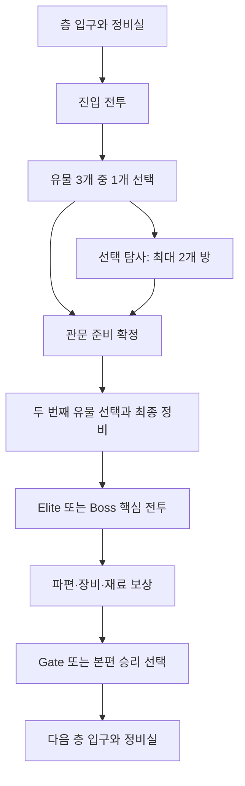

# 유물 중심 런 진행 전면 재설계 제안

작성일: 2026-09-07.

> **통합 검토본 (2026-09-12):** [런 구조 통합 설계안](run_structure_integrated_design_2026-09-12.ko.md)에
> 후속 재설계안과 사용자 합의를 함께 정리했다. 이후 런 구조 검토는 통합본에서 이어간다.
> 이 문서의 본문은 초기 제안 이력으로 보존하며, 통합이 정책 채택이나 구현 승인을 뜻하지 않는다.

상태: **AI의 초기 통합 기획 제안 v1 / 후속 대화 이전의 참고안 / 구현·밸런스 검증 전**.

> **후속 대화 반영 (2026-09-07):** 최신 결정과 검토 범위는
> [런 진행·성장 구간 재설계 대화 기록](run_progression_growth_policy_notes_2026-09-07.ko.md)을 따른다.
> 사용자는 Elite·NormalBoss를 필수 전투로, 일반 침식체를 무기 강화 재료를 얻기 위한 선택 전투로
> 두기로 했다. 아래의 필수 진입 전투와 선택 전투 없이 가능한 무기 강화 예산은 이 결정으로 교체된다.
> 보유 5명·전투 등록 4명, 6층과 유물 13개 등도 확정값이 아니다. 직원 5~8명 범위와 8층 비교안이
> 후속 대화에 등장했으며, 정확한 인원·층수·공급량은 재검토한다. 아래 본문은 초기안의 근거와
> 내용을 보존한 것이고, 이번 결정으로 문서 전체가 승인된 것은 아니다.

사용자는 유물을 포함한 진행 전면 재설계를 요청하고 기존 요소의 삭제·변경과 신규 요소의 추가를
허용했다. 이 문서는 그 요청에 대한 하나의 구체적인 추천안이다. 아래의 새 규칙과 수치는 사용자
확정 정책이나 현재 동작이 아니다. 기존 룰북·사용자 결정 기록을 변경하거나 정식 Working Policy,
Final Freeze, 구현 Goal을 생성한 문서도 아니다.

## 1. 제안하는 게임 경험

**처음부터 환상체의 힘과 유물 하나를 들고 출발한 탐사대가, 여섯 층에서 서로 다른 전투 조합을
만들고, 시설 핵심의 최종 보스를 제압해 귀환한다. 완성한 조합으로 더 싸우고 싶으면 심층 탐사를
계속한다.**

시설의 방·통로 탐사, 직원의 부상과 트라우마, 실시간 배치 방어를 중심에 둔다. 진행은 다음의
성장 순서를 제공한다.

1. 시작부터 작은 조합을 직접 사용한다.
2. 첫 층에서 유물의 집중 투자와 직원 간 분산을 선택한다.
3. 두 번째 층까지 주력 직원들의 파편을 확보한다.
4. 중반에 개화와 유물 연결로 운용을 바꾼다.
5. 후반에는 보스의 예고를 읽고 완성한 조합을 조정한다.
6. 최종전에서 성과를 확인하고 런을 끝낼 수 있다.

좋은 획득 때문에 적이 즉시 더 강해지지 않게 한다. 파편 한 개의 획득에 같은 환상체를 세 번
잡는 의무를 없애고, 반복 제압의 위험은 추가 보상에 투자하고 싶은 플레이어가 선택한다.

## 2. 모드와 한 런의 길이

| 항목 | 제안 |
| --- | --- |
| 튜토리얼 | 현재 Standard를 학습 전용으로 축소. 작은 시설 지도 하나에서 3개의 단계적 전투와 고정 파편·유물·정비를 학습 |
| 본편 | 가칭 `시설 제압`. 3개 구역, 구역당 2층, 총 6층을 진행하는 독립 런 |
| 구역 관문 | 2층·4층에 NormalBoss, 6층에 FinalBoss |
| 중간 핵심 전투 | 1층·3층·5층은 Elite 환상체 |
| 심층 탐사 | 본편 승리 후 같은 직원·장비·파편·유물을 유지해 선택적으로 계속하는 연장 진행 |
| 본편 플레이 시간 | 첫 목표 90~120분. 실측 전의 가설이며 전투 수·설명량·전투 길이를 함께 조정 |
| 전역 성장 | 도감·튜토리얼 해금·기념 기록 유지. 다음 런의 능력치·장비·재화를 누적 지급하지 않음 |

본편 승리는 독립된 달성 기록이다. 6층 보상과 승리를 확정한 뒤 `귀환` 또는 `심층 탐사`를 고른다.
귀환은 해당 런을 종료하고, 심층 탐사는 승리 기록을 유지한 채 active run을 계속한다. 연장에서
실패하더라도 이미 달성한 본편 승리는 사라지지 않는다. 현재의 RunComplete 즉시 이어하기 폐기
정책과는 다른 결과 흐름을 필요로 한다.

심층 탐사는 같은 6층 구성의 다음 주기를 사용한다. 새 주기에는 더 높은 고정 난이도와 미리
고지한 전장 변형을 적용한다. 각 Gate에서 귀환할 수 있으며, 모든 FinalBoss 격파는 강제 종료가
아니다. `한 런에서 모든 FinalBoss 격파` 기록은 이 연장에서 도전할 수 있다.

본편은 제한된 획득으로 조합을 만드는 구간이고, 장기 연장은 풍부한 보유품과 강한 조합을 시험하는
구간으로 설계한다. 연장에서도 계속 처음과 같은 수집 희소성이 유지된다고 전제하지 않는다.

기본 경로는 층당 진입 전투와 핵심 전투로 총 12전이다. 선택 방에서 전투를 고르면 최대 12전을
추가할 수 있으므로 첫 시간 예산은 필수 12전과 선택 전투 약 6전을 기준으로 잡는다. Event 안에서
여러 연속 전투를 추가해 이 예산을 우회하지 않는다.

## 3. 한 층의 구조

### 3.1 시설 지도와 탐사 선택

- 방과 통로로 구성된 시설 지도를 유지한다. 실제 도달 가능성과 일방통행은 지도 연결이 결정한다.
- 각 층에 필수 진입 전투 1개, 선택 탐사 방 3~4개, 핵심 전투, 정비실과 Gate를 배치한다.
- 선택 탐사 방은 **최대 2개만 해결**할 수 있다. 0~1개만 방문하고 관문 준비로 넘어가도 된다.
- 현재 층의 선택 탐사 기회는 숫자로 명시한다. 실시간 제한이나 누적 경보 수치는 도입하지 않는다.
- 선택 방의 성공·실패 결과를 확정하면 기회를 한 번 사용한다. 실패도 그 방을 다시 이용하지 못하게
  한다. 결과 확정 전 전투 후퇴는 방 진입과 탐사 기회 사용을 복원한다.
- 실패로 닫힌 선택 방도 해결한 node 한 개로 세고 Breakdown 등 node 경과를 적용한다. 필수 전투의
  첫 패배는 node를 해결하지 않으므로 해당 node 경과를 만들지 않는다.
- 완료 방의 통과, 정비실 방문, 장비 변경과 상점 거래는 탐사 기회를 쓰지 않는다.
- 핵심 전투를 준비한다고 확정하면 남은 선택 탐사 방은 닫힌다. 두 번째 기본 유물 선택은 그 확정에
  연결하므로, 유물을 먼저 받아 선택 방을 추가로 공략하는 경로는 제공하지 않는다.
- 핵심 전투 후퇴는 관문 준비가 확정된 상태로 돌아온다. 이미 닫은 선택 방을 다시 열지 않는다.
- 핵심 전투 승리 후 Gate가 열린다. 필수 전투의 패배 횟수 소진으로 Gate를 열지 않는다.

선택 방 구성의 초기 표준은 다음과 같다. 층별 지도 형태는 바뀌어도 성장 기회와 회복 접근성을
별도로 검증한다.

| 선택 방 | 주요 목적 | 감수하거나 포기하는 것 |
| --- | --- | --- |
| 유물 회수실 | 고위험 전투 승리로 추가 유물 1개 선택 | 직원 손실 위험, 탐사 기회 1회 |
| 선택 격리실 | 미보유 파편의 원본 환상체 제압 또는 강화 재현 | 새 운용을 배우는 전투, 탐사 기회 1회 |
| 의료·보급실 | 확정된 치료품·강화 재료 확보 | 유물·새 파편 방을 선택할 기회 |
| Event | 직원 전문성과 선택에 따른 재료·재화·회복·보스 정보 | 실패 결과 또는 선택의 대가, 탐사 기회 1회 |

같은 층의 추가 유물 회수실은 최대 하나다. 일반 Event의 무작위 유물 지급은 초기안에서 사용하지
않는다. 조건부 비밀방은 선택 방 하나를 대체하거나 그 방의 보상을 바꾸며, 별도의 무료 탐사 기회를
추가하지 않는다. 이전 모노리스 잔재 4개 교환 체인을 필수로 상속하지 않는다.

### 3.2 층별 정비실

현재 Start를 확장한 층별 정비 거점이다. 층 진입 직후부터 핵심 전투 준비까지 방문할 수 있고,
같은 층에서는 하나의 서비스 상태를 공유한다. 진입 전투와 선택 탐사 뒤에는 완료 통로를 통해
돌아올 수 있도록 지도 연결을 보장한다.

- 유물·장비·파편 장착 변경, 무기 강화, 파편 개화와 형태 선택, 분쇄를 제공한다.
- 치료와 기본 소모품 상점을 함께 제공한다. 무기를 장착하지 않은 생존 직원에게 줄 기본 무기도
  구매할 수 있어야 한다.
- 층당 무료 치료는 1회다. 직원 한 명의 신체 부상 1 감소 또는 트라우마 30 감소 중 하나를 고른다.
- 여기와 상점의 초기 치료품은 각각 부상 1 또는 트라우마 30을 감소시키며 유효 범위에서 clamp한다.
- 무료 치료를 층 입구에서 쓸지, 탐사 뒤에 쓸지 선택한다. 재방문해도 치료 횟수·상품 재고는 늘지 않는다.
- 추가 치료는 실제 보유 치료품이나 상점 구매를 사용한다. 죽은 직원을 부활시키지 않는다.
- 정비실 서비스와 유물 선택은 별도 node 완료를 만들지 않는다. Breakdown 카운터를 상점 구매 횟수나
  강화 횟수만큼 감소시키지 않는다.
- 2층·4층 정비실은 채용도 제공한다. 유료 유물 상품은 2층·4층·5층에 각각 하나씩만 둔다.
- 정비실의 일반 상점과 유물 상품에는 이번 초기안에서 재추첨을 두지 않는다.

핵심 전투 뒤 다음 층 첫 전투를 시작하기 전에 정비실을 이용할 수 있다. 전원이 부상으로 출전
불가능해졌는데 치료 거점까지 가려면 먼저 전투해야 하는 구조를 피한다.

## 4. 여섯 층의 성장 곡선

표의 유물 수는 기본 보상만 모두 선택하고 분쇄하지 않았을 때의 누적 획득 수다. 실제 활성 슬롯
수나 서로 연계되는 유물 수를 보장하는 숫자는 아니다. 시작 유물 1개에 층마다 2개를 더한다.

| 단계 | 플레이어가 완성할 것 | 핵심 전투 | 핵심 전투 전 기본 유물 누계 | 파편·개화의 주요 변화 |
| --- | --- | --- | ---: | --- |
| 출발 | 주력 한 명의 파편과 유물 조합 | 없음 | 1 | 시작 파편 1개 |
| 1층 | 집중 투자하면 주력의 유물 3슬롯 사용, 또는 여러 직원에게 분산 | Elite | 3 | 첫 승리로 두 번째 파편 |
| 2층 | 주력과 보조 직원의 역할 분담 | NormalBoss | 5 | 세 번째 파편, 첫 개화용 보스 핵 |
| 3층 | 첫 개화 또는 기존 형태 유지, 연결형 조합 시험 | Elite | 7 | 네 번째 파편, 무기 강화 +2 개방 |
| 4층 | 두 번째 핵심 조합과 특급 선택 | NormalBoss | 9 | 다섯 번째 파편, 두 번째 보스 핵 |
| 5층 | 최종 보스 예고에 맞춘 편성과 생존 보완 | Elite | 11 | 여섯 번째 파편, 무기 강화 +3 개방 |
| 6층 | 새 수집보다 완성한 조합의 조정과 실행 | FinalBoss | 13 | 승리 뒤 최종 파편과 본편 완료 |

파편 수는 서로 다른 보상 대상들을 선택한 표준 경로의 값이다. 선택형 제압으로 미리 얻은 파편,
분쇄, 의도적인 반복 선택은 실제 보유량을 바꾼다. 2층 종료 시 모든 파편이 모든 직원의 무기와
호환되거나, 3층의 개화가 모든 보유 파편에 가능한 것으로 해석하지 않는다.

구역별 전투 의도:

- 1~2층: 한 전선 유지와 기본 스킬 운용을 익히고, 첫 보스가 화력·저지·회복의 균형을 확인한다.
- 3~4층: 두 경로, 시간차 웨이브, 원거리 압박 등으로 주력 한 명의 의존도를 시험한다.
- 5~6층: 예고된 복합 위협과 보스 기믹에 맞춰 인력·배치·유물 슬롯을 조정한다.

층이 올라간다고 모든 전투에 새 기믹을 겹치지 않는다. 좋은 조합으로 적을 빠르게 정리하는 비교적
단순한 전투도 남겨 성장 효과를 느낄 수 있게 한다. 최종 파편은 승리 보상이므로 본편 클리어의
필수 전력으로 예산에 포함하지 않는다. 연장을 선택하면 다음 전투부터 사용할 수 있다.

## 5. 시작 직원과 출발 보급

- 시작 직원은 3명이며 전원 실제 배치 가능한 무기를 가진다.
- 본편 roster는 최대 5명, 한 전투에 등록하는 직원은 최대 4명으로 제안한다. 등록한 직원만 그 전투에서
  배치·재배치할 수 있다. 전투 중 예비 직원으로 등록 명단을 바꾸지 않는다.
- 2층 정비실에서 네 번째 직원을 무료로 채용할 수 있다. 4층의 다섯 번째 직원은 유료 선택이다.
  후보는 실제 무기와 초기 장비를 함께 가져오며, 플레이어는 채용을 거절할 수 있다.
- 정원이 찼을 때 새 후보를 선택하면 기존 생존 직원 한 명을 본사로 돌려보내는 선택을 제공한다.
  해당 직원의 런 소유 장비·파편·유물을 회수하고, 떠난 직원은 같은 런에서 재채용하지 않는다.
- 사망 직원은 기록에는 남지만 생존 roster 정원을 차지하지 않는다. 채용 session을 닫았다 열어
  후보를 새로 뽑거나 무료 채용을 반복할 수 없다.

출발 보급은 다음 순서로 고른다.

1. 초반 사용이 완결된 Elite 파편·호환 기본 무기 묶음 3개 중 하나를 선택한다.
2. 선택한 파편·무기로 즉시 활용할 수 있는 일반 유물 3개 중 하나를 선택한다.
3. 받을 직원과 장착 구성을 확인하고 첫 층에 진입한다.

묶음 후보는 단일 피해·범위 대응·제어/유지 같은 서로 다른 운용을 보여준다. 모든 파편을 시작부터
직접 지정하는 방식은 사용하지 않는다. Run seed로 정한 후보는 재접속·새 화면 진입으로 바뀌지 않는다.
시작 파편은 명시적인 본편 출발 지급 경로이며, 현재 Endless의 전투 전용 지급 정책을 변경한다.

## 6. 파편·무기·직원 성장의 정리

### 6.1 파편은 첫 제압에서 얻는다

- 보상을 가진 Elite·NormalBoss의 최초 승리는 그 조우가 명시한 파편 1개를 즉시 지급한다.
- 한 환상체가 여러 파편을 가지더라도 해당 조우가 작성한 정확한 파편 하나를 지급한다.
- 시작 지급과 다른 경로를 포함해 이미 지급받은 같은 fragment identity의 반복 보상은 재료·재화다.
  파편을 분쇄했다고 같은 제압 보상에서 무한히 다시 지급하지 않는다.
- 핵심 전투의 후보는 가능하면 서로 다른 미획득 보상을 가진 환상체 2개를 보여주고 하나를 선택한다.
  상대와 파편·장비 보상을 진입 전에 공개한다. 후보는 층 생성 때 확정하고 다른 후보는 함께 닫힌다.
- 실제 적격 후보가 하나면 하나만 보여준다. 보상이 없는 특수 서사 조우를 필수 파편 지급 칸에 넣지 않는다.
- 직접 제압과 무관한 파편의 상점 판매·일반 보상 무작위 지급은 추가하지 않는다. 출발 보급은 명시적 예외다.
- 일반 보스 파편의 보편적인 상위 성능을 목표로 삼지 않는다. 더 복잡한 운용이나 고점·대가를 줄 수 있지만,
  투자한 Elite 파편을 후반까지 유지할 수 있게 한다. 현재 참고 노트의 등급별 성능 방향에서 바꾸는 제안이다.

### 6.2 개화는 중반 운용 선택이다

- 파편 일반 강화 제거, 개화 전·후 형태 보존, Maintenance에서 형태 선택이라는 기존 유물 노트의 목표를 유지한다.
- 첫 시작 후보에 속하는 Elite 파편의 기본 개화 recipe는 파편 가루와 `보스 핵` 1개를 사용한다.
- 보스 핵은 이번 안에서 추가하는 NormalBoss 제압 재료다. 유물 강화 재화가 아니며 2층·4층 필수 보스가
  각각 1개를 지급한다. 각 보스는 첫 개화의 가루 비용도 충당하는 고정 재료 보상을 지급한다.
- 따라서 시작 파편을 보존하고 해당 재료를 다른 데 쓰지 않았다면 3층 입구 정비실에서 첫 개화가 가능하다.
- 특수 파편의 특정 환상체 파츠·교차 콘텐츠 조건은 유지할 수 있다. 그 형태는 선택형 고점으로 취급하며
  기본 클리어에 필요한 성장량이나 첫 개화 보장에 포함하지 않는다.
- 단순히 모든 개화를 상위 수치로 만들지 않는다. 기본형에 맞춘 유물 조합을 유지하는 선택도 유효해야 한다.

### 6.3 수직 성장은 무기에 모은다

- 직원의 전투 XP·level·전투 tier 성장과 미사용 GrowthStack을 본편 성장축에서 제거한다.
- 직원의 기본 능력치·성격·Event 적성은 유지한다. 손실 관리와 어떤 장비를 누구에게 줄지가 직원 운용의 중심이다.
- 무기는 공격력·주문력 중 자신이 제공하는 능력치를 일반 강화로 높인다. 강화 한도는 +3으로 시작한다.
- +1은 1층부터, +2는 3층부터, +3은 5층부터 정비실에서 허용한다. 강화는 장비 instance를 따른다.
- 방어구·액세서리의 자체 특수 효과는 유지하되 일반 강화는 제거한다. 분쇄 가능 여부는 개별 recipe가 정한다.
- 무기 교체 시 새 무기에 강화가 자동 이전되지 않는다. 강화 무기를 분쇄하면 기본 가루와 투자 가루의
  75%를 내림해 회수하도록 제안한다. 분쇄 뒤 같은 instance를 복구하거나 파는 경로는 없다.
- 무기 강화·분쇄, 파편 개화·분쇄, 유물 분쇄는 정비실이 소유한다. 장착 변경은 일반 Safezone에서도 가능하다.

독립 성장축은 `무기 강화`, `파편과 개화 형태`, `유물 조합`으로 정리한다. 자동 XP를 없애는 대신
패배 반복으로 얻는 수치 성장을 없애고, 승리의 재료 보상과 경로 선택에 투자를 모은다.

## 7. 유물 획득과 3슬롯의 선택

### 7.1 공급량

| 획득처 | 횟수·수량 | 역할 |
| --- | --- | --- |
| 출발 보급 | 일반 유물 1개 | 첫 전투부터 작은 조합 사용 |
| 층 진입 전투 승리 | 층마다 1회, 3개 중 1개 | 전투로 얻는 확정 성장 |
| 관문 준비 확정 | 층마다 1회, 3개 중 1개 | 보스 전에 조합을 다듬는 확정 성장 |
| 선택 유물 회수실 | 층마다 최대 1개 | 위험과 탐사 기회를 투자하는 추가 성장 |
| 정비실 유료 상품 | 2·4·5층 각각 최대 1개 | 치료·장비 예산과 교환하는 선택 |
| 일반 전투·Event 무작위 드롭 | 초기안에서는 없음 | 공급량을 예측하고 선택의 간격을 유지 |

기본 경로는 1 + 6 × 2 = **13개**다. 추가 방을 전부 성공하고 상점 상품을 전부 사면 최대 22개다.
유물을 원하지 않아 선택을 건너뛰면 소량의 Enkephalin을 받는다. 보유량 상한을 새로 두지 않는다.

전투 등록 4명은 12슬롯, 예비까지 포함한 생존 5명은 15슬롯이다. 13개 기본 지급이 네 명의 좋은
조합 12개를 보장하지는 않는다. 중복·비호환·효과 조건과 보관·분쇄·집중 투자 때문에 실제 배분이
달라진다. 추가 획득은 빈칸을 채우는 것과 기존 조합을 바꾸는 것 모두에 사용한다.

### 7.2 제안 후보의 구성

일반 유물 선택 화면은 서로 다른 3종을 제안하며 각 위치를 다음 역할로 구성한다.

1. **현재 활용:** 보유한 무기·파편·해금 형태와 무료 장착 변경만으로 생존 직원에게 활용 가능한 유물.
2. **다른 운용:** 보유한 다른 파편, 아직 쓰지 않은 효과 또는 새로운 효과를 부여하는 유물로 방향 전환 제안.
3. **폭넓은 선택:** 공격·저지·회복·생존 등에 사용할 범용 유물 또는 조건을 명확히 보여주는 미래 투자.

이는 화면상 슬롯의 공격·방어 제한이 아니다. 현재 활용 조건은 장착 중인 주력만 보지 않고 보유품을
함께 읽는다. 개화를 새로 수행하거나 아직 없는 장비를 구매해야만 활성화되는 유물을 현재 활용 칸에
넣지 않는다. 전용 유물은 대상 파편·장비를 보유한 경우에만 기본 후보에 포함한다.

- 보유 유물과 중복되는 후보도 나타날 수 있다. 한 화면에서 같은 유물 종류를 두 번 제안하지 않는다.
- 후보의 정체는 최초 개봉 시 보유품과 source seed로 확정하고 저장한다. 이후 장비 교체로 다시 뽑지 않는다.
- 다른 유물의 새 효과와 조합되는 경우도 호환성에 반영한다. 불가능한 순환 의존만으로 활성화된다고 표시하지 않는다.
- 후보가 3종 미만이면 실제 가능한 1~2종을 그대로 표시한다. 빈 칸을 임의의 무효 콘텐츠로 메우지 않는다.
- 현재 활용 가능한 후보가 최소 1종 존재하도록 출발·획득 pool의 콘텐츠 커버리지를 사전 검증한다.
- 초기안에는 유료·무료 재추첨을 넣지 않는다. 선택 횟수가 많은 상태에서 추가 메뉴와 비용을 줄인다.
- 세 후보의 효과, 활용 가능한 직원·파편, 교체가 필요한 유물과 비호환 사유를 함께 보여준다.

### 7.3 희귀도

- 일반·희귀·특급의 구분과 유물 자체 강화 없음 정책을 유지한다.
- 출발은 일반, 1층은 일반 중심으로 구성한다. `깊은 쐐기`의 희귀 등급을 낮춰 출발 보급에 넣지 않는다.
- 2층 관문 준비에서 희귀 후보를 최소 하나, 4층 관문 준비에서 특급 후보를 최소 하나 제안한다.
- 위 보장 후보도 현재 보유품으로 활용할 수 있어야 한다. 가장 강한 특정 유물이나 원하는 전용 유물의
  확정 지급을 뜻하지 않는다.
- 일반 유물은 끝까지 쓸 수 있어야 한다. 역할 분류나 효과 복잡성만으로 희귀도를 정하지 않는다.
- 선택 방·상점은 희귀 이상을 노릴 기회지만, 특급을 여럿 얻어야 본편을 클리어하도록 설계하지 않는다.

### 7.4 유지하는 유물 공통 정책

직원당 자유 슬롯 3개, 런 공용 소유와 직원 간 이전, 사본별 소유, 중복·비호환 규칙, 조건 미충족 시
비활성 유지, 사망 시 회수, 전투 중 장착 변경 금지, 상점 판매 금지, 장비 가루로 분쇄를 유지한다.

태그 기반 범용·전용 유물을 모두 사용하고, 새 효과에도 태그와 출처를 부여한다. 같은 종류의 피해
증폭은 합산하고 공통 상한을 추가하지 않는다. 동일 연쇄에서 같은 유물 사본의 같은 효과로 되돌아오는
순환 발동을 막는다. 재배치 시 일시 스택은 초기화하고 전투당 횟수 제한의 사용 기록은 유지한다.

## 8. 재화와 회복의 초기 예산

아래는 공급량 모순을 찾기 위한 **첫 플레이 검증용 수치**다. 현재 live 값이나 확정 밸런스가 아니다.

| 항목 | 초기 제안값 |
| --- | --- |
| 시작 자원 | Enkephalin 100, 장비 가루 10 |
| 층 진입 전투 승리 | Enkephalin 80, 장비 가루 10, 유물 선택 1회 |
| 핵심 전투 승리 | Enkephalin 120, 장비 가루 20, 조우의 파편·장비 보상 |
| 무기 강화 비용 | +1: 가루 20 / +2: 추가 40 / +3: 추가 60 |
| 첫 개화 recipe | 파편 가루 20, 보스 핵 1 |
| 2층·4층 보스 추가 재료 | 파편 가루 20, 보스 핵 1 |
| 유물 상점 상품 | Enkephalin 240, 해당 층 재고 1개 |
| 기본 치료품 | Enkephalin 60, 부상용·트라우마용 각 층 재고 2개씩 |
| 복구용 기본 무기 | Enkephalin 40, 기본 근접·원거리 중 실제 배치 가능한 상품, 각 층 종류별 재고 1개 |
| 유물 선택 건너뛰기 | Enkephalin 30 |
| 유물 분쇄 가루 | 일반 5 / 희귀 10 / 특급 20을 첫 비교값으로 사용 |

첫 진입 전투 뒤에는 가루가 20이므로 선택 방 없이도 첫 무기 +1이 가능하다. 각 층의 기본 전투
승리 수입은 200이므로 유물 상점 상품 240은 누적 저축을 요구한다. 치료품 4개의 가격도 240이라
유물 구매와 생존 자원이 직접 경쟁한다. 무료 치료는 최소 복구 경로를 제공하지만 모든 직원을
매 층 완치시키지 않는다.

파편 가루는 개화에, 장비 가루는 무기 강화에 사용한다. 유물은 분쇄하면 장비 가루를 주지만 유물
레벨·유물 강화 재화·전용 재추첨 통화는 만들지 않는다. 파편과 장비의 개별 분쇄·판매 recipe는
이 예산에 맞춰 작성하고, 구매·분쇄·판매의 반복으로 이익을 얻는 조합이 없는지 함께 검증한다.

## 9. 모노리스·숙달·보스 징조의 재배치

### 9.1 반복 제압

모노리스의 구매 자격, 3 uses, Stage 2·3 의무, 세 번째 파편 지급, 숙달 반복 pool, Elite 소탕과
잔재 4개 교환을 본편 진행에서 제거한다.

대신 3층 이후 선택 격리실이 이미 제압한 환상체의 **강화 재현**을 제안할 수 있다. 알려진 상대의
더 어려운 변형과 예고된 보상을 선택하는 방이다. 재현은 해당 방에서 한 번만 결과를 확정하며,
승리하면 그 환상체·보유 파편의 태그에 관련된 유물 선택 또는 개화 재료 중 미리 고지된 보상을
지급한다. 유물을 주는 재현 방은 그 층의 유물 회수실을 대체하므로 추가 유물은 여전히 최대 1개다.

강화 재현에 실패해도 소유 파편과 해금 형태를 영구 봉쇄하지 않는다. 이미 얻은 파편을 계속 사용할
수 있으며 해당 방의 보상 기회만 잃는다. 본편 길이가 짧아진 만큼 반복 전투를 자동 소탕으로 줄이는
별도 시스템은 첫 개편안에서 사용하지 않는다.

### 9.2 최종 보스와 징조

- 기본 최종 보스는 런 생성 시 적격 registry에서 하나를 정하고 6층에 반드시 배치한다.
- 기본 최종전에 도달하는 데 특정 무작위 파편·전용 유물·희귀 재료를 요구하지 않는다.
- 2층 승리 후 주요 위협을 예고하고, 4층 승리 시 최종 보스와 기본 기믹을 충분히 공개한다.
- 기존 BossOmen은 선택형 분기로 바꾼다. 3층·5층의 관련 Event 두 단계를 모두 해결하면 6층의 보스를
  특별한 상대와 보상으로 교체하는 식으로 작성한다. 해당 Event는 선택 탐사 기회를 사용한다.
- 징조를 무시하거나 실패하면 기본 최종 보스가 남는다. 중간에 탐사 지도를 갑자기 폐기하지 않는다.
- 특별 상대와 보상·위험의 차이를 마지막 징조 선택 전에 보여준다. 기본 최종전보다 무조건 유리한
  우회로로 만들지 않는다.
- 숨겨진 보스도 필요하면 이 대체 최종전 구조에 넣는다. 기본 클리어 경로를 막거나 추가 필수 층을 만들지 않는다.
- 원본 콘텐츠의 기믹이나 최종 백야 체인·흉탄의 사수 상세 설계는 이 진행안으로 확정하지 않는다.

심층 탐사에서는 일반 FinalBoss identity를 cycle로 순환시킨다. 모든 보스를 한 런에 만나는 기록과
반복 보상은 그 구간으로 옮기며, 본편 6층에서 전체 보스를 모두 만날 의무는 없다.

## 10. 난이도와 전투 설계

**현재 전투력과 런 최고 전투력이 다음 층 적의 능력치를 결정하는 연결을 제거한다.**

- 난이도는 시작 시 선택한 난이도, 구역·층, 조우의 기본 난이도와 명시적으로 선택한 고위험 변형이 정한다.
- 같은 난이도·seed·경로라면 강한 유물을 얻었어도 적의 HP·공격력·웨이브가 추가 상승하지 않는다.
- Certified 전투력은 준비 상태와 상대 위협 안내용으로만 유지한다. 유물의 기여도도 설명용 평가에 포함한다.
- 특정 조합을 감지해 다음 보스가 그 조합에 면역이 되는 보정은 두지 않는다.
- 도전 강도는 공격력·HP뿐 아니라 적의 동시 압박, 경로 분리, 스킬 사용 타이밍, 보호 대상과 현장 작업으로 만든다.
- 현장 작업은 선택적 수리·유리한 전장 상태를 만드는 보조 기믹으로 사용한다. 모든 전투의 의무 조작으로 넣지 않는다.
- 본편 최종전은 특급 여러 개·희귀한 전용 유물·모든 직원의 개화를 요구하지 않는다.
- 심층 탐사의 상승도 층·주기와 공개된 변형을 따른다. 보유 전투력으로 적을 추격 강화하지 않는다.

첫 균형 목표는 3명의 일반적인 조합으로도 기본 난이도 본편을 완료할 수 있고, 네 번째 직원과
고위험 보상이 편성의 유연성과 고점을 제공하는 것이다. 구체적인 통과율은 검증 결과로 판단한다.

## 11. 손실·후퇴·저장·실패

### 11.1 직원 상태

- 신체 부상 0~6, 트라우마 0~100, 출전 자격과 사망 시 장비·파편·유물 회수를 유지한다.
- Gate는 생존 직원의 현재 트라우마 10%를 올림해 회복한다. 신체 부상과 사망을 되돌리지 않는다.
- Breakdown은 이후 실제 node 완료 2회 안에 트라우마를 99 이하로 낮춰야 하는 첫 조정값을 사용한다.
  Breakdown을 새로 발생시킨 node 자체는 이 두 번에 세지 않는다.
- 정비실은 node를 완료하지 않고 치료할 수 있으므로, 치료 메뉴를 열었다는 이유로 사망 카운터가 줄지 않는다.
  이후 Gate 완료에서는 회복을 먼저 반영하고 여전히 Breakdown인 직원만 카운터를 진행한다.
- 전투 외 직원 Psychology·신뢰를 새로운 성장 보상으로 추가하지 않는다.

### 11.2 전투 재도전과 런 실패

- 전투 전체 후퇴는 결과 판정 전 진입 상태를 복원하는 현재의 무료 학습 수단으로 유지한다.
- 후퇴·재시작으로 보상 후보·적 구성·Event 주사위를 다시 뽑지 않는다. 후퇴에 XP·재화·소탕 보상을 주지 않는다.
- 선택 방 전투는 패배 결과 확정 시 그 방과 탐사 기회를 잃는다. 런 전체는 계속할 수 있다.
- 필수 진입 전투와 Elite·NormalBoss 핵심 전투는 최대 2회의 패배 결과를 허용한다. 첫 패배 뒤에는 같은
  정비실에서 복구하고 재시도한다. 두 번째 패배 확정은 런 실패다.
- 첫 필수 진입 전투 패배 뒤에는 선택 탐사를 열지 않는다. 핵심 전투 패배 뒤에도 준비 확정으로 닫힌
  선택 방을 다시 열지 않는다. 재도전이 새 보상을 수집하는 우회 경로가 되지 않게 한다.
- FinalBoss는 패배 결과 한 번의 확정으로 해당 본편 또는 연장이 실패한다. 결과 판정 전 후퇴는 허용한다.
- 승패와 손실은 결과 확인으로 한 번 확정한다. 실패 확정 전 사용할 수 있는 치료·무료 치료·채용·기본
  무기와 실제 재화를 검사하고, 복구 가능한 직원이 있다면 정비실 이용을 허용한다.
- 필수 전투의 시도 소진은 인력 복구 여부와 별개의 런 실패다. 전원이 사망하거나 실제 복구 경로도 없으면
  그보다 먼저 실패한다.

### 11.3 저장은 중단을 돕는다

- SavePoint node와 수동 과거 checkpoint load 3회를 제거한다. 회복 기능은 층별 정비실로 옮긴다.
- node 결과·보상 선택·거래·편성 등 확정된 상태 변경마다 자동 저장하며, 이어하기는 마지막 확정 상태다.
- 사용자가 원하는 과거 방으로 되돌아가지는 않는다. 선택 후보와 잔여 재고도 저장한다.
- 같은 process의 연결 해제는 현재 전투를 Pause하고 재접속으로 복구한다.
- process가 전투 중 종료되면 확정된 진입 직전 상태로 돌아간다. 이는 무료 후퇴와 같은 취급이다.
- 전투 종료로 결과가 생성된 뒤에는 미확정 결과 화면 자체를 저장한다. 종료·재접속으로 판정된 패배를
  전투 도중 중단처럼 되돌리지 않는다.
- 유물의 전투 누적 상태·사본별 사용 제한은 같은 process 복구에서 유지하고, 전투를 다시 시작하면
  해당 전투의 초기 상태에서 시작한다.

무제한 과거 복원과 재화 획득 반복을 막으면서, 90~120분 런을 한 번에 끝낼 필요는 없게 한다.

## 12. 침식과 보스 관문의 충돌 해소

현재 침식 목표 정책은 전장에 있는 적을 즉시 kill한다. 이를 그대로 두면 단일 보스 관문과
여섯 층의 성장 검증을 침식 한 번으로 건너뛸 수 있어, 이 개편에서는 다음 변경을 함께 제안한다.

- 일반 침식체는 현재 전장의 대상만 즉시 처치한다.
- Elite·NormalBoss·FinalBoss급 적은 즉사시키지 않고, 해당 적 최대 HP의 20%를 첫 검증값으로 하는
  특수 피해를 준다. 방어·저항으로 감소시키지 않되 encounter의 무적·보호·phase 전이 한계를 따른다.
- 해당 범위의 피해로 실제 HP가 0이 되면 처치할 수 있지만, 여러 보호 phase를 한꺼번에 넘어가지는 않는다.
- 미출현 적·필수 후속 웨이브·보호 대상·현장 작업 조건을 제거하지 않는다.
- 사용 직원은 즉시 철수하고 트라우마 100에 더해 신체 부상 1을 얻는다. 기존의 트라우마 단독 대가를 변경한다.
- 높은 트라우마·만충 공명에서 실제 파편 시전을 대체하는 조건, FinalBoss 파편의 침식 제외, 별도 버튼 없음은 유지한다.
- 별도 전투당 공용 횟수 상한은 추가하지 않는다. 같은 직원은 Breakdown으로 재배치할 수 없고, 다른 직원의
  침식은 각각 그 직원의 부상·이탈이라는 대가를 갖는다.
- 침식에 유물 증폭·연쇄와 장비·파편 처치 효과·적의 사망 효과를 적용하지 않는 경계는 유지한다.

이는 침식 기존 사용자 결정 중 즉사 범위와 직원의 대가를 변경하는 **이번 제안**이다. 20%는
밸런스 초깃값이며, 여러 직원의 연속 침식이 보스와 후속 웨이브를 무의미하게 만들지 않는지 검증한다.

## 13. 예시 런으로 보는 조합의 변화

아래 경로는 설계 가능성을 보여주는 한 seed의 사례다. 특정 파편·유물의 확정 등장이나 아직
미정인 개별 유물 효과·등급을 추가 승인하는 예시가 아니다.

| 시점 | 획득·선택 | 플레이 변화 |
| --- | --- | --- |
| 출발 | 나무꾼 계열 파편, 호환 Sword, 일반 생존 유물 | 첫 전투부터 파편의 3타 운용과 저지·생존을 사용 |
| 1층 | 첫 두 유물 중 하나를 주력에게, 하나를 다른 직원에게 분산. 핵심 제압에서 래티씨아 파편 획득 | 단일 강적 처리와 설치형 범위 대응이라는 두 방향 확보 |
| 2층 | 희귀 후보에서 깊은 쐐기를 선택. 네 번째 직원을 채용 | 같은 대상에게 유효 타격을 이어가는 주력과 두 번째 전선 준비 |
| 3층 | 시작 파편 개화 여부를 검토하고, 선택 유물 방에서 소환물 피해 후 받는 피해 증가 유물을 확보 | 래티씨아의 친구가 남긴 약화 시간에 다른 직원의 화력을 연결 |
| 4층 | 두 번째 개화 재료와 특급 후보 확보. 주력 추가 강화 대신 보조 생존을 선택 | 단일 직원의 고점과 복수 전선의 안정성 사이에서 투자 결정 |
| 5층 | 최종 보스 예고를 보고 추가 파편 방을 포기하고 의료·보급실 방문 | 이미 만든 조합을 보존하며 최종전의 손실을 줄이는 선택 |
| 6층 | 마지막 기본 유물을 기존 슬롯과 비교해 교체하거나 분쇄 | 최종 보스에서 배치·발동 순서를 실행하고 귀환 또는 연장 선택 |

`깊은 쐐기`는 같은 시전·같은 대상의 적중 누적이라는 기존 설계를 따른다. 소환물 유물의 받는 피해
증가 세부 적용 범위는 개별 콘텐츠 설계가 확정해야 한다. 이 예시로 새로운 상호작용을 구현 완료로
간주하지 않는다. `붉은 실타래` 없이도 래티씨아 파편과 범용 유물 조합이 완결되어야 한다.

## 14. 주요 유지·변경·삭제 목록

| 기존 요소 | 제안 | 이유 |
| --- | --- | --- |
| DefenseRoute·배치·철수·태세·전술 이동·수동 스킬 | 유지 | 전투 정체성과 직접 판단의 중심 |
| 시설 방·통로와 완료 방 통과 | 유지 | 시설 탐사 감각과 경로 선택 |
| 횟수 제한 없는 층 내 추가 탐사 | 최대 2개 선택 방으로 변경 | 보상을 모두 회수하는 행동에 기회비용 부여 |
| Gate 도달만으로 층 전환 | 핵심 전투 승리 후 개방 | 성장의 성과를 확인하는 관문 |
| Standard 고정 3층 | 짧은 학습용 지도 1개 | 본편과 튜토리얼의 역할 분리 |
| Endless가 유일한 본편 | 6층 본편과 선택 연장 | 런의 완성과 종료 시점 제공 |
| 시작 파편 없음 | 호환 무기·파편과 일반 유물 보급 | 처음부터 조합을 사용 |
| Elite 3승 파편 지급 | 첫 보상 제압에서 지급 | 파편을 얻은 뒤 운용하는 시간 확보 |
| 모노리스 구매·단계·숙달·소탕 | 선택 강화 제압으로 재구성 | 성장 필수 절차와 반복 관리 축소 |
| 직원 XP·level | 제거 | 수직 성장과 보상 체계 단순화 |
| 모든 장비·파편의 일반 강화 | 무기만 +3까지 강화, 파편은 개화 | 유물 노트의 성장 방향 반영 |
| 유물 | 시작 1개 + 층별 기본 2개와 선택 보상 | 일정한 조합 선택의 간격 |
| 전투력 추종 난이도 | 고정 구역·층 난이도 | 강한 조합의 성과 보존 |
| SavePoint·과거 load 3회 | 자동 이어하기, 정비실 회복 | 중단 편의와 성장 선택의 확정 분리 |
| BossOmen 강제 지도 교체 | 선택형 최종 보스 분기 | 예측 가능한 본편 길이와 선택 위험 |
| 침식 전장 적 전체 즉사 | 보스급 피해 상한과 부상 대가 추가 | 보스 관문과 운영 리스크의 양립 |
| 유물의 전투 전용 효과 범위 | 유지 | 맵·보상·상점 규칙과 전투 조합의 책임 분리 |
| 영구 도감·해금·기록 | 유지하고 본편 승리 기록 추가 | 런 외 수집과 다음 런의 전력 분리 |

## 15. 설계 점검과 첫 검증 범위

이 문서에서 수행한 점검은 보상 수량 계산, 경로·복구 접근성, 기존 결정과의 변경점 비교다.
플레이 테스트·시뮬레이션·런타임 검증은 수행하지 않았다.

### 15.1 문서 수준에서 확인한 경계

- 유물은 시작 1개와 6층의 각 2개로 총 13개이며, 6층의 두 유물도 최종전 전에 받는다.
- 본편 파편 7개 중 최종 파편은 클리어 전 전력에 포함하지 않는다.
- 첫 무기 강화와 시작 파편의 첫 개화는 선택 방·유료 유물·무작위 치료 보상에 의존하지 않는다.
- 핵심 전투 뒤 인력 손실은 다음 층 첫 전투 전에 정비실에서 복구할 수 있다. 자원 부족으로 복구 불가능한
  상태가 되는 위험 자체는 남는다.
- 유물 보장과 치료 서비스는 방문 횟수로 재지급되지 않는다. 선택 방의 실패도 기회비용을 지불한다.
- 후퇴는 같은 진입 상태로 돌아가고, 확정된 패배·유물 선택·채용 결과를 다시 뽑지 않는다.
- 선택 방을 모두 건너뛰어도 필수 성장 공급과 Gate 경로가 남는다.
- 같은 층에서 유물을 주는 강화 재현과 유물 회수실을 중복 배정하지 않는다.
- 본편 승리 뒤 연장 실패는 이미 얻은 기념 기록을 취소하지 않는다.

### 15.2 첫 콘텐츠와 플레이 검증

처음에는 2층짜리 구역 하나를 먼저 플레이 가능한 상태로 검증한다. 아래 수량은 제작 범위를 가늠하기
위한 제안이다.

- 서로 다른 역할의 직원·기본 무기, 시작 보급 후보 3개, 보상 있는 Elite 4종과 NormalBoss 1종.
- 범용 유물 12종 정도와 전용 유물 3종 정도. 기존 이름 있는 유물의 미정 수치·등급은 개별 검토에서 정한다.
- 주력 집중, 두 직원 분산, 생존 중심의 세 가지 편성으로 같은 구역을 비교한다.
- 선택 탐사 전부 생략, 회복 위주, 고위험 위주 경로를 비교한다.
- 사망·채용 거절·무기 분쇄·파편 분쇄·비호환 유물 선택·Breakdown을 포함한 복구 실패 경계를 확인한다.

그 다음 6층 전체 검증에는 적어도 보상 있는 Elite 6종, NormalBoss 2종, FinalBoss 1종과 충분한
희귀·특급 후보가 필요하다. 후보 부족이나 전용 유물 편중이 있으면 유효 선택 보장을 충족하는
콘텐츠를 먼저 보강한다. 같은 15개 유물만으로 전체 런의 다양성을 검증했다고 주장하지 않는다.

| 측정 항목 | 첫 목표 또는 실패 신호 |
| --- | --- |
| 첫 조합 사용 | 첫 전투에서 파편과 유물 효과를 확인할 수 있음 |
| 선택 간격 | 기본 경로에서 두 번의 필수 전투를 연속 완료할 때까지 새 유물 선택이 없는 공백 없음 |
| 1층 성장 | 집중·분산 두 방식 모두 첫 관문 통과 가능 |
| 중반 개화 | 시작 파편을 보존한 표준 경로에서 3층 입구 개화 가능 |
| 주력 다양성 | 한 시작 파편·한 유물이 다른 선택을 지속적으로 압도하면 조정 |
| 선택 방 가치 | 모든 경로에서 유물 회수실이 의료·새 파편보다 항상 우월하면 조정 |
| 성장 체감 | 같은 종류 적에 대한 처리 시간·허용 손실이 좋은 획득 후 개선되는지 확인 |
| 메뉴 부담 | 보상·정비 판단이 전투보다 길어지는 구간은 선택 수나 정보량 축소 |
| 본편 길이 | 초기 90~120분 가설 검증. 길면 성장 보장보다 반복 전투·탐사 수부터 축소 |
| 침식 | 최종 보스 한 번의 무조건 제거 또는 연속 침식만으로 주력 전투가 무의미해지는지 확인 |

### 15.3 이 안에서 감수하는 단점

- 6층과 필수 관문은 한 런의 끝을 명확히 하지만, 원하는 만큼 시설을 누비는 본편의 자유는 줄인다.
- 탐사 2회 제한은 선택을 선명하게 만드는 대신 인위적인 제약으로 느껴질 수 있다. 물리적인 경로가
  선택에 거의 영향을 주지 않는다면 시설 지도와 탐사 기회 규칙을 중복 사용하고 있는지 재검토한다.
- 보장 유물이 많으면 기대보다 정기 지급처럼 느껴질 수 있다. 먼저 선택 방의 위험·후보 차별성을 확인하고,
  초반 성장 보장을 무작위 드롭으로 바꾸기 전에 보상 화면 횟수와 묶음 제시를 비교한다.
- 직원 XP 제거는 보상 체계를 단순하게 하지만 개별 직원이 자란다는 감각을 약하게 만들 수 있다.
  플레이 검증에서 문제가 확인되면 기존 XP를 그대로 복원하기보다 장비·파편 운용과 연결되는 한 번의
  전문화 선택이 필요한지 비교한다. 이 전문화는 현재 제안에 추가한 확정 시스템이 아니다.
- 2층·4층의 같은 성장 순서와 6층 FinalBoss가 반복되므로, 구역별 지형·제압 후보·Event·징조와
  유물 조합의 차이가 실제로 다른 판단을 만들어야 한다.
- 특정 강한 조합이 고정 난이도를 크게 앞서는 런은 어느 정도 허용한다. 모든 편성이 비슷한 시간과
  손실로 끝나도록 실시간 보정하지 않으며, 항상 같은 조합만 선택되는 경우 개별 콘텐츠를 조정한다.

## 16. 채택 이후 필요한 후속 작업의 범위

현재 상태로 구현 완료나 이행 가능성을 보증하지 않는다. 실제 구현 설계 전에 다음 변화가 함께
다뤄져야 한다.

- 모드·승리·연장·기록, 맵 생성·탐사 기회·필수 관문, 직원 등록 정원과 채용 교체.
- 첫 제압 파편 지급과 출발 지급, 모노리스·숙달·소탕 제거, 개화와 무기 성장·XP 제거.
- 유물 사본·태그·호환·후보·연쇄·분쇄·저장과 전투 수명.
- 전투력 평가의 안내 전용 전환, 고정 조우 난이도, 침식 대상과 대가 변경.
- 자동 저장과 미확정 결과 복구, 과거 checkpoint·기존 XP·강화·모노리스 상태의 전환 정책.
- 룰북, runtime/data 계약, 실제 RON, Core·server와 외부 Unity UI·통신의 일치.

기존 active run은 새로운 길이·재료·정원 체계로 자동 해석하기 어렵다. 이 제안은 기존 세이브를
삭제하거나 변환하는 조치를 정하지 않는다. 기존 런을 끝낸 뒤 새 규칙으로 시작시키는 방식과 명시적
초기화 등 실제 이행 선택은 구현 검토에서 별도로 다룬다. 영구 도감과 기념 기록 보존을 기본 목표로 한다.

## 참고한 현재 자료

- [현재 게임 룰북](../archive/game_rulebook_legacy_2026-10-04.md): 게임 모드, 시설 탐사, 전투력 난이도, 파편·모노리스·숙달, 결과·실패.
- [유물 시스템 설계 노트](run_relic_system_design_notes_2026-08-21.ko.md): 사용자 결정과 획득 보류 범위.
- [유물 콘텐츠 설계 노트](../skills/run_relic_content_design_notes.ko.md): 3슬롯의 재미, 범용·전용, 개별 유물의 합의·미정 경계.
- [침식 시스템 메모](ego_corrosion_system_design_notes_2026-08-19.ko.md): 운영 리스크, 현재 목표 처치 범위와 대가.
- [현재 층 배정 데이터](../../../game_resources/data/map/node_assignment_profiles.ron).
- [현재 시설 지도](../../../game_resources/data/map/facility_templates.ron).
- [현재 런 정책](../../../game_resources/data/run/policy.ron).

현재 데이터는 기존 동작 확인의 근거이며 위 제안 수치의 출처가 아니다.
