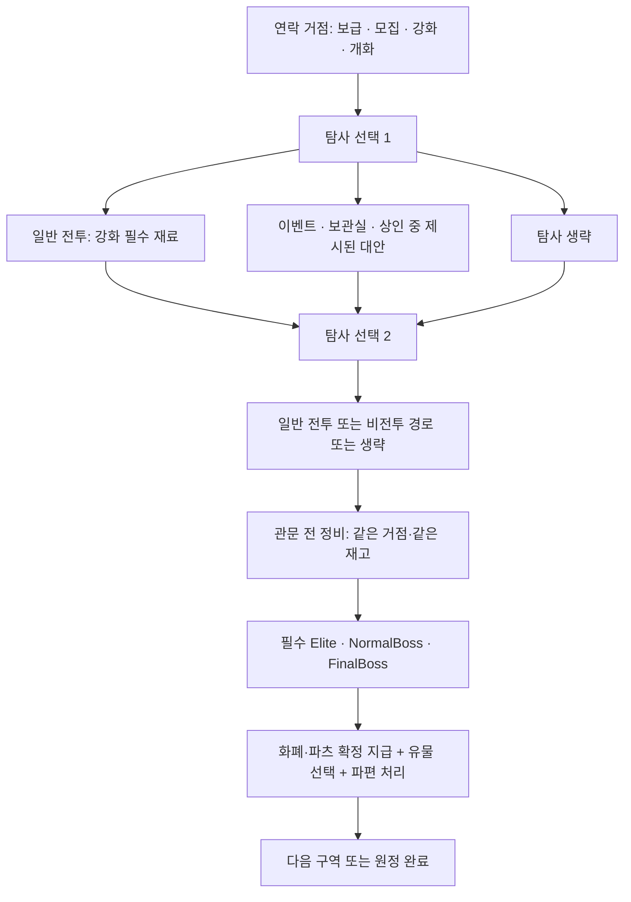

# 런 구조 재설계안 — 6구역 원정과 선택 성장

작성일: 2026-09-12.

> **통합 검토본:** [런 구조 통합 설계안](run_structure_integrated_design_2026-09-12.ko.md)에
> 9월 7일 초기안·후속 사용자 합의와 병합하고 경로·경제·실패 조건을 보완했다.
> 이후 검토는 통합본에서 이어가며, 이 문서는 비교 이력으로 보존한다. 정책 채택을 뜻하지 않는다.

상태: **사용자 요청에 따라 작성한 AI 설계 제안. 정책 채택·구현 지시·기존 룰북 교체가 아니다.**
이번 작업은 현재 코드/RON 조사와 공식 외부 자료 비교에 근거한다. 새 게임 플레이테스트나 성능 검증은 하지 않았다.
수치·인원·보상·상점·저장 변경은 모두 아래 제안이며, 이전에 비슷한 초안이 있었다는 이유로 승인된 것으로 취급하지 않는다.

제안의 중심은 **원정 출발 → 제한된 경로 선택 → 필수 환상체 제압 → 얻은 것으로 재편성 → 다음 구역 → 최종전**이다.
기본 보급·강화·개화 서비스는 일정하게 접근할 수 있게 하고, 무엇을 살지와 어떤 성장 재료를 확보할지는 탐사로 결정한다.

## 1. 지켜야 할 합의와 새 제안의 경계

| 기존 사용자 합의 | 이번 설계에서의 처리 |
| --- | --- |
| Elite·NormalBoss는 필수 관문, 일반 침식체 전투는 선택 | 필수 관문으로 가는 비전투 경로를 항상 보장한다. 일반 전투 횟수로 입장을 잠그지 않는다. |
| 무기 강화의 필수 재료는 일반 침식체 전투에서 확보 | 상점·보스·유물 분쇄로 그 필수 재료를 우회 획득하지 못하게 한다. |
| 엔케팔린은 강화·개화·상점 경제의 공통 비용 | 경제 작업에 사용한다. 이동·장착·보상 수령·전투 명령까지 유료화하는 것으로 확대하지 않는다. |
| 환상체 파츠는 개화 재료, 어려운 보스 파츠로 개화 난이도 조절 | 보스 배정과 레시피를 함께 계획하고 격파한 파츠를 같은 런의 남은 전투에서 사용하게 한다. |
| 본부는 일반 아이템·섭취 아이템·구급상자 판매 | 매 구역 연락 거점에서 기본 보급 역할을 준다. |
| 유물은 직원당 3슬롯, 런 공용 사본, 일반·희귀·특급, 자체 강화 없음 | 6명 기준 18슬롯에 맞춘 획득 곡선을 시험한다. 직원 사망 시 회수·전투 외 이전·분쇄 규칙을 보존한다. |
| 무기만 일반 강화, 파편은 개화, 직원 XP 제거는 미승인 | 무기 강화와 파편 개화를 서로 다른 성장 축으로 두고 XP는 유지한다. |

근거: [진행·성장 합의](run_progression_growth_policy_notes_2026-09-07.ko.md),
[최근 경제 합의](game_rulebook_followup_policy_notes_2026-09-10.ko.md),
[차기 룰북의 유물 정의](../game_rules/relics.md).
직원 5~8명은 과거 검토 범위다. 아래 시작 4명·출전 6명·보유 8명과 6구역은 새 비교 후보다.

## 2. 참고한 게임과 가져올 원리

외부 게임에 대한 사실은 아래 공식 개발사 설명 또는 개발사·배급사 제공 Steam 소개에서 확인했다.
오른쪽의 우리 게임 적용은 이 문서의 설계 판단이며 해당 개발사의 권고가 아니다. 특정 업데이트의 과거 수치를 현행 보편 규칙으로 인용하지 않는다.

| 게임 | 확인한 구조·특징 | 우리 게임에 적용할 원리 |
| --- | --- | --- |
| Slay the Spire | 매번 달라지는 지도에서 안전·위험 경로를 선택하고, 카드·유물의 상호작용으로 조합한다. [공식 소개](https://store.steampowered.com/app/646570/Slay_the_Spire/) | 다음 관문을 알고 회복·돈·성장 중 무엇을 확보할지 경로로 선택한다. 우리 유물은 개인 장착이므로 그 게임의 지급량을 그대로 가져오지 않는다. |
| Monster Train | 경로마다 유닛 모집·강화·지속 보너스·복제 등 다른 혜택을 제공한다. 공식 업데이트 소개에는 일부 보스를 런 시작에 미리 보여주는 기능도 명시돼 있다. [공식 소개](https://store.steampowered.com/app/1102190/Monster_Train/) | 전투 사이 서비스를 고르는 기회를 만들고, 보스와 필요한 성장의 관계를 미리 읽게 한다. |
| Hades | 런 중 신들의 Boon을 선택해 능력 조합을 만든다. 개발사 문서에는 방 보상 미리보기도 확인된다. [공식 소개](https://store.steampowered.com/app/1145360/Hades/), [개발사 업데이트 기록](https://www.supergiantgames.com/blog/hades-welcome-to-hell-update-patch-notes/) | 유물·파편을 늦게 몰아주지 않고 초반부터 선택·실전 사용을 반복한다. Hades의 영구 능력치 성장을 우리 게임에 함께 도입하지 않는다. |
| Into the Breach | 적 공격을 미리 표시하는 전술전과 무기·파일럿 확보를 결합한다. [공식 소개](https://store.steampowered.com/app/590380/Into_the_Breach/) | 우리 실시간 전투에서는 전체 공격 예고를 복제하기보다 진입로·대공·작업 등 편성에 필요한 정보를 무료로 제공한다. |
| FTL | 함선·승무원을 이끌고 무작위 은하의 조우에 대응하며 여러 해결책을 선택한다. [개발사 소개](https://subsetgames.com/ftl.html) | 여러 직원과 장비가 함께 하나의 원정 전력을 이룬다는 관점을 유지한다. 추격 게이지·연료를 별도 새 자원으로 추가하는 것은 이번 제안에서 채택하지 않는다. |

핵심 추론: 우리 게임은 한 유닛의 짧은 방 전투보다 편성과 전술전의 비용이 크다. 전투 횟수를 늘리는 방식보다, 적은 핵심 전투 사이에서 성장 선택을 충분히 제공하는 편이 적합하다.

## 3. 현재 코드에서 바꿀 주요 흐름

현재 코드는 시작 직원 3명·500 엔케팔린, 고정 3층 Standard와 무한 Endless를 사용한다.
본부 연락은 직원 모집/긴급 보급/상점 중 하나를 해결하면 끝나며, Maintenance·SavePoint는 별도 지도 노드다.
현재 일반적인 전투 보상은 결과 확인 때 ClaimAll로 지급한다. 완료 노드를 서비스 목적으로 재방문하지 못한다.
Endless 4층 이후 일반적인 pooled Shop은 모노리스 떠돌이 상인으로 연결된다.

| 현재 | 제안 |
| --- | --- |
| 튜토리얼 Standard를 마친 뒤 무한 Endless가 주력 | 짧은 튜토리얼 + 종점이 있는 기본 원정 + 원정 완료 뒤 선택하는 확장 모드 |
| 보급·정비 이용 가능성이 노드 배정에 좌우 | 구역별 연락 거점에서 기본 서비스를 보장, 탐사 상점은 특별 상품 기회 |
| 완료한 방을 통과해 여러 분기를 추가 탐사 가능 | 두 단계의 분기 중 각 단계 하나를 고르고 합류. 선택하지 않은 동급 분기는 닫힘 |
| 초기 파편·유물 새 공급 구조 없음 | 시작부터 빌드 선택을 주고 제압 보상을 빠르게 실전에 연결 |
| 보스/파편 진행·숙달·모노리스 장기 반복 중심 | 기본 원정은 첫 제압과 개화 목표 중심, 장기 반복은 확장 모드에 분리 |

코드 근거: [시작](../../src/game/world.rs), [노드 전환](../../src/game/world/node_flow.rs),
[본부](../../src/game/world/headquarters.rs), [상점 선택](../../src/game/world/map_content.rs),
[지도 경로](../../src/game/map/progression.rs), [전투 결과](../../src/game/world/combat.rs),
[현행 층 배정](../../../game_resources/data/map/node_assignment_profiles.ron).

## 4. 권장 기본 원정: 3막·6구역

6구역은 프로토타입 시작점이다. 과거 6층 제안을 확정한 것이 아니다. 구역은 기존 Floor에 대응시키되 화면 이름은 추후 정한다.

| 구역 | 필수 관문 | 성장 경험 | 보급·선택 기회 |
| --- | --- | --- | --- |
| 1 | Elite A | 시작 조합 시험, 첫 환상체 파편 확보 | 일반 상인 경로, 유물 보관실 경로 |
| 2 | NormalBoss A | 첫 조합 완성, 다음 구역 개화용 파츠 확보 | 5번째 직원 모집, 보스 파츠·개화 예고 |
| 3 | Elite B | 첫 개화형과 새 직원을 실전 사용 | 6번째 직원 모집, 특수 상인·유물 보관실 경로 |
| 4 | NormalBoss B | 조합 약점 보완, 어려운 개화용 파츠 확보 | 일반 상인 경로, 고급 개화 준비 |
| 5 | Elite C | 후반 개화형과 유물 연쇄를 충분히 사용 | 특수 상인·유물 보관실 경로 |
| 6 | FinalBoss | 완성한 조합의 최종 시험 | 최종 정비, 선택 일반 전투·회복 경로, 보상은 엔딩/확장 모드용 |

필수 전투는 6회, 일반 침식체 전투는 선택 결과에 따라 0~12회다. 초기 측정은 선택 전투 6회, 총 12회를 기준으로 한다.
최종전 뒤 얻는 파츠·유물은 기본 원정 내 빌드 공급량에 세지 않는다.

### 직원과 시작 선택

- 시작 4명, 초반에 저지·화력·지원 역할을 구성할 수 있는 후보와 시작 무기를 제공한다.
- 출전 6명·보유 8명을 우선 비교한다. 동시 배치 6명도 시험값이며 3개 이상 진입로/작업 담당이 있는 기존 보스에서 검증 전 확정하지 않는다.
- 2·3구역 시작에 각각 한 명의 모집 기회를 보장한다. 모집은 후보 중 선택·엔케팔린 비용·거절 가능이다. 무작위 상점 출현에 맡기지 않는다.
- 추천 최대 6명까지의 기본 채용 비용을 주 경로 수입에서 감당할 수 있게 한다. 후보는 보유 roster의 결손 역할을 포함하되 최적 빌드를 자동 완성하지 않는다.
- 늦게 합류한 직원은 해당 구역의 기본 전투에 참여할 레벨·시작 장비를 갖춘다. 따라잡기용 필수 반복 전투를 요구하지 않는다.
- 시작 파편은 1개를 후보 3개 중 선택한다. 시작 유물 4개는 후보 3개 중 2개 선택을 두 번 시행해 확보한다.
- 무료 시작 지급과 보상 수령에 엔케팔린 요금을 부과하지 않는다. 강화·개화·구매·치료 서비스는 공통 비용 규칙을 적용한다.

### 플레이 시간 가설

익숙한 플레이어의 재도전이 많지 않은 원정을 90~120분에 맞추는 것이 초기 목표다. 실제 측정값은 아니다.
6개 관문 × 5~7분 = 30~42분, 일반 전투 6개 × 2~4분 = 12~24분,
편성·보상·상점·이벤트 24~35분으로 66~101분이며, 제한된 재도전 시간을 더하면 목표 범위 근처다.
모든 선택 전투를 수행하거나 초회 설명을 읽는 런은 더 길다. 실제 전투가 이보다 길면 8구역으로 늘리지 말고 전투 길이·선택 구간을 먼저 조정한다.

## 5. 한 구역의 실제 순서

각 선택 단계는 2~3개 후보 중 하나를 이용하거나 생략한다. 일반 전투와 비전투 대안을 항상 함께 제공한다.
새 행동 포인트 화폐를 만들지 않고 지도 연결 자체로 선택 횟수를 제한한다. 같은 단계의 다른 후보는 합류 후 이용하지 못한다.
거점은 강제 구매 화면이 아니라 무료로 넘어갈 수 있는 준비 장소다. 처음과 관문 직전 방문은 재고·모집·구매 횟수를 공유한다.
한 구역 안에서 재진입해 회복·재고·특가가 다시 생성되지 않는다. 관문 전에는 새로 얻은 재료로 강화·개화할 수 있다.
필수 관문에 패배했다고 미완료 성공으로 처리해 다음 구역에 넘어가지는 못한다.

각 구역 입장 때 지도, 관문 적, 경로의 주 보상 종류, 상인 종류를 보여준다. 무료 정보에 진입로·대공·작업·대략적 전투 성격을 포함한다.
정확한 패턴 타이밍을 모두 공개할 필요는 없지만 특정 소비 아이템이 없으면 불가능한 숨은 검사는 피한다.

## 6. 세 상점의 역할

| 상점 | 접근·보장 | 판매 제안 | 금지할 우회 |
| --- | --- | --- | --- |
| 본부 상점 | 매 구역 연락 거점, 해당 구역 재고 공유 | 기본 무기·장비, 섭취 아이템, 구급상자. 핵심은 결손 보완 | 무기 강화 필수 재료·보스 파츠·유물 대량 공급 |
| 일반 떠돌이 | 1·4구역에 선택 가능한 방문 기회 보장, 나머지는 보조 무작위 | 다양한 장비·소모품, 일반/희귀 유물. 슬롯 부족 시 대안 비교 | 본부의 단순 상위호환, 무한 갱신·구매 |
| 특수 떠돌이 | 3·5구역에 선택 가능한 방문 기회 보장 | 분야별 희귀/특급 유물, 침식 아이템. 런마다 취급 계열 변화 | 개화 전 필수 파츠를 팔아 보스 격파 우회, 침식 유물 완제품 드롭 |

두 떠돌이는 모두 엔케팔린을 기본 비용으로 쓴다. 상점 전용 새 화폐는 제안하지 않는다.
특수 상점은 ‘높은 가격의 모든 좋은 것’ 대신 특정 태그·기믹의 좁은 전문점으로 만든다.
예: 폭발·관통 전문 / 지원·소환 전문 / 침식 관련 전문. 모든 전문점의 출현을 한 런에 보장하지 않는다.
보스 파츠는 초기안에서 상점 결제·판매 대상에서 제외해 개화 목표를 명확히 한다. 남는 파츠의 후속 용도는 확장 모드에서 별도 검토한다.
상점이 보장된다는 것은 방문 가능한 경로가 있다는 뜻이지, 반드시 방문하거나 원하는 유물을 반드시 구매한다는 뜻이 아니다.

본부 연락의 모집·상점·보급 택일은 해제한다. 모집과 구매는 엔케팔린 예산을 놓고 경쟁한다.
기존 무조건 긴급 현금 지급은 매 구역 반복하지 않는다. 회복이 불가능해진 런을 계속 붙잡아두는 보조금 루프도 만들지 않는다.

## 7. 유물 공급: 초반부터 얻고, 후반에는 교체하기

6명 출전이면 18슬롯이다. 1캐릭터의 전역 유물 게임과 같은 지급량을 쓰면 다수 직원이 비어 있을 수 있다.
그러나 18슬롯이 전부 채워져야 기본 진행이 가능한 밸런스로도 만들지 않는다.

| 경로 | 최종전 전 제안 공급량 | 성격 |
| --- | ---: | --- |
| 시작 보급 | 4개 | 직원마다 하나씩 나눠 쓰거나 핵심 직원에게 집중 |
| 1~5구역 관문 보상 | 각 2개, 합계 10개 | 모든 관문 승리 시 보장. 매 관문 후보 3개 중 1개 선택을 두 번 |
| 1·3·5구역 보관실 선택 경로 | 방문당 1개, 최대 3개 | 일반 전투·다른 경로를 포기하는 비용 |
| 떠돌이 상점·기타 이벤트 | 경로·예산에 따라 1~4개 목표 | 공급 상한이나 보장치가 아닌 플레이테스트 목표 |

보관실 세 곳을 선택하고 상점·이벤트에서 1~4개 얻은 경우 총 18~21개다. 최소 관문 경로는 14개이며,
공급량은 보유 자산 수다. 장착 호환성·중복 불가 때문에 실제 활성 슬롯 수는 더 적을 수 있다.
표의 여러 경로는 동시에 무조건 얻는 것으로 계산하지 않는다. 두 선택 단계 × 6구역 = 12방문 기회 안에서 성립하는지를 검사한다.
예: 일반 전투 5회 + 보관실 3회 + 상인 4회 = 12회. 이 경로는 별도 이벤트 방문을 할 수 없다.

최초 공급은 범용 중심이며 기본 무기·파편에 즉시 적용 가능한 선택을 최소 하나 포함한다.
전용 유물은 보유 파편 또는 남은 원정에서 확보 가능한 파편을 기준으로 제시하되, 모든 보상을 현재 빌드에 맞춤 제공하지 않는다.
기본형/개화형 비활성 조건을 미리 표시한다. 사용 불가능한 전용 유물 세 개만 뜨는 보상은 피한다.
특급은 후반 선택지와 특수 상점 중심이다. ‘일반 유물은 후반 폐기’라는 수치 설계는 하지 않는다.
획득한 유물은 추가 거래 비용 없이 전투 밖에서 재편성한다. 분쇄는 기존 합의대로 장비 가루를 준다.

## 8. 파편·파츠·개화를 같은 런에서 연결하기

기본 원정의 환상체 첫 제압에서 해당 파편을 1개 지급하는 방향을 제안한다. 기존 Elite 3승/숙달 기반 지급을 변경하는 제안이다.
보스의 엔케팔린·정해진 파츠·해당 파편과 유물 선택 보상은 별도다. 파츠를 받으려고 유물 보상을 포기시키지 않는다.
이미 가진 파편의 중복 보상은 신규 파편 대체나 공통 자원으로 임의 변환하지 않고 명시 recipe/중복 정책을 정한다.

예시 흐름: 시작 파편 P → 2구역 보스 A 파츠 → 3구역 시작에 P 개화 → 3·4·5·6구역에서 개화형 활용.
고급 개화는 4구역 보스 B 파츠를 요구 → 5구역 시작에 개화 → 5·6구역에서 활용한다.
이 예시는 새 고유 파편/보스 이름·수량을 확정하지 않는다.

- 해당 런에 절대 나오지 않는 보스의 파츠를 현재 핵심 개화 목표로 제시하지 않는다.
- 런 생성 시 시작 선택과 관문 후보·레시피의 도달 가능성을 함께 확인한다. 적어도 하나의 의미 있는 개화 경로를 보장한다.
- 초기 관문 보상에서 선택 가능한 파편의 개화에 필요한 보스가 2·4구역 후보에 들어가도록 구성한다.
- 특정 파츠는 해당 보스 승리 시 정해진 최소량을 보장한다. RNG 드롭 실패로 준비한 개화가 막히지 않게 한다.
- 최종 보스 파츠는 확장 모드용이면 그대로 표시한다. 그 파츠를 요구하는 개화를 기본 원정 승리의 전제로 삼지 않는다.
- 기본 원정은 주요 개화 1~2개를 사용하는 경험을 목표로 한다. 모든 직원의 모든 파편을 개화시키는 것은 기대하지 않는다.

### 일반 전투를 선택하는 의미

일반 침식체 전투는 엔케팔린·XP와 함께 무기 강화 필수 재료를 지급한다.
이를 안 하면 필수 관문에 접근할 수 있지만 무기 일반 강화는 할 수 없다. 관문은 무기 무강화의 유물·개화 빌드로도 숙련 플레이가 가능한지 시험한다.
적 전력을 플레이어의 강화량과 같은 비율로 즉시 올리지 않는다. 난도는 선택한 원정 난이도·구역·조우 조건에 주로 묶어 성장의 이득을 남긴다.
이는 현재 전투력 anchor/비례 조정 정책의 재설계 제안이지, 현행 코드의 설명이 아니다.

## 9. 경제의 초기 예산 가설

아래 금액은 상대적인 구매 압박을 계산하기 위한 예시다. 기존 500 시작 금액과 보상 수치를 변경하는 제안이다.

| 항목 | 예시 엔케팔린 |
| --- | ---: |
| 시작 보급 | 400 |
| 최종전 전 5개 관문 | 각 200, 총 1,000 |
| 일반 전투 승리 | 100 |
| 기본 신규 직원 모집 | 150 |
| 무기 강화 한 단계 | 120 + 일반 전투 전용 필수 재료 |
| 파편 개화 | 250 + 지정 환상체 파츠 및 최종 결정된 공통 재료 |
| 일반/희귀 유물 비교 가격 | 150 / 250 |
| 회복 소모품 비교 가격 | 50 |

시작+관문만으로 1,400. 일반 전투 6회면 2,000.
직원 2명 300 + 무기 강화 4회 480 + 개화 2회 500 + 회복 4회 200 = 1,480.
일반 전투 6회 경로에는 유물·장비 구매 예산 520이 남는다. 일반 유물 3개 구매 뒤 70 잔액이다.
기본 모집은 파츠·유물 구매와 함께 선택 가능한 투자다. 6명 고정 보스 난도를 전제로 모집 거절을 함정으로 만들지 않는다.
총액이 맞아도 2구역 모집/3구역 개화 시점에 잔고가 모자랄 수 있으므로 구역별 현금 흐름을 별도로 확인한다.
개화 2개와 모든 무기 강화·희귀 상품을 항상 동시에 살 수 있도록 맞추지는 않는다.

재료 경제는 아직 최종 선택이 필요하다. 강화에는 일반 전투 전용 필수 재료를 요구하고 기존 장비 가루를 보조 재료로 둘 수 있다.
파편 가루를 개화 공통 재료로 유지할지는 최근 파츠 합의와 함께 결정해야 한다. 유지한다면 그 공급까지 위 경로 안에서 보장해야 한다.
신규 재료 이름을 늘리는 것보다 전용 재료/보조 재료/파츠의 실제 역할을 먼저 확정한다. 장비 가루·파편 가루의 기존 자산을 자동 삭제하지 않는다.

## 10. 실패·후퇴·저장 제안

이 절은 기존 게임과 차이가 큰 미승인 제안이다. 직원 신체 손상·트라우마·사망 판정 자체는 별도 기존 정책을 유지한다.

- 전투불능은 해당 직원의 상태 변화로 처리하고, 곧바로 한 런 전체 종료로 묶지 않는다.
- 일반 선택 전투 실패는 보상 없이 지나갈 수 있다. 그 선택 단계는 소비하며 해당 구역의 다른 같은 단계 보상을 다시 고르지 않는다.
- 필수 관문은 성공해야 통과한다. 관문당 최대 3시도를 우선 시험한다. 실패 확정은 기존 직원 손실을 반영한다.
- 후퇴는 진입 전 편성·자산으로 복원하되 그 시도 횟수는 소비하는 안을 추천한다. 보상은 없고 최대 3시도에 포함한다.
- 네트워크 끊김·프로세스 복구 자체를 플레이어의 패배나 새 시도로 세지 않는다. 같은 진행/예약된 시도를 이어갈 기준을 정해야 한다.
- 일반 난도는 완료한 노드·선택 결과에서 자동 저장하고 중단 후 이어하기를 제공한다. 임의의 과거 체크포인트 되감기는 기본 난도에서 제외하는 안이다.
- 기존 최대 3회 체크포인트 되감기는 별도 학습/지원 옵션으로 남기는 대안을 제안한다. 이를 기본 난도에서도 유지할 경우 같은 보상 후보·시드를 유지하고 실제 런 시간을 다시 측정한다.
- 전투 중 재개를 지원하기 전에는 중단된 전투를 동일 입력의 진입점에서 재개하되, 이미 확보한 시도 1회를 중복 차감하지 않는 복구 규칙이 필요하다. 종료로 보상·상품을 재추첨하지 않는다.
- 고난도 개화나 유물 1개 없다는 이유로 사전에 출전이 불가능한 고정 조합 검사를 두지 않는다. 손상 회복 수단도 없고 실제 출전 인력도 부족하면 명확히 런 실패를 알린다.

무료 무제한 후퇴를 그대로 유지하는 대안은 접근성이 높지만 정찰·반복 시간이 길어질 수 있다. 후퇴 비용은 새 화폐 대신 유한 시도 수로 표현한다.
이 절을 적용하려면 save/resume/attempt/결과 정책을 함께 검토해야 하며 R05 자원 저장소만 바꿔서 끝나는 일이 아니다.

## 11. 종료·재플레이·기존 Endless의 위치

기본 원정은 FinalBoss 승리에서 명확하게 완료한다. 파츠·유물·장비·엔케팔린은 런 자산이며 별도 영구 화폐나 능력치 축적을 추가하지 않는다.
도감·서사·완료 기록 같은 영구 정보는 유지한다. 새 콘텐츠 해금 보상은 별도 승인 없이 붙이지 않는다.
완료 화면에서 같은 원정을 더 진행하는 확장 모드를 선택할 수 있는 안을 제시한다. 완료 기록은 남고 이후 실패가 기본 원정 성공을 취소하지 않는다.
확장 모드는 기본 원정과 별도 난도·보상 균형을 가진다. 현재 Endless의 모노리스·숙달·소탕·보스 징조를 이 영역에서 재검토한다.
현재 Endless를 삭제하거나 기존 세이브를 새 6구역 형식으로 자동 변환하지 않는다. 기존 모드는 레거시 버전으로 유지하고 새 RunRulesVersion/모드 경계를 정한 뒤 이행한다.
기본 원정 완성을 위해 무한 반복 경제까지 한 번에 설계하지 않는다.

## 12. 재설계가 해결해야 할 함정

| 위험 | 이 안의 대응 | 확인할 증거 |
| --- | --- | --- |
| 일반 전투를 무조건 전부 도는 것이 최적 | 한 단계의 비전투 기회와 배타적으로 선택 | 실제 경로 선택과 무강화 빌드의 승리 사례 |
| 반대로 일반 전투가 손해라 아무도 안 함 | 전용 강화 재료와 현금·XP 가치 | 비슷한 숙련도에서 시간/손실 대비 후속 전투 이득 |
| 직원 증가로 유물 공급 부족 | 기본 14개+선택 공급과 초기 지급 | 보유량 대신 실제 활성 슬롯 수·첫 시너지 시점 |
| 개화 재료를 얻었을 때 런 종료 | 2·4구역 파츠 → 3·5구역 개화 | 개화 뒤 핵심 전투를 최소 2회 경험하는 경로 |
| 상인·파츠가 랜덤이라 빌드 불가능 | 선택 가능한 방문 기회와 최소 개화 경로 | 지도·레시피·보상 경로 생성 검사 |
| 거점 반복으로 모든 선택이 무의미 | 같은 구역은 재고/구매/회복 상태 공유 | 재입장·저장복원·거래 취소 시 중복 없음 |
| 선택 강화만큼 적도 강해짐 | 적 전력의 주 기준을 구역·난도에 둠 | 같은 조우에서 강화 전후 실제 전투 이득 |
| 플레이 시간이 너무 김 | 6관문에서 시작, 성장 선택을 전투 사이에 배치 | 전투·편성·보상·재도전 시간을 분리 측정 |

## 13. 구현 전 검토 순서

1. 짧은 종결 원정/무한 중심 중 기본 경험, 6구역 길이와 출전 규모를 검토한다.
2. 본부·정비 접근 보장과 두 단계 배타적 경로를 종이 지도에서 확인한다.
3. 1~3구역만으로 모집·유물 공급·첫 개화까지 실제 플레이할 수 있는 프로토타입을 만든다.
4. 선택 일반 전투 0회/보통/최대 경로의 현금·재료·직원·유물 곡선을 비교한다.
5. 5~8명 전장 요구, 소유/출전/동시배치 상한을 별도로 검증한다.
6. 전체 6구역에서 개화 시점·재시도·실제 시간과 실패 원인을 측정한 뒤 가격·지급량·층수를 조정한다.

R05와의 연결: 엔케팔린·재료·파츠는 우선 run 공용 owner를 가정하고 강화/개화 복합 비용의 전액 성공/실패 보존이 필요하다.
장비·유물의 일시 중첩과 전투당 사용 횟수는 별도 owner×lifetime이다. 위 구조를 위해 모든 런 진행을 ResourceStore로 통합할 필요는 없다.
지도/상점/보상/파편 지급/저장/런 실패 변경은 각 소유 계약과 단계에서 다룬다. 이 제안을 기존 R05 Goal이나 현재 감사의 추가 완료 조건으로 자동 적용하지 않는다.

## 14. 채택 여부를 나눠 검토할 항목

전체안을 한 번에 승인할 필요는 없다. 우선 아래 세 구조적 선택을 먼저 결정하면 경제와 콘텐츠를 구체화할 수 있다.

- 종점이 있는 6구역 기본 원정을 만들고 무한 탐사는 확장으로 둘 것인가?
- 본부 상점·강화·개화를 일정한 거점 서비스로 보장할 것인가?
- 각 구역에서 배타적 탐사 선택 두 번 후 필수 관문으로 갈 것인가?

그다음 인원·유물 공급·첫 제압 파편·파츠 배정·후퇴/저장 방식을 각각 검토한다.
본 문서는 검토용 결과이며 코드·RON·정식 룰북·로드맵 실행 기준을 변경하지 않았다.
