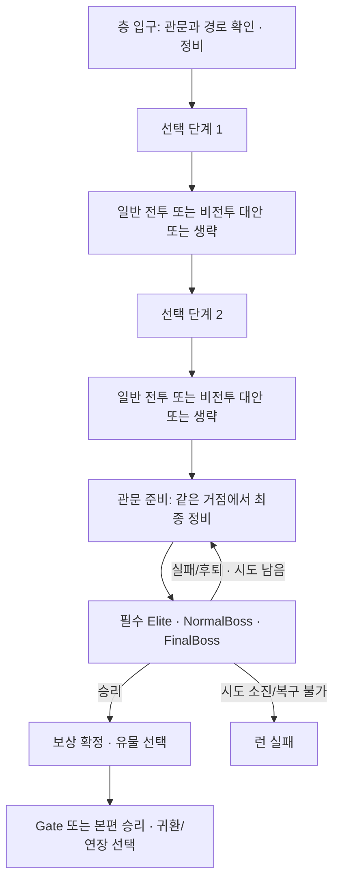

# 런 구조 통합 설계안 — 필수 관문과 선택 성장

작성일: 2026-09-12.

상태: **8층 배치·보스 분류는 후속 사용자 합의 / 성장·경제·세부 진행은 통합 검토안 / 구현·밸런스 검증 전**.

후속 결정: 엘리트 4회·일반 보스 3회·최종 보스 1회. 준최종 보스 구분은 폐기한다.
기존 6층 추천을 아래 8층 배치로 교체했으며, 원문 두 개는 초기 제안 이력으로 남긴다.

이 문서는 [9월 7일 초기안](run_progression_relic_redesign_proposal_2026-09-07.ko.md)과
[9월 12일 추가안](run_structure_design_proposal_2026-09-12.ko.md)을 병합한다.
두 원문은 비교 이력으로 보존하고, 이후 런 구조 논의는 이 문서를 통합된 검토 출발점으로 사용한다.
문서 병합 요청은 아래 새 규칙·수치의 채택이나 구현 승인을 뜻하지 않는다.
현재 룰북·차기 룰북·코드·RON·로드맵의 실행 기준을 이 문서로 교체하지 않는다.

## 1. 통합 기준과 보완한 문제

우선순위는 **사용자 합의 → 그 합의를 만족하는 통합 추천안 → 비교용 수치와 대안**이다.
날짜가 더 최근이라는 이유만으로 AI 제안을 기존 사용자 결정보다 우선하지 않는다.

| 표시 | 의미 |
| --- | --- |
| 합의 | 사용자 대화 기록에 있는 목표 정책. 구현 완료를 뜻하지 않음 |
| 추천 | 이번 통합본에서 선택한 설계 방향. 사용자 채택 전 |
| 시험값 | 경로·예산·플레이 검증을 위한 수치. 확정 밸런스 아님 |
| 보류 | 기존 결정과 충돌하거나 독립적인 선택이 필요하여 통합본에서 확정하지 않은 부분 |

아래 본문에서 별도 표시가 없는 새 진행 규칙은 모두 **추천**이다.

| 발견한 문제 | 통합 처리 |
| --- | --- |
| 초기안의 필수 일반 진입 전투가 후속 합의와 충돌 | 제거. 일반 전투를 전부 생략해도 관문에 도달하는 실제 경로를 둠 |
| 6층·6구역·3구역 용어 혼용 | 기존 Floor에 대응하는 단위를 ‘층’으로 통일. 후속 합의에 따라 본편은 8층 |
| 보유 5·등록 4명과 보유 8·등록 6명이 혼재 | 후자를 시험값으로 사용하되 시작·채용·동시 배치·역할 요구를 별도 검증 |
| 유물 13개와 14개가 다른 지급 시점을 전제로 계산됨 | 최종전 전에 실제 받는 수량으로 통일. 8층 단순 완료 경로의 시험값은 시작 4 + 앞선 관문 14 = 기본 18 |
| 선택 전투·보관실·상점을 각각 최대치로 더하면 방문 예산을 초과할 수 있음 | 층당 두 단계의 배타적 경로와 실제 16회 방문 예시로 검증 |
| 총수입만 맞고 채용·개화 시점의 현금 부족을 확인하지 못함 | 층별 관문 전 잔액과 재료 확보 시점을 함께 계산 |
| 공통 보스 핵과 특정 환상체 파츠가 경쟁 | 공통 보스 핵 신설은 제외하고 지정 환상체 파츠를 중심으로 개화 경로 구성 |
| 분쇄 가루로 선택 전투 없이 강화할 수 있음 | 일반 전투에서만 최초 확보하는 필수 재료 조건을 유지. 구체 자원 구성은 별도 시험안으로 제시 |
| 보스 후보 선택·파편 중복·후속 개화의 관계가 불명확 | 선택 전 보상·레시피 공개, 경로별 도달 가능성, 중복 지급 이력 규칙을 명시 |
| 무료 후퇴와 시도 소비, 패배 2회와 3시도, 저장 복구가 충돌 | 추천안은 관문당 총 3시도. 수동 후퇴·패배·통신 중단·확정 결과를 구분 |
| 침식 변경·XP 제거·난이도 변경이 진행 개편에 묶여 들어옴 | XP 유지. 침식 수치 변경은 보류. 전투력 추종 변경은 별도 채택 항목으로 분리 |

## 2. 보존할 사용자 합의

| 주제 | 합의와 적용 범위 |
| --- | --- |
| 보스 분류 — 2026-09-12 후속 결정 | 엘리트·최종 외 14개 항목을 일반 보스로 통일. 아종·특수·숨겨진 등급을 따로 두지 않으며 개별 조우 조건·보상은 유지. 준최종 보스 구분은 후속 결정으로 폐기 |
| 층별 배치 — 후속 합의 | 1·3·5·7층 엘리트, 2·4·6층 일반 보스, 8층 최종 보스 |
| 연속 조우 시작 — 후속 합의 | 여러 단계에 걸쳐 진행되는 보스가 해당 런에 등장하면 첫 일반 보스 자리인 2층에서 반드시 시작 |
| 필수·선택 전투 | Elite·NormalBoss는 필수 관문, 일반 침식체 전투는 선택. 매 층 두 보스 종류를 모두 배치한다는 뜻은 아님 |
| 무기 재료 | 일반 침식체 전투를 선택해야 무기 강화 필수 재료를 얻음. 상점·분쇄 등으로 완전히 대체하지 않음 |
| 경제 사용처 | 강화, 개화, 본부 상점, 일반 떠돌이 상점, 특수 떠돌이 상점 |
| 엔케팔린 | 강화·개화·상점 경제의 공통 비용. 이 발언만으로 전투 명령·지도 이동·보상 수령을 유료화하지 않음 |
| 개화 | 환상체 격파로 얻는 파츠를 사용. 어려운 보스의 파츠 요구로 개화 접근 난이도를 조절 |
| 본부 상점 | 일반 아이템·섭취 아이템·구급상자 등을 엔케팔린으로 구매 |
| 성장 체계 | 무기만 일반 강화. 방어구·액세서리는 자체 능력치·효과를 가질 수 있으나 일반 강화 없음. 파편은 개화 전·후 형태를 보존하고 정비에서 선택 |
| 유물 | 전투 효과 전용, 직원당 자유 슬롯 3개, 런 공용 사본, 보유 총량 상한 없음, 일반·희귀·특급, 자체 강화 없음 |
| 유물 관리 | Safezone·Maintenance에서 무료 장착 변경, 전투 중 변경 금지. 직원 사망 시 회수. 판매 불가, 분쇄하면 기존 장비 가루 획득 |
| 유물 조건 | 조건 미충족이면 슬롯을 점유한 채 비활성. 중복·비호환·전용 대상 제한 유지 |
| 유물 상태 | 전투마다 누적 상태 초기화. 같은 전투 재배치는 일시 스택만 초기화하며 전투당 사용 기록은 유지. 동일 연쇄의 같은 사본·효과 재진입 방지 |
| 침식된 유물 | 침식 아이템을 기존 유물에 적용해 생성. 완제품 직접 드롭은 사용하지 않음. 아이템 획득처는 미정 |

근거: [진행·성장 합의](run_progression_growth_policy_notes_2026-09-07.ko.md),
[유물 시스템 합의](run_relic_system_design_notes_2026-08-21.ko.md),
[9월 12일 경제 합의](game_rulebook_followup_policy_notes_2026-09-10.ko.md).

보스 명칭 통일은 [일반 보스 분류 결정](game_rulebook_followup_policy_notes_2026-09-10.ko.md)과
[콘텐츠 로스터](../skills/lobotomy_content_catalog.md)를 따른다. 같은 일반 보스 분류라도
동행·계약·장례·별도 발현 같은 조우 조건을 유지하며, 일괄 관문 배정이나 동일 보상 지급을 뜻하지 않는다.

기존 유물 노트에는 파편 가루를 개화 재료로 유지한다는 결정이 있다. 최근 경제 기록은 파츠와
함께 요구할지·대체할지를 추가 검토 대상으로 두었다. 이 통합본은 파편 가루를 삭제하지 않으며,
경제 예시는 가루를 함께 쓰는 안으로 계산한다. 최종 레시피 구성은 보류다.

직원 5~8명은 검토 범위다. 본편 층별 배치는 8층으로 합의했고, 준최종 분류는 폐기했다. 첫 파편 지급, 유물 수급처와 수량,
상점 역할·출현 주기, XP 제거, 후퇴·저장 변경은 사용자 합의로 승격하지 않는다.

## 3. 목표 경험과 기본 모드

**파편과 작은 유물 조합을 갖춘 직원들이 시설에 진입하고, 필요한 성장을 골라 확보한 뒤
환상체를 제압한다. 얻은 파츠로 개화하고 편성을 바꾸며, 최종 보스에서 완성한 조합을 사용한다.**

추천 기본 흐름은 `출발 준비 → 선택 성장 → 필수 관문 → 보상과 재편성 → 다음 층 → 최종전`이다.
일반 전투는 무기 성장, 환상체는 파편·개화 파츠, 유물은 전투 방식의 연결과 변형을 담당한다.
엔케팔린은 이 성장과 생존·채용·구매가 같은 예산 안에서 경쟁하게 한다.

| 모드 | 합의 또는 통합 추천 |
| --- | --- |
| 튜토리얼 | 배치·파편·유물·회복·선택 경로를 순서대로 배우는 짧은 고정 진행. 기존 Standard 축소의 정확한 지도 수는 보류 |
| 기본 원정 | 층별 배치 합의: 8층, E → N → E → N → E → N → E → Final |
| 심층 연장 | 본편 승리 보상을 확정한 뒤 같은 런 자산으로 계속하는 선택. 연장 실패가 본편 승리 기록을 취소하지 않음 |
| 런 외 기록 | 도감·서사·기존 해금·완료 기록. 새 영구 화폐나 다음 런 능력치 보너스는 추가하지 않음 |

8층 구성을 기준으로 실제 전투·정비·보상 시간을 검증한다. 장기 조우의 선행 Event와 후속 전투는
별도 슬롯 연결을 설계해야 하므로, 보스 배치 8개를 실제 전투 정확히 8회로 단정하지 않는다.
본편 승리 기록과 계속 진행 가능한 런 상태를 분리하고, 연장 중 관문 통과 후 귀환할 수 있게 한다.
연장의 반복 보상·난도·보스 순환은 별도 설계하며, 본편 경제 계산에 미리 합산하지 않는다.

## 4. 한 층의 경로와 정비

- 층마다 선택 단계 2개를 둔다. 각 단계는 일반 전투와 비전투 대안을 포함한 2~3개 후보 및 생략을 제공한다.
- 선택한 방의 결과 또는 생략을 확정하면 같은 단계의 나머지 분기는 닫힌다. 지도 연결로 표현하며 새 탐사 화폐를 만들지 않는다.
- 단계 1을 생략하고 단계 2를 이용할 수 있다. 바로 관문 준비로 넘어가면 두 단계의 남은 기회를 닫는다.
- 방 진입 전 확인 취소는 선택 확정이 아니다. 상점·보관실의 내용을 개봉하거나 전투를 시작하면 해당 분기 선택이 확정된다.
- 다른 분기의 상점 재고를 모두 미리 열어본 뒤 유리한 방을 고르는 방식은 제공하지 않는다. 방문 전에는 상인 종류·상품 계열·가격대까지 공개한다.
- 선택 방은 성공·확정 패배·방문 종료마다 단계 하나를 해결한다. 상점에서 아무것도 사지 않아도 방문 기회는 소비한다.
- 정비 거점은 층 입구·선택 단계 사이·관문 직전에 이용 가능하다. 재방문은 선택 기회를 쓰지 않고 상품·모집 후보·서비스 이용 상태도 초기화하지 않는다.
- 완료 방의 통과, 정비 거래, 편성 변경은 별도 node 완료를 만들지 않는다. 비방문 분기의 폐쇄와 생략도 직원 상태의 node 경과에 합산하지 않는다.
- 실제 선택 방의 결과와 관문 완료는 각각 한 번만 node 경과를 반영한다. 재도전의 중간 패배는 관문 완료가 아니다. 기존 Breakdown 기간·Gate 회복 수치는 별도 변경하지 않는다.
- 관문은 승리해야 열린다. 관문 준비 후 후퇴하거나 패배해도 닫힌 탐사 분기는 다시 열리지 않는다.

각 층의 필수 관문·진입로 수·대공 및 현장 작업 요구·주 보상 종류는 탐사 전에 무료로 보여준다.
기본 최종 보스의 큰 위협은 2층 승리 후, 편성에 필요한 상세 정보는 늦어도 4층 승리 후 공개한다.
시설의 방·통로 표현은 유지하되, 생략 경로와 정비 복귀 연결이 실제 지도에서도 존재해야 한다.

## 5. 직원 규모와 층별 성장

**시험값:** 시작 4명, 보유 최대 8명, 전투 등록 최대 6명, 동시 배치 최대 6명.
보유·등록·배치 제한은 서로 다른 값이며, 이를 모두 5~8명 합의로 취급하지 않는다.
시작 직원 전원에게 실제 배치 가능한 기본 무기를 지급하고, 파편 묶음의 무기는 해당 파편의 호환성을 보장한다.

| 층 | 관문 | 진입 시 기본 유물 누계 | 성장·서비스 추천 |
| --- | --- | ---: | --- |
| 출발 | 없음 | 4 | 직원 4명, 파편·호환 기본 무기 묶음 3개 중 1개 선택 |
| 1 | Elite A | 4 | 시작 조합 사용. 일반 상인·유물 보관실을 선택 후보에 배정 |
| 2 | NormalBoss A | 6 | 연속 조우 보스가 등장하는 런에서는 여기서 시작. 채용·즉시 완료 시 첫 개화용 파츠 지급은 시험안 |
| 3 | Elite B | 8 | 여섯 번째 직원 모집, 첫 개화. 특수 상인·유물 보관실 후보 |
| 4 | NormalBoss B | 10 | 일반 상인 후보. 승리하면 후반 개화용 지정 파츠 확보 |
| 5 | Elite C | 12 | 두 번째 개화. 특수 상인·유물 보관실 후보 |
| 6 | NormalBoss C | 14 | 세 번째 일반 보스. 후반 조합과 파편 보완 |
| 7 | Elite D | 16 | 새 파편 실전 사용과 최종전 준비 |
| 8 | FinalBoss | 18 | 최종 정비와 조합 실행. 승리 후 보상은 본편 전력에 산입하지 않음 |

유물 누계는 각 앞선 관문을 해당 층 안에서 해결해 시험 보상을 모두 선택하고 분쇄하지 않은 단순 경로다.
선택 방·상점 보상은 제외한다. 장기 조우의 보상 시점이 달라지면 이 누계도 다시 계산해야 한다.
5층 입구 개화는 5~8층 관문에서, 3층 입구 개화는 3~8층 관문에서 사용할 시간이 남는다.

채용은 2·3층에 한 명씩 기회를 보장하되 비용을 내고 거절할 수 있다. 후보는 결손 역할을 포함하고
합류 시점의 기본 전투에 참여 가능한 레벨과 무기를 갖춘다. 화면 재진입으로 후보를 재추첨하지 않는다.
이번 최소 예시는 6명까지만 공급한다. 보유 상한 8명 자체가 직원 두 명의 추가 획득을 보장하지 않는다.
추가·대체 채용 경로는 별도 콘텐츠로 검토한다. 정원이 찬 경우 생존 직원을 귀환시키고 런 소유품을 회수하는 교체안을 사용하며,
같은 채용 기회의 반복 사용과 귀환 직원의 즉시 재채용은 막는다. 사망 기록은 보존하되 생존 정원을 차지하지 않는다.

직원 XP는 유지한다. 일반 전투 XP를 포함해 신규 구조에 맞는 성장량을 검증하되, 패배·후퇴로 XP를 반복 획득하는 경제는 추가하지 않는다.
채용을 거절한 4~5명 편성과 6명 편성을 비교하고, 3개 이상 진입로·회복·현장 작업의 동시 역할을 점검한다.
4명으로 원천적으로 수행할 수 없는 의무가 있다면 적 배치나 최소 인력 보급을 고쳐야 한다.
화면에서 채용을 선택이라고 표시하면서 필수 보스가 특정 유료 인원을 암묵적으로 요구하게 만들지 않는다.

### 5.1 여러 단계로 이어지는 보스의 시작 순서

**후속 합의:** 절망의 기사·증오의 여왕·두건과 늑대처럼 여러 단계에 걸쳐 진행되는 보스는
해당 런에 등장할 경우 **첫 일반 보스 자리인 2층에서 반드시 시작**한다. 사용자가 ‘1번째’는
2층을 뜻한다고 확인했다. 4·6층에서 해당 연속 조우를 처음 시작하는 배정은 하지 않는다.
새 보스 등급을 만드는 규칙이 아니라 같은 일반 보스의 시작 순서 규칙이다.
모든 해당 보스가 매 런 동시에 등장한다는 뜻은 아니며, 후속 단계는 개별 조우 조건을 따른다.

| 조우 | 초기에 시작한 뒤 남아야 하는 과정 |
| --- | --- |
| 절망의 기사 | 직원 보호 계약 → 이후 전투의 HP 0 조건 → 구조전 또는 장기 생존. 기존 10층 생존은 8층 본편 밖의 조건이므로 별도 연결 필요 |
| 증오의 여왕 | Event 합류 → 동행 전투 → 3연승 또는 지원 중 퇴각 조건 → 전용 조우 |
| 붉은 두건과 늑대 | 두건 선행 조우·호출권 → 이후 늑대 조우 → 계약에 따른 우호 결말 또는 연속 두건전 |

8층의 보스 분류 배치는 합의된 상태다. 후속 전투가 남은 일반 보스 자리를 사용하는지 별도 삽입인지,
최초 계약을 어떻게 층 완료로 처리하는지, 한 런에 몇 개의 연속 조우를 넣을지는 추가 결정이 필요하다.
특히 시작층에서 파편·파츠를 받지 않는 조우를 기존의 즉시 개화 예산에 그대로 끼워 넣지 않는다.
원래의 계약·지원·발동 조건과 보상을 임의 변경하지 않고, 각 경로의 보상 시점·정비·전투 수를 다시 확인한다.

## 6. 선택 방과 세 상점의 역할

| 경로/서비스 | 주 수급처·기능 | 기회비용과 제한 |
| --- | --- | --- |
| 일반 침식체 전투 | 무기 강화 필수 재료, 엔케팔린, XP | 손실 위험과 다른 선택 방 포기. 일반 전투 횟수로 관문 입장을 잠그지 않음 |
| 유물 보관실 | 유물 1개 선택 | 다른 경로 포기. 1·3·5층에 최대 한 곳씩 후보로 제공 |
| 의료·보급 방 | 치료품·기본 보급 | 다른 경로 포기. 일반 전투 필수 강화 재료와 보스 파츠는 지급하지 않음 |
| Event | 직원 적성에 따른 위험·회복·현금·정보 선택 | 예고된 대가와 경로 소비. 최소 경제 예시에는 추가 수입을 산입하지 않음 |
| 본부 상점·정비 | 기본 무기·장비, 섭취품·구급상자, 강화·개화, 유물 관리, 지정 층 채용 | 층마다 접근 가능. 구매·경제 서비스는 엔케팔린 예산 소비 |
| 일반 떠돌이 상점 | 장비·소모품, 일반/희귀 유물 | 1·4층 방문 후보 보장. 방문과 구매는 별개 선택 |
| 특수 떠돌이 상점 | 특정 태그·운용 계열의 희귀/특급 유물, 침식 아이템 후보 | 3·5층 방문 후보 보장. 원하는 전문점·상품까지 보장하지 않음 |

보관실은 초기 검증에서 비전투 선택 방으로 둔다. 고위험 전투형 회수실을 추가한다면 보관실을
대체하며 전투 수와 보상 위험 예산을 다시 계산한다. 환상체 선택 격리실·강화 재현도 확장 후보로
보존하지만, 현재의 필수 Elite·NormalBoss 합의와 추가 제압의 관계를 결정하기 전 기본 지도에 넣지 않는다.

추천 본부는 일반 유물 판매처로 두지 않는다. 떠돌이 상점은 모두 엔케팔린을 요구하며,
특수 상점 전용 화폐나 파츠 결제를 추가하지 않는다. 파츠 판매도 기본 시험안에서는 제외한다.
본부의 채용·보급·상점 택일 구조는 통합 서비스로 바꾸고, 같은 층에서는 재고를 공유한다.
무료 반복 현금 지급과 자동 재추첨은 사용하지 않는다. 무료 정비 접근이 무료 치료를 뜻하지 않는다.
9월 7일의 층당 무료 치료 수치는 이번 추천 예산에 포함하지 않고, 치료품 구매·소비로 회복한다.
거점 이용 중 같은 치료에 구매 비용과 별도 서비스 비용을 중복 부과하지 않는다.

Event·의료 방의 무료 획득은 탐사 기회를 소비한 보상이다. 정확한 보상량은 별도 작성하며,
방문만 하면 모든 손실을 초기화하거나 필수 강화 재료·파츠를 대신 지급하게 하지 않는다.
유물을 주는 Event·비밀방을 나중에 추가할 때는 기존 보관실 예산을 대체하는지부터 정한다.

## 7. 유물 수급과 후보 품질

| 지급처 | 시험 수량 | 지급 시점 |
| --- | ---: | --- |
| 출발 보급 | 4개 | 서로 다른 후보 3개 중 2개 선택을 두 번. 첫 전투 전에 받음 |
| 1~7층 관문 | 총 14개 | 관문마다 3개 중 1개 선택을 두 번. 확정 화폐·파츠·파편과 별도 지급 |
| 1·3·5층 보관실 | 최대 3개 | 실제 방문한 방마다 3개 중 1개 |
| 떠돌이 상점 | 경로·가격·재고에 따름 | 아래 예시는 유물 상품 한 개를 구매. 통합본에서 총량 상한을 단정하지 않음 |

각 층 안에서 관문을 해결하는 시험 경로의 기본 지급은 **4 + 7 × 2 = 18개**다. 보관실 세 곳과
상점 유물 네 개를 더한 25개는 실제 방문·예산·재고가 성립하는 별도 경로에서만 가능하다.
일반 전투 8회 + 보관실 3회 + 상점 4회는 15회 방문이다. 16회 예산 안에는 들어가지만
같은 층의 배타적 선택과 현금 흐름까지 확인해야 모든 보상을 함께 계산할 수 있다.
장기 조우의 계약 시작에 전투 승리 보상을 선지급한다는 결정은 아니다. 지급 시점·추가 전투 보상은 별도 설계한다.

직원 6명의 슬롯은 18개지만 이를 전부 채워야 클리어하는 구조로 만들지 않는다.
후보 품질은 보유 수보다 **실제로 활성화 가능한 사본, 조합의 연결, 획득 후 사용한 전투 수**로 평가한다.

추천 후보 규칙:

- 한 화면 안의 후보 종류는 서로 다르게 한다. 보유 유물과 같은 종류의 독립 사본은 허용한다.
- 일반 3개 중 1개 선택에는 보유 무기·파편·해금 형태와 무료 장착 변경으로 활용 가능한 후보를 최소 하나 둔다.
- 출발의 3개 중 2개 선택에는 두 개를 함께 받아 합법적으로 활용할 조합이 최소 하나 있어야 한다. 두 번의 선택 후 전체 배분도 확인한다.
- 나머지 칸에는 다른 보유 운용 또는 범용 선택을 제안한다. 아직 없는 파편 전용 유물은 기본 보장 칸에 넣지 않고, 미래 투자라면 획득 경로를 표시한다.
- 후보는 개봉 시 보유품과 지급처 seed로 확정해 저장한다. 장착 변경·재접속·후퇴로 다시 뽑지 않는다.
- 후보가 부족하면 가능한 수만 표시한다. 시작 지급 수량까지 부족해지는 콘텐츠 pool은 생성 검증에서 거부하거나 호환 범용 후보로 보완한다.
- 선택 결과를 저장한 뒤 다음 선택을 생성한다. 두 번째 선택에서 첫 번째 보유품을 읽는지 일관되게 적용한다.
- 선택 생략은 허용하되 이번 예산에서는 엔케팔린 보상을 주지 않는다. 기존 초기안의 생략 시 30 지급은 채택하지 않는다.
- 유물 자체의 판매 금지·분쇄 정책은 유지한다. 유물 선택을 생략하거나 분쇄한 런에 기본 18개 보유를 보장하지 않는다.

출발은 일반 중심, 2층 보상에는 활용 가능한 희귀 후보, 4층 보상에는 활용 가능한 특급 후보를
최소 하나 포함하는 안을 시험한다. 초기안의 ‘관문 준비 보상’은 없어졌으므로 이 보장은 승리 후다.
보상 화면을 과도하게 늘리지 않도록 확정 보상을 묶어 보여주되, 두 번의 유물 선택 관계는 유지한다.

## 8. 파편 획득·파츠·개화

추천은 시작 파편 1개와 환상체 첫 보상 제압에서 해당 파편 1개를 지급하는 방식이다.
같은 환상체를 세 번 제압해야 첫 파편을 쓰는 절차를 본편의 기본 성장 조건에서 분리한다.
이것은 기존 모노리스·숙달 지급을 바꾸는 제안이며, 기존 모드까지 자동 삭제하는 결정은 아니다.

관문에는 가능하면 같은 관문 등급의 서로 다른 환상체 후보 둘을 제시한다. 상대·파편·파츠·장비와
열리는 개화를 선택 전에 공개한다. 하나를 고르면 다른 상대의 보상 기회는 닫힌다.
후보가 하나뿐이면 하나만 표시한다. 선택하지 않은 상대의 파츠도 받을 것처럼 예산을 계산하지 않는다.

- 런 생성 시 시작 묶음의 각 선택에 대해 적어도 하나의 실제 진행 가능한 개화 경로가 있어야 한다.
- 보스 후보와 레시피가 맞아도 파츠 수량·공통 재료·현금·정비 시점이 없으면 개화 가능으로 세지 않는다.
- 플레이어가 보장된 개화 경로의 보스를 포기하거나 파편을 분쇄할 수는 있다. 그 결과와 대안은 선택 전에 표시하고 몰래 다른 파츠로 바꾸지 않는다.
- 첫 목표 파츠는 2층 승리, 두 번째 목표는 4층 승리에서 필요한 최소량을 확정 지급하는 안을 시험한다.
- 해당 런에 나오지 않는 상대나 최종 보스의 파츠가 필요한 형태는 ‘이번 본편 내 개화 가능’으로 표시하지 않는다.
- 기본 원정은 의미 있는 개화 1~2회를 기대하며, 모든 직원의 모든 파편 개화를 요구하지 않는다.
- 파편의 원본과 다른 환상체 파츠를 요구하는 레시피도 가능하다. 획득한 파편 수와 실제 호환·개화 가능한 파편 수를 구분한다.

**중복 처리 추천:** 출발 지급을 포함해 한 런에서 이미 지급된 fragment identity를 기록한다.
같은 보상을 다시 받으면 조우에 작성된 대체 보상만 지급하고, 미작성 대체 보상은 새 콘텐츠로 승인받기 전 생성하지 않는다.
대체 보상은 엔케팔린 또는 허용된 공통 재료로 작성하되 일반 전투 전용 필수 재료를 주지 않는다.
파편 분쇄가 지급 이력을 지우지 않게 한다. 이력·재료 보상·소유 파편 수를 각각 저장한다.
출발 지급과도 중복되지 않는 서로 다른 파편 보상을 고르고 분쇄하지 않았다면 최종전 전 파편은
시작 1 + 앞선 관문 7 = 최대 8개다. 최종 보스 파편은 그 이후다.
이는 모두 파편 보상이 있는 조우를 완료한 시험 상한이다. 계약 시작·장례·마탄 최초 조우처럼
즉시 파편을 지급하지 않는 콘텐츠에 일괄 적용하지 않는다.

## 9. 재료 구성과 층별 경제 예시

### 9.1 자원 역할을 먼저 정한다

| 자원 | 역할과 상태 |
| --- | --- |
| 엔케팔린 | 합의된 범용 화폐. 강화·개화·채용·구매가 공유하는 예산 |
| 일반 전투 필수 재료 W | 획득 경로 조건은 합의. 별도 자원으로 만들지는 보류. 아래 계산에서는 독립된 시험 재료로 표현 |
| 기존 장비 가루 D | 유물 분쇄 지급은 합의. 시험안에서는 W와 함께 무기 강화에 사용하는 보조 재료 |
| 기존 파편 가루 F | 삭제하지 않음. 아래 개화 예시는 유지안으로 계산하며 파츠와의 최종 관계는 보류 |
| 지정 환상체 파츠 | 합의된 개화 재료. 어느 보스가 무엇을 얼마나 주는지는 콘텐츠별 작성 |

시험 강화 비용은 `엔케팔린 + W + D`다. W는 일반 침식체 승리로만 최초 확보하고,
시작 보급·보스·상점·Event·유물/기본 장비 분쇄로 지급하지 않는다. D를 분쇄로 얻어도 W가 없으면 강화할 수 없다.
투자 W 회수는 소비 이력을 가진 강화 장비에서만 논의할 수 있으며, 반복 강화·분쇄로 증식하지 않아야 한다.
이 예시는 환급 수입을 0으로 잡는다. 강화 상한 +3·층별 단계 해금·75% 환급은 미채택 비교안으로 남긴다.

### 9.2 계산에 사용한 시험값

| 항목 | 엔케팔린 | 재료 |
| --- | ---: | --- |
| 시작 | +400 | W·D·F·파츠는 0으로 계산 |
| 일반 전투 승리 | +100 | W 1, D 5 |
| 1~7층 관문 승리 | +200 | 2·4층에 F 20 및 해당 개화용 지정 파츠 1씩 추가 |
| 신규 직원 1명 | -150 | 기본 장비 포함 |
| 무기 +1 한 번 | -120 | W 1, D 5 소비. 예시는 서로 다른 무기 네 개를 한 번씩 강화 |
| 파편 개화 1회 | -250 | F 20, 지정 파츠 1 소비 |
| 치료품 1개 | -50 | 실제 효과·사용 대상은 별도 콘텐츠 기준. 완전 회복으로 간주하지 않음 |
| 일반/희귀 유물 1개 | -150 / -250 | 재고가 있는 방문 상점에서 구매 |

파츠가 서로 다른 레시피에 쓰인다는 전제다. 두 보스가 임의의 같은 공통 핵을 지급하는 계산이 아니다.
위 재료 수량과 가격은 역할·현금 흐름을 검증하기 위한 새 제안이다.

### 9.3 8층 단순 완료 경로의 현금 흐름

아래는 각 관문을 해당 층 안에서 완료하는 비교 경로다. 패배·추가 치료·환급·선택 방 현금 보너스는
계산하지 않는다. 장기 조우의 시작·후속 단계와 지연 보상을 반영한 확정 경로가 아니며,
그 조우들의 배치를 정한 뒤 해당 층의 수입 시점을 다시 확인해야 한다.
일반 전투의 재료로 강화하고, 본부 서비스는 선택 방 방문 수에 포함하지 않는다.

| 층 | 선택 단계 1 / 2 | 층 시작 잔액 | 일반 전투 수입 | 관문 전 지출 | 관문 전 잔액 | 관문 승리 후 |
| --- | --- | ---: | ---: | --- | ---: | ---: |
| 1 | 일반 전투 / 보관실 | 400 | 100 | 강화 120 | 380 | 580 |
| 2 | 일반 전투 / 의료·보급 | 580 | 100 | 채용 150 + 강화 120 + 치료품 50 | 360 | 560 |
| 3 | 일반 전투 / 보관실 | 560 | 100 | 채용 150 + 개화 250 + 강화 120 + 치료품 50 | 90 | 290 |
| 4 | 일반 전투 / Event | 290 | 100 | 치료품 50 | 340 | 540 |
| 5 | 일반 전투 / 특수 상인 | 540 | 100 | 개화 250 + 강화 120 + 희귀 유물 250 | 20 | 220 |
| 6 | 일반 전투 / 의료·보급 | 220 | 100 | 치료품 50 | 270 | 470 |
| 7 | 일반 전투 / Event | 470 | 100 | 없음 | 570 | 770 |
| 8 | 일반 전투 / 의료·보급 | 770 | 100 | 치료품 50 | 820 | 최종 보상 계산 제외 |

방문은 일반 전투 8 + 보관실 2 + 상점 1 + 의료·Event 5 = **16회**다.
최종전 전 유물 획득은 기본 18 + 보관실 2 + 구매 1 = **21개**다.
수입은 400 + 7 × 200 + 8 × 100 = **2,600**,
지출은 채용 300 + 강화 480 + 개화 500 + 치료품 250 + 유물 250 = **1,780**, 잔액은 **820**이다.
W는 8 획득·4 소비로 4, D는 40 획득·20 소비로 20이 남고, F와 지정 파츠는 두 개화에 전량 사용한다.
6층 일반 보스에 추가 파츠·개화를 배정할지는 아직 정하지 않았으므로 이 예산에 산입하지 않는다.

이 계산에서는 3층 입구의 채용·개화 400을 지불하면 160이 남는다.
5층 관문 직전 잔액은 20뿐이다. 최종 잔액 820이 남는다고 5층에서 추가 치료품을 바로 살 수 있는 것은 아니다.
손실이 커지면 유물 구매·강화·두 번째 개화를 미루는 선택이 필요하다.
의료 방의 추가 보급은 수입에 넣지 않았고, 치료품 다섯 개로 반드시 생존한다는 검증도 하지 않았다.
8층으로 늘리면서 후반 잔액과 유물 공급이 증가했다. 이 수치는 이전 가격을 유지한 비교 결과이며
가격·추가 투자·후반 상점 배치를 검증 없이 확정하는 근거가 아니다.

같은 가격으로 일반 전투를 생략하거나 최대한 선택한 경로도 비교한다. 추가 선택 방 수입과 장기 조우의
지연·추가 보상은 제외한다.

| 일반 전투 수 | 수입 | 비교 지출 | 최종전 전 잔액 | 포기하거나 남는 선택 |
| --- | ---: | ---: | ---: | --- |
| 0회 | 1,800 | 채용 300 + 개화 500 + 치료품 250 = 1,050 | 750 | W가 없어 강화 불가. 비전투/생략 기회 16회 |
| 8회 | 2,600 | 위 예시 1,780 | 820 | 나머지 8회를 보관실 2·상점 1·의료/Event 5에 사용 |
| 16회 | 3,400 | 채용 300 + 강화 480 + 개화 500 + 치료품 250 = 1,530 | 1,870 | 비전투 선택 방 없음. 기본 유물 18개, 남는 W 12·D 60 |

0회 경로의 각 관문 직전 잔액은 400·400·150·300·250·400·600·750이다.
각 층에서 보상을 바로 받는 이 무손실 가정에서는 지불 시점도 성립한다. 실제 무강화 클리어와
치료 충분성, 연속 조우를 반영한 지불 시점은 별도 검증 대상이다.
16회 경로의 잔액은 강화 네 번으로 지출을 제한한 비교값이다. 추가 강화·치료를 하면 달라진다.
본부 구매 기회는 남지만 선택 보관실·떠돌이 상인·의료·Event 방문 보상을 함께 얻었다고 계산하지 않는다.

## 10. 손실·재도전·중단 후 복구

아래는 **미승인 추천 규칙**이다. 부상·트라우마·출전 자격·사망 자체의 기존 수치를 바꾸지 않는다.

| 사건 | 결과와 다음 선택 |
| --- | --- |
| 진입 전 확인 취소 | 비용·시도·분기 선택을 확정하지 않고 준비로 복귀 |
| 선택 전투 승리 | 보상과 직원 상태를 확정하고 해당 단계를 한 번 해결 |
| 선택 전투 패배 | 보상 없이 손실을 확정하고 단계를 닫음. 같은 단계의 다른 방을 다시 고르지 못함 |
| 선택 전투 수동 후퇴 | 전투 진입 상태로 복원하되 선택 방은 포기한 것으로 닫음. 같은 방 재도전·다른 분기 수집 없음 |
| 필수 관문 시작 | 관문당 총 3시도 중 하나를 사용. FinalBoss도 같은 시험 규칙 적용 |
| 관문 패배 | 손실을 확정. 시도가 남으면 같은 거점에서 복구·재편성 후 재도전 |
| 관문 수동 후퇴 | 진입 시 자산·직원 상태를 복원하되 사용한 시도는 되돌리지 않음. 결과 보상 없음 |
| 관문 3시도 소진 | 인력을 회복할 수 있어도 런 실패. Gate를 열지 않음 |
| 실제 출전 가능한 인력 없음 | 접근 가능한 정비·보유 치료품·실제 재화·채용 재고로 복구 가능한지 확인. 불가능하면 실패 |
| 전원 사망 | 이번 추천은 부활·사후 신규 채용으로 런을 재시작하지 않고 실패 처리 |

관문 패배 후 회복과 정비는 가능하지만 선택 탐사를 다시 열지 않는다. 되돌려 받는 ‘진입 상태’는
전투 전에 이미 지불한 강화·개화·치료 비용까지 환불하는 과거 상태가 아니다.
전투 결과는 판정 시 고정하고, 결과창을 닫거나 재접속했다고 패배를 무효화하지 않는다.
보상 선택을 완료하기 전에는 다음 관문으로 진행하지 않으며 중간 저장에서 남은 선택을 이어간다.

자동 이어하기는 확정된 거래·선택·결과·진입 시도를 보존하는 방식으로 추천한다.
같은 프로세스의 연결 해제는 전투를 정지하고 같은 전투 상태로 복구한다.
전투 중 프로세스가 종료되면 가능한 경우 전투 상태를 복구한다. 그 저장을 지원하지 못하는 초기 구현은
같은 seed·같은 예약 시도의 진입 상태로 재시작하되 시도를 추가 소비하지 않는다.
이 대안은 프로세스 종료를 통한 무료 재시작 가능성을 남긴다. 수동 후퇴 비용을 엄격하게 집행하는
모드에서는 전투 상태 보존 없이는 두 경로가 동등하다고 주장할 수 없다.
확정 결과가 저장된 뒤에는 이 진입점 복구를 사용하지 않는다.

임의의 과거 체크포인트 복원은 기본 원정에서 제외하는 안을 비교한다. 기존 3회 복원은
학습·지원 옵션으로 남길 수 있으나 선택 이전의 전체 자산·지급 이력도 함께 복원해야 한다.
복원 가능 횟수 자체는 되감기로 되돌리지 않고, 후보·재고 seed도 일관되게 유지한다.
현재 모드의 SavePoint·무료 후퇴 규칙은 이 문서만으로 변경하지 않는다.

## 11. 난이도·침식·반복 콘텐츠의 보류 경계

**난이도 추천:** 새 기본 원정은 난도·층·조우·명시적 위험 선택을 적 전력의 주 기준으로 둔다.
좋은 유물을 얻거나 무기를 강화했다는 이유만으로 같은 상대의 능력치가 즉시 추격 상승하지 않게 한다.
단순 전투와 복합 기믹 전투를 섞어 성장 효과를 체감하게 하고, 희귀 전용 유물·전원 개화·정확한 특정 조합을 필수 조건으로 두지 않는다.

기존 합의에는 활성 유물을 Certified 전투력과 이후 Endless 난이도에 반영한다는 내용이 있다.
따라서 고정 난이도 추천은 **새 원정 모드의 별도 채택 항목**이다. 기존 Endless의 반영 합의를
자동 폐기하지 않으며, 심층 연장에서도 어느 난이도 규칙을 쓸지 별도 결정한다.

**침식 보류:** 기존 파편 침식형은 현재 전장의 적을 즉시 처치하지만 미출현 적·남은 웨이브까지
없애는 무조건 승리는 아니다. 단일 보스 관문을 너무 쉽게 끝내는지 확인해야 한다.
9월 7일의 ‘보스 최대 HP 20% 피해·직원 부상 추가’는 채택하지 않는다. 기존 처치·효과 미발동
경계를 유지한 조건에서 관문 경험을 먼저 검증하고, 필요하면 침식 담당 정책에서 변경안을 결정한다.
보스 면역·추가 phase를 이 문서에서 암묵적으로 추가해 문제를 숨기지 않는다.

**반복 콘텐츠 보류:** 모노리스·숙달·소탕·강화 재현은 본편 필수 성장에서 분리하는 방향을 검토한다.
기존 Endless에서는 별도 이행 결정 전 보존한다. BossOmen은 기본 최종전을 대체하는 선택 분기안으로
남기되, 기본 프로토타입에서는 필수 이벤트나 추가 보스로 넣지 않는다. 채택한다면 경로·보상·파츠·
최종 보스 예고를 함께 다시 계산한다. 최종 보스 선택 때문에 이미 약속한 본편 개화 경로가 사라지면 안 된다.

## 12. 코드 이행 범위와 검증 계획

원문 조사에서 현재 Standard 고정 진행·Endless, 본부 연락의 택일 서비스, 완료 노드 재방문 제한,
ClaimAll 중심 전투 보상, 모노리스·숙달·SavePoint 흐름이 변경 대상으로 확인됐다.
이는 원문 조사 시점의 비교다. 이번 병합은 현재 작업 트리 전체를 다시 감사하거나 구현 상태를 판정한 작업이 아니다.

| 변경 영역 | 구현 전에 구체화할 계약 |
| --- | --- |
| 모드·지도 | 새 런 규칙 버전, 두 단계 분기 폐쇄, 정비 재방문, 관문 승리 조건, 승리 기록과 연장 상태 |
| 보상 | 확정 지급과 유물 선택 분리, 선택 도중 저장, fragment 지급 이력, 동일 결과의 중복 적용 방지 |
| 경제 | 엔케팔린·복수 재료 전액 차감과 결과 적용이 함께 성공하거나 모두 보존되는 강화·개화·구매 |
| 직원·장비 | 보유/등록/배치 상한, 후보 고정, 귀환·사망 회수, 형태·강화 instance 보존 |
| 저장·실패 | 시도와 전투 진입 복원 경계, 선택 방 포기, 미완료 보상, 통신 복구, 과거 복원과 별도 횟수 |
| 콘텐츠 | 선택 경로별 파츠·레시피·호환 유물 커버리지, 실제 인력으로 수행 가능한 보스 요구 |

R05와 연결되는 핵심은 런 공용 자원의 소유·수명과 복합 비용 처리다. 유물 사본·전투 일시 상태는
각각 다른 소유·수명을 가진다. 지도·상점·진행 상태 전체를 자원 저장소로 합치지 않는다.
이 설계안을 진행 중인 R05 또는 완료 감사의 추가 조건으로 자동 적용하지 않는다.
기존 세이브는 규칙 버전별로 구분하고 새 8층 진행으로 강제 변환하지 않는다.

검증은 먼저 1~3층에서 채용·첫 파편·첫 개화를 실제 사용한 뒤, 전체 8층으로 확장한다.

| 확인 항목 | 확인할 증거와 실패 신호 |
| --- | --- |
| 실제 선택성 | 일반 전투 0회에도 관문까지 연결. 일반 전투 16회 경로에는 다른 선택 방 보상이 없음 |
| 자원 경로 | 일반 전투 없이 W를 최초 획득하거나 분쇄·상점 반복으로 증식하는 경로가 없음 |
| 시점별 경제 | 거래 직전 잔액·재료가 충분함. 최종 잔액으로 앞선 층 지출을 정당화하지 않음 |
| 개화 도달성 | 각 시작 선택에 실제 보스·레시피·수량·현금·정비 경로 존재. 핵심 개화 후 관문 최소 2회 사용 |
| 유물 품질 | 출발 4개를 합법적으로 활용, 일반 보상에 현재 활용 후보 존재, 후보 부족 처리와 중복 기록 일관 |
| 인력 | 채용 거절·직원 손실·3개 이상 진입로·현장 작업을 포함해 편성 가능 여부 확인 |
| 실패·복구 | 선택 방 패배/후퇴, 관문 3시도 소진, 자금 부족, 전원 사망, 결과 중단을 각각 재현 |
| 저장 경계 | 거래·보상·시도·후퇴·프로세스 종료 전후 자산/후보/상태가 중복 적용되거나 재추첨되지 않음 |
| 난이도·침식 | 같은 조우에서 성장 이득 확인. 기존 침식으로 관문 경험이 무의미해지는지 별도 검증 |
| 시간과 판단 부담 | 전투·편성·보상·재도전 시간을 분리 측정. 모든 경로가 항상 일반 전투 또는 보관실 하나로 쏠리면 조정 |

각 관문이 전투 한 번으로 끝나는 비교 경로는 관문 8 × 5~7분, 일반 전투 8 × 2~4분,
비전투 판단 32~47분으로 **88~135분 + 재도전**을 시험 계산한다. 실제 측정값은 아니다.
기존 90~120분 목표는 8층과 장기 조우를 반영해 재검토한다. 일반 전투 최대 경로는
관문 8전 + 선택 일반 전투 16전 = 24전인 비교값이다. 동행·계약 뒤 추가 전투가 생기거나
관문이 비전투로 시작하는 경우 각각 더하거나 빼야 하며, 조우 분류만으로 실제 전투 수를 고정하지 않는다.

이번 병합에서 확인한 것은 문서 충돌·경로 수·수량·현금 및 재료 산술이다.
게임 플레이테스트, 시뮬레이션, 런타임 테스트와 성능 측정은 수행하지 않았다.

## 13. 다음 결정과 원문에서 보존한 대안

| 우선순위 | 통합 추천 | 아직 결정할 부분 |
| --- | --- | --- |
| 1 | 합의된 8층·엘리트 4/일반 3/최종 1, 준최종 없음 | 장기 조우 연결, 난이도 기준과 연장 세부 |
| 2 | 층별 정비 + 배타적 탐사 두 단계 | 시설 지도에서의 표현, 방문 종료·포기 UX |
| 3 | 시작 4·등록 6·보유 8 시험 | 보스 역할에 맞는 인원과 채용·추가 인력 경로 |
| 4 | 단순 완료 경로 기준 시작 4 + 관문 14 유물, 보관실·떠돌이 추가 | 실제 후보 pool·희귀도·상품·가격·보상 횟수 |
| 5 | 첫 제압 파편, 2·4층 파츠로 중후반 개화 | 개별 파편·보스·파츠·중복 대체 보상 |
| 6 | 공통 엔케팔린 + 일반 전투 필수 재료 | W의 독립 자원 여부, D·F의 최종 용도, 강화 상한·환급 |
| 7 | 관문 3시도·수동 후퇴 소비·자동 이어하기 | 학습 옵션, 프로세스 종료 복구 수준, 침식과 보스 관문의 관계 |

초기안의 시작 유물 1개·총 13개, 무료 치료 1회, 직원 XP 제거, +3 강화 상한·75% 환급,
공통 보스 핵, 무료 무제한 후퇴, 관문 패배 2회·FinalBoss 단일 패배 종료,
침식 20% 피해·부상 추가는 통합 추천에서 제외했다. 검토 이력은 원문에 보존한다.
별도 화폐·영구 전력 성장·유물 경제 효과·무조건 모든 개화 보장은 추가하지 않는다.

## 14. 참고 문서와 비교 게임

- [9월 7일 초기 재설계안](run_progression_relic_redesign_proposal_2026-09-07.ko.md): 층별 정비·유물 후보·성장 사용 시간·후퇴와 저장의 원안.
- [9월 12일 추가 재설계안](run_structure_design_proposal_2026-09-12.ko.md): 배타적 두 단계 탐사·세 상점·파츠·경제·현재 코드 비교.
- [후속 진행·성장 결정](run_progression_growth_policy_notes_2026-09-07.ko.md): 필수/선택 전투와 무기 재료, 미정 인원·층수의 기준.
- [유물 공통 정책](run_relic_system_design_notes_2026-08-21.ko.md), [최근 경제 합의](game_rulebook_followup_policy_notes_2026-09-10.ko.md), [차기 룰북 통합 초안](../game_rulebook.md).

원문의 외부 게임 비교는 다음 설계 참고로 보존한다. 이번 병합에서 외부 자료를 새로 조사한 것은 아니다.

| 원문에서 참고한 게임 | 통합본에 남긴 설계 원리 |
| --- | --- |
| [Slay the Spire 공식 소개](https://store.steampowered.com/app/646570/Slay_the_Spire/) | 위험·회복·성장의 경로 선택. 개인 장착 유물 수량은 우리 직원 구조로 별도 계산 |
| [Monster Train 공식 소개](https://store.steampowered.com/app/1102190/Monster_Train/) | 경로별 서비스 차이와 보스 정보를 활용한 성장 준비 |
| [Hades 공식 소개](https://store.steampowered.com/app/1145360/Hades/) · [개발사 보상 예고 기록](https://www.supergiantgames.com/blog/hades-welcome-to-hell-update-patch-notes/) | 초반부터 조합을 얻고 전투에서 사용. 영구 능력치 성장은 함께 도입하지 않음 |
| [Into the Breach 공식 소개](https://store.steampowered.com/app/590380/Into_the_Breach/) | 편성에 필요한 위협 정보 제공 |
| [FTL 개발사 소개](https://subsetgames.com/ftl.html) | 여러 직원과 장비를 하나의 원정 전력으로 관리 |

이는 원문 자료에서 추론한 우리 게임의 설계 선택이며, 해당 게임의 수치·구조 전체를 복제하는 규칙이 아니다.
